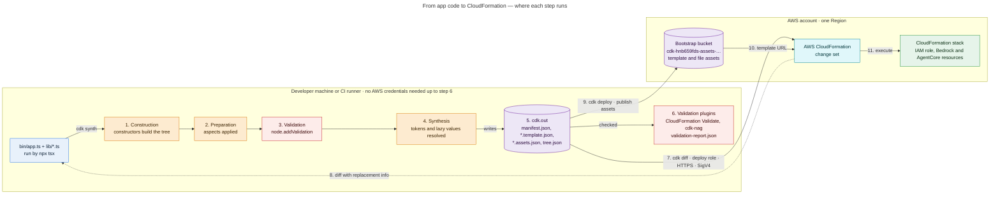

# Synthesis and CloudFormation templates

> **Level:** Intermediate · **Verified:** 2026-11-15 · **Feature status:** n/a · **Time:** ~30 min
>
> AWS CDK CLI 2.1148.1 · `aws-cdk-lib` 2.277.0 · cloud assembly schema 55.0.0

A CDK app never talks to Amazon Bedrock or CloudFormation by itself: it runs, builds a construct
tree, and writes a **cloud assembly** — templates plus manifests — to `cdk.out`. Everything you
review, test and deploy is in that directory. This chapter walks through the app lifecycle,
tokens, the files in `cdk.out` and how `cdk synth`, `cdk diff` and `cdk deploy` differ.

## Learning objectives

After this chapter you can:

- Describe the phases of the app lifecycle and what runs in each, including the validation that now runs after synthesis.
- Explain what a token is, why an ARN prints as `${Token[TOKEN.20]}`, and how it becomes `Fn::GetAtt` in the template.
- Find and read each file in a cloud assembly, and read a synthesized template, including the parts the CDK adds.
- Choose between `cdk synth`, `cdk diff` and `cdk deploy`, and say which of them need AWS credentials.

## Prerequisites

- [Apps, stacks and constructs](01-apps-stacks-constructs.md) and [L1, L2 and L3 constructs](02-l1-l2-l3-constructs.md)
- [Intrinsic functions](../cloudformation/02-intrinsic-functions.md)

## Concept in plain language

A CDK app is like an architect's program that prints blueprints. Running it does not build
anything; it produces a folder of drawings. Some measurements are unknown when the drawings are
printed — the exact address of a building that does not exist yet — so the drawings contain
placeholders such as "address of building B". The construction company (CloudFormation) fills
those in while it builds. In the CDK the placeholders are called **tokens**.

Before the drawings leave the office, inspectors check them: your own checks first, then a
schema check of every template. Only then does anyone compare the drawings with what is already
built (`cdk diff`) or start building (`cdk deploy`).

## How it really works

### The app lifecycle

> [!NOTE]
> **Documented fact** — Synthesis runs four phases: **construction** (your code instantiates
> constructs), **preparation** (constructs finish their state; aspects are applied),
> **validation** (constructs that implement `validate` check themselves) and **synthesis**
> (`app.synth()` writes the artifacts). "By the time the AWS CloudFormation deployment phase starts,
> your CDK app has already finished running and exited."
> Source: [Deploy AWS CDK applications](https://docs.aws.amazon.com/cdk/v2/guide/deploy.html)

| Phase | What runs | Typical code |
|:--|:--|:--|
| Construction | Every constructor in the tree | Almost all of your app |
| Preparation | Aspects (tags, policy checks), top-down over the tree | `Aspects.of(scope).add(...)` |
| Validation | `node.addValidation(...)` callbacks; a non-empty result fails synthesis | Cross-property checks |
| Synthesis | Tokens and lazy values resolved, templates and manifests written | Nothing you write normally |
| After synthesis | Validation plugins over the written templates | Built-in CloudFormation Validate, cdk-nag |

The official template's `bin/` file has no `app.synth()` call. `AppProps.autoSynth` defaults to
`true` when the CLI runs the app (it sets `CDK_OUTDIR`), so the app synthesizes when the program
ends (typings of `aws-cdk-lib` 2.277.0).

### Validation after synthesis

> [!NOTE]
> **Documented fact** — The CDK construct library includes a default `CloudFormationValidatePlugin`
> that runs `cloudformation-validate` after synthesis: schema checks (types, required properties,
> enumerations, patterns), built-in rules and state machine checks, offline and without
> credentials.
> Source: [Validate templates with cloudformation-validate](https://docs.aws.amazon.com/AWSCloudFormation/latest/UserGuide/cloudformation-validate.html)

What we observed with CLI 2.1148.1 and `aws-cdk-lib` 2.277.0:

- Findings are written to `cdk.out/validation-report.json` and printed with the construct path
  and the source line that created the construct.
- With `"@aws-cdk/core:validateAgainstDefaultRules": true` (in every new project's `cdk.json`),
  errors fail `cdk synth` with exit code 1. Without that flag — for example in a unit test that
  creates `new App()` without context — the same errors are downgraded to warnings.
- The cloud assembly is still written when validation fails, so you can inspect it.
- Opt-outs exist (`cdk synth --no-validation`, `CDK_VALIDATION=false`,
  `new App({ builtinCloudFormationValidation: false })`) and a finding can be acknowledged with
  `Validations.of(scope).acknowledge({ id, reason })`
  ([aws-cdk-lib module README](https://docs.aws.amazon.com/cdk/api/v2/docs/aws-cdk-lib-readme.html)).

### Tokens

> [!NOTE]
> **Documented fact** — Tokens are placeholders for values that are only known at deployment.
> They implement `IResolvable`; during synthesis the CDK calls `resolve` to produce the final
> template value, usually `Ref` or `Fn::GetAtt`. String-encoded tokens print as `${Token[TOKEN.<n>]}`.
> Source: [Tokens and the AWS CDK](https://docs.aws.amazon.com/cdk/v2/guide/tokens.html)

| You write | During construction | In the template |
|:--|:--|:--|
| `role.roleArn` | `${Token[TOKEN.20]}` | `{ "Fn::GetAtt": ["ChatInvokeRoleD82371CA", "Arn"] }` |
| `Stack.of(this).region` (environment-agnostic stack) | a token | `{ "Ref": "AWS::Region" }` |
| `` `arn:${partition}:bedrock:${region}::foundation-model/${id}` `` | a string containing tokens | `Fn::Join` of literals and `Ref`s |
| `Lazy.string({ produce: () => ... })` | a token | whatever `produce` returns at synthesis |

Rules that follow: you cannot branch on a token's value (`if (arn.startsWith(...))`), you can
detect one with `Token.isUnresolved(value)`, and you see the final value with
`stack.resolve(value)` in a test.

### The cloud assembly in `cdk.out`

Files written by `cdk synth` for the example below (and, for a `Stage`, inside
`assembly-<Stage>/`):

| File | What it holds |
|:--|:--|
| `manifest.json` | Schema version (`55.0.0`), `minimumCliVersion`, and one entry per artifact: each stack's environment (`aws://unknown-account/unknown-region` when agnostic), template file, dependencies, the bootstrap roles to assume and the bootstrap version it requires; plus a feature-flag report |
| `<artifactId>.template.json` | The CloudFormation template, in JSON |
| `<artifactId>.assets.json` | Asset manifest: files and Docker images to publish, including the template itself, with destinations in the bootstrap bucket `cdk-hnb659fds-assets-<account>-<region>` |
| `<artifactId>.metadata.json` | Construct metadata: creation stack traces, warnings, errors |
| `tree.json` | The construct tree with each construct's class and library version |
| `validation-report.json` | Results of every validation plugin |
| `cdk.out` | The schema version again, for the CLI |
| `assembly-<Stage>/` | A nested assembly per `Stage` |

The artifact ID is the stack ID for a stack directly under the `App` (`Invocation`) and a hashed
form for a stack inside a stage (`DevInference6843ABEE`).

> [!IMPORTANT]
> **Status** — The CLI and the library are versioned separately; a CLI can read assemblies from
> libraries released before it. `aws-cdk-lib` 2.277.0 records `"minimumCliVersion": "2.1148.2"`
> in the manifest, one patch above the academy's pinned CLI 2.1148.1. The manifest field is used
> for error messages; with schema 55.0.0, CLI 2.1148.1 synthesized, listed and diffed every
> example in this section without error. Upgrade the CLI first when you upgrade the library.
> Sources: [versioning and CLI compatibility](https://docs.aws.amazon.com/cdk/v2/guide/versioning.html), [CLI and library split](https://aws.amazon.com/blogs/opensource/aws-cdk-is-splitting-construct-library-and-cli/)

### Reading a synthesized template

Besides your resources, a default `cdk synth` adds:

| Part | Purpose | Turn off |
|:--|:--|:--|
| `Metadata.aws:cdk:path` on each resource | Maps the logical ID back to the construct path | `--no-path-metadata` |
| `CDKMetadata` resource of type `AWS::CDK::Metadata`, with a `CDKMetadataAvailable` condition | Version reporting: which constructs the stack uses | `--no-version-reporting` |
| `Parameters.BootstrapVersion` (from SSM parameter `/cdk-bootstrap/hnb659fds/version`) and `Rules.CheckBootstrapVersion` | Fails the deployment if the environment's bootstrap stack is older than version 6 | Use another synthesizer |
| `Outputs` | Your `CfnOutput`s and outputs created for cross-stack references | — |

Sources: [CDK CLI command reference](https://docs.aws.amazon.com/cdk/v2/guide/ref-cli-cmd.html) for the two flags; the rest is what the example produced.

### `cdk synth`, `cdk diff` and `cdk deploy`

| Command | What it does | Needs credentials? |
|:--|:--|:--|
| `cdk synth` | Runs the app and writes `cdk.out`; prints the template for one stack | No — unless a context lookup is missing from `cdk.context.json` |
| `cdk diff` | Compares the app with the deployed stack. Default `--method auto` creates a change set (deploy role) and falls back to a template-only diff | Yes, except `cdk diff --template <file>` against a local template |
| `cdk deploy` | Synthesizes, publishes assets to the bootstrap bucket and repository, submits the template to CloudFormation | Yes, and a bootstrapped environment |

Useful `cdk diff` options: `--security-only` (only broadened security changes),
`--fail` (exit code 1 on any difference, for CI), and `--exclusively` with `--template` to diff
one stack offline ([cdk diff](https://docs.aws.amazon.com/cdk/v2/guide/ref-cli-cmd-diff.html)).

## Architecture diagram



**What this shows** — Steps 1–6 run locally and need no AWS account; they are what the academy
runs for every CDK example. Only `cdk diff` (with a change set) and `cdk deploy` cross into an
AWS account, through the roles created by bootstrapping.

**Walkthrough**

1. The CLI runs the command in `cdk.json`; constructors build the construct tree.
2. Aspects visit every construct in the tree, top-down.
3. Validation callbacks run; any message fails synthesis.
4. Tokens and lazy values are resolved into literals, `Ref`, `Fn::GetAtt` and `Fn::Join`.
5. The cloud assembly is written to `cdk.out`.
6. Validation plugins read the templates and write `validation-report.json`; errors fail the command.
7. `cdk diff` assumes the deploy role and creates a read-only change set.
8. The diff shows adds, removals and replacements; without credentials it falls back to comparing templates.
9. `cdk deploy` publishes the template and assets to the bootstrap bucket.
10. CloudFormation receives the template location in a change set.
11. CloudFormation executes the change set and creates or updates the resources.

| Legend | Meaning |
|:--|:--|
| Solid arrow | Request or data flow; dashed arrow: result returned |
| Cylinder | Stored artefacts |
| Red | Checks that can stop the pipeline |
| Boxes | Trust boundary: your runner versus the AWS account |

**Variations** — Context lookups (`fromLookup`) make step 1 call AWS through the bootstrap
lookup role unless the value is cached in `cdk.context.json`; see
[Context and environment configuration](04-context-and-environments.md). Bootstrapping and the
deployment roles are covered in [Bootstrap and deployment](06-bootstrap-and-deployment.md) and
diagram set [28](../../diagrams/mermaid/28-cdk-and-cloudformation-synthesis.md).

## Implementation details

1. **Keep synthesis pure.** AWS says never to modify your account during synthesis and to avoid
   network calls; put deploy-time work in custom resources
   ([best practices](https://docs.aws.amazon.com/cdk/v2/guide/best-practices.html)).
2. **Validate early, in this order of preference:** throw in the constructor for bad props;
   `node.addValidation` for conditions that depend on later calls; an aspect for rules across
   the tree; a validation plugin for rules over the final template.
3. **Look at `cdk.out` in code review** when a change is risky. The assembly is reproducible
   from the commit; it is in `.gitignore` in the official template, so do not commit it.
4. **Diff offline in CI:** synthesize the base branch and the change into two directories and run
   `cdk diff --app <new cdk.out> --exclusively --template <old template> <stack>`. This shows
   replacements without credentials, but only a change set knows about drift.
5. **Do not pass `--no-validation` by habit.** If a finding is wrong for you, acknowledge it with a reason.

## Example

A stack that shows a token, a lazy value and a validation callback.

> **Code status:** validated — `tsc` (TypeScript 7.0.2) and `cdk synth --quiet --no-version-reporting --no-path-metadata` (CLI 2.1148.1, `aws-cdk-lib` 2.277.0) in a scratch project with the [construct library](construct-library/README.md) toolchain; also synthesized with default metadata to show `CDKMetadata` · mock-tested — Jest 30, 3 tests · **never deployed**

```ts
// lib/invocation-stack.ts
import { CfnOutput, Lazy, Stack, StackProps, Token } from 'aws-cdk-lib';
import * as iam from 'aws-cdk-lib/aws-iam';
import { Construct } from 'constructs';
import { BedrockInvocationRole } from './bedrock-invocation-role'; // copied from the academy construct library

export interface InvocationStackProps extends StackProps {
  /** Foundation model IDs. Confirm current IDs in the Amazon Bedrock model catalog. */
  readonly modelIds: string[];
}

export class InvocationStack extends Stack {
  /** A token: the real ARN exists only after CloudFormation creates the role. */
  public readonly invokeRoleArn: string;
  private readonly approvedUseCases: string[] = [];

  constructor(scope: Construct, id: string, props: InvocationStackProps) {
    super(scope, id, props);

    const invoke = new BedrockInvocationRole(this, 'ChatInvoke', {
      assumedBy: new iam.ServicePrincipal('lambda.amazonaws.com'),
      foundationModelIds: props.modelIds,
    });
    this.invokeRoleArn = invoke.role.roleArn;

    // Prints something like ${Token[TOKEN.123]} while the app runs, never the real ARN.
    if (Token.isUnresolved(this.invokeRoleArn)) {
      console.log(`roleArn during construction: ${this.invokeRoleArn}`);
    }
    new CfnOutput(this, 'InvokeRoleArn', { value: this.invokeRoleArn });

    // A lazy value is produced during synthesis, after every line of construction code has run.
    new CfnOutput(this, 'ApprovedUseCases', {
      value: Lazy.string({ produce: () => this.approvedUseCases.join(',') }),
    });

    // Runs in the validation phase; a non-empty array fails synthesis.
    this.node.addValidation({
      validate: () => (this.approvedUseCases.length === 0 ? ['Approve at least one use case'] : []),
    });
  }

  /** Can be called after construction; the lazy output above still sees the value. */
  public approveUseCase(name: string): void {
    this.approvedUseCases.push(name);
  }
}
```

```ts
// bin/app.ts
import { App } from 'aws-cdk-lib';
import { InvocationStack } from '../lib/invocation-stack';

const app = new App();
const stack = new InvocationStack(app, 'Invocation', {
  modelIds: ['example.model-a-v1:0'], // placeholder: confirm current IDs in the model catalog
});
stack.approveUseCase('support-chat'); // after construction; read by the Lazy value at synthesis
```

```ts
// test/synthesis.test.ts
import { App, Token } from 'aws-cdk-lib';
import { InvocationStack } from '../lib/invocation-stack';

const modelIds = ['example.model-a-v1:0'];

test('an attribute is a token until CloudFormation resolves it', () => {
  const stack = new InvocationStack(new App(), 'Invocation', { modelIds });
  expect(Token.isUnresolved(stack.invokeRoleArn)).toBe(true);
  expect(stack.resolve(stack.invokeRoleArn)).toEqual({ 'Fn::GetAtt': ['ChatInvokeRoleD82371CA', 'Arn'] });
});

test('app.synth() returns the cloud assembly that cdk synth writes to cdk.out', () => {
  const app = new App();
  const stack = new InvocationStack(app, 'Invocation', { modelIds });
  stack.approveUseCase('support-chat');

  const assembly = app.synth();
  const artifact = assembly.getStackArtifact(stack.artifactId);

  expect(artifact.templateFile).toBe('Invocation.template.json');
  expect(artifact.environment.name).toBe('aws://unknown-account/unknown-region'); // environment-agnostic
  expect(artifact.template.Outputs.ApprovedUseCases.Value).toBe('support-chat'); // Lazy resolved at synthesis
});

test('the validation phase fails synthesis', () => {
  const app = new App();
  new InvocationStack(app, 'Invocation', { modelIds }); // no use case approved
  expect(() => app.synth()).toThrow(/Approve at least one use case/);
});
```

What `npx cdk synth --quiet` printed, and the outputs it wrote:

```text
roleArn during construction: ${Token[TOKEN.20]}
```

```json
"Outputs": {
  "InvokeRoleArn":    { "Value": { "Fn::GetAtt": ["ChatInvokeRoleD82371CA", "Arn"] } },
  "ApprovedUseCases": { "Value": "support-chat" }
}
```

A schema error caught after synthesis (an L1 guardrail with an invalid name; exit code 1):

```text
ERROR Name: 'bad name!' does not match pattern '^[0-9a-zA-Z-_]+$' (CloudFormation Validate)
   Probe/G (G) aws-cdk-lib.aws_bedrock.CfnGuardrail
   Acknowledge with 'CloudFormation-Validate::F3031'
Synthesis finished with errors
```

## Common mistakes

> [!WARNING]
> **Common mistake** — Treating a token as a string. `role.roleArn.split(':')[4]` returns a piece
> of `${Token[...]}`, not an account ID. Use the stack's `account`, `Fn.split` / `Fn.select`, or
> make the decision with values you already know at synthesis.

| Mistake | Symptom | Fix |
|:--|:--|:--|
| Calling AWS APIs or writing files outside `cdk.out` while the app runs | Synthesis differs between machines; side effects on every `synth` | Keep synthesis pure; use custom resources for deploy-time work |
| Unit tests pass, `cdk synth` fails on a schema error | Tests use `new App()` without the `cdk.json` flags, so findings are only warnings | Pass the project context to `new App({ context })` in tests ([chapter 4](04-context-and-environments.md)) |
| Running `cdk diff` in CI without credentials and trusting it fully | The diff silently falls back to template comparison | Use `--method change-set` where credentials exist; know what a template diff cannot show |
| Editing `cdk.out` templates by hand | Changes vanish on the next synth | Change the code, or use an escape hatch |
| Searching a template for `aws:cdk:path` after `--no-path-metadata` | No mapping from logical ID to construct | Synthesize without the flag, or read `tree.json` |
| Upgrading `aws-cdk-lib` before the CLI | "Cloud assembly schema version mismatch" | Upgrade the CLI first; its release date must not be older than the library's |

## Security considerations

- Synthesis executes your code and every dependency's code with your local permissions. Pin
  dependencies and review new construct libraries as you would any build-time dependency.
- Validation plugins "can do anything that your CDK application can"; the README makes you
  responsible for checking that a plugin is safe ([aws-cdk-lib module README](https://docs.aws.amazon.com/cdk/api/v2/docs/aws-cdk-lib-readme.html)).
- `cdk.out` contains ARNs, account IDs of environment-specific stacks and anything you put in
  props. Never put a secret in a prop: it would land in the template in plain text.
- Read the "IAM Statement Changes" table of `cdk diff`, or run `cdk diff --security-only`, before
  approving a deployment that touches Bedrock permissions.

## Cost considerations

- `cdk synth`, offline `cdk diff --template` and unit tests create nothing in AWS.
- `cdk deploy` uploads the template and file assets to the bootstrap bucket, where they are stored
  until you remove them. Asset garbage collection (`cdk gc`, still behind `--unstable=gc`) is
  covered in [Bootstrap and deployment](06-bootstrap-and-deployment.md).
- An error caught at synthesis costs a few seconds; the same error caught by CloudFormation costs a
  deployment that runs, fails and rolls back. Keep the built-in validation on.

## Knowledge check

1. Your stack prints `bucket name: ${Token[TOKEN.42]}` during `cdk synth`. Is that a bug?
2. A teammate adds `if (stack.region === 'us-east-1')` to an environment-agnostic stack. What does the condition evaluate to, and why?
3. `cdk synth` fails with a CloudFormation Validate error, but `npx jest` passes on the same code. Name the most likely reason.
4. Which command shows you that a change will **replace** an existing AgentCore Memory, and what does it need to be accurate?

<details>
<summary>Answers</summary>

1. No. The name is unknown until CloudFormation creates the bucket; the token resolves to `Ref` in the template.
2. Always `false`: the region is a token (`Ref AWS::Region`), not the string `us-east-1`. Decisions that need the Region require an environment-specific stack or configuration.
3. The test's `App` has no `@aws-cdk/core:validateAgainstDefaultRules` context, so validation findings are warnings there; the CLI reads `cdk.json` and turns them into errors.
4. `cdk diff`; for accurate replacement information it needs credentials so that it can create a change set (`--method change-set`). A template-only diff marks every change to a replacement-requiring property as a replacement.

</details>

## Further reading

Official sources opened while writing this chapter:

- [Deploy AWS CDK applications](https://docs.aws.amazon.com/cdk/v2/guide/deploy.html) — app lifecycle, cloud assembly, deployment roles.
- [Tokens and the AWS CDK](https://docs.aws.amazon.com/cdk/v2/guide/tokens.html) — encodings, `IResolvable`, lazy values.
- [cdk synthesize](https://docs.aws.amazon.com/cdk/v2/guide/ref-cli-cmd-synth.html), [cdk diff](https://docs.aws.amazon.com/cdk/v2/guide/ref-cli-cmd-diff.html) and [CDK CLI command reference](https://docs.aws.amazon.com/cdk/v2/guide/ref-cli-cmd.html) — options used here.
- [Validate templates with cloudformation-validate](https://docs.aws.amazon.com/AWSCloudFormation/latest/UserGuide/cloudformation-validate.html) — the checks behind the built-in plugin.
- [aws-cdk-lib module README](https://docs.aws.amazon.com/cdk/api/v2/docs/aws-cdk-lib-readme.html) — template and policy validation, acknowledgements.
- [AWS CDK versioning and stability](https://docs.aws.amazon.com/cdk/v2/guide/versioning.html) and [the CLI and library split](https://aws.amazon.com/blogs/opensource/aws-cdk-is-splitting-construct-library-and-cli/) — schema and CLI compatibility.
- [Best practices](https://docs.aws.amazon.com/cdk/v2/guide/best-practices.html) — determinism, no side effects during synthesis.
- Installed sources: `aws-cdk-lib/core/lib/app.d.ts` (`autoSynth`, `builtinCloudFormationValidation`) and the CLI's `cdk synth --help` and `cdk diff --help` (2.1148.1).
