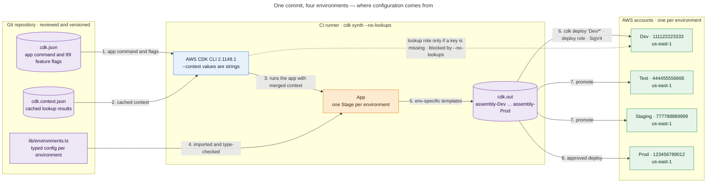

# Context and environment configuration

> **Level:** Intermediate · **Verified:** 2026-11-15 · **Feature status:** n/a · **Time:** ~30 min
>
> AWS CDK CLI 2.1148.1 · `aws-cdk-lib` 2.277.0

The same CDK code usually deploys to several AWS accounts — development, test, staging and
production — each with its own models, Regions and retention rules. This chapter explains how
the CDK learns where a stack goes (its **environment**), where configuration values come from
(**context** and feature flags), and a typed, reviewable way to describe four environments
without letting synthesis depend on whoever runs it.

## Learning objectives

After this chapter you can:

- Distinguish environment-agnostic from environment-specific stacks and predict how account, Region, partition and ARNs render in each.
- List the sources of context values, their precedence, and why `cdk.json` and `cdk.context.json` are committed.
- Read and manage the feature flags in `cdk.json`.
- Implement typed dev, test, staging and production configuration with one `Stage` per environment.
- Keep synthesis deterministic in a pipeline: no lookups, and tests that see the same flags as `cdk synth`.

## Prerequisites

- [Apps, stacks and constructs](01-apps-stacks-constructs.md) and [Synthesis and CloudFormation templates](03-synthesis-and-cloudformation.md)
- [AWS Organizations and AWS Control Tower](../../00-foundations/aws-fundamentals/05-organizations-control-tower.md) — why one account per environment
- [ADR-013: One AWS account per environment](../../ARCHITECTURE-DECISIONS.md#adr-013-one-aws-account-per-environment)

## Concept in plain language

Imagine printing the same document for four offices. The **environment** is the delivery
address: if you leave it blank, the document says "this office" everywhere and any office can
use it; if you fill it in, the address is printed into every page. **Context** is the set of
sticky notes the printer reads before printing: settings from the project file, from the command
line, and remembered answers to questions it once had to ask (such as "which Availability Zones
does this office have?"). **Feature flags** are sticky notes that switch on newer printing
behaviour without surprising offices that relied on the old one.

Every print run from the same commit should produce the same pages, so avoid notes that depend
on who is at the printer.

## How it really works

### Environment-agnostic and environment-specific stacks

An environment is an AWS account plus a Region
([environments](https://docs.aws.amazon.com/cdk/v2/guide/environments.html)).

| | Environment-agnostic (no `env`) | Environment-specific (`env: { account, region }`) |
|:--|:--|:--|
| Manifest | `aws://unknown-account/unknown-region` | `aws://111122223333/us-east-1` |
| `stack.region` in a template | `{ "Ref": "AWS::Region" }` | `us-east-1` |
| Partition in ARNs | `{ "Ref": "AWS::Partition" }` | `aws`, with the `@aws-cdk/core:enablePartitionLiterals` flag |
| Context lookups (`fromLookup`) | Not possible | Possible (but see below) |
| `if (stack.region === 'us-east-1')` | Always false (a token) | Works |
| Availability Zones | Always two | Looked up and cached |
| Where it can deploy | Anywhere, chosen by the CLI profile | Only the named account and Region |

> [!NOTE]
> **Documented fact** — The official template says that without `env` a stack "will be
> environment-agnostic. Account/Region-dependent features and context lookups will not work, but a
> single synthesized template can be deployed anywhere." For production AWS recommends hard-coded
> account and Region values; `CDK_DEFAULT_ACCOUNT` and `CDK_DEFAULT_REGION` are for development,
> because the template then depends on "the machine, user, or session that it's synthesized under".
> Sources: installed template `bin/%name%.template.ts` (CLI 2.1148.1), [Configure environments](https://docs.aws.amazon.com/cdk/v2/guide/configure-env.html)

Precedence when several are present: hard-coded `env` values, then `env` values from the
`CDK_DEFAULT_*` variables, then the `--profile` passed to the CLI, then the default profile
([configure environments](https://docs.aws.amazon.com/cdk/v2/guide/configure-env.html)). One
paragraph of that page names `AWS_DEFAULT_ACCOUNT` and `AWS_DEFAULT_REGION`; the examples on the
same page, the [environments](https://docs.aws.amazon.com/cdk/v2/guide/environments.html) page
and the official template all use `CDK_DEFAULT_ACCOUNT` and `CDK_DEFAULT_REGION`.

A `Stage` can carry the `env`; stacks created inside it inherit it.

### Context: sources and precedence

Context values are key–value pairs (any JSON type) attached to the app, a stack or a construct;
a construct sees its own and its parents' context, not its children's
([context](https://docs.aws.amazon.com/cdk/v2/guide/context.html)). The `aws-cdk-lib` README
lists the sources in order of precedence
([aws-cdk-lib module — App Context](https://docs.aws.amazon.com/cdk/api/v2/docs/aws-cdk-lib-readme.html)):

| # | Source | Typical use |
|--:|:--|:--|
| 1 | `node.setContext()` in code | Rare; tests |
| 2 | `postCliContext` prop of `App` | Values that must override the CLI |
| 3 | `cdk synth --context key=value` (`-c`) | One-off switches; **always strings** |
| 4 | `context` in the project's `cdk.json` | Feature flags, project settings |
| 5 | `cdk.context.json` | Values cached by lookups — managed by the CDK, not by you |
| 6 | `context` in `~/.cdk.json` | Personal defaults |
| 7 | `context` prop of `App` | Defaults in code; what unit tests use |

> [!NOTE]
> **Documented fact** — "Because they're part of your application's state, `cdk.json` and
> `cdk.context.json` must be committed to source control." Do not edit cached values by hand; use
> `cdk context --reset <key>` or `cdk context --clear`. Prefix your own keys with your package name.
> Source: [Context values and the AWS CDK](https://docs.aws.amazon.com/cdk/v2/guide/context.html)

### Lookups, and why pipelines should not perform them

`Vpc.fromLookup`, `StringParameter.valueFromLookup` and other lookup methods ask the AWS account
during synthesis and cache the answer in `cdk.context.json`
([context](https://docs.aws.amazon.com/cdk/v2/guide/context.html)); the CLI uses the bootstrap
`LookupRole` for that ([deploy](https://docs.aws.amazon.com/cdk/v2/guide/deploy.html)). AWS's best practices call for
committing that cache so that each commit always synthesizes the same template, and for a
separate script, run on purpose, for values that have no context provider
([best practices](https://docs.aws.amazon.com/cdk/v2/guide/best-practices.html)).

In CI, add `--no-lookups` so a missing cache entry fails instead of calling AWS. With CLI
2.1148.1 a lookup of an SSM parameter in an environment-specific stack failed like this:

```text
Context lookups have been disabled. Make sure all necessary context is already in 'cdk.context.json'
by running 'cdk synth' on a machine with sufficient AWS credentials and committing the result.
Missing context keys: 'ssm:account=111122223333:parameterName=/chat/model-id:region=us-east-1'
```

### Feature flags

> [!NOTE]
> **Documented fact** — Feature flags are context values that switch on potentially breaking
> behaviour. They are disabled by default, so existing projects keep working; projects created
> with `cdk init` include flags enabling all features available in that release. `cdk context
> --reset` and `--clear` do not remove them.
> Source: [AWS CDK feature flags](https://docs.aws.amazon.com/cdk/v2/guide/featureflags.html)

`cdk init` with CLI 2.1148.1 wrote 89 flags. Four of them change what the examples in this
section produce:

| Flag (value in a new project) | Effect |
|:--|:--|
| `@aws-cdk/core:defaultCrossStackReferences` (`"weak"`) | Cross-stack references use `Fn::GetStackOutput`; unset behaves like `"strong"` ([chapter 1](01-apps-stacks-constructs.md)) |
| `@aws-cdk/core:enablePartitionLiterals` (`true`) | "Make ARNs concrete if AWS partition is known" |
| `@aws-cdk/core:validateAgainstDefaultRules` (`true`) | "Treat CloudFormation Validate findings as errors" ([chapter 3](03-synthesis-and-cloudformation.md)) |
| `@aws-cdk/aws-iam:minimizePolicies` (`true`) | "Minimize IAM policies by combining Statements" |

The quoted explanations come from the feature-flag report that synthesis writes into
`manifest.json`. `cdk flags --unstable=flags` lists flags that differ from the recommended
values, and `cdk flags --unstable=flags <name>` explains one
([cdk flags](https://docs.aws.amazon.com/cdk/v2/guide/ref-cli-cmd-flags.html)):

```text
Flag name: @aws-cdk/core:defaultCrossStackReferences
Description: Controls whether cross-stack references are strong, weak, or both
Recommended value: weak
Default value: strong
User value: weak
Effective value: weak
```

> [!WARNING]
> **Common mistake** — A unit test that creates `new App()` does **not** read `cdk.json`, so it
> synthesizes without your feature flags. In the example below the same production stack
> rendered `arn:aws:bedrock:us-west-2::…` under `cdk synth` but `{ "Ref": "AWS::Partition" }` in a
> plain test, and validation errors became warnings. Load the `context` block of `cdk.json` into
> `new App({ context })` in tests.

### Typed configuration and one Stage per environment

> [!NOTE]
> **Documented fact** — AWS recommends modelling all production stages in code — "Create a stack
> for your production environment, and create a separate stack for each of your other stages" —
> keeping sensitive values in AWS Secrets Manager or Parameter Store and referencing them by name
> or ARN, and limiting environment-variable lookups to the top level of the app.
> Source: [Best practices](https://docs.aws.amazon.com/cdk/v2/guide/best-practices.html)

The pattern in the example: a TypeScript file declares an `EnvironmentConfig` interface and one
object per environment, the compiler checks every field, and `bin/app.ts` creates one `Stage` per
object. `cdk synth` then writes `assembly-Dev`, `assembly-Test`, `assembly-Staging` and
`assembly-Prod`, and a pipeline deploys `Dev/*` first and `Prod/*` last.

## Architecture diagram



**What this shows** — Everything that decides the templates lives in the repository: typed
configuration, flags and cached context. The CI runner synthesizes all environments from one
commit without calling AWS, and each nested assembly is pinned to its own account.

**Walkthrough**

1. The CLI reads the app command and the feature flags from `cdk.json`.
2. It adds cached context from `cdk.context.json`.
3. It runs the app with the merged context.
4. The app imports the typed configuration; a missing field is a compile error.
5. Synthesis writes one nested assembly per stage, each with a fixed account and Region.
6. The pipeline deploys the development stage using that account's bootstrap deploy role.
7. The same assembly is promoted to test and staging.
8. Production is deployed after an approval step.

| Legend | Meaning |
|:--|:--|
| Purple / cylinder | Files under version control or generated artefacts |
| Green | Target AWS accounts (placeholders) |
| Dashed arrow | A call that should not happen in a pipeline |
| Boxes | Trust boundaries: repository, runner, accounts |

**Variations** — A developer sandbox can use `CDK_DEFAULT_ACCOUNT` and `CDK_DEFAULT_REGION`
(the example's `-c sandbox=true` branch); never use that for a pipeline stage. Promotion and
approvals are covered in [Environments, isolation and controlled promotion](../maintenance/03-environments-and-promotion.md),
cross-account deployment in [Multi-account and multi-Region deployments](../maintenance/06-multi-account-multi-region.md).

## Implementation details

1. **Pin long-lived environments.** Hard-code account and Region per environment in typed
   configuration; keep `CDK_DEFAULT_*` for personal sandboxes.
2. **One account per environment** (ADR-013). Treat the configuration file as reviewed
   infrastructure code: a changed account ID or Region is a change of deployment target.
3. **Put model IDs and Regions in configuration.** The `modelRegions` list must contain every
   destination Region of a cross-Region inference profile you allow
   ([cross-Region inference](../../01-amazon-bedrock/inference/04-cross-region-inference.md));
   confirm model IDs in the model catalog ([ADR-010](../../ARCHITECTURE-DECISIONS.md#adr-010-model-and-inference-profile-ids-are-always-configuration)).
4. **Use context for switches, not for configuration.** Command-line context is a string:
   compare with `String(value) === 'true'`, and validate it.
5. **Never put secrets in config or context.** Store the name or ARN of a Secrets Manager secret or
   Parameter Store parameter.
6. **Synthesize every stage in CI with `--no-lookups`**, and test that `manifest.missing` is empty.
7. **Upgrade flags deliberately.** After a library upgrade, run `cdk flags --unstable=flags`,
   switch one flag at a time and read `cdk diff`.

## Example

Four pinned environments plus an optional sandbox. The stack itself is environment-neutral code;
only the `Stage` decides where it goes.

> **Code status:** validated — `tsc` (TypeScript 7.0.2) and `cdk synth --quiet --no-version-reporting --no-path-metadata` (CLI 2.1148.1, `aws-cdk-lib` 2.277.0, `cdk.json` with the template's 89 flags), also with `--no-lookups -c sandbox=true`, in a scratch project with the [construct library](construct-library/README.md) toolchain · mock-tested — Jest 30, 8 tests · **never deployed**

```ts
// lib/environments.ts
/** The environments this application is deployed to. One AWS account each. */
export type EnvironmentName = 'dev' | 'test' | 'staging' | 'prod';

export interface EnvironmentConfig {
  readonly name: EnvironmentName;
  /** AWS account and Region the stacks are pinned to (placeholders below). */
  readonly account: string;
  readonly region: string;
  /** Foundation model IDs. Confirm current IDs in the Amazon Bedrock model catalog. */
  readonly modelIds: string[];
  /** Regions the models may run in, for example every destination of an inference profile. */
  readonly modelRegions: string[];
  /** Keep stateful resources when the stack or resource is deleted. */
  readonly retainData: boolean;
}

const MODEL_IDS = ['example.model-a-v1:0']; // placeholder

export const ENVIRONMENTS: Record<EnvironmentName, EnvironmentConfig> = {
  dev: {
    name: 'dev', account: '111122223333', region: 'us-east-1',
    modelIds: MODEL_IDS, modelRegions: ['us-east-1'], retainData: false,
  },
  test: {
    name: 'test', account: '444455556666', region: 'us-east-1',
    modelIds: MODEL_IDS, modelRegions: ['us-east-1'], retainData: false,
  },
  staging: {
    name: 'staging', account: '777788889999', region: 'us-east-1',
    modelIds: MODEL_IDS, modelRegions: ['us-east-1', 'us-west-2'], retainData: true,
  },
  prod: {
    name: 'prod', account: '123456789012', region: 'us-east-1',
    modelIds: MODEL_IDS, modelRegions: ['us-east-1', 'us-west-2'], retainData: true,
  },
};
```

```ts
// lib/chat-stack.ts
import { RemovalPolicy, Stack, StackProps, Tags } from 'aws-cdk-lib';
import * as iam from 'aws-cdk-lib/aws-iam';
import * as s3 from 'aws-cdk-lib/aws-s3';
import { Construct } from 'constructs';
import { BedrockInvocationRole } from './bedrock-invocation-role'; // copied from the academy construct library
import { EnvironmentConfig } from './environments';

export interface ChatStackProps extends StackProps {
  readonly config: EnvironmentConfig;
}

export class ChatStack extends Stack {
  constructor(scope: Construct, id: string, props: ChatStackProps) {
    super(scope, id, props);
    const { config } = props;

    const prompts = new s3.Bucket(this, 'PromptBucket', {
      encryption: s3.BucketEncryption.S3_MANAGED,
      enforceSSL: true,
      versioned: config.retainData,
      removalPolicy: config.retainData ? RemovalPolicy.RETAIN : RemovalPolicy.DESTROY,
    });

    const invoke = new BedrockInvocationRole(this, 'ChatInvoke', {
      assumedBy: new iam.ServicePrincipal('lambda.amazonaws.com'),
      foundationModelIds: config.modelIds,
      modelRegions: config.modelRegions,
    });
    prompts.grants.read(invoke.role);

    Tags.of(this).add('environment', config.name);
  }
}
```

```ts
// lib/chat-stage.ts
import { Stage, StageProps } from 'aws-cdk-lib';
import { Construct } from 'constructs';
import { ChatStack } from './chat-stack';
import { EnvironmentConfig } from './environments';

export interface ChatStageProps extends StageProps {
  readonly config: EnvironmentConfig;
}

/** One environment = one Stage. Stacks inside inherit the Stage's env. */
export class ChatStage extends Stage {
  constructor(scope: Construct, id: string, props: ChatStageProps) {
    super(scope, id, props);
    new ChatStack(this, 'Chat', { config: props.config });
  }
}
```

```ts
// bin/app.ts
import { App } from 'aws-cdk-lib';
import { ChatStage } from '../lib/chat-stage';
import { ENVIRONMENTS } from '../lib/environments';

const app = new App();

// Every long-lived environment is modelled in code and pinned to its account and Region.
for (const config of Object.values(ENVIRONMENTS)) {
  const id = config.name.charAt(0).toUpperCase() + config.name.slice(1); // Dev, Test, Staging, Prod
  new ChatStage(app, id, { env: { account: config.account, region: config.region }, config });
}

// Optional personal sandbox: `cdk synth -c sandbox=true` (context from the CLI is always a string).
// It takes account and Region from the CLI profile, so its template depends on who runs synth.
if (String(app.node.tryGetContext('sandbox')) === 'true') {
  new ChatStage(app, 'Sandbox', {
    env: { account: process.env.CDK_DEFAULT_ACCOUNT, region: process.env.CDK_DEFAULT_REGION },
    config: ENVIRONMENTS.dev,
  });
}
```

```ts
// test/environments.test.ts
import { readFileSync } from 'node:fs';
import { join } from 'node:path';
import { App, Stack } from 'aws-cdk-lib';
import { Template } from 'aws-cdk-lib/assertions';
import { ChatStack } from '../lib/chat-stack';
import { ChatStage } from '../lib/chat-stage';
import { ENVIRONMENTS, EnvironmentName } from '../lib/environments';

// `new App()` in a test does not read cdk.json. Pass the same context (feature flags included)
// so the test synthesizes what `cdk synth` would.
const projectContext = JSON.parse(readFileSync(join(__dirname, '..', 'cdk.json'), 'utf8')).context;

function chatStackFor(name: EnvironmentName, app = new App({ context: projectContext })): Stack {
  const config = ENVIRONMENTS[name];
  const stage = new ChatStage(app, 'Env', { env: { account: config.account, region: config.region }, config });
  return stage.node.findChild('Chat') as Stack;
}

test.each(Object.values(ENVIRONMENTS))('$name is pinned to its own account and Region', (config) => {
  const stack = chatStackFor(config.name);
  expect(stack.account).toBe(config.account);
  expect(stack.region).toBe(config.region);
});

test('environment-specific stacks get literal ARNs; agnostic stacks get pseudo parameters', () => {
  const specific = JSON.stringify(Template.fromStack(chatStackFor('prod')).toJSON());
  expect(specific).toContain('arn:aws:bedrock:us-west-2::foundation-model/');

  const agnostic = new ChatStack(new App({ context: projectContext }), 'Agnostic', { config: ENVIRONMENTS.prod });
  expect(agnostic.resolve(agnostic.region)).toEqual({ Ref: 'AWS::Region' });
});

test('without the cdk.json feature flags the same stack synthesizes differently', () => {
  const withoutFlags = JSON.stringify(Template.fromStack(chatStackFor('prod', new App())).toJSON());
  expect(withoutFlags).not.toContain('arn:aws:bedrock:us-west-2'); // partition stays { Ref: AWS::Partition }
});

test('only staging and prod retain data', () => {
  for (const config of Object.values(ENVIRONMENTS)) {
    const template = Template.fromStack(chatStackFor(config.name));
    template.hasResource('AWS::S3::Bucket', { DeletionPolicy: config.retainData ? 'Retain' : 'Delete' });
  }
});

test('synthesis needs no context lookups', () => {
  const app = new App({ context: projectContext });
  for (const config of Object.values(ENVIRONMENTS)) {
    new ChatStage(app, config.name, { env: { account: config.account, region: config.region }, config });
  }
  for (const nested of app.synth().nestedAssemblies) {
    expect(nested.nestedAssembly.manifest.missing).toBeUndefined();
  }
});
```

The production role's model statement as synthesized — literal Regions and partition:

```json
{
  "Sid": "InvokeFoundationModels",
  "Effect": "Allow",
  "Action": ["bedrock:InvokeModel", "bedrock:InvokeModelWithResponseStream"],
  "Resource": [
    "arn:aws:bedrock:us-east-1::foundation-model/example.model-a-v1:0",
    "arn:aws:bedrock:us-west-2::foundation-model/example.model-a-v1:0"
  ]
}
```

To try it in your own sandbox accounts (never done for this repository): bootstrap each account
and Region, then `npx cdk deploy 'Dev/*'`; tear down with `npx cdk destroy 'Dev/*'`. Staging and
production buckets are retained by design and must be deleted by hand.

## Common mistakes

| Mistake | Symptom | Fix |
|:--|:--|:--|
| Production stacks that use `CDK_DEFAULT_ACCOUNT` / `CDK_DEFAULT_REGION` | The template depends on whose credentials ran `synth`; a wrong profile deploys to the wrong account | Hard-code the environment for every long-lived stage |
| `cdk.context.json` in `.gitignore` | Synthesis in CI performs lookups, or produces different templates | Commit it; refresh entries deliberately with `cdk context --reset` |
| Reading `-c retain=false` as a boolean | `'false'` is truthy; data is deleted or kept by accident | Parse and validate strings from the command line |
| Deleting the `context` block from `cdk.json` "to clean up" | Templates change: weak references become strong, ARNs lose partition literals, validation errors turn into warnings | Keep flags; change them one at a time with `cdk diff` |
| Tests that use `new App()` | Tests pass, `cdk synth` fails or differs | Load the `cdk.json` context into the test `App` |
| Lookups in a stack that a pipeline synthesizes | Pipeline needs extra credentials, or fails with `--no-lookups` | Run lookups once on a workstation and commit the cache, or pass the value as configuration |

## Security considerations

- Pinning `env` per stage is a safety control: an environment-specific template cannot be
  deployed into another account, and the manifest names the account's bootstrap roles.
- Keep configuration that weakens controls (for example `retainData: false`, extra model Regions)
  visible in code review; a typed config file makes that diff obvious.
- Context, `cdk.json` and the cloud assembly are plain text. Reference secrets by name or ARN only.
- Lookups use the bootstrap lookup role in the target account. Pipelines that run with
  `--no-lookups` do not need it at all.

## Cost considerations

- Each environment is a full copy of the stacks and is billed separately. Use the configuration to
  scale down non-production stages (fewer model Regions, `DESTROY` removal policies, shorter
  retention) instead of copy-pasting stacks.
- Retained resources in deleted test stacks keep costing money; use `retainData: false` only
  where losing the data is acceptable, and clean up retained resources in the others.

## Knowledge check

1. Your pipeline synthesizes `Prod/*` with `CDK_DEFAULT_ACCOUNT`. A developer with credentials for the test account runs `cdk deploy` locally. What can happen?
2. Where should the list of allowed model Regions for each environment live, and why not in `--context`?
3. After an upgrade of `aws-cdk-lib`, `cdk diff` shows changes in stacks you did not touch. What should you check first?
4. A colleague's unit test asserts on the production template and passes, but the deployed template has a different ARN format. Explain.

<details>
<summary>Answers</summary>

1. The production stage synthesizes for the developer's test account and Region, so production resources can be created in the test account. Hard-coding the environment prevents this.
2. In typed configuration in the repository: it is type-checked, reviewed and the same for every run. Command-line context is an unchecked string that depends on who runs the command.
3. Feature flags and defaults: run `cdk flags --unstable=flags` and read the library's release notes; new behaviour is either flag-gated or a documented change in an L2's output.
4. The test's `new App()` did not load the `cdk.json` flags, so `@aws-cdk/core:enablePartitionLiterals` was off in the test but on in `cdk synth`.

</details>

## Further reading

Official sources opened while writing this chapter:

- [Environments for the AWS CDK](https://docs.aws.amazon.com/cdk/v2/guide/environments.html) and [Configure environments](https://docs.aws.amazon.com/cdk/v2/guide/configure-env.html) — agnostic and specific stacks, precedence.
- [Context values and the AWS CDK](https://docs.aws.amazon.com/cdk/v2/guide/context.html) — sources, caching, `cdk context`.
- [AWS CDK feature flags](https://docs.aws.amazon.com/cdk/v2/guide/featureflags.html) and [cdk flags](https://docs.aws.amazon.com/cdk/v2/guide/ref-cli-cmd-flags.html) — how flags work and how to inspect them.
- [Introduction to AWS CDK stages](https://docs.aws.amazon.com/cdk/v2/guide/stages.html) — one stage per environment, nested assemblies.
- [Best practices](https://docs.aws.amazon.com/cdk/v2/guide/best-practices.html) — model all stages in code, commit `cdk.context.json`, no environment variables inside constructs.
- [aws-cdk-lib module README](https://docs.aws.amazon.com/cdk/api/v2/docs/aws-cdk-lib-readme.html) — context precedence.
- Installed sources: the official template's `bin/%name%.template.ts` and `.recommended-feature-flags.json` (CLI 2.1148.1).
