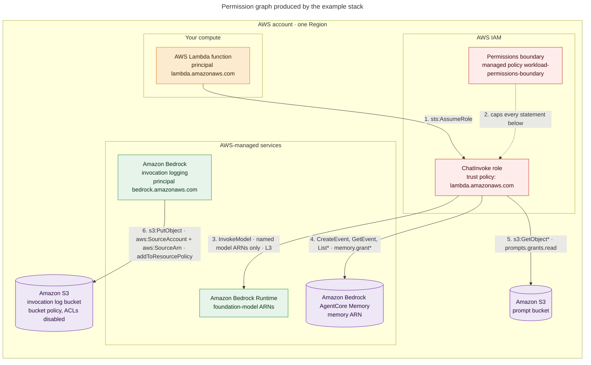
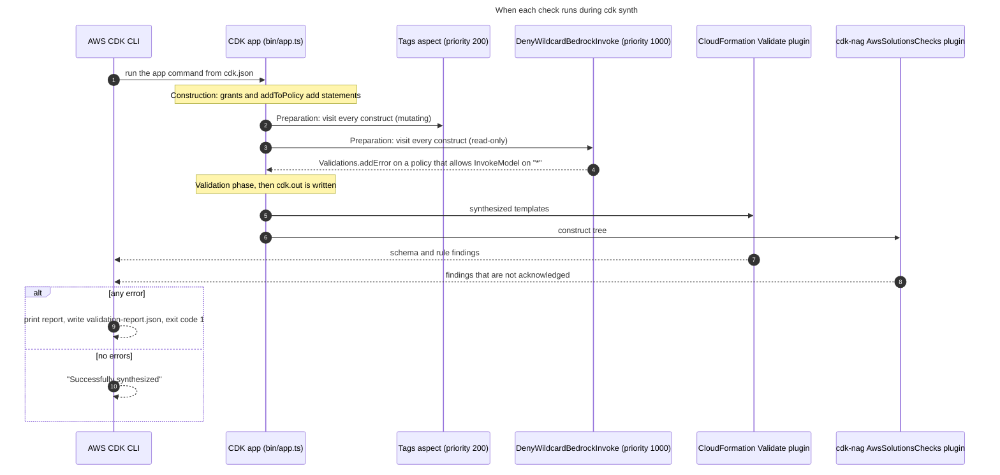

# Permissions and Aspects

> **Level:** Intermediate · **Verified:** 2026-11-15 · **Feature status:** n/a · **Time:** ~35 min
>
> `aws-cdk-lib` 2.277.0 · cdk-nag 3.0.2 · AWS CDK CLI 2.1148.1

Most security mistakes in a Bedrock application are IAM mistakes: a role that may invoke every
model, a bucket policy without a source condition, a boundary that was never attached. The CDK
writes most IAM policy for you through grant methods, and it gives you **Aspects** and validation
plugins to check the whole construct tree before anything is deployed. This chapter covers both,
and ends with a small Aspect that fails synthesis when a statement allows `bedrock:InvokeModel`
on `"*"`.

## Learning objectives

After this chapter you can:

- Use grant methods and Grants classes to produce least-privilege policies, and recognise when you must write a statement yourself.
- Choose between `addToPolicy`, `addToPrincipalPolicy` and `addToResourcePolicy`, and between principal types.
- Apply a permissions boundary to a stack, a stage or a whole app.
- Explain how Aspects run (prepare phase, priorities, the `Stage` boundary) and how `Tags` use them.
- Run cdk-nag 3 as a validation plugin, acknowledge findings correctly, and write and test a custom Aspect.

## Prerequisites

- [IAM fundamentals: principals, policies and evaluation](../../00-foundations/security/01-iam-fundamentals.md), [IAM roles, trust policies and cross-account access](../../00-foundations/security/02-iam-roles-and-trust.md) and [Resource-based policies](../../00-foundations/security/03-resource-policies.md)
- [L1, L2 and L3 constructs](02-l1-l2-l3-constructs.md) and [Synthesis and CloudFormation templates](03-synthesis-and-cloudformation.md)

## Concept in plain language

A **grant** is a key handed out by the lock itself: you ask the bucket "let this function read
you", and the bucket cuts exactly the key that is needed. A **resource policy** is a notice on the
door listing who may enter. A **permissions boundary** is the building's master rule: whatever
keys someone holds, they never open rooms outside the boundary.

An **Aspect** is an inspector who walks through every room after the builders finish but before
the building is handed over. Some inspectors fix things (put up a name plate — a tag); others
only write findings. If a finding is an error, the handover is cancelled.

## How it really works

### Grants

> [!NOTE]
> **Documented fact** — Grant methods take an `IGrantable` (roles, users, groups, and resources
> that run with a role, such as Lambda functions) and return an `iam.Grant`. A Grants class
> (for example `BucketGrants.fromBucket(bucket)`) is preferred over `grant*` methods on the
> construct because it works for both L1 and L2 resources; L2s expose it as the `grants` property.
> Source: [Permissions and the AWS CDK](https://docs.aws.amazon.com/cdk/v2/guide/permissions.html)

What the grants in this chapter's example produced:

| Call | Statement added to the role's default policy |
|:--|:--|
| `new BedrockInvocationRole(...)` (academy L3) | `bedrock:InvokeModel`, `bedrock:InvokeModelWithResponseStream` on named foundation-model ARNs |
| `memory.grantWrite(role)` (AgentCore L2) | `bedrock-agentcore:CreateEvent` on the memory ARN |
| `memory.grantReadShortTermMemory(role)` | `GetEvent`, `ListActors`, `ListEvents`, `ListSessions` on the memory ARN |
| `prompts.grants.read(role)` (S3 L2) | `s3:GetBucket*`, `s3:GetObject*`, `s3:List*` on the bucket and its objects |

The stable `aws-bedrock` module has no L2 for models, so nothing grants `bedrock:InvokeModel`
for you; the AgentCore README shows `runtime.role.addToPrincipalPolicy(...)` with a model ARN for
that case. The academy's [`BedrockInvocationRole`](construct-library/lib/bedrock-invocation-role.ts)
packages the documented model, inference-profile and guardrail permissions.

On S3, `bucket.grantRead()` still exists, but its doc comment in 2.277.0 says "The use of this
method is discouraged. Please use `grants.read()` instead."

### Principals and the three ways to add a statement

The CDK models principals as classes: `ServicePrincipal`, `AccountPrincipal`,
`ArnPrincipal`, `OrganizationPrincipal`, `FederatedPrincipal`, `CompositePrincipal` and IAM
`Role`, `User` and `Group` ([permissions](https://docs.aws.amazon.com/cdk/v2/guide/permissions.html)).
`principal.withConditions({...})` adds conditions to any of them
([aws_iam module](https://docs.aws.amazon.com/cdk/api/v2/docs/aws-cdk-lib.aws_iam-readme.html)).

| Method | Adds to | Use it for |
|:--|:--|:--|
| `role.addToPolicy(statement)` | The role's default inline policy (created on first use) | Statements no grant covers, on a role you own |
| `grantable.grantPrincipal.addToPrincipalPolicy(statement)` | The identity policy of whatever principal is behind an `IGrantable` | Writing construct code that accepts any grantable |
| `resource.addToResourcePolicy(statement)` | The resource's policy (for example an S3 bucket policy) | Letting a service or another account in |

For Amazon Bedrock itself, resource-based policies exist in 2.277.0 only as L1 types
(`CfnResourcePolicy`, `CfnKnowledgeBasePolicy`; AgentCore `CfnResourcePolicy`). Which Bedrock
resources accept them is an open point in the academy's verification notes; see
[Resource-based policies](../../00-foundations/security/03-resource-policies.md).

The example's resource policy follows the documented bucket policy for model invocation logging:
principal `bedrock.amazonaws.com`, `s3:PutObject` on
`<bucket>/AWSLogs/<account>/BedrockModelInvocationLogs/*`, with `aws:SourceAccount` and
`aws:SourceArn` conditions, and bucket ACLs disabled
([model invocation logging](https://docs.aws.amazon.com/bedrock/latest/userguide/model-invocation-logging.html)).

### Permissions boundaries

| Scope | API | Notes |
|:--|:--|:--|
| One role, a construct, a stack | `iam.PermissionsBoundary.of(scope).apply(managedPolicy)` | "The Boundary applied closest to the Role wins" ([PermissionsBoundary](https://docs.aws.amazon.com/cdk/api/v2/docs/aws-cdk-lib.aws_iam.PermissionsBoundary.html)) |
| A stage | `new Stage(app, 'Prod', { permissionsBoundary: PermissionsBoundary.fromName('...') })` | `PermissionsBoundary` here comes from `aws-cdk-lib` core |
| The whole app | `"@aws-cdk/core:permissionsBoundary": { "name": "..." }` in `cdk.json` | Names can use `${Qualifier}`, `${AWS::AccountId}` and similar placeholders when the stack has an environment ([aws_iam module](https://docs.aws.amazon.com/cdk/api/v2/docs/aws-cdk-lib.aws_iam-readme.html)) |
| The deployment itself | `cdk bootstrap --custom-permissions-boundary <name>` | Bounds the CloudFormation execution role, not your application's roles ([permissions boundaries](https://docs.aws.amazon.com/cdk/v2/guide/customize-permissions-boundaries.html)) |

A boundary grants nothing on its own; effective permissions are the intersection of identity
policy and boundary. It also applies to roles that L2s create for you, such as the `Memory`
service role — the example's test checks that.

### Aspects

> [!NOTE]
> **Documented fact** — An Aspect implements `visit(node)`. During the prepare phase the CDK calls
> it for the construct and each of its children, top-down. "Aspects don't propagate across `Stage`
> construct boundaries"; apply them to the `Stage` itself or lower. The CDK uses aspects to tag
> resources.
> Source: [Aspects and the AWS CDK](https://docs.aws.amazon.com/cdk/v2/guide/aspects.html)

From the `aws-cdk-lib` README: aspects take an optional priority — `AspectPriority.MUTATING`
(200), `DEFAULT` (500), `READONLY` (1000), lower runs first — and with aspect stabilization (the
default for new projects since 2.172.0) they also visit nodes that other aspects add. The
recommendation is to use Mixins to *make* changes and Aspects to *validate*
([aws-cdk-lib module](https://docs.aws.amazon.com/cdk/api/v2/docs/aws-cdk-lib-readme.html)). With
the new-project flag `@aws-cdk/core:aspectPrioritiesMutating`, aspects the library adds for you,
such as `Tags`, get the `MUTATING` priority, so a `READONLY` check sees the final tags.

To report a problem, call `Validations.of(node).addError(id, message)`; the 2.277.0 typings
prefer it over `Annotations.of(node).addError(message)`, state that "Synthesis will be
interrupted when errors are reported", and note that errors cannot be acknowledged.

### cdk-nag 3 is a validation plugin, not an Aspect

> [!IMPORTANT]
> **Status** — In cdk-nag 3, rule packs implement `IPolicyValidationPlugin` and are registered
> with `Validations.of(app).addPlugins(new AwsSolutionsChecks(app))` "instead of
> `Aspects.of(app).add(...)`" (the cdk-nag 2 style that most tutorials show). Suppressions became
> `Validations.of(construct).acknowledge({ id, reason })`; each finding of a multi-finding rule is
> acknowledged separately, for example `AwsSolutions-IAM5[Action::s3:GetObject*]`, and prefix
> matching is not supported yet. `validateScope(scope)` runs a pack directly in a test.
> Sources: cdk-nag 3.0.2 `README.md` and `lib/nag-pack.d.ts` (installed package); [Validate templates with cloudformation-validate](https://docs.aws.amazon.com/AWSCloudFormation/latest/UserGuide/cloudformation-validate.html) for the built-in plugin that runs alongside it.

Because cdk-nag findings now arrive through the validation report, they are not construct
annotations. In our tests an unacknowledged finding made `cdk synth` exit with code 1 and made
`app.synth()` throw `Validation failed` — including inside `Annotations.fromStack()`, which
synthesizes. Test a pack with `validateScope`, as below, or by expecting the throw; the
chapter 6–9 examples show the same wiring in
[`examples/test/policy-checks.test.ts`](examples/test/policy-checks.test.ts)
([examples README](examples/README.md)).

## Architecture diagram



**What this shows** — Every permission in the example and the construct call that produced it.
Identity-policy grants (3–5) live on one role and are capped by the boundary (2); the logging
bucket admits the Bedrock service through a resource policy (6).

**Walkthrough**

1. The function (in a later chapter or project) assumes the role through its trust policy.
2. The boundary limits the role's effective permissions to the intersection with the boundary policy.
3. The L3 grants inference on named foundation-model ARNs only.
4. The AgentCore `Memory` L2's grant methods add the data-plane actions on one memory.
5. The S3 Grants class adds read access to one bucket.
6. The bucket policy lets Amazon Bedrock write invocation logs, only for this account's Bedrock resources.

| Legend | Meaning |
|:--|:--|
| Red | IAM: role and boundary |
| Green | Amazon Bedrock services |
| Purple cylinder | Data stores |
| Solid arrow | Permission used in a request; dashed arrow: a cap, not a request |

**Variations** — With a Global cross-Region inference profile the role also needs the profile ARN
and the Region-less model ARN (`allowGlobalInference` in the L3); see
[Cross-Region inference](../../01-amazon-bedrock/inference/04-cross-region-inference.md). Turning
logging on is a separate API call that has no CloudFormation type; the
[CDK coverage for Amazon Bedrock](09-cdk-for-bedrock.md) chapter fills that gap.



**What this shows** — The order of the checks. Mutating aspects run before read-only ones, so the
custom rule sees the final policies; plugins run on the written templates.

**Walkthrough** — 1: the CLI starts the app. 2–3: aspects visit the tree by priority. 4: the custom
rule records an error. 5–6: plugins receive the templates and the tree. 7–8: they return findings.
9–10: any error fails the command and the report is written either way.

## Implementation details

1. **Grant from the resource side.** Prefer `resource.grants.*`, Grants classes and L2 `grant*`
   methods; they scope actions and ARNs for you.
2. **Write statements only where no grant exists**, with a `sid`, named actions and ARNs, and a
   comment when `"*"` is unavoidable (for example `bedrock:ListFoundationModels`, which has no
   resource type in the [Service Authorization Reference](https://docs.aws.amazon.com/service-authorization/latest/reference/list_bedrock.html)).
3. **Condition every service principal** in a resource policy with `aws:SourceAccount` and
   `aws:SourceArn` ([confused deputy prevention, as documented for invocation logging](https://docs.aws.amazon.com/bedrock/latest/userguide/model-invocation-logging.html)).
4. **Attach the boundary at the highest scope that is true for all roles** (app or stage), and
   override closer to a role only when needed.
5. **Register aspects on the `Stage`** (or on each stack inside it), not only on the `App`.
6. **Give read-only aspects `AspectPriority.READONLY`** so that they run after tags and other mutations.
7. **Acknowledge cdk-nag findings narrowly**, on the construct that causes them, with a reason.

> [!TIP]
> **Academy recommendation** — Keep a small set of Bedrock-specific rules as Aspects in your
> construct library (wildcard model access, missing guardrail enforcement, unconditioned service
> principals) and run them in every app, next to a general rule pack. A generic acknowledgement
> such as `AwsSolutions-IAM5[Resource::*]` on a role also silences the next, unrelated `"*"`
> statement on that role — in our test, cdk-nag stayed silent about a later `bedrock:InvokeModel`
> on `"*"`, while the custom Aspect caught it.
> This is our design guidance, not an official AWS reference architecture.

## Example

A stack that uses every permission mechanism above, an app that applies tags, a boundary, the
custom Aspect and cdk-nag, and Jest tests for the Aspect.

> **Code status:** validated — `tsc` (TypeScript 7.0.2) and `cdk synth --quiet --no-version-reporting --no-path-metadata` (CLI 2.1148.1, `aws-cdk-lib` 2.277.0, cdk-nag 3.0.2; exit code 0, and exit code 1 with a deliberately broad statement added) in a scratch project with the [construct library](construct-library/README.md) toolchain · mock-tested — Jest 30, 11 tests · **never deployed**

```ts
// lib/deny-wildcard-bedrock-invoke.ts
import { IAspect, Stack, Validations } from 'aws-cdk-lib';
import * as iam from 'aws-cdk-lib/aws-iam';
import { IConstruct } from 'constructs';

/** Error ID reported by the aspect (shown in the CLI output and the validation report). */
export const WILDCARD_INVOKE_ERROR = 'academy:BedrockInvokeModelOnWildcard';

const INVOKE_MODEL = 'bedrock:InvokeModel';

/**
 * Fails synthesis when an IAM statement allows bedrock:InvokeModel on Resource "*".
 * Read-only: it inspects L1 IAM resources and never changes the tree.
 */
export class DenyWildcardBedrockInvoke implements IAspect {
  public visit(node: IConstruct): void {
    for (const document of policyDocumentsOf(node)) {
      for (const statement of asArray(document?.Statement)) {
        if (statement.Effect === 'Allow' && allowsInvokeModel(statement) && asArray(statement.Resource).includes('*')) {
          Validations.of(node).addError(
            WILDCARD_INVOKE_ERROR,
            `IAM statement ${statement.Sid ?? '(no Sid)'} allows ${INVOKE_MODEL} on "*". ` +
              'Scope it to foundation-model, inference-profile or other Bedrock resource ARNs.',
          );
        }
      }
    }
  }
}

/** Resolved policy documents held by an L1 IAM resource (tokens become CloudFormation JSON). */
function policyDocumentsOf(node: IConstruct): any[] {
  if (node instanceof iam.CfnPolicy || node instanceof iam.CfnManagedPolicy) {
    return [Stack.of(node).resolve(node.policyDocument)];
  }
  if (node instanceof iam.CfnRole) {
    // Inline policies set directly on the role (for example through the inlinePolicies prop).
    return asArray(Stack.of(node).resolve(node.policies)).map((p) => p.policyDocument ?? p.PolicyDocument);
  }
  return [];
}

/** True if the statement's Action (or NotAction) lets the principal call bedrock:InvokeModel. */
function allowsInvokeModel(statement: any): boolean {
  if (statement.NotAction !== undefined) {
    return !asArray(statement.NotAction).some((pattern) => matches(pattern, INVOKE_MODEL));
  }
  return asArray(statement.Action).some((pattern) => matches(pattern, INVOKE_MODEL));
}

/** IAM action matching: case-insensitive, with * and ? wildcards. Tokens never match. */
function matches(pattern: unknown, action: string): boolean {
  if (typeof pattern !== 'string') return false;
  const regex = pattern.replace(/[.+^${}()|[\]\\]/g, '\\$&').replace(/\*/g, '.*').replace(/\?/g, '.');
  return new RegExp(`^${regex}$`, 'i').test(action);
}

function asArray(value: any): any[] {
  if (value === undefined || value === null) return [];
  return Array.isArray(value) ? value : [value];
}
```

```ts
// lib/chat-permissions-stack.ts
import { Duration, RemovalPolicy, Stack, StackProps, Validations } from 'aws-cdk-lib';
import * as agentcore from 'aws-cdk-lib/aws-bedrockagentcore';
import * as iam from 'aws-cdk-lib/aws-iam';
import * as s3 from 'aws-cdk-lib/aws-s3';
import { Construct } from 'constructs';
import { BedrockInvocationRole } from './bedrock-invocation-role'; // copied from the academy construct library

export interface ChatPermissionsStackProps extends StackProps {
  /** Foundation model IDs. Confirm current IDs in the Amazon Bedrock model catalog. */
  readonly modelIds: string[];
}

export class ChatPermissionsStack extends Stack {
  public readonly invokeRole: iam.IRole;

  constructor(scope: Construct, id: string, props: ChatPermissionsStackProps) {
    super(scope, id, props);

    // 1. Principal + identity policy: a least-privilege role from the L3 pattern.
    const invoke = new BedrockInvocationRole(this, 'ChatInvoke', {
      assumedBy: new iam.ServicePrincipal('lambda.amazonaws.com'),
      foundationModelIds: props.modelIds,
    });
    this.invokeRole = invoke.role;

    // 2. Grant methods: the resource construct writes the identity policy for you.
    const memory = new agentcore.Memory(this, 'ChatMemory', { expirationDuration: Duration.days(30) });
    memory.grantWrite(invoke.role);
    memory.grantReadShortTermMemory(invoke.role);

    const prompts = new s3.Bucket(this, 'PromptBucket', { enforceSSL: true });
    prompts.grants.read(invoke.role); // the grants facade replaces grantRead() on L2s

    // 3. addToPolicy: a statement no grant method covers.
    invoke.role.addToPolicy(
      new iam.PolicyStatement({
        sid: 'ListModelCatalog',
        actions: ['bedrock:ListFoundationModels'],
        resources: ['*'], // list operations do not support resource-level permissions
      }),
    );

    // 4. addToResourcePolicy: Amazon Bedrock writes model invocation logs into this bucket.
    const invocationLogs = new s3.Bucket(this, 'InvocationLogBucket', {
      enforceSSL: true,
      objectOwnership: s3.ObjectOwnership.BUCKET_OWNER_ENFORCED, // ACLs disabled
      removalPolicy: RemovalPolicy.RETAIN,
    });
    invocationLogs.addToResourcePolicy(
      new iam.PolicyStatement({
        sid: 'AmazonBedrockLogsWrite',
        principals: [new iam.ServicePrincipal('bedrock.amazonaws.com')],
        actions: ['s3:PutObject'],
        resources: [invocationLogs.arnForObjects(`AWSLogs/${this.account}/BedrockModelInvocationLogs/*`)],
        conditions: {
          StringEquals: { 'aws:SourceAccount': this.account },
          ArnLike: { 'aws:SourceArn': `arn:${this.partition}:bedrock:${this.region}:${this.account}:*` },
        },
      }),
    );

    // 5. cdk-nag findings reviewed and accepted. cdk-nag 3 acknowledges each finding separately.
    const grantFindings = ['Action::s3:GetBucket*', 'Action::s3:GetObject*', 'Action::s3:List*', 'Resource::<PromptBucket1668FD1C.Arn>/*'];
    Validations.of(invoke.role).acknowledge(
      ...grantFindings.map((finding) => ({
        id: `AwsSolutions-IAM5[${finding}]`,
        reason: 'Read-only access to one prompt bucket, generated by grants.read()',
      })),
      { id: 'AwsSolutions-IAM5[Resource::*]', reason: 'bedrock:ListFoundationModels has no resource-level permissions' },
    );
    for (const bucket of [prompts, invocationLogs]) {
      Validations.of(bucket).acknowledge({ id: 'AwsSolutions-S1', reason: 'Access logging is configured centrally (learning example)' });
    }
  }
}
```

```ts
// bin/app.ts
#!/usr/bin/env node
import { App, AspectPriority, Aspects, Tags, Validations } from 'aws-cdk-lib';
import * as iam from 'aws-cdk-lib/aws-iam';
import { AwsSolutionsChecks } from 'cdk-nag';
import { ChatPermissionsStack } from '../lib/chat-permissions-stack';
import { DenyWildcardBedrockInvoke } from '../lib/deny-wildcard-bedrock-invoke';

const app = new App();
const stack = new ChatPermissionsStack(app, 'ChatPermissions', {
  modelIds: ['example.model-a-v1:0'], // placeholder: confirm current IDs in the model catalog
});

// Permissions boundary on every role in the stack (the managed policy is created by your platform team).
iam.PermissionsBoundary.of(stack).apply(
  iam.ManagedPolicy.fromManagedPolicyName(stack, 'Boundary', 'workload-permissions-boundary'),
);

// Tags are a mutating aspect; the custom rule is read-only and runs after it.
Tags.of(app).add('project', 'bedrock-chat');
Aspects.of(app).add(new DenyWildcardBedrockInvoke(), { priority: AspectPriority.READONLY });

// cdk-nag 3 is a validation plugin, not an aspect.
Validations.of(app).addPlugins(new AwsSolutionsChecks(app));
```

```ts
// test/deny-wildcard-bedrock-invoke.test.ts
import { App, AspectPriority, Aspects, Stack, Stage } from 'aws-cdk-lib';
import { Annotations, Match } from 'aws-cdk-lib/assertions';
import * as iam from 'aws-cdk-lib/aws-iam';
import { BedrockInvocationRole } from '../lib/bedrock-invocation-role';
import { ChatPermissionsStack } from '../lib/chat-permissions-stack';
import { DenyWildcardBedrockInvoke } from '../lib/deny-wildcard-bedrock-invoke';

const lambda = () => new iam.ServicePrincipal('lambda.amazonaws.com');
const wildcardError = Match.stringLikeRegexp('allows bedrock:InvokeModel on "\\*"');

/** A stack with the aspect applied, plus one role whose policy the test controls. */
function stackWith(statement?: iam.PolicyStatement): Stack {
  const stack = new Stack(new App(), 'Test');
  Aspects.of(stack).add(new DenyWildcardBedrockInvoke(), { priority: AspectPriority.READONLY });
  if (statement) {
    new iam.Role(stack, 'Role', { assumedBy: lambda() }).addToPolicy(statement);
  }
  return stack;
}

test('the chapter stack passes: every InvokeModel grant is scoped', () => {
  const stack = new ChatPermissionsStack(new App(), 'Chat', { modelIds: ['example.model-a-v1:0'] });
  Aspects.of(stack).add(new DenyWildcardBedrockInvoke(), { priority: AspectPriority.READONLY });
  Annotations.fromStack(stack).hasNoError('*', Match.anyValue());
});

test.each([['bedrock:InvokeModel'], ['bedrock:invoke*'], ['bedrock:*'], ['*']])(
  'Allow %s on "*" is an error',
  (action) => {
    const stack = stackWith(new iam.PolicyStatement({ actions: [action], resources: ['*'] }));
    Annotations.fromStack(stack).hasError('/Test/Role/DefaultPolicy/Resource', wildcardError);
  },
);

test('NotAction that does not exclude InvokeModel is an error', () => {
  const stack = stackWith(new iam.PolicyStatement({ notActions: ['s3:*'], resources: ['*'] }));
  Annotations.fromStack(stack).hasError('/Test/Role/DefaultPolicy/Resource', wildcardError);
});

test('scoped resources, other actions and Deny statements are allowed', () => {
  const stack = stackWith(new iam.PolicyStatement({ actions: ['bedrock:ListFoundationModels'], resources: ['*'] }));
  new BedrockInvocationRole(stack, 'Invoke', {
    assumedBy: lambda(),
    foundationModelIds: ['example.model-a-v1:0'],
    requiredGuardrailArnPattern: 'arn:aws:bedrock:us-east-1:111122223333:guardrail/abc123:*', // adds Deny on "*"
  });
  Annotations.fromStack(stack).hasNoError('*', Match.anyValue());
});

test('inline and managed policies are checked too', () => {
  const stack = stackWith();
  const document = new iam.PolicyDocument({
    statements: [new iam.PolicyStatement({ actions: ['bedrock:InvokeModel'], resources: ['*'] })],
  });
  new iam.Role(stack, 'InlineRole', { assumedBy: lambda(), inlinePolicies: { invoke: document } });
  new iam.ManagedPolicy(stack, 'Managed', { document });
  const annotations = Annotations.fromStack(stack);
  annotations.hasError('/Test/InlineRole/Resource', wildcardError);
  annotations.hasError('/Test/Managed/Resource', wildcardError);
});

test('an aspect added to the App does not reach into a Stage', () => {
  const app = new App();
  const stack = new Stack(new Stage(app, 'Prod'), 'Chat');
  new iam.Role(stack, 'Role', { assumedBy: lambda() }).addToPolicy(
    new iam.PolicyStatement({ actions: ['bedrock:InvokeModel'], resources: ['*'] }),
  );
  Aspects.of(app).add(new DenyWildcardBedrockInvoke());
  Annotations.fromStack(stack).hasNoError('*', Match.anyValue()); // not visited
});
```

```ts
// test/cdk-nag.test.ts and test/permissions-boundary.test.ts
import { App, PermissionsBoundary, Stage } from 'aws-cdk-lib';
import { Template } from 'aws-cdk-lib/assertions';
import { AwsSolutionsChecks } from 'cdk-nag';
import { ChatPermissionsStack } from '../lib/chat-permissions-stack';

test('cdk-nag AwsSolutions finds nothing that has not been acknowledged', () => {
  const app = new App();
  const stack = new ChatPermissionsStack(app, 'Chat', { modelIds: ['example.model-a-v1:0'] });
  const report = new AwsSolutionsChecks(app).validateScope(stack); // test entry point in cdk-nag 3
  expect(report.violations).toEqual([]);
});

test('a Stage-level permissions boundary reaches every role, including generated ones', () => {
  const prod = new Stage(new App(), 'Prod', {
    env: { account: '111122223333', region: 'us-east-1' },
    permissionsBoundary: PermissionsBoundary.fromName('workload-permissions-boundary'),
  });
  const stack = new ChatPermissionsStack(prod, 'Chat', { modelIds: ['example.model-a-v1:0'] });
  const roles = Object.values(Template.fromStack(stack).findResources('AWS::IAM::Role'));
  expect(roles).toHaveLength(2); // the L3 role and the Memory L2's generated service role
  for (const role of roles) {
    expect(JSON.stringify(role.Properties.PermissionsBoundary)).toContain(':iam::111122223333:policy/workload-permissions-boundary');
  }
});
```

With one extra statement — `invokeRole.addToPrincipalPolicy(new iam.PolicyStatement({ sid: 'TooBroad',
actions: ['bedrock:InvokeModel'], resources: ['*'] }))` — `cdk synth` stopped with exit code 1:

```text
ERROR IAM statement TooBroad allows bedrock:InvokeModel on "*". Scope it to foundation-model, inference-profile or other Bedrock resource ARNs. (Annotation)
   ChatPermissions/ChatInvoke/Role/DefaultPolicy/Resource (ChatInvokeRoleDefaultPolicy5C6F4E62) aws-cdk-lib.aws_iam.CfnPolicy
   Rule Annotation::academy:BedrockInvokeModelOnWildcard
Synthesis finished with errors
```

Without the acknowledgements in step 5, cdk-nag reports, for example:

```text
ERROR The IAM entity contains wildcard permissions and does not have a cdk-nag rule suppression with evidence for those permission. (AwsSolutions)
   ChatPermissions/ChatInvoke/Role/DefaultPolicy/Resource aws-cdk-lib.aws_iam.CfnPolicy
   Acknowledge with 'AwsSolutions::AwsSolutions-IAM5[Action::s3:GetObject*]'
```

The `id` passed to `acknowledge` is the part after `AwsSolutions::`, as in the cdk-nag README.

## Common mistakes

| Mistake | Symptom | Fix |
|:--|:--|:--|
| `Aspects.of(app).add(...)` with stacks inside a `Stage` | The rule never fires for staged stacks | Add the aspect to each `Stage` (or to the stacks) |
| cdk-nag 2 code (`Aspects.of(app).add(new AwsSolutionsChecks())`, `NagSuppressions`) with cdk-nag 3 | Type errors, or rules that never run | `Validations.of(app).addPlugins(new AwsSolutionsChecks(app))`; `Validations.of(c).acknowledge(...)` |
| Acknowledging a whole rule ID such as `AwsSolutions-IAM5` | Findings still reported (no prefix matching in cdk-nag 3) | Acknowledge each `RuleId[Finding]` |
| A read-only aspect with default priority next to library aspects | It may inspect the tree before mutations finish | `AspectPriority.READONLY` |
| `bedrock:InvokeModel` on `"*"` "for now" | Any model, any Region, any account-owned profile can be invoked | Name model and inference-profile ARNs, or use the academy L3 |
| Service principal in a resource policy without source conditions | Confused-deputy exposure | Add `aws:SourceAccount` and `aws:SourceArn` |
| Expecting the boundary to grant access | Requests denied | A boundary only limits; the identity policy must still allow |

## Security considerations

- Grants are least privilege for the resource they belong to, not for your use case: `grants.read`
  includes `s3:List*` and `s3:GetBucket*`. Use a narrower statement when that matters.
- Aspects and validation plugins are pre-deployment checks of your own code. AWS warns that
  constructs are not enough for compliance and recommends service control policies and
  permissions boundaries as the enforcing layer
  ([best practices](https://docs.aws.amazon.com/cdk/v2/guide/best-practices.html)); see
  [Governance at scale](../../06-security-governance/06-governance-at-scale.md).
- Validation errors from `Validations.addError` cannot be acknowledged, so use them for rules that
  must never be waived and warnings for rules with legitimate exceptions.
- Review every acknowledgement in code review like a policy change; it is one.

## Cost considerations

- Grants, boundaries, aspects and cdk-nag cost nothing to run; they execute during synthesis.
- Model invocation logging stores prompts and responses in S3 or CloudWatch Logs, which are
  billed; plan retention for the log bucket you grant Bedrock access to.
- A broad `bedrock:InvokeModel` grant is also a cost control failure: it lets a compromised or
  buggy caller run any model you have access to. Scoping by model ARN limits spend as well as risk.

## Knowledge check

1. Why does the example's custom Aspect use `AspectPriority.READONLY`, and what could go wrong with the default priority?
2. A role has `AwsSolutions-IAM5[Resource::*]` acknowledged for `bedrock:ListFoundationModels`. A teammate adds `bedrock:InvokeModel` on `"*"` to the same role. What does cdk-nag report, and what does the custom Aspect report?
3. Your app has `Aspects.of(app).add(new DenyWildcardBedrockInvoke())` and two stages, `Dev` and `Prod`. Which stacks are checked?
4. You apply a permissions boundary to the stack and another one to one role inside it. Which boundary does that role get?

<details>
<summary>Answers</summary>

1. Read-only checks should see the final tree. `READONLY` (1000) runs after `MUTATING` (200) and `DEFAULT` (500) aspects, so statements and tags added by other aspects are already there.
2. cdk-nag reports nothing for that statement: the finding ID `AwsSolutions-IAM5[Resource::*]` is already acknowledged on the role. The Aspect reports an error and synthesis fails.
3. None of the staged stacks: aspects do not propagate across `Stage` boundaries. Add the aspect to each stage.
4. The one applied closest to the role: the role-level boundary.

</details>

## Further reading

Official sources opened while writing this chapter:

- [Permissions and the AWS CDK](https://docs.aws.amazon.com/cdk/v2/guide/permissions.html) — principals, grants, Grants classes, roles.
- [aws_iam module](https://docs.aws.amazon.com/cdk/api/v2/docs/aws-cdk-lib.aws_iam-readme.html) and [PermissionsBoundary](https://docs.aws.amazon.com/cdk/api/v2/docs/aws-cdk-lib.aws_iam.PermissionsBoundary.html) — boundaries at every scope.
- [Create and apply permissions boundaries for the AWS CDK](https://docs.aws.amazon.com/cdk/v2/guide/customize-permissions-boundaries.html) — boundaries during bootstrapping.
- [Aspects and the AWS CDK](https://docs.aws.amazon.com/cdk/v2/guide/aspects.html) — visitor pattern, prepare phase, Stage boundaries, Aspects versus Mixins.
- [aws-cdk-lib module README](https://docs.aws.amazon.com/cdk/api/v2/docs/aws-cdk-lib-readme.html) — aspect priorities and stabilization, validation plugins.
- [Monitor model invocation using CloudWatch Logs and Amazon S3](https://docs.aws.amazon.com/bedrock/latest/userguide/model-invocation-logging.html) — the bucket policy used here.
- [Actions, resources, and condition keys for Amazon Bedrock](https://docs.aws.amazon.com/service-authorization/latest/reference/list_bedrock.html) — which actions accept resource ARNs.
- [Best practices](https://docs.aws.amazon.com/cdk/v2/guide/best-practices.html) — "Constructs aren't enough for compliance".
- Installed sources: cdk-nag 3.0.2 `README.md` and `lib/nag-pack.d.ts`; `aws-cdk-lib` 2.277.0 `core/lib/validation/validations.d.ts`, `aws-iam/README.md`, `aws-bedrockagentcore/README.md`.
- Testing aspects in depth: [Testing CDK applications](07-testing.md).
