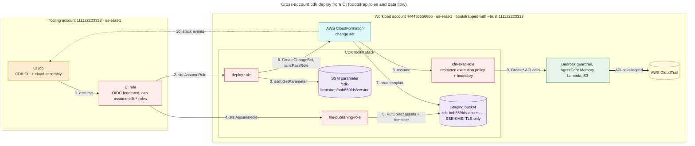

# Bootstrap and deployment

> **Level:** Intermediate · **Verified:** 2026-11-15 · **Feature status:** n/a · **Time:** ~30 min

Before the AWS CDK can deploy anything into an account and Region, that environment needs a small set of resources and roles that the CDK relies on. This chapter explains what `cdk bootstrap` creates, how a pipeline account is allowed to deploy into a workload account, what happens between `cdk deploy` and a running Bedrock guardrail, and which CLI commands are stable today.

## Learning objectives

After this chapter you can:

- Explain each resource and role that `cdk bootstrap` creates, and which step of a deployment uses it.
- Configure trust so that a tooling account can deploy into a workload account, and restrict what those deployments may create.
- Trace a deployment from synthesis through asset publishing, change set, execution and rollback.
- Choose between running the CDK CLI from CI and using CDK Pipelines.
- Tell which CDK CLI commands are stable and which need an `--unstable` flag.

## Prerequisites

- [Synthesis and CloudFormation templates](03-synthesis-and-cloudformation.md) and [Context and environment configuration](04-context-and-environments.md)
- [IAM roles, trust policies and cross-account access](../../00-foundations/security/02-iam-roles-and-trust.md)
- [Change sets and drift detection](../cloudformation/04-change-sets-and-drift.md)

## Concept in plain language

Think of an AWS environment (one account plus one Region) as a building site. Before any contractor can work there, the site needs a **loading dock** where materials are dropped off, and a set of **badges** that say who may unload, who may hand plans to the builder, and what the builder may build.

`cdk bootstrap` builds that dock and prints those badges. The dock is an S3 bucket and an ECR repository. The badges are IAM roles. When you run `cdk deploy`, the CDK command-line interface (CLI) puts your Lambda code, container images and the template itself on the dock, then hands the plan to AWS CloudFormation. CloudFormation does the building, wearing its own badge, the **execution role**. Whatever that role may do, every deployment may do.

## How it really works

### What the bootstrap stack contains

`cdk bootstrap` deploys a CloudFormation stack named `CDKToolkit` from a template that ships inside the CLI. The table below is read from that template in CLI 2.1148.1 (template version 33). Physical names follow `cdk-<qualifier>-<purpose>-<account>-<region>`; the default qualifier is `hnb659fds`.

| Resource (logical ID) | Physical name pattern | What it is for | Who uses it |
|:--|:--|:--|:--|
| `StagingBucket` | `cdk-hnb659fds-assets-<account>-<region>` | File assets (zipped Lambda code, the templates themselves). Versioned, TLS-only bucket policy, SSE-KMS, noncurrent versions expire after 30 days, retained if the stack is deleted | File publishing role, deploy role, CloudFormation |
| `ContainerAssetsRepository` | `cdk-hnb659fds-container-assets-<account>-<region>` | Docker image assets. Tags are immutable; the repository policy lets Lambda (and EMR Serverless) in the same account pull images | Image publishing role, Lambda |
| `FilePublishingRole` | `cdk-hnb659fds-file-publishing-role-…` | Write objects to the staging bucket | CLI, CodeBuild in CDK Pipelines |
| `ImagePublishingRole` | `cdk-hnb659fds-image-publishing-role-…` | Push images to the repository | CLI, CodeBuild |
| `LookupRole` | `cdk-hnb659fds-lookup-role-…` | Context lookups during synthesis. `ReadOnlyAccess` plus an explicit deny on `kms:Decrypt` | CLI |
| `DeploymentActionRole` | `cdk-hnb659fds-deploy-role-…` | Create, execute and delete change sets; roll back; pass the execution role; read the staging bucket; stack refactoring | CLI, CodePipeline |
| `CloudFormationExecutionRole` | `cdk-hnb659fds-cfn-exec-role-…` | The permissions every deployment runs with. Trusted only by `cloudformation.amazonaws.com` | CloudFormation |
| `CdkBootstrapVersion` | SSM parameter `/cdk-bootstrap/hnb659fds/version` | The template version, checked by every deployment | CLI, CloudFormation |

> [!NOTE]
> **Documented fact** — The bootstrap bucket uses an AWS managed key by default; `--bootstrap-customer-key` creates a customer managed key instead. Earlier template versions always created a KMS key, and AWS suggests re-bootstrapping those environments to avoid the key charge.
> Source: [Customize AWS CDK bootstrapping](https://docs.aws.amazon.com/cdk/v2/guide/bootstrapping-customizing.html), [Bootstrap your environment](https://docs.aws.amazon.com/cdk/v2/guide/bootstrapping-env.html)

### Trust between a tooling account and target accounts

The trust policies of the publishing roles, the deploy role and the lookup role allow the bootstrapped account itself, plus any account you list with `--trust`. `--trust-for-lookup` grants only the lookup role, and `--trust` implies it. Since template version 29, every bootstrap role rejects `AssumeRole` calls that carry an external ID, so the roles cannot be "deputized" by accident.

The execution role is different: only CloudFormation can assume it, so a trusted account gets its permissions only **through** CloudFormation.

> [!CAUTION]
> **Cost or security hazard** — Bootstrapping with no `--trust` and no `--cloudformation-execution-policies` attaches `AdministratorAccess` to the execution role (the CLI prints a warning). Anyone with access to a trusted account effectively has all permissions of the configured execution policies. Source: [CDK Pipelines README](https://docs.aws.amazon.com/cdk/api/v2/docs/aws-cdk-lib.pipelines-readme.html)

With `--trust`, the CLI refuses to continue unless you also pass `--cloudformation-execution-policies`: attach a customer managed policy that allows only the services your stacks use. Other built-in controls:

| Control | Flag | Effect |
|:--|:--|:--|
| Permissions boundary on the execution role | `--custom-permissions-boundary <policy name>` or `--example-permissions-boundary` | Caps what CloudFormation can do, and the example boundary denies creating users or roles without that boundary |
| Boundary on every bootstrap role | `--apply-permissions-boundary-to-all-roles` | The custom boundary must still allow what those roles need, or deployments fail |
| Termination protection | `--termination-protection` | Protects `CDKToolkit`; AWS warns there is no general recovery if a pipeline's bootstrap stack is deleted |
| Your own template | `--show-template`, edit, then `--template <file>` | Full control. Change the `BootstrapVariant` parameter so a plain `cdk bootstrap` will not overwrite it |

Bootstrap parameters are remembered. To remove one, rerun with `--no-previous-parameters` and resupply **all** of them; to add a trusted account, list every account again.

### The bootstrap contract inside your templates

The synthesizer (by default `DefaultStackSynthesizer`) writes the bootstrap names into the cloud assembly. Every template gets a `BootstrapVersion` parameter that resolves `/cdk-bootstrap/<qualifier>/version` from SSM, and a `CheckBootstrapVersion` rule that fails the deployment if that version is too old. The manifest records, per stack, the deploy role ARN, the execution role ARN, the S3 URL of the uploaded template and the minimum bootstrap version. If you bootstrap with `--qualifier acad1`, synthesize with `new DefaultStackSynthesizer({ qualifier: 'acad1' })` or the context key `@aws-cdk/core:bootstrapQualifier`; the [example test](examples/test/delivery-pipeline.test.ts) checks this.

### Assets

An **asset** is a local file, directory or Docker image a stack needs at deployment time. Each asset is named after a hash of its content, so an unchanged asset is not uploaded again; the template is itself a file asset. Assets accumulate, and `cdk gc --unstable=gc` deletes those no deployed template references.

### The deploy sequence

1. **Synthesize.** The CLI runs the `app` command from `cdk.json`, which builds the construct tree, resolves tokens it can, runs Aspects and validation, and writes the cloud assembly to `cdk.out`.
2. **Check bootstrap.** The CLI reads the version parameter in the target environment; a missing parameter produces "Has the environment been bootstrapped?".
3. **Publish assets** with the file and image publishing roles.
4. **Create a change set** as the deploy role, passing the execution role. If the template and tags are identical to the deployed stack, the CLI skips the deployment unless you pass `--force`.
5. **Approve** if the change broadens IAM or security group rules (`--require-approval broadening`, the default) or, with `destructive`, replaces or deletes resources. In CI with no terminal, a required approval fails the run.
6. **Execute the change set.** CloudFormation, acting as the execution role, calls the service APIs (for example `CreateGuardrail`) and emits stack events.
7. **Roll back on failure.** By default, CloudFormation undoes the whole operation and the stack returns to its last stable state.

> [!NOTE]
> **Documented fact** — `cdk deploy --no-rollback` leaves a failed deployment paused so you can fix and retry; `cdk rollback` then returns to the last stable state, `--orphan <LogicalId>` or `--force` skips resources that cannot roll back, and the command needs bootstrap version 23. A `--no-rollback` deployment cannot contain replacements.
> Source: [CDK CLI README](https://raw.githubusercontent.com/aws/aws-cdk-cli/main/packages/aws-cdk/README.md), [Choose how to handle failures](https://docs.aws.amazon.com/AWSCloudFormation/latest/UserGuide/stack-failure-options.html)

### Commands and their stability (CLI 2.1148.1)

| Command | What it does | Stability |
|:--|:--|:--|
| `cdk deploy` | Synthesize, publish assets, create and execute a change set. `--method=prepare-change-set` then `--method=execute-change-set` splits review from execution | Stable |
| `cdk diff` | Compare with the deployed stack; `--fail-on=broadening` or `=destructive` gates CI | Stable |
| `cdk drift` | Run CloudFormation drift detection; `--fail` for CI | Stable (no flag) |
| `cdk import` | Bring existing resources into a stack (bootstrap version 12+); `cdk deploy --import-existing-resources` for named resources | Stable (no flag) |
| `cdk rollback` | Roll back a paused failed deployment | Stable |
| `cdk refactor` | Move or rename resources without replacement, using CloudFormation stack refactoring | Preview: `--unstable=refactor` |
| `cdk gc` | Delete unused assets | `--unstable=gc` |
| `cdk publish-assets` | Publish assets without deploying | `--unstable=publish-assets` |
| `cdk orphan` | Detach resources from a stack without deleting them | `--unstable=orphan` |
| `cdk migrate` | Generate a CDK app from a stack, template or scanned resources | Experimental |

## Architecture diagram



**What this shows** — A CI job in a tooling account deploys into a separate workload account. It never holds workload-account credentials of its own: it assumes the bootstrap roles that trust the tooling account, and the actual resource creation runs as the execution role, which only CloudFormation can assume.

**Walkthrough**

1. The CI job obtains its own role, for example through OIDC (see [GitHub Actions for IaC](../../07-devops-and-cicd/04-github-actions.md)).
2. The CLI assumes the deploy role in the target account.
3. With that role it reads the bootstrap version parameter (the deploy role's policy allows exactly this parameter).
4. It assumes the file publishing role in the target account.
5. It uploads content-addressed assets and the template to the staging bucket.
6. With the deploy role it creates a change set and passes the execution role.
7. CloudFormation reads the template from the staging bucket.
8. CloudFormation assumes the execution role.
9. Resources are created or updated with the execution role's permissions.
10. The CLI polls stack events until the stack is stable or rolled back.

**Legend** — solid arrow: request · dashed arrow: response or status · thick arrow: asynchronous log delivery · red boxes: IAM roles · cylinders: stored data. The full picture, including the construct tree and drift, is in [diagram set 28](../../diagrams/mermaid/28-cdk-and-cloudformation-synthesis.md).

## Implementation details

**Bootstrap the tooling account and each workload account** (run by an administrator, once per environment, never from the pipeline):

```bash
# Tooling account: hosts the pipeline. Its own execution policy can be narrow too.
npx cdk bootstrap aws://111122223333/us-east-1 \
  --cloudformation-execution-policies arn:aws:iam::111122223333:policy/CdkToolingExecution \
  --termination-protection

# Workload account: trusts the tooling account, runs deployments under a narrow policy and a boundary.
npx cdk bootstrap aws://444455556666/us-east-1 \
  --trust 111122223333 \
  --cloudformation-execution-policies arn:aws:iam::444455556666:policy/CdkBedrockWorkloadExecution \
  --custom-permissions-boundary CdkWorkloadBoundary \
  --termination-protection
```

**Deploy from CI with the CLI.** Synthesize once, test, then deploy the same assembly:

```bash
npx cdk synth --quiet                         # writes cdk.out
npx cdk diff --app cdk.out --fail-on=destructive Workload-Guardrail
npx cdk deploy --app cdk.out --require-approval=never --method=prepare-change-set Workload-Guardrail
# a reviewer inspects the change set, then:
npx cdk deploy --app cdk.out --method=execute-change-set Workload-Guardrail
```

**CDK Pipelines or the CLI from CI?**

| Question | CDK CLI in your CI system | CDK Pipelines (`aws-cdk-lib/pipelines`) |
|:--|:--|:--|
| Where does it run? | Any CI (GitHub Actions, GitLab, CodeBuild) | AWS CodePipeline and CodeBuild in the tooling account |
| Who defines the pipeline? | CI YAML, outside the app | The CDK app itself; the pipeline is **self-mutating** |
| Cross-account | Assume bootstrap roles from the CI role | Built in; needs `crossAccountKeys: true` and `--trust` bootstrapping |
| Change sets | `--method=prepare-change-set` / `execute-change-set` | Prepare and execute actions per stack, as the deploy role |
| Approvals and tests | CI features | `ManualApprovalStep`, `ShellStep` pre and post steps |
| Fits best when | The organisation already standardises on one CI system | A team wants the whole delivery path in one CDK codebase |

> [!TIP]
> **Academy recommendation** — Bootstrap every target account with `--trust` for the tooling account only, a customer managed execution policy and a permissions boundary, and turn on termination protection. Use administrator credentials only to bootstrap; let the pipeline do everything after that. This is our design guidance, not an official AWS reference architecture.

## Example

The pipeline below runs in the tooling account and deploys the three chapter 9 stacks into the workload account. Its test proves the trust model from the synthesized template: the deploy actions assume `deploy-role` and pass `cfn-exec-role`, both in account `444455556666`.

> **Code status:** validated (`tsc`, `cdk synth`, `cfn-lint` with no errors) · mock-tested (Jest, 25 tests in the [examples project](examples/README.md)) · **never deployed**

```ts
// lib/delivery-pipeline-stack.ts (excerpt)
this.pipeline = new pipelines.CodePipeline(this, 'Pipeline', {
  pipelineType: codepipeline.PipelineType.V2,
  crossAccountKeys: true,        // KMS-encrypted artifacts the target account can read
  enableKeyRotation: true,
  synth: new pipelines.ShellStep('Synth', {
    input: pipelines.CodePipelineSource.connection(props.repository, props.branch ?? 'main', {
      connectionArn: props.connectionArn,
    }),
    commands: ['npm ci', 'npx tsc', 'npx jest --ci', 'npx cdk synth'],
  }),
});
this.pipeline.addStage(new BedrockWorkloadStage(this, 'Workload', { env: props.workloadEnv }), {
  pre: [new pipelines.ManualApprovalStep('ApproveWorkloadChange')],
});
```

```ts
// test/delivery-pipeline.test.ts (excerpt)
expect(actionRole.asString()).toBe(`:iam::${WORKLOAD}:role/cdk-hnb659fds-deploy-role-${WORKLOAD}-us-east-1`);
expect(executionRole.asString()).toBe(`:iam::${WORKLOAD}:role/cdk-hnb659fds-cfn-exec-role-${WORKLOAD}-us-east-1`);
```

> [!CAUTION]
> **Cost or security hazard** — Deploying the pipeline creates CodePipeline, CodeBuild, a KMS key and S3 buckets that are billed while they exist, and its first run deploys Bedrock resources into the workload account. Try it only in sandbox accounts, and remove it with `cdk destroy` in the tooling account plus `cdk destroy` of the stage stacks in the workload account.

## Common mistakes

> [!WARNING]
> **Common mistake** — Re-running `cdk bootstrap --trust <new account>` with only the new account. The trusted list is replaced, so the previously trusted pipeline loses access on the next deployment. Always pass the full list.

| Mistake | Symptom | Fix |
|:--|:--|:--|
| Deploying to an environment that was never bootstrapped | `SSM parameter /cdk-bootstrap/hnb659fds/version not found` | Bootstrap that account and Region |
| Target not bootstrapped with `--trust` for the pipeline account | CDK Pipelines fails with "Policy contains a statement with one or more invalid principals" | Bootstrap the target with `--trust <tooling account>` |
| Custom `--qualifier` in bootstrap but not in the app | Templates look for `/cdk-bootstrap/hnb659fds/version` and fail | Pass the same qualifier to `DefaultStackSynthesizer` |
| Leaving `AdministratorAccess` as execution policy | Any change merged to the repository can create any resource | Customer managed execution policy plus a permissions boundary |
| `--require-approval` left at the default in CI | Deployment fails because approval is needed and no terminal is attached | Gate with `cdk diff --fail-on=broadening` and an approval step, then deploy with `--require-approval=never` |
| Deleting the `CDKToolkit` stack to "reset" | Pipelines and deployments stop; no general recovery | Update in place with `cdk bootstrap`; enable termination protection |

## Security considerations

- The execution role is the effective permission set of every deployment; review changes to its policy like production IAM.
- Keep `--deny-external-id` on unless a third party must assume the bootstrap roles.
- The lookup role can read the whole account (minus `kms:Decrypt`); trust it only where context lookups are needed.
- The staging bucket holds your code and templates; restrict who else can read it.
- CloudTrail in the target account records the deploy role, the execution role and every API call they make; see [AWS CloudTrail for Bedrock](../../02-related-aws-services/security/05-cloudtrail-for-bedrock.md).

## Cost considerations

- You pay for S3 storage of assets, ECR storage of images, and a KMS key only with `--bootstrap-customer-key`; AWS notes that bootstrap resources may incur charges when used.
- Assets accumulate with every change; `cdk gc` with buffer days keeps storage in check.
- CDK Pipelines adds CodePipeline, CodeBuild minutes and, for cross-account delivery, a KMS key.

## Knowledge check

1. A colleague bootstraps a workload account with `--trust 111122223333` but no execution policy. What happens, and why does the CLI behave that way?
2. Your pipeline account can assume `cdk-hnb659fds-deploy-role` in the workload account. Can it create an IAM user directly? Can it get one created?
3. A deployment fails while creating an AgentCore Memory after the guardrail was created. What is the state of the stack with default options, and with `--no-rollback`?
4. Why does the synthesized template contain a `BootstrapVersion` parameter and a `CheckBootstrapVersion` rule?

<details>
<summary>Answers</summary>

1. The CLI stops with an error asking for `--cloudformation-execution-policies`: with trust in place it will not silently grant `AdministratorAccess` to deployments from another account.
2. Not directly: the deploy role's own policy covers CloudFormation operations, `iam:PassRole` for the execution role and asset reads. Indirectly yes, if the execution role's policy allows `iam:CreateUser`, because CloudFormation runs as the execution role. That is why the execution policy and boundary matter.
3. By default CloudFormation rolls back: the guardrail is deleted and the stack returns to its last stable state (or `ROLLBACK_COMPLETE` for a new stack). With `--no-rollback`, the guardrail stays, the stack is left failed, and you fix and redeploy or run `cdk rollback`.
4. To bind the template to a bootstrap stack: the parameter reads the version from SSM at deployment time and the rule fails early if the environment's bootstrap stack is too old for what the template needs.

</details>

## Further reading

Official sources opened while writing this chapter:

- [AWS CDK bootstrapping](https://docs.aws.amazon.com/cdk/v2/guide/bootstrapping.html) — what bootstrapping is and the `CDKToolkit` stack.
- [Bootstrap your environment](https://docs.aws.amazon.com/cdk/v2/guide/bootstrapping-env.html) — roles, naming, required permissions, template version history, termination protection.
- [Customize AWS CDK bootstrapping](https://docs.aws.amazon.com/cdk/v2/guide/bootstrapping-customizing.html) — `--trust`, execution policies, qualifier, the bootstrap contract.
- [Deploy AWS CDK applications](https://docs.aws.amazon.com/cdk/v2/guide/deploy.html) — app lifecycle, cloud assembly, deployment permissions.
- [Continuous integration and delivery using CDK Pipelines](https://docs.aws.amazon.com/cdk/v2/guide/cdk-pipeline.html) — bootstrapping for pipelines, security notes.
- [CDK Pipelines README](https://docs.aws.amazon.com/cdk/api/v2/docs/aws-cdk-lib.pipelines-readme.html) — `crossAccountKeys`, trust warnings (read from the installed `aws-cdk-lib` 2.277.0 copy).
- [CDK CLI README](https://raw.githubusercontent.com/aws/aws-cdk-cli/main/packages/aws-cdk/README.md) — commands, `--unstable` features, rollback, import, gc, refactor, drift.
- [cdk drift](https://docs.aws.amazon.com/cdk/v2/guide/ref-cli-cmd-drift.html) and [cdk import](https://docs.aws.amazon.com/cdk/v2/guide/ref-cli-cmd-import.html) — command references.
- [Preserve deployed resources when refactoring CDK code](https://docs.aws.amazon.com/cdk/v2/guide/refactor.html) — `cdk refactor` and its preview status.
- [Choose how to handle failures when provisioning resources](https://docs.aws.amazon.com/AWSCloudFormation/latest/UserGuide/stack-failure-options.html) — rollback and "preserve successfully provisioned resources".
- [Update CloudFormation stacks using change sets](https://docs.aws.amazon.com/AWSCloudFormation/latest/UserGuide/using-cfn-updating-stacks-changesets.html) — change set lifecycle.
