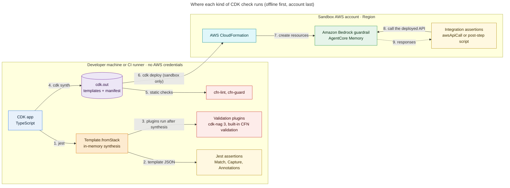

# Testing CDK applications

> **Level:** Intermediate · **Verified:** 2026-11-15 · **Feature status:** n/a · **Time:** ~30 min

A CDK app is a program that writes CloudFormation, so you can test it like a program: in milliseconds, without credentials, on every commit. This chapter shows how to assert on synthesized templates, when a snapshot helps and when it hurts, how to test validation and Aspects, how to run cdk-nag inside a unit test, and what no unit test can tell you about a Bedrock deployment.

## Learning objectives

After this chapter you can:

- Write fine-grained assertions with `Template.fromStack`, `hasResourceProperties`, `Match`, `resourceCountIs` and `Capture`.
- Decide when a snapshot test adds value and when it only adds noise.
- Test construct validation, Aspects and cdk-nag rule packs.
- Explain what unit tests cannot prove, and choose an integration-testing option for what remains.

## Prerequisites

- [Synthesis and CloudFormation templates](03-synthesis-and-cloudformation.md)
- [Permissions and Aspects](05-permissions-and-aspects.md)
- [Testing infrastructure code](../../07-devops-and-cicd/03-testing-iac.md) for the tool-independent view

## Concept in plain language

A building inspector can check the **blueprint** before anything is built: are there fire exits, is the wiring rated correctly, is the door where the plan says. That check is quick and cheap, and it catches most mistakes. It cannot tell you whether the concrete will set in the rain.

CDK unit tests inspect the blueprint. They synthesize your stack into a CloudFormation template in memory and check what is in it. Integration tests pour the concrete: they deploy to a real account and call the result.

## How it really works

### Fine-grained assertions

`Template.fromStack(stack)` synthesizes the stack and parses its template. Everything else is a query on that JSON:

| API | Asserts | Use it for |
|:--|:--|:--|
| `resourceCountIs(type, n)` | Exactly `n` resources of a type | "One guardrail, one version, no surprise KMS key" |
| `hasResourceProperties(type, props)` | At least one resource whose `Properties` match | The common case |
| `hasResource(type, def)` | Matches the whole resource, including `DependsOn`, `DeletionPolicy` | Removal and update policies |
| `allResourcesProperties(type, props)` | Every resource of the type matches | Invariants such as "every bucket is encrypted" |
| `findResources(type, props?)` / `getResourceId(type, props?)` | Returns matches / the one matching logical ID | Correlating resources (`Ref`, `Fn::GetAtt`) |
| `hasOutput`, `hasMapping`, `hasCondition` | Other template sections | Stack contracts |
| `templateMatches(obj)` / `toJSON()` | Whole template | Snapshot tests |

Objects in a pattern match **partially and recursively** (keys you do not mention are ignored). Literal arrays must match element for element; `Match.arrayWith([...])` matches an ordered subset. Other matchers: `Match.objectLike`, `Match.objectEquals`, `Match.absent()`, `Match.anyValue()`, `Match.arrayEquals`, `Match.stringLikeRegexp`, `Match.not` and `Match.serializedJson` for JSON embedded in a string.

`Capture` records the value at a position so you can make a second assertion about it: capture a version's `GuardrailIdentifier`, then check that it is a `Fn::GetAtt` on the guardrail's logical ID. When several resources match, `capture.next()` moves to the next captured value.

> [!NOTE]
> **Documented fact** — Synthesizing without an explicit output directory creates a temporary `cdk.out*` directory that Jest does not clean up; add `aws-cdk-lib/testhelpers/jest-autoclean` to `setupFilesAfterEnv` (the academy's `jest.config.js` does).
> Source: `aws-cdk-lib/assertions` README, `aws-cdk-lib` 2.277.0 (installed copy; online at [Assertions](https://docs.aws.amazon.com/cdk/api/v2/docs/aws-cdk-lib.assertions-readme.html))

### Snapshots and their trade-offs

A snapshot test stores `Template.fromStack(stack).toJSON()` the first time and fails on any later difference. AWS's testing guide describes the trade-off precisely: snapshots let you refactor freely, but CDK upgrades also change synthesized templates, so you cannot rely on snapshots alone to show the implementation is correct.

| Snapshot is useful | Snapshot is noise |
|:--|:--|
| Refactoring a stack that must produce an identical template | Stacks with assets, whose hashes change with every code edit |
| Reviewing exactly what an `aws-cdk-lib` upgrade changed | Teams that run `jest -u` without reading the diff |
| Small, stable, L1-heavy stacks such as a guardrail | Large stacks where one intended change rewrites hundreds of lines |

### Testing validation and Aspects

- **Constructor validation** is ordinary code: `expect(() => new ContentGuardrail(stack, 'X', badProps)).toThrow(/guardrailName/)`.
- **Aspects** run during synthesis and usually report through annotations. `Annotations.fromStack(stack)` synthesizes and exposes `hasError`, `hasWarning`, `hasInfo`, their `hasNo…` forms and `find…`, all of which accept matchers.
- **Tags** applied to a stack live in the cloud assembly manifest, not the template; assert them with `Tags.fromStack(stack)`.

### cdk-nag in tests: version 3 changed the mechanism

> [!IMPORTANT]
> **Status** — cdk-nag 3 (3.0.2 is installed here; it requires `aws-cdk-lib` 2.257.0 or later) is no longer an Aspect. It is a **policy-validation plugin**: register it with `Validations.of(app).addPlugins(new AwsSolutionsChecks(app))`. Findings no longer appear as annotations; a violation interrupts synthesis and the report is written to the cloud assembly. Suppressions move from `NagSuppressions` to `Validations.of(construct).acknowledge({ id, reason })`.
> Source: cdk-nag README and MIGRATION guide in the installed package (3.0.2); [`aws-cdk-lib` Template and Policy Validation](https://docs.aws.amazon.com/cdk/api/v2/docs/aws-cdk-lib-readme.html)

So the v2-era pattern `Annotations.fromStack(stack).hasNoError('*', …)` no longer catches cdk-nag findings. In version 3 you assert on synthesis itself: `expect(() => Template.fromStack(stack)).not.toThrow()` for a compliant stack and `.toThrow(/AwsSolutions-IAM5/)` for a known violation. Findings that carry a detail are acknowledged one by one, for example `AwsSolutions-IAM5[Action::bedrock:*]`. The same validation framework also runs the built-in `CloudFormationValidatePlugin` on every synthesis, which checks templates for misconfigurations that would fail deployment.

### What unit tests cannot prove

| Question | Why a template test cannot answer it | Where it is answered |
|:--|:--|:--|
| Will CloudFormation accept every property value? | Matchers check what you wrote, not the service's rules | `cfn-lint` on `cdk.out`, built-in validation, then a deployment |
| Does IAM actually allow the call? | Policies are evaluated by IAM at request time, with SCPs, boundaries and resource policies | A deployed test calling the API |
| Is the model, guardrail tier or AgentCore service available in this Region and account? | Availability and model access are account-side state | Deployment in each target Region |
| Are quotas sufficient? | Quotas live in Service Quotas | Deployment and load tests |
| Does the agent behave correctly? | Behaviour is runtime, not infrastructure | Application and evaluation tests ([Model and RAG evaluation](../../01-amazon-bedrock/model-evaluation/01-model-evaluation.md)) |

### Integration testing options

| Option | Status checked 2026-11-15 | Notes |
|:--|:--|:--|
| `@aws-cdk/integ-tests-alpha` with the `integ-runner` CLI | **Experimental** (both packages carry the experimental banner); not installed in this repository | Test files `integ.*.ts` are CDK apps; `integ-runner` compares snapshots and, to accept a new snapshot, deploys, runs `awsApiCall` assertions and destroys |
| CDK Pipelines `ShellStep` post-steps | Stable | Call the deployed stage (for example invoke a Lambda that runs `ApplyGuardrail`) before promotion |
| A sandbox account plus `cdk deploy`, test script, `cdk destroy` in CI | Stable CLI commands | Simplest; isolate the account and clean up |
| `cdk diff --fail-on=destructive` and `cdk drift --fail` | Stable | Not tests of behaviour, but cheap gates around deployments |

## Architecture diagram



**What this shows** — Everything in the left box runs offline in seconds and is what this academy runs (ADR-003). Only the right box needs an account, and it is the only place where IAM, quotas, Region availability and service-side validation are exercised.

**Walkthrough**

1. Jest constructs the app and synthesizes stacks in memory.
2. Assertions query the template JSON.
3. Registered validation plugins (cdk-nag, the built-in CloudFormation validation) run after synthesis and fail it on a violation.
4. `cdk synth` writes the cloud assembly.
5. `cfn-lint` and `cfn-guard` check the written templates ([Hooks and CloudFormation Guard](../cloudformation/05-hooks-and-guard.md)).
6. In a sandbox account only, the assembly is deployed.
7. CloudFormation creates the Bedrock resources.
8. Integration assertions call the deployed resources.
9. Responses decide pass or fail; then the stack is destroyed.

**Legend** — solid arrow: request or data flow · dashed arrow: response · red boxes: policy checks · cylinder: files on disk.

## Implementation details

### Walking through the library's tests

The [construct library](construct-library/README.md) tests [`BedrockInvocationRole`](construct-library/test/bedrock-invocation-role.test.ts) with seven tests, each showing one technique:

| Test | Technique |
|:--|:--|
| grants named models in named Regions, with streaming by default | `resourceCountIs` plus `hasResourceProperties` with an exact `Statement` array, and `Match.arrayWith` / `Match.objectLike` / `Match.anyValue` for a `Fn::Join` ARN |
| never grants a wildcard resource for an Allow statement | An **invariant**: `findResources` and a loop over every statement |
| streaming can be switched off | Testing a non-default prop |
| global inference adds the Region-less model ARN | Testing a public member by resolving its token with `stack.resolve` |
| restricting to inference profiles adds the condition key | Matching an IAM `Condition` block inside `Match.arrayWith` |
| a required guardrail produces an explicit deny … | Several statements in one assertion |
| rejects wildcards and empty model lists | Validation with `toThrow` |

A helper `synth()` builds a fresh `App` and `Stack` per test with a fixed placeholder environment, so ARNs resolve the same way every run.

### The new tested example

The [examples project](examples/README.md) adds two test files for this chapter. [`content-guardrail.test.ts`](examples/test/content-guardrail.test.ts) tests the reusable guardrail construct from [chapter 8](08-construct-libraries.md): defaults with `Match.absent()`, `Capture` to prove the version points at its guardrail, a test that a policy change changes the version description (so a new version is published), the `grantApply` policy, validation errors, and a logical-ID contract. [`policy-checks.test.ts`](examples/test/policy-checks.test.ts) tests an Aspect, cdk-nag 3 and a snapshot.

## Example

> **Code status:** validated (`tsc`) · mock-tested (Jest 30, 25 tests and 1 snapshot pass; cdk-nag 3.0.2) · **never deployed**

```ts
// test/policy-checks.test.ts (excerpts)
test('reports an error annotation on the offending policy', () => {
  const app = new App();
  const stack = consumerStack(app, true);              // a role granted bedrock:* on *
  Aspects.of(stack).add(new NoBedrockWildcards());

  Annotations.fromStack(stack).hasError(
    '/Consumer/AppRole/DefaultPolicy/Resource',
    Match.stringLikeRegexp('Wildcard action bedrock:\\*'),
  );
});

test('a wildcard grant fails synthesis with AwsSolutions-IAM5', () => {
  const app = new App();
  const stack = consumerStack(app, true);
  Validations.of(app).addPlugins(new AwsSolutionsChecks(app));

  expect(() => Template.fromStack(stack)).toThrow(/AwsSolutions-IAM5/);
});
```

```ts
// test/content-guardrail.test.ts (excerpt)
test('the version points at this guardrail (Capture)', () => {
  const stack = newStack();
  new ContentGuardrail(stack, 'Guardrail');
  const template = Template.fromStack(stack);

  const identifier = new Capture();
  template.hasResourceProperties('AWS::Bedrock::GuardrailVersion', { GuardrailIdentifier: identifier });
  const guardrailLogicalId = template.getResourceId('AWS::Bedrock::Guardrail');
  expect(identifier.asObject()).toEqual({ 'Fn::GetAtt': [guardrailLogicalId, 'GuardrailId'] });
});
```

## Common mistakes

> [!WARNING]
> **Common mistake** — Asserting on logical IDs copied from a template (`ConversationMemoryD396D01B`) in many tests. Every refactor breaks dozens of tests. Use `getResourceId()` or `Capture` to correlate resources, and keep exactly one deliberate logical-ID contract test per stateful resource.

| Mistake | Symptom | Fix |
|:--|:--|:--|
| Accepting snapshot updates with `jest -u` without reading them | A permission change slips through review | Review snapshot diffs like code; prefer fine-grained tests for security properties |
| Using `ts-jest` or `ts-node` with TypeScript 7 | "does not expose the JavaScript compiler API" | `@swc/jest` and `tsx`, as in the academy's `jest.config.js` |
| Expecting cdk-nag 3 findings in `Annotations` | Tests pass while synthesis fails in CI | Assert `toThrow` / `not.toThrow` on synthesis |
| Context lookups in tested stacks | Tests need credentials or a stale `cdk.context.json` | Pass values as props; keep lookups out of constructs |
| One shared `App` across tests | Construct ID collisions and order-dependent results | A new `App` per test |

## Security considerations

- Encode security invariants as tests: no `*` in Allow statements, every bucket encrypted, `KmsKeyArn` present where policy requires a customer managed key.
- A test proves the template says what you intend; IAM, SCPs and permissions boundaries still decide at runtime ([Identity, least privilege and IAM isolation for agents](../../06-security-governance/02-identity-and-least-privilege.md)).
- Acknowledged cdk-nag findings are exceptions with a reason in code; review them like any other security exception.
- Integration tests in a shared account can leak data or cost; use an isolated sandbox account and destroy what you deploy.

## Cost considerations

- Unit tests and synthesis cost nothing in AWS.
- Integration tests create real resources; Bedrock inference, guardrail evaluation and AgentCore usage are billed by use, so keep test prompts small and tear stacks down in the same job.

## Knowledge check

1. A test asserts `PiiEntitiesConfig: [{ Type: 'EMAIL', Action: 'ANONYMIZE' }]` and someone adds a `PHONE` entity. Does the test still pass? What would you change if it should?
2. Your snapshot test fails after upgrading `aws-cdk-lib` and nothing in your code changed. What do you do?
3. A teammate migrated to cdk-nag 3, and `Annotations.fromStack(stack).hasNoError('*', Match.anyValue())` still passes while `cdk synth` fails in the pipeline. Why?
4. Name two properties of a Bedrock guardrail deployment that no unit test can verify.

<details>
<summary>Answers</summary>

1. It fails: a literal array must match element for element. If extra entities are acceptable, use `Match.arrayWith([...])`.
2. Read the diff. If the change is intended by the new library version (for example a new default), accept it with `jest -u` in a separate commit that says so; if not, pin the version and investigate.
3. cdk-nag 3 reports through the policy-validation framework, which interrupts synthesis, not through annotations. Assert on whether synthesis throws.
4. For example: that the content-filter tier is available in the target Region, that the caller's IAM role can actually apply it, that the service accepts the configuration, or that it blocks the prompts it should.

</details>

## Further reading

Official sources opened while writing this chapter:

- [Testing AWS CDK applications](https://docs.aws.amazon.com/cdk/v2/guide/testing.html) — fine-grained assertions versus snapshot tests.
- [Assertions module](https://docs.aws.amazon.com/cdk/api/v2/docs/aws-cdk-lib.assertions-readme.html) — read from the installed `aws-cdk-lib` 2.277.0 README: matchers, `Capture`, `Annotations`, `Tags`, Jest clean-up.
- [Template and Policy Validation](https://docs.aws.amazon.com/cdk/api/v2/docs/aws-cdk-lib-readme.html) — `Validations`, built-in CloudFormation validation, plugin reports (installed README).
- [cdk-nag](https://github.com/cdklabs/cdk-nag) — README and MIGRATION guide of version 3.0.2 (installed package).
- [integ-tests README](https://raw.githubusercontent.com/aws/aws-cdk/main/packages/@aws-cdk/integ-tests-alpha/README.md) — experimental status, `IntegTest`, `awsApiCall`, `ExpectedResult`.
- [integ-runner README](https://raw.githubusercontent.com/aws/aws-cdk-cli/main/packages/@aws-cdk/integ-runner/README.md) — snapshot workflow and update behaviour.
- [Best practices for developing and deploying cloud infrastructure with the AWS CDK](https://docs.aws.amazon.com/cdk/v2/guide/best-practices.html) — unit test your infrastructure; assert that logical IDs of stateful resources stay static.
- [CDK CLI README](https://raw.githubusercontent.com/aws/aws-cdk-cli/main/packages/aws-cdk/README.md) — `cdk diff --fail-on`, `cdk drift --fail`.
