# Reusable construct libraries

> **Level:** Advanced · **Verified:** 2026-11-15 · **Feature status:** n/a · **Time:** ~30 min

A construct library turns one team's hard-won Bedrock configuration (a guardrail policy, a least-privilege invocation role) into something every other team can use in one line. This chapter covers how to design a construct's API, how to compose and publish it, what counts as a breaking change when every release can replace live resources, and how to deprecate and document it.

## Learning objectives

After this chapter you can:

- Design a construct API: props with documented defaults, early validation, exposed members and `grant` methods.
- Compose constructs so that logical IDs stay stable, and recognise when a change would replace resources.
- Choose between a TypeScript-only package and a multi-language jsii package, and publish either.
- Apply semantic versioning to constructs, including the breaking changes that type checkers cannot see.
- Deprecate an API and document a library so that it can be discovered and upgraded safely.

## Prerequisites

- [L1, L2 and L3 constructs](02-l1-l2-l3-constructs.md) and [Permissions and Aspects](05-permissions-and-aspects.md)
- [Testing CDK applications](07-testing.md)

## Concept in plain language

A good construct is like a kitchen appliance. You choose a few settings on the front panel (the **props**); sensible defaults cover everything else; it refuses to start if you set something dangerous (**validation**); it has labelled sockets for connecting other things (**exposed members** and **grants**); and the manufacturer promises that version 2 still fits the same socket (**versioning**). What you never do is open the casing to rewire it every time you use it.

The unusual part, compared with an ordinary library, is that the "socket" includes the **identity of deployed resources**. A refactor that looks harmless in code can make CloudFormation delete and recreate a guardrail or an AgentCore Memory with its data.

## How it really works

### Designing the API

| Element | Rule | Why |
|:--|:--|:--|
| Props | A `readonly` interface named `<Construct>Props`; every optional field has a doc comment and an `@default` describing the behaviour | The AWS Construct Library design guidelines require this, and editors show it |
| Defaults | Make a prop required only if no sensible default can be provided or calculated | One-line usage that is already safe |
| Types | Take construct interfaces (`kms.IKey`, `iam.IGrantable`), not ARN strings; do not expose `Cfn*` property types or `Token` | Strong typing and cross-language safety |
| Validation | Throw an `Error` in the constructor; skip values that are unresolved tokens (`Token.isUnresolved`); use `node.addValidation()` only for checks that need the finished tree | Mistakes fail at synth, not mid-deployment |
| Exposed members | `public readonly` ARNs, IDs, roles; an escape hatch to the L1 | Callers wire constructs together without reaching inside |
| Grants | `grantX(grantee: iam.IGrantable): iam.Grant`, built with `iam.Grant.addToPrincipal` (or `addToPrincipalOrResource` for resources with resource policies) | Intent-based, least-privilege permissions in one call |
| Physical names | Optional, generated by default | A fixed name blocks a second copy and any replacement |

> [!NOTE]
> **Documented fact** — The design guidelines ask construct authors to treat "the construct hierarchy and all construct IDs as part of the external contract" and to call out any change to them as breaking, because the logical ID is computed from the full construct path. The primary resource of a construct uses the ID `Resource`.
> Source: [AWS Construct Library Design Guidelines](https://raw.githubusercontent.com/aws/aws-cdk/main/docs/DESIGN_GUIDELINES.md)

### Composing constructs

Model with constructs and deploy with stacks: a library exports constructs, and the consuming app decides which stack they go into ([best practices](https://docs.aws.amazon.com/cdk/v2/guide/best-practices.html)). Inside a construct, child IDs form the logical IDs. Two heuristics in the logical-ID algorithm matter to library authors:

- `Resource` is hidden from the readable part of the logical ID but still feeds its hash, and `node.defaultChild` returns it, which is how escape hatches find the L1.
- `Default` is removed from both the readable part and the hash. Wrapping an existing resource in a new construct and giving it the ID `Default` keeps its logical ID unchanged, which is the documented way to refactor flat code into a construct without replacement.

The example in this chapter shows a subtler trap: some L2s derive a **physical name** from the construct path. The stable `Memory` L2 renders a `Name` such as `AcademyAgentMemoryConversationMemory80DA62AA` when you omit `memoryName`, and `Name` is a create-only property of `AWS::BedrockAgentCore::Memory`. Moving that construct changes both the logical ID and the name.

### Packaging and publishing

| Choice | When | What it takes |
|:--|:--|:--|
| Source folder in the app's repository | One app uses it | Nothing; this is where every library should start |
| TypeScript-only npm package in a private registry (for example AWS CodeArtifact) | Several TypeScript apps in your organisation | `tsc`, a `package.json` with `aws-cdk-lib` and `constructs` as **peer** dependencies, a release pipeline |
| jsii package published to npm, PyPI, Maven and NuGet | Consumers in several languages, or Construct Hub | The `jsii` compiler, `jsii-pacmak`, and the jsii TypeScript restrictions |

**jsii at a high level.** jsii compiles a TypeScript library into an assembly with type information, and `jsii-pacmak` generates idiomatic packages for Python, Java, .NET and Go from it; the AWS CDK itself is built this way. The price is a restricted TypeScript: interfaces without an `I` prefix are **structs** with only `readonly` properties, behavioural interfaces start with `I`, generics cannot be declared, and overrides must keep visibility and signatures.

> [!IMPORTANT]
> **Status** — The current `jsii` compiler release line, 6.0, is built on TypeScript 6.0; "TypeScript 7 (the native port) is not yet supported in a GA release", and 7.1 support is available only as dev pre-releases. The academy's libraries are type-checked with TypeScript 7.0 and are therefore TypeScript-only. A multi-language library would build with `jsii` instead of `tsc`.
> Source: [jsii-compiler README](https://raw.githubusercontent.com/aws/jsii-compiler/main/README.md)

Construct Hub lists a package automatically when it is a public npm package with a permissive open-source licence, a CDK keyword (`awscdk`, `cdk8s` or `cdktf`) and a `.jsii` assembly ([AWS Open Source Blog](https://aws.amazon.com/blogs/opensource/best-practices-for-discoverability-of-a-construct-library-on-construct-hub/)).

### Semantic versioning: what is breaking

| Change | Breaks callers' **code**? | Breaks callers' **deployed resources**? | Version bump |
|:--|:-:|:-:|:--|
| Add an optional prop with a default that renders the same template | No | No | Minor |
| Remove or rename a prop or public member; make an optional prop required | Yes | — | Major |
| Change a default so the synthesized template changes (for example filter strength `HIGH` → `MEDIUM`) | No | Yes: updates every consumer on upgrade | Major, or minor with a loud changelog if it is purely additive hardening |
| Rename a child construct or move it in the tree | No | **Yes: new logical ID, so replacement** | Major |
| Change how a physical name is derived | No | Yes: replacement, or failure if the name is taken | Major |
| Raise the minimum `aws-cdk-lib` peer version | Possibly | Possibly | Minor if additive; check the upstream changelog |
| An upstream L1 change (in `aws-cdk-lib` 2.268.0 the CloudFormation types `AWS::Bedrock::ModelInvocationJob` and `AWS::Bedrock::DefaultPromptRouter` were removed from the specification) | Yes for code that used them | — | Your major, if you re-export or depend on them |

Tooling covers only part of this. `jsii-diff` compares two jsii assemblies and fails if stable or deprecated APIs changed incompatibly ([jsii-diff README](https://raw.githubusercontent.com/aws/jsii/main/packages/jsii-diff/README.md)); `tsc` does the same informally for TypeScript-only packages. Neither sees logical IDs. That is why the [example tests](examples/test/content-guardrail.test.ts) pin the guardrail's logical ID, and why the consuming app should run `cdk diff --fail-on=destructive` before deploying an upgrade. When IDs must change, `cdk refactor --unstable=refactor` can move resources without replacement ([Version upgrades, refactoring and importing](../maintenance/05-upgrades-refactoring-import.md)).

### Deprecation and documentation

1. Mark the old API with a `@deprecated` TSDoc tag that names the replacement; editors strike it through.
2. At runtime, call `Annotations.of(this).addDeprecation('my-lib.ContentGuardrail.foo', 'Use bar instead')`. It is shown once per construct as a warning, and setting `CDK_BLOCK_DEPRECATIONS` turns it into an error, so consumers can test that they are clean.
3. Keep the deprecated API until the next major version, then remove it (our recommendation; announce the removal in the changelog).
4. Document every public member with TSDoc (`@default` included), keep a README with a minimal copy-paste example, and keep a changelog that names template-changing releases. Construct Hub and IDEs render the TSDoc.

## Architecture diagram

```mermaid
---
title: Life of a construct library release (academy design)
---
flowchart LR
    subgraph lib["Library repository · platform team"]
        src["Construct source<br/>props, validation, grants"]:::compute
        tests["Jest tests<br/>assertions + logical-ID contract"]:::obs
        apiCheck["API compatibility<br/>tsc or jsii-diff"]:::security
        release["Release job<br/>semver bump + changelog"]:::compute
    end
    subgraph registry["Package registry"]
        pkg[("AWS CodeArtifact or npm<br/>versioned package")]:::data
    end
    subgraph app["Consuming app repository · product team"]
        pin["package.json<br/>pinned version"]:::client
        diff["cdk diff<br/>--fail-on=destructive"]:::security
        deploy["Pipeline deploy<br/>to workload account"]:::edge
    end
    src -- "1. change" --> tests
    tests -- "2. pass" --> apiCheck
    apiCheck -- "3. major, minor or patch" --> release
    release -- "4. publish" --> pkg
    pkg -- "5. upgrade" --> pin
    pin -- "6. synthesize and compare" --> diff
    diff -- "7. no replacements" --> deploy
    diff -. "replacement found: stop" .-> pin

    classDef client   fill:#E8F1FB,stroke:#1F6FEB,color:#0B1F33
    classDef edge     fill:#E0F7FA,stroke:#00838F,color:#00363A
    classDef compute  fill:#FDEBD0,stroke:#D97706,color:#3B2300
    classDef data     fill:#EDE7F6,stroke:#6A1B9A,color:#2A0A3D
    classDef security fill:#FDECEA,stroke:#C62828,color:#3D0A0A
    classDef obs      fill:#FFF8E1,stroke:#B28704,color:#3D2E00
```



**What this shows** — Two gates protect consumers: the library's own tests and API check decide the version number, and the consumer's `cdk diff` catches what versioning cannot, a replacement of a live resource.

**Walkthrough**

1. A change to the construct runs the unit tests, including the logical-ID contract test.
2. An API compatibility check compares the public surface with the last release.
3. The result decides the semantic version bump.
4. The release job publishes the package to a registry.
5. The product team upgrades the pinned version.
6. Their pipeline synthesizes and runs `cdk diff --fail-on=destructive`.
7. Only a diff without replacements or deletions proceeds; otherwise the upgrade stops for review.

**Legend** — solid arrow: normal flow · dashed arrow: rejection path · red boxes: compatibility gates · cylinder: stored packages.

## Implementation details

The library standard for this academy is in the [construct library README](construct-library/README.md): readonly props with `@default`, constructor validation, no account IDs, Regions, ARNs or model IDs in code, `public readonly` outputs, stable L2 first and L1 otherwise ([ADR-012](../../ARCHITECTURE-DECISIONS.md#adr-012-cdk-in-typescript-stable-constructs-first)), no `*` on Allow statements, and a Jest test for every construct. Two choices in its `package.json` matter for consumers:

- `aws-cdk-lib` and `constructs` are **peer dependencies** (`^2.277.0`, `^10.0.0`), so the app decides the exact version and installs one copy. **Our reading:** two copies in one app are a frequent cause of type errors between "identical" construct classes, which is why the jsii guide also recommends declaring jsii dependencies as peer dependencies.
- The package is `private`; publishing it would need a build step that emits JavaScript and declarations (the academy's `tsconfig.json` uses `noEmit`).

> [!TIP]
> **Academy recommendation** — Wrap Bedrock L1 resources in your own constructs when you need organisation defaults (filter strengths, PII handling, KMS keys), but do not treat the wrapper as enforcement. Back it with service control policies, permissions boundaries and guardrail enforcement, as the AWS best-practices page also advises. This is our design guidance, not an official AWS reference architecture.

## Example

`ContentGuardrail` wraps the L1 guardrail and version from [chapter 9](09-cdk-for-bedrock.md) into a construct with defaults, validation, exposed members and a grant. Its version description carries a hash of the policy configuration; because `Description` is a create-only property of `AWS::Bedrock::GuardrailVersion`, a policy change publishes a new version automatically.

> **Code status:** validated (`tsc`, `cdk synth`) · mock-tested (7 Jest tests in [`content-guardrail.test.ts`](examples/test/content-guardrail.test.ts)) · **never deployed**

```ts
// lib/content-guardrail.ts (excerpt; full file in the examples project)
export interface ContentGuardrailProps {
  /** @default - derived from the construct path, so two instances never collide */
  readonly guardrailName?: string;
  /** @default FilterStrength.HIGH */
  readonly harmfulContentStrength?: FilterStrength;
  /** @default true */
  readonly blockPromptAttacks?: boolean;
  /** @default ['EMAIL', 'PHONE'] */
  readonly anonymizePiiTypes?: string[];
  /** @default - encrypted with an AWS managed key */
  readonly encryptionKey?: kms.IKey;
  // ... deniedTopics, description, blocked messages
}

export class ContentGuardrail extends Construct {
  public readonly guardrailArn: string;
  public readonly guardrailId: string;
  public readonly guardrailVersion: string;
  public readonly cfnGuardrail: bedrock.CfnGuardrail; // escape hatch

  constructor(scope: Construct, id: string, props: ContentGuardrailProps = {}) {
    super(scope, id);
    const name = props.guardrailName ?? defaultName(this);
    if (!Token.isUnresolved(name) && !NAME_PATTERN.test(name)) {
      throw new Error(`guardrailName must match ${NAME_PATTERN}, got '${name}'`);
    }
    // ... build the policy once, then:
    this.cfnGuardrail = new bedrock.CfnGuardrail(this, 'Resource', { name, kmsKeyArn: props.encryptionKey?.keyArn, ...policy /* ... */ });
    const version = new bedrock.CfnGuardrailVersion(this, 'Version', {
      guardrailIdentifier: this.cfnGuardrail.attrGuardrailId,
      description: `Published by the AWS CDK; configuration ${configHash}`,
    });
    // ... assign the public members
  }

  /** Allow a principal to apply this guardrail (`bedrock:ApplyGuardrail` on its ARN). */
  public grantApply(grantee: iam.IGrantable): iam.Grant {
    return iam.Grant.addToPrincipal({ grantee, actions: ['bedrock:ApplyGuardrail'], resourceArns: [this.guardrailArn] });
  }
}
```

Usage in an application stack:

```ts
const guardrail = new ContentGuardrail(this, 'SupportGuardrail', {
  deniedTopics: [{ name: 'InvestmentAdvice', definition: 'Recommendations about specific securities.' }],
});
guardrail.grantApply(handler);   // handler: a lambda.Function, an AgentCore Runtime role, ...
// pass guardrail.guardrailId and guardrail.guardrailVersion to the application as configuration
```

## Common mistakes

> [!WARNING]
> **Common mistake** — "Tidying up" a library by renaming a child construct from `Resource` to `Guardrail`. Type checks pass, unit tests that use `getResourceId` pass, and every consumer's next deployment replaces the guardrail, which also deletes its published versions. A logical-ID contract test catches it.

| Mistake | Symptom | Fix |
|:--|:--|:--|
| `aws-cdk-lib` as a regular dependency of the library | Two copies in `node_modules`; type errors between their `Construct` classes | Peer dependency with a range; the app pins the exact version |
| Required props for things that have a safe default | Long, copy-pasted call sites | Defaults plus `@default` docs |
| Taking `keyArn: string` instead of `kms.IKey` | Callers pass wrong ARNs; grants cannot be added | Take the construct interface |
| Hard-coded physical names | Second deployment in the same account fails; replacements fail | Generate names; expose them as members |
| Depending on an alpha package without pinning | A minor `aws-cdk-lib` upgrade breaks the build | Pin `@aws-cdk/*-alpha` exactly; prefer L1 per ADR-012 |

## Security considerations

- Secure defaults are the main value of a shared construct: encryption on, least-privilege grants, no wildcard actions.
- Grants should scope to the resource ARN; test that no Allow statement has `Resource: "*"`.
- Publishing to a private registry is a supply-chain boundary: require reviews and signed releases, and consume with lockfiles.
- A construct cannot stop someone from not using it; enforce critical controls with SCPs, permissions boundaries and guardrail enforcement ([Governance at scale](../../06-security-governance/06-governance-at-scale.md)).

## Cost considerations

- A construct's defaults decide cost for every consumer at once: a default customer managed KMS key, log retention or an always-on resource multiplies across teams.
- Document cost-relevant defaults in the README and in `@default` text.

## Knowledge check

1. You add an optional `contextualGrounding` prop that is off by default. Is that a major, minor or patch release?
2. You move the `CfnGuardrail` inside a new `Policies` construct. What happens to consumers, and how could you have avoided it?
3. Why are `aws-cdk-lib` and `constructs` peer dependencies of a construct library?
4. Your team wants Python developers to use your TypeScript constructs. What has to change in the build, and what is the TypeScript 7 caveat?

<details>
<summary>Answers</summary>

1. Minor: new API, and the template for existing callers is unchanged.
2. Its logical ID changes, so every consumer's next deployment replaces the guardrail. Keep the original path, use the `Default` ID heuristic when wrapping, or plan a `cdk refactor` migration and release it as a major version.
3. So the consuming app controls the single version that is installed; two copies of `aws-cdk-lib` in one app lead to type and construct-tree errors.
4. Build with `jsii` and `jsii-pacmak` instead of `tsc`, respect the jsii TypeScript restrictions, and publish to PyPI. The current jsii release is built on TypeScript 6.0, not 7.

</details>

## Further reading

Official sources opened while writing this chapter:

- [AWS Construct Library Design Guidelines](https://raw.githubusercontent.com/aws/aws-cdk/main/docs/DESIGN_GUIDELINES.md) — props, defaults, types, grants, construct IDs, errors, versioning.
- [Best practices for developing and deploying cloud infrastructure with the AWS CDK](https://docs.aws.amazon.com/cdk/v2/guide/best-practices.html) — constructs versus stacks, logical IDs, generated names, compliance.
- [Identifiers and the AWS CDK](https://docs.aws.amazon.com/cdk/v2/guide/identifiers.html) — logical ID algorithm, `Resource` and `Default` heuristics.
- [Supported programming languages](https://docs.aws.amazon.com/cdk/v2/guide/languages.html) — jsii and language bindings.
- [jsii TypeScript restrictions](https://aws.github.io/jsii/user-guides/lib-author/typescript-restrictions/) — structs, interfaces, generics, overrides.
- [jsii-compiler README](https://raw.githubusercontent.com/aws/jsii-compiler/main/README.md) — release lines and TypeScript support.
- [jsii-diff README](https://raw.githubusercontent.com/aws/jsii/main/packages/jsii-diff/README.md) — API compatibility checks.
- [Best practices for discoverability on Construct Hub](https://aws.amazon.com/blogs/opensource/best-practices-for-discoverability-of-a-construct-library-on-construct-hub/) — publication requirements.
- [AWS CDK changelog](https://raw.githubusercontent.com/aws/aws-cdk/main/CHANGELOG.v2.md) — 2.268.0 L1 removals.
