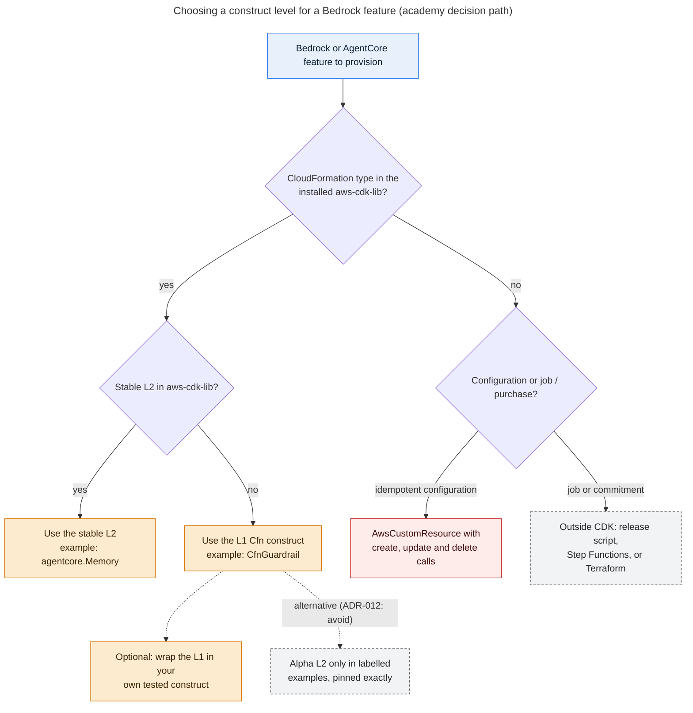

# CDK coverage for Amazon Bedrock

> **Level:** Advanced · **Verified:** 2026-11-15 · **Feature status:** GA (constructs as listed; alpha package experimental) · **Time:** ~30 min

Which Bedrock and AgentCore features can you build with the AWS CDK, at which construct level, and what do you do when there is no CloudFormation resource at all? This chapter maps every Bedrock-related resource type in `aws-cdk-lib` 2.277.0 to its L1, stable L2 and alpha L2 constructs, applies the academy's rule for choosing between them, and shows three synthesized examples.

## Learning objectives

After this chapter you can:

- Find, for any Bedrock or AgentCore feature, the CloudFormation type and the CDK constructs that cover it.
- Choose between an L1, a stable L2 and an experimental alpha L2, and justify the choice.
- Write a guardrail with the L1 `CfnGuardrail` and an AgentCore Memory with the stable `Memory` L2.
- Recognise features with no CloudFormation type and pick a safe alternative.

## Prerequisites

- [L1, L2 and L3 constructs](02-l1-l2-l3-constructs.md)
- [Amazon Bedrock Guardrails](../../01-amazon-bedrock/guardrails/01-guardrails.md) and [AgentCore Memory](../../01-amazon-bedrock/agentcore/06-agentcore-memory.md)
- [Reusable construct libraries](08-construct-libraries.md)

## Concept in plain language

Think of three shelves in a hardware shop. The bottom shelf (**L1**) has every part the manufacturer makes, one for one, with no assembly help. The middle shelf (**stable L2**) has kits with instructions, sensible defaults and a warranty: the parts will still fit next year. The top shelf (**alpha L2**) has prototype kits: handy, but the next delivery may come with different screws.

For Bedrock, the bottom shelf is complete for everything CloudFormation supports. The middle shelf is well stocked for AgentCore and empty for core Bedrock. Some things, such as Provisioned Throughput, are not sold in this shop at all.

## How it really works

The L1 classes are generated from the CloudFormation resource specification bundled with each `aws-cdk-lib` release, so "is there an L1?" and "is there a CloudFormation type?" have the same answer for a given version. The lists below come from the installed library ([generated reference](../../references/cdk-and-cloudformation-bedrock.md)) and were cross-checked against the resource schemas bundled with `cfn-lint` 1.60.1.

> [!IMPORTANT]
> **Status** — AgentCore L2 constructs are **stable** in `aws-cdk-lib/aws-bedrockagentcore`; they graduated in 2.255.0 (2026-05-18), and the Policy submodule in 2.269.0 (2026-09-10). Agent, knowledge base, guardrail, prompt and inference-profile L2s are in the **experimental** `@aws-cdk/aws-bedrock-alpha` (2.277.0-alpha.0 here). The Bedrock L2s in `@cdklabs/generative-ai-cdk-constructs` are deprecated; that repository asks users to migrate to the alpha package.
> Source: [AWS CDK changelog](https://raw.githubusercontent.com/aws/aws-cdk/main/CHANGELOG.v2.md), [generative-ai-cdk-constructs README](https://raw.githubusercontent.com/awslabs/generative-ai-cdk-constructs/main/README.md)

### Amazon Bedrock (`aws-cdk-lib/aws-bedrock`, `aws-bedrockmantle`)

| Feature | CloudFormation type | L1 | Stable L2 | Alpha L2 | Academy choice |
|:--|:--|:--|:-:|:--|:--|
| Guardrail and versions | `AWS::Bedrock::Guardrail`, `GuardrailVersion` | `CfnGuardrail`, `CfnGuardrailVersion` | — | `Guardrail`, `GuardrailVersion` | L1, or your own wrapper ([chapter 8](08-construct-libraries.md)) |
| Automated Reasoning policy | `AutomatedReasoningPolicy`, `AutomatedReasoningPolicyVersion` | `Cfn…` | — | — | L1 |
| Guardrail enforcement, resource policy | `EnforcedGuardrailConfiguration`, `ResourcePolicy` | `Cfn…` | — | — | L1 |
| Knowledge base (Managed and customer-managed) | `KnowledgeBase` | `CfnKnowledgeBase` (has `managedKnowledgeBaseConfiguration`) | — | `KnowledgeBase`: only `KnowledgeBaseType.vector()` with an OpenSearch Serverless store | L1 — the alpha L2 cannot build a Managed Knowledge Base |
| Data source, KB policy, retrieval instruction | `DataSource`, `KnowledgeBasePolicy`, `RetrievalInstruction` | `Cfn…` | — | — | L1 |
| Prompt management | `Prompt`, `PromptVersion` | `Cfn…` | — | `Prompt`, `PromptVersion` | L1 |
| Flows | `Flow`, `FlowAlias`, `FlowVersion` | `Cfn…` | — | — | L1 |
| Application inference profile | `ApplicationInferenceProfile` | `Cfn…` | — | `ApplicationInferenceProfile` | L1 |
| Intelligent prompt router | `IntelligentPromptRouter` | `Cfn…` | — | `PromptRouter` (reference helper) | L1 |
| Agents Classic (maintenance mode) | `Agent`, `AgentAlias` | `Cfn…` | — | `Agent`, `AgentAlias` | Do not start new work; use AgentCore ([ADR-008](../../ARCHITECTURE-DECISIONS.md#adr-008-new-agent-work-targets-agentcore)) |
| Data Automation | `DataAutomationProject`, `Blueprint`, `DataAutomationLibrary` | `Cfn…` | — | — | L1 |
| Session (feature **UNVERIFIED**, see register U14) | `Session` | `CfnSession` | — | — | — |
| Foundation and provisioned models (references, not resources) | — | — | `FoundationModel`, `ProvisionedModel` | `BedrockFoundationModel`, `CrossRegionInferenceProfile` | Stable helpers, or plain ARNs from configuration |
| `bedrock-mantle` Projects | `AWS::BedrockMantle::Project` | `aws_bedrockmantle.CfnProject` | — | — | L1 |

### Amazon Bedrock AgentCore (`aws-cdk-lib/aws-bedrockagentcore`) and AWS Agent Registry

| Feature | CloudFormation types (`AWS::BedrockAgentCore::…`) | Stable L2 | L1 only |
|:--|:--|:--|:--|
| Runtime | `Runtime`, `RuntimeEndpoint` | `Runtime`, `RuntimeEndpoint` | `CapacityProvider` |
| Harness | `Harness`, `HarnessEndpoint` | — | both |
| Gateway | `Gateway`, `GatewayTarget`, `GatewayRule`, `GatewayRateLimit` | `Gateway`, `GatewayTarget` | `GatewayRule`, `GatewayRateLimit` |
| Memory | `Memory` | `Memory` | — |
| Identity | `WorkloadIdentity`, `ApiKeyCredentialProvider`, `OAuth2CredentialProvider` | all three | `ConsentPortal` |
| Built-in tools | `BrowserCustom`, `BrowserProfile`, `CodeInterpreterCustom` | `BrowserCustom`, `CodeInterpreterCustom` | `BrowserProfile` |
| Policy | `Policy`, `PolicyEngine` | both | — |
| Evaluations and Optimization | `Evaluator`, `OnlineEvaluationConfig`, `Dataset`, `ConfigurationBundle` | `Evaluator`, `OnlineEvaluationConfig` | `Dataset`, `ConfigurationBundle` |
| Payments (preview) | `PaymentManager`, `PaymentConnector`, `PaymentCredentialProvider` | — | all three |
| Resource policy | `ResourcePolicy` | — | yes |
| AWS Agent Registry | `AWS::AgentRegistry::Registry`, `RegistryRecord` (module `aws-cdk-lib/aws-agentregistry`) | — | `CfnRegistry`, `CfnRegistryRecord` |

> [!NOTE]
> **Documented fact** — `aws-cdk-lib` 2.277.0 ships `aws-agentregistry` with the L1 classes `CfnRegistry` and `CfnRegistryRecord`, and the `cfn-lint` 1.60.1 schemas include both types. The academy's feature register currently lists Registry as unsupported in CloudFormation and CDK; this has been reported for correction.
> Source: installed `aws-cdk-lib/aws-agentregistry` README and typings (2.277.0)

### Choosing a level (ADR-012)

[ADR-012](../../ARCHITECTURE-DECISIONS.md#adr-012-cdk-in-typescript-stable-constructs-first) says: a stable L2 when one exists, otherwise the L1; the alpha package only in clearly labelled examples. For Bedrock that means **stable L2 for AgentCore, L1 for everything in `aws-bedrock`**. The reasons are concrete:

- An L1 maps one-to-one onto the CloudFormation documentation and gains new properties as soon as the specification does; for example, `CfnKnowledgeBase` already has the Managed Knowledge Base configuration that the alpha L2 lacks.
- The alpha package is versioned `<cdk-version>-alpha.0` and its README states that its APIs "are subject to non-backward compatible changes or removal in any future version". You must pin it exactly and expect edits on every upgrade.
- L1s are stable but not immutable: in 2.268.0 the CDK removed `AWS::Bedrock::ModelInvocationJob` and `AWS::Bedrock::DefaultPromptRouter` from its L1 set to follow the published CloudFormation schemas.

### Gaps: no CloudFormation type

None of these has a resource type in `aws-cdk-lib` 2.277.0 or in the `cfn-lint` 1.60.1 schemas. The Terraform column is from [Terraform coverage for Amazon Bedrock](../terraform/10-terraform-for-bedrock.md).

| Feature | API that does it | Terraform 6.73.0 | Verified alternative in a CDK codebase |
|:--|:--|:--|:--|
| Model invocation logging | `PutModelInvocationLoggingConfiguration` | `aws_bedrock_model_invocation_logging_configuration` | `AwsCustomResource` calling the API on create and update, `DeleteModelInvocationLoggingConfiguration` on delete (example 3) |
| Provisioned Throughput | `CreateProvisionedModelThroughput` | `aws_bedrock_provisioned_model_throughput` | Purchase outside CDK (it is a commitment); reference it with `ProvisionedModel.fromProvisionedModelArn` |
| Batch inference | `CreateModelInvocationJob` | `aws_bedrock_model_invocation_job` | A job, not infrastructure: start it from the application or Step Functions (`CallAwsService`) |
| Model and RAG evaluation | `CreateEvaluationJob` | `aws_bedrock_evaluation_job` | A job: start it from a pipeline step or Step Functions |
| Model customization | `CreateModelCustomizationJob` | `aws_bedrock_custom_model` | Step Functions task `BedrockCreateModelCustomizationJob` |
| Custom Model Import, on-demand deployment | `CreateModelImportJob`, `CreateCustomModelDeployment` | ❌ | API calls from a release script |
| Model access agreements | `PutUseCaseForModelAccess`, `CreateFoundationModelAgreement` | `aws_bedrock_use_case_for_model_access`, `aws_bedrock_foundation_model_agreement` | Account set-up outside CDK |
| Marketplace model endpoints | `CreateMarketplaceModelEndpoint` | ❌ | Outside CDK |
| AgentCore token vault customer managed key | `SetTokenVaultCMK` | `aws_bedrockagentcore_token_vault_cmk` | Outside CDK, or `AwsCustomResource` |

> [!TIP]
> **Academy recommendation** — Use `AwsCustomResource` only for **idempotent, configuration-like** calls with a clean delete (logging configuration, a token vault key). Do not wrap **jobs** (batch, evaluation, customization) or **purchases** (Provisioned Throughput) in custom resources: a stack rollback or deletion would cancel or orphan them, and their lifetimes are not those of a stack. This is our design guidance, not an official AWS reference architecture.

## Architecture diagram



**What this shows** — The decision path behind every example in this academy. The first question is mechanical (look in the installed library); the second is the ADR; the third decides how to handle a gap.

**Walkthrough**

1. Look the feature up in the tables above or in the generated reference.
2. If a stable L2 exists, use it: AgentCore Memory, Gateway and Runtime.
3. Otherwise use the L1, optionally behind your own construct.
4. With no CloudFormation type, decide whether the API call is configuration (custom resource) or a job or commitment (outside the stack).

**Legend** — rectangles: actions · diamonds: decisions · dashed grey: options outside the academy's default path · red: custom resource, which runs code with IAM permissions during deployment.

## Implementation details

- **Model IDs are configuration** ([ADR-010](../../ARCHITECTURE-DECISIONS.md#adr-010-model-and-inference-profile-ids-are-always-configuration)). Pass them in as props or context; the `FoundationModelIdentifier` constants in `aws-cdk-lib` are a list fixed at each release and cannot follow the model catalog.
- **Guardrail versions** are snapshots. `Description` and `GuardrailIdentifier` are create-only properties of `AWS::Bedrock::GuardrailVersion`, so changing the description publishes a new version by replacement. CloudFormation usually creates the replacement first and then deletes the old resource, so the previous version disappears unless you retain it ([update behaviors](https://docs.aws.amazon.com/AWSCloudFormation/latest/UserGuide/using-cfn-updating-stacks-update-behaviors.html)).
- **The `Memory` L2 sets a physical name** derived from the construct path when you omit `memoryName`, and `Name` is create-only, so moving the construct replaces the memory and its stored events.
- **AgentCore service-linked roles**: the AgentCore README notes that the deployment role needs `iam:CreateServiceLinkedRole`; include it in a restricted CloudFormation execution policy ([chapter 6](06-bootstrap-and-deployment.md)).
- **Region support** differs by AgentCore service (16 Regions for Memory, per the [register](../../FEATURE-VERIFICATION.md#b1-agentcore--regions)); synthesis cannot tell you this.

## Example

All three examples are in the [examples project](examples/README.md) and are tested in [`bedrock-stacks.test.ts`](examples/test/bedrock-stacks.test.ts).

> **Code status:** validated (`tsc`, `cdk synth`, `cfn-lint` with no errors) · mock-tested (Jest assertions on all three stacks) · **never deployed**

**1. Guardrail with the L1 `CfnGuardrail`.** Property names mirror `AWS::Bedrock::Guardrail`; enum values come from the `CreateGuardrail` API model.

```ts
// lib/guardrail-l1-stack.ts (excerpt)
this.guardrail = new bedrock.CfnGuardrail(this, 'SupportGuardrail', {
  name: `${this.stackName.slice(0, 40)}-guardrail`,   // 1-50 chars, [0-9a-zA-Z-_]
  blockedInputMessaging: 'Sorry, I cannot help with that request.',
  blockedOutputsMessaging: 'Sorry, I cannot share that response.',
  contentPolicyConfig: {
    filtersConfig: [
      { type: 'HATE', inputStrength: 'HIGH', outputStrength: 'HIGH' },
      // ... SEXUAL, VIOLENCE, INSULTS, MISCONDUCT
      { type: 'PROMPT_ATTACK', inputStrength: 'HIGH', outputStrength: 'NONE' },
    ],
  },
  topicPolicyConfig: {
    topicsConfig: [{
      name: 'InvestmentAdvice', type: 'DENY',
      definition: 'Recommendations to buy, sell or hold specific financial products or securities.',
      examples: ['Which stock should I buy this week?'],
    }],
  },
  sensitiveInformationPolicyConfig: {
    piiEntitiesConfig: [{ type: 'EMAIL', action: 'ANONYMIZE' }, { type: 'PHONE', action: 'ANONYMIZE' }],
  },
  wordPolicyConfig: { managedWordListsConfig: [{ type: 'PROFANITY' }] },
});
this.guardrailVersion = new bedrock.CfnGuardrailVersion(this, 'SupportGuardrailVersion', {
  guardrailIdentifier: this.guardrail.attrGuardrailId,
  description: 'Release 1',            // change this text to publish a new version
});
```

**2. AgentCore Memory with the stable L2.** Compare what you write with what is synthesized: the L2 adds an execution role whose trust policy is limited to this account and memory, generates strategy names and a memory name, and its `grant*` methods scope IAM to the memory ARN.

```ts
// lib/agent-memory-stack.ts (excerpt)
this.memory = new agentcore.Memory(this, 'ConversationMemory', {
  description: 'Short-term events for 30 days plus semantic and summary long-term records',
  expirationDuration: Duration.days(30),           // rendered as EventExpiryDuration: 30
  memoryStrategies: [
    agentcore.MemoryStrategy.usingBuiltInSemantic(),
    agentcore.MemoryStrategy.usingBuiltInSummarization(),
  ],
});
this.memory.grantWrite(this.agentRole);              // bedrock-agentcore:CreateEvent on the memory ARN
this.memory.grantReadLongTermMemory(this.agentRole); // RetrieveMemoryRecords and related reads
```

**3. A gap: model invocation logging with `AwsCustomResource`.** The bucket policy follows the S3 destination set-up in the Bedrock user guide; the custom resource calls the control-plane API.

```ts
// lib/invocation-logging-stack.ts (excerpt)
const put: cr.AwsSdkCall = {
  service: 'bedrock',
  action: 'PutModelInvocationLoggingConfiguration',
  parameters: { loggingConfig: { s3Config: { bucketName: this.bucket.bucketName, keyPrefix: prefix }, textDataDeliveryEnabled: true } },
  physicalResourceId: cr.PhysicalResourceId.of(`bedrock-invocation-logging-${this.region}`),
};
new cr.AwsCustomResource(this, 'ModelInvocationLogging', {
  onCreate: put,
  onUpdate: put,
  onDelete: { service: 'bedrock', action: 'DeleteModelInvocationLoggingConfiguration' },
  policy: cr.AwsCustomResourcePolicy.fromStatements([new iam.PolicyStatement({
    actions: ['bedrock:PutModelInvocationLoggingConfiguration', 'bedrock:DeleteModelInvocationLoggingConfiguration'],
    resources: ['*'],                                // account-level setting: no resource ARN exists
  })]),
  installLatestAwsSdk: false,
});
```

> [!CAUTION]
> **Cost or security hazard** — Invocation logging is an account-and-Region setting that stores full prompts and responses. Deploy it from exactly one stack per account and Region, encrypt and restrict the bucket, and remember that `cdk destroy` turns logging off for the whole account. Model invocation logging covers `bedrock-runtime` calls only; `bedrock-mantle` traffic is not captured ([Model invocation logging](https://docs.aws.amazon.com/bedrock/latest/userguide/model-invocation-logging.html)).

## Common mistakes

> [!WARNING]
> **Common mistake** — Building a Managed Knowledge Base with the alpha `KnowledgeBase` L2. In `2.277.0-alpha.0` it supports only `KnowledgeBaseType.vector()` with OpenSearch Serverless. Use `CfnKnowledgeBase` with `managedKnowledgeBaseConfiguration`.

| Mistake | Symptom | Fix |
|:--|:--|:--|
| Starting new agents on `CfnAgent` or the alpha `Agent` | Accounts without Agents activity in the last 12 months get HTTP 403 on `CreateAgent` (Agents Classic is in maintenance mode) | AgentCore Runtime or harness |
| Unpinned `@aws-cdk/aws-bedrock-alpha` | Builds break on an unrelated CDK upgrade | Pin the exact `-alpha.0` version, or use the L1 |
| Changing a guardrail but not its version | Applications pinned to a version never see the change | Publish a new `CfnGuardrailVersion` (or use the hash pattern from chapter 8) |
| Assuming a feature has an L1 because Terraform has a resource | `cdk synth` succeeds with nothing for it | Check the tables above; plan the gap |
| Two stacks managing invocation logging | They overwrite each other; deleting one disables logging | One owner per account and Region |

## Security considerations

- The `Memory` L2 execution role trusts `bedrock-agentcore.amazonaws.com` with `aws:SourceAccount` and `aws:SourceArn` conditions; when you supply your own role, keep those conditions.
- `AwsCustomResource` runs a Lambda function with the IAM permissions you grant it during every deployment; keep its policy to the exact actions.
- Guardrails protect only the calls that apply them; enforce their use with IAM condition keys or enforced guardrail configuration ([Automated Reasoning checks and guardrail enforcement](../../01-amazon-bedrock/guardrails/02-automated-reasoning-and-enforcement.md)).

## Cost considerations

- Constructs cost nothing; the resources do. Guardrails, AgentCore Memory and model invocations are billed by use; Provisioned Throughput is billed for its term whether used or not ([Provisioned Throughput](../../01-amazon-bedrock/inference/07-provisioned-throughput.md)).
- Invocation logs grow with traffic; set S3 lifecycle rules that match your retention policy.

## Knowledge check

1. A teammate wants to provision Provisioned Throughput in the same CDK stack as the application, using `AwsCustomResource`. What do you advise and why?
2. Why does the academy use `CfnGuardrail` but `agentcore.Memory`?
3. You need an AWS Agent Registry record in a CDK app. What construct do you use?
4. After editing the guardrail's denied topics in `GuardrailL1Stack`, the application still behaves as before. Why?

<details>
<summary>Answers</summary>

1. Keep it outside the stack. It is a commitment with its own term; a stack rollback or `cdk destroy` would call your delete handler and end or orphan it. Reference the purchased model ARN with `ProvisionedModel.fromProvisionedModelArn`.
2. ADR-012: there is no stable L2 for guardrails (only the alpha one), while AgentCore L2s are stable in `aws-cdk-lib`.
3. The L1 `CfnRegistryRecord` from `aws-cdk-lib/aws-agentregistry` (no L2 exists).
4. The application uses a published version; the edit changed only the working draft. Change the version's description (or use a configuration hash) to publish a new version, then point the application at it.

</details>

## Further reading

Official sources opened while writing this chapter:

- [Generated CDK and CloudFormation reference](../../references/cdk-and-cloudformation-bedrock.md) — every type and construct in `aws-cdk-lib` 2.277.0.
- [Amazon Bedrock AgentCore construct library](https://docs.aws.amazon.com/cdk/api/v2/docs/aws-cdk-lib.aws_bedrockagentcore-readme.html) — `Memory`, strategies, grants (read from the installed README).
- [Amazon Bedrock construct library (alpha)](https://docs.aws.amazon.com/cdk/api/v2/docs/aws-bedrock-alpha-readme.html) — experimental guardrail, prompt, agent and knowledge base L2s (read from the installed README).
- [AWS CDK changelog](https://raw.githubusercontent.com/aws/aws-cdk/main/CHANGELOG.v2.md) — AgentCore graduation (2.255.0, 2.269.0) and L1 removals (2.268.0).
- [generative-ai-cdk-constructs README](https://raw.githubusercontent.com/awslabs/generative-ai-cdk-constructs/main/README.md) — deprecation of its Bedrock L2s.
- [Monitor model invocation using CloudWatch Logs and Amazon S3](https://docs.aws.amazon.com/bedrock/latest/userguide/model-invocation-logging.html) — S3 destination bucket policy, logging APIs, `bedrock-runtime` scope.
- [Detect prompt attacks with Amazon Bedrock Guardrails](https://docs.aws.amazon.com/bedrock/latest/userguide/guardrails-prompt-attack.html) — the prompt-attack filter.
- [CreateGuardrail API reference](https://docs.aws.amazon.com/bedrock/latest/APIReference/API_CreateGuardrail.html) — request shape and enum values.
- [Lambda Node.js runtimes](https://docs.aws.amazon.com/lambda/latest/dg/lambda-nodejs.html) — the runtime-included SDK v3 that the custom resource uses.
- [Understand update behaviors of stack resources](https://docs.aws.amazon.com/AWSCloudFormation/latest/UserGuide/using-cfn-updating-stacks-update-behaviors.html) — replacement order.
