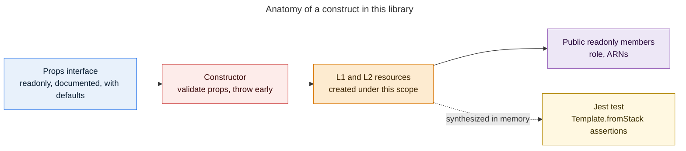

# Reusable CDK construct library

> **Code status:** `tsc` ✅ (TypeScript 7.0.2) · Jest ✅ 7 tests with `aws-cdk-lib/assertions` · `aws-cdk-lib` 2.277.0 · **never synthesized into a deployed stack, never deployed**

A small TypeScript construct library for Bedrock building blocks. It is the CDK counterpart of
the [reusable Terraform modules](../../terraform/modules/README.md): the same ideas, expressed
as constructs, with the same documented IAM behaviour.

[AWS CDK chapters](../README.md) · [Reusable construct libraries](../08-construct-libraries.md) · [Testing CDK applications](../07-testing.md) · [Generated CDK / CloudFormation reference](../../../references/cdk-and-cloudformation-bedrock.md)

## Constructs

| Construct | Level | Purpose | Terraform twin |
|:--|:-:|:--|:--|
| [`BedrockInvocationRole`](lib/bedrock-invocation-role.ts) | L3 (pattern) | Least-privilege role for the inference APIs, scoped to models, Regions, inference profiles and guardrails | [`bedrock-invocation-role`](../../terraform/modules/bedrock-invocation-role/README.md) |

More constructs are added alongside the chapters and projects that need them; each one gets a
row here, a test file, and a twin in the Terraform catalog where one makes sense.

## How a construct here is put together



## Usage

```ts
import * as iam from 'aws-cdk-lib/aws-iam';
import { BedrockInvocationRole } from '@academy/bedrock-constructs';

const invoke = new BedrockInvocationRole(this, 'ChatInvoke', {
  assumedBy: new iam.ServicePrincipal('lambda.amazonaws.com'),
  foundationModelIds: [props.modelId],                 // confirm current IDs in the model catalog
  modelRegions: ['us-east-1', 'us-east-2', 'us-west-2'],
  inferenceProfileArns: [props.inferenceProfileArn],
  restrictToInferenceProfiles: true,
});

// Use the role when you create the function: new lambda.Function(this, 'Handler', { role: invoke.role, ... })
// invoke.foundationModelArns lists every model ARN that was granted.
```

## Construct standard

| Rule | Why |
|:--|:--|
| Props are a `readonly` interface with a doc comment and an `@default` for every optional field | The API documents itself in the editor |
| Validate props in the constructor and `throw` with a clear message | Errors appear at synth time, not during deployment |
| No account IDs, Regions, ARNs or model IDs in code — use `Stack.of(this)` and props | The same construct works in any account, Region and partition |
| Expose what callers need as `public readonly` members | Callers can wire constructs together without reaching inside |
| Prefer a stable L2; fall back to L1 (`Cfn*`); use an alpha module only when labelled | Stable APIs do not break on upgrade |
| Never grant `*` on an Allow statement | Least privilege by construction — there is a test for it |
| Every construct has a Jest test using `Template.fromStack` | Tests run in milliseconds with no credentials |

## Toolchain

The setup mirrors the official `cdk init app --language typescript` template that ships with
CDK CLI 2.1148.1: TypeScript 7, Jest 30 with the `@swc/jest` transform, and
`aws-cdk-lib/testhelpers/jest-autoclean`.

> [!WARNING]
> **Common mistake** — Using `ts-jest` or `ts-node` with TypeScript 7. They depend on the
> JavaScript compiler API that TypeScript 7 no longer exposes, and fail with "does not expose
> the JavaScript compiler API". Use `@swc/jest` and `tsx`, as the current CDK template does.

## Test

```bash
npm ci
npx tsc          # type-check only (noEmit)
npx jest
```

Or from the academy root: `bash scripts/validate-cdk.sh 04-infrastructure-as-code/aws-cdk/construct-library`.

## Versioning

The package follows [Semantic Versioning](https://semver.org/). Removing or renaming a prop,
changing a default so that synthesized resources change, or changing a construct ID (which
changes logical IDs and can replace resources) is a **major** change. See
[Module and construct versioning](../../maintenance/02-module-and-construct-versioning.md).

## Limitations

- Tested by synthesizing templates in memory only. CloudFormation and IAM have not evaluated them.
- The package is `private` and is not published to a registry; projects in this repository
  that want a construct copy or reference it by path.
