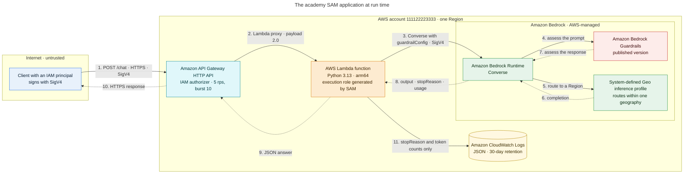
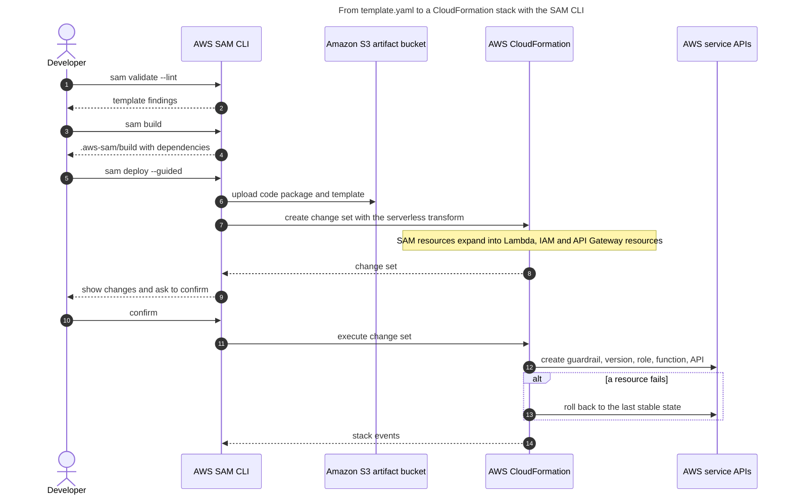

# AWS SAM

> **Level:** Intermediate · **Verified:** 2026-11-15 · **Feature status:** GA · **Time:** ~35 min

The AWS Serverless Application Model (AWS SAM) is a shorthand for serverless resources plus a
CLI that builds, tests and deploys them through AWS CloudFormation. It has no Amazon Bedrock
resource types of its own, yet it is one of the quickest ways to ship a Lambda function that
calls Bedrock, because a SAM template accepts every native `AWS::Bedrock::*` and
`AWS::BedrockAgentCore::*` type.

## Learning objectives

After this chapter you can:

- Explain the two parts of SAM, the template transform and the CLI, and what each does.
- Choose between `sam build`, `sam validate`, `sam local invoke`, `sam sync` and `sam deploy`.
- Write a least-privilege execution role for Converse through an inference profile with a guardrail.
- Declare native Bedrock and AgentCore resources in a SAM template, and know what linting covers.
- Decide when SAM is the right tool and when AWS CDK or Terraform fits better.

## Prerequisites

- [The Converse API](../../01-amazon-bedrock/inference/01-converse-api.md)
- [Cross-Region inference: Geo and Global profiles](../../01-amazon-bedrock/inference/04-cross-region-inference.md)
- [Template anatomy: parameters, mappings, conditions, resources and outputs](../cloudformation/01-template-anatomy.md)
- [Terraform, AWS CDK, CloudFormation, SAM and Pulumi compared](../comparison/02-tool-comparison.md)

## Concept in plain language

In plain CloudFormation, one HTTP endpoint backed by a function needs a function, a role, an
API, a route, an integration, a stage and a permission. In SAM you write the function and one
event line, and the rest is expanded for you, like a form letter. The SAM CLI is the toolbox
around it: it packages code, runs the function on your laptop, and deploys an ordinary
CloudFormation stack.

## How it really works

### Two parts

| Part | What it is | What it does |
|:--|:--|:--|
| SAM template | A CloudFormation template that declares `Transform: AWS::Serverless-2016-10-31` and may use a `Globals` section | Mixes `AWS::Serverless::*` resources with any CloudFormation resource |
| SAM transform | Applied by CloudFormation when a change set is created | Expands each SAM resource into CloudFormation resources whose logical IDs derive from the SAM logical ID |
| SAM CLI | Open-source command-line tool (1.172.1, released 2026-11-11, bundles aws-sam-translator 1.116.0) | Builds, validates, tests locally, syncs and deploys |

Only `Transform` and `Resources` are required. If you also use `AWS::LanguageExtensions`, list it
before the serverless transform.

### Resource types

The SAM specification has fourteen resource types. None is for Bedrock.

| SAM type | Base CloudFormation resource it generates |
|:--|:--|
| `AWS::Serverless::Function` | `AWS::Lambda::Function`, plus a role, event sources and permissions as needed |
| `AWS::Serverless::Api` | `AWS::ApiGateway::RestApi` |
| `AWS::Serverless::HttpApi` | `AWS::ApiGatewayV2::Api` |
| `AWS::Serverless::StateMachine` | `AWS::StepFunctions::StateMachine` |
| `AWS::Serverless::SimpleTable` | `AWS::DynamoDB::Table` |
| `AWS::Serverless::LayerVersion` | `AWS::Lambda::LayerVersion` |
| `AWS::Serverless::Application` | `AWS::CloudFormation::Stack` (a nested application) |
| `AWS::Serverless::CapacityProvider` | `AWS::Lambda::CapacityProvider` (Lambda Managed Instances) |
| `AWS::Serverless::WebFunction` | `AWS::Lambda::WebFunction`, plus a revision and an endpoint |
| `AWS::Serverless::MicrovmImage` | `AWS::Lambda::MicrovmImage` |
| `AWS::Serverless::NetworkConnector` | `AWS::Lambda::NetworkConnector` |
| `AWS::Serverless::Connector` | IAM permissions between two resources |
| `AWS::Serverless::GraphQLApi`, `AWS::Serverless::WebSocketApi` | Not listed in the generated-resources table read on the verification date |

> [!NOTE]
> **Documented fact** — The Lambda documentation now calls the classic function type a
> **Lambda Event Function** ("previously known as Lambda functions"). `AWS::Serverless::Function`
> and `AWS::Lambda::Function` keep their names, so existing templates do not change.
> Source: [AWS::Serverless::Function](https://docs.aws.amazon.com/serverless-application-model/latest/developerguide/sam-resource-function.html)

### Policy templates

`Policies` on a function accepts AWS managed policy names, inline policy documents and **policy
templates**, which take placeholder values such as a table name. The policy template table lists
78 templates; **none covers Amazon Bedrock**. Bedrock permissions are therefore written inline,
as in this chapter's template. A policy template with no placeholders still needs `{}`.

### The CLI commands you use

| Command | What it does | Watch out |
|:--|:--|:--|
| `sam validate --lint` | Validates the template and runs cfn-lint | cfn-lint loads `.cfnlintrc` custom rules, which can run code: never on untrusted projects |
| `sam build` | Installs dependencies and writes `.aws-sam/build` plus a rewritten template | Runs the project's build scripts; review untrusted projects first |
| `sam local invoke` | Runs one function in a local Docker container with an event file | Does not test IAM permissions between cloud resources; real Bedrock calls still need AWS credentials |
| `sam sync` | Fast development loop; `--code` updates code through service APIs, bypassing CloudFormation | Causes stack drift by design; AWS recommends it for development only |
| `sam deploy` | Zips and uploads artifacts to S3, creates a change set, deploys the stack; `--guided` saves `samconfig.toml` | Creates IAM roles with your credentials; review before confirming |
| `sam delete` | Deletes the stack and the uploaded artifacts | Cannot be undone; reads options from `samconfig.toml` |

> [!IMPORTANT]
> **Status** — The `sam sync` reference says the default switches to CloudFormation Express mode
> (`--express`) on 2026-09-01; check `sam sync --help` in your version.
> Source: [sam sync](https://docs.aws.amazon.com/serverless-application-model/latest/developerguide/sam-cli-command-reference-sam-sync.html)

### How a SAM application calls Bedrock

A SAM application calls Bedrock as any Lambda function does: the handler calls `Converse` on
`bedrock-runtime` with the execution role's credentials. SAM only changes where the role's
permissions are written.

| Statement in the template | Action | Resource | Why |
|:--|:--|:--|:--|
| `AllowTheInferenceProfile` | `bedrock:InvokeModel` | The inference profile ARN in the stack's Region | `Converse` is authorised as `bedrock:InvokeModel`; the profile is the `modelId` |
| `AllowTheModelOnlyThroughThatProfile` | `bedrock:InvokeModel` | `foundation-model/<id>` in any Region, with `bedrock:InferenceProfileArn` equal to that profile | A Geo profile routes to several Regions; the condition allows the model only through the profile |
| `UseTheGuardrail` | `bedrock:ApplyGuardrail`, `bedrock:GetGuardrail` | The guardrail ARN | Required to use a guardrail during inference |

No `bedrock:InvokeModelWithResponseStream` is granted, because the handler does not stream.

> [!NOTE]
> **Documented fact** — To run inference with a guardrail, the role needs `bedrock:InvokeModel`
> on the model and `bedrock:ApplyGuardrail` on the guardrail; the inference prerequisites list
> `bedrock:GetGuardrail` as "required to use a guardrail during model invocation".
> Sources: [Guardrail permissions](https://docs.aws.amazon.com/bedrock/latest/userguide/guardrails-permissions.html),
> [Prerequisites for running model inference](https://docs.aws.amazon.com/bedrock/latest/userguide/inference-prereq.html)

### Native Bedrock and AgentCore types in a SAM template

Any CloudFormation type can sit in `Resources` next to SAM resources: the 23 `AWS::Bedrock::*`
and 27 `AWS::BedrockAgentCore::*` types in the
[CDK and CloudFormation reference](../../references/cdk-and-cloudformation-bedrock.md), such as a
guardrail, a knowledge base or an AgentCore Runtime beside the functions that use them. SAM adds
no defaults and generates no IAM for them.

> [!WARNING]
> **Common mistake** — Assuming `sam validate --lint` knows the newest Bedrock properties. It uses
> the cfn-lint version bundled with the SAM CLI: SAM CLI 1.168.0 shipped cfn-lint 1.53.3 and
> rejected the valid `PlatformVersion` property of `AWS::BedrockAgentCore::Runtime` until 1.170.0
> updated cfn-lint. Keep the SAM CLI current, or also run a standalone, newer cfn-lint.
> Source: [aws-sam-cli issue 9339](https://github.com/aws/aws-sam-cli/issues/9339)

### SAM compared with AWS CDK and Terraform for Bedrock

| Need | AWS SAM | AWS CDK | Terraform |
|:--|:--|:--|:--|
| Lambda, APIs, events with little code | Strongest | Good (L2 constructs) | Verbose |
| Bedrock abstractions | None; native types and inline IAM | Stable AgentCore L2s; alpha guardrail and knowledge base L2s | Resource-level |
| Bedrock types CloudFormation lacks (Provisioned Throughput, batch jobs, invocation logging) | Not available | Not available | Available |
| Local function testing | `sam local invoke` | Through the SAM CLI | Through the SAM CLI (beta hook) |
| Loops, conditions, unit tests of infrastructure | Template conditions and `Fn::ForEach` (language extensions) | Full programming language; assertions | `for_each`, `count`; `terraform test` |
| Rollback | Automatic (CloudFormation) | Automatic | Roll forward |

## Architecture diagram



**What this shows** — The deployed application: signed callers only, an inference profile and a
guardrail on every request, and metadata-only logging.

**Walkthrough**

1. The HTTP API's IAM authorizer checks the caller's signature and `execute-api:Invoke` permission.
2. API Gateway invokes the function with the HTTP API 2.0 event.
3. The handler validates the body and calls `Converse` with the profile ID and `guardrailConfig`.
4. The guardrail assesses the input; a block returns the configured message and `stopReason` `guardrail_intervened`.
5. The profile routes the request to a Region in its geography.
6. The model returns a completion.
7. The guardrail assesses the output.
8. The function receives `output`, `stopReason` and `usage`.
9. It returns the answer, a `blockedByGuardrail` flag and token counts.
10. API Gateway returns the response.
11. Logs record `stopReason` and token counts, never text.

| Legend | Meaning |
|:--|:--|
| Solid arrow | Request |
| Dashed arrow | Response |
| Cylinder | Log storage |
| Nested boxes | Internet, account, AWS-managed service |

**Variations** — With a Global profile, the model statement also needs the Region-less
foundation-model ARN and the documented `aws:RequestedRegion` condition; see
[Cross-Region inference](../../01-amazon-bedrock/inference/04-cross-region-inference.md). The
fuller serverless design is [diagram set 22](../../diagrams/mermaid/22-serverless-enterprise-chatbot.md).

### Build and deploy



**What this shows** — SAM's build and deploy steps end in an ordinary CloudFormation change set.

**Walkthrough** — Steps 1–4 run locally. Step 6 uploads to an S3 bucket the CLI creates if
needed. The transform runs at step 7. From step 10 on, it is plain CloudFormation, including
rollback.

## Implementation details

The template is [`template.yaml`](template.yaml) and the handler [`src/app.py`](src/app.py).

1. **Model and profile IDs are parameters** (`FoundationModelId`, `InferenceProfileId`), never
   literals in code ([ADR-010](../../ARCHITECTURE-DECISIONS.md#adr-010-model-and-inference-profile-ids-are-always-configuration)).
   The defaults name Amazon Nova 2 Lite and its `us.` Geo profile as listed in
   [Model providers and the model catalog](../../01-amazon-bedrock/foundation-models/01-model-providers-and-catalog.md);
   confirm both before deploying.
2. **`Globals`** set runtime `python3.13`, `arm64`, 256 MB, 30 s and X-Ray tracing once.
3. **The guardrail is a native type.** Content filters at `HIGH`, a prompt-attack filter on input
   (output strength `NONE`), and e-mail and phone masking.
4. **The guardrail version is a separate resource.** Both of its properties require
   replacement. **Our reading:** editing the guardrail changes neither property, so no new
   version is published; edit the version's `Description` whenever the guardrail changes.
5. **The HTTP API requires SigV4** (`Auth.EnableIamAuthorizer` with `DefaultAuthorizer: AWS_IAM`)
   and throttles at 5 requests per second with a burst of 10, which caps token spend.
6. **The log group is explicit**, with retention and JSON log format, so it is deleted with the stack.
7. **The role is least privilege**: three statements, scoped to one profile, one model through
   that profile, and one guardrail.

> [!TIP]
> **Academy recommendation** — The model statement uses a Region wildcard bounded by the
> `bedrock:InferenceProfileArn` condition. For strict least privilege, list the profile's
> destination Regions instead, as the academy's
> [Terraform module](../terraform/modules/bedrock-invocation-role/README.md) does. This is our
> design guidance, not an official AWS reference architecture.

**What the linter checked.** We broke the template on purpose. cfn-lint 1.60.1 reported an invalid guardrail filter type, a wrong `GetAtt`
attribute in `Outputs`, a reference to a non-existent resource, a non-boolean
`Auth.EnableIamAuthorizer` and a deprecated runtime. It did **not** report a misspelled
`ThrottlingBurstLimit`, an extra property on an `HttpApi` event, or a wrong `GetAtt` attribute
inside the function's environment variables. Linting is necessary, not sufficient.

## Example

> **Code status:** `template.yaml` validated with `cfn-lint` 1.60.1 (no findings, including
> informational checks) and checked with a CloudFormation Guard ownership rule · `src/app.py`
> byte-compiled and mock-tested with botocore Stubber (9 tests, boto3 1.44.3) · `sam` itself was
> not run · **never deployed**

The heart of the handler; the full file adds input validation and error mapping:

```python
request = {
    "modelId": os.environ["MODEL_ID"],
    "system": [{"text": SYSTEM_PROMPT}],
    "messages": [{"role": "user", "content": [{"text": message}]}],
    "inferenceConfig": {"maxTokens": int(os.environ.get("MAX_TOKENS", "512"))},
    "guardrailConfig": {
        "guardrailIdentifier": os.environ["GUARDRAIL_ID"],
        "guardrailVersion": os.environ["GUARDRAIL_VERSION"],
    },
}
result = client.converse(**request)
blocked = result.get("stopReason") == "guardrail_intervened"
```

The least-privilege policy, as written in the template:

```yaml
      Policies:
        - Version: "2012-10-17"
          Statement:
            - Sid: AllowTheInferenceProfile
              Effect: Allow
              Action: bedrock:InvokeModel
              Resource: !Sub "arn:${AWS::Partition}:bedrock:${AWS::Region}:${AWS::AccountId}:inference-profile/${InferenceProfileId}"
            - Sid: AllowTheModelOnlyThroughThatProfile
              Effect: Allow
              Action: bedrock:InvokeModel
              Resource: !Sub "arn:${AWS::Partition}:bedrock:*::foundation-model/${FoundationModelId}"
              Condition:
                StringEquals:
                  bedrock:InferenceProfileArn: !Sub "arn:${AWS::Partition}:bedrock:${AWS::Region}:${AWS::AccountId}:inference-profile/${InferenceProfileId}"
            - Sid: UseTheGuardrail
              Effect: Allow
              Action:
                - bedrock:ApplyGuardrail
                - bedrock:GetGuardrail
              Resource: !GetAtt ChatGuardrail.GuardrailArn
```

To try it in **your own sandbox account** (never run while building this repository):

> [!CAUTION]
> **Cost hazard** — Deploying creates billable resources: API Gateway requests, Lambda duration,
> model tokens, guardrail assessments and log storage. Delete the stack when you finish.

```bash
cd 04-infrastructure-as-code/aws-sam
python -m pytest tests -q                 # unit tests, no AWS calls
sam validate --lint
sam build
sam deploy --guided                       # review the change set before confirming
# ... call the endpoint with a SigV4-signing client ...
sam delete                                # teardown
```

## Common mistakes

| Mistake | Symptom | Fix |
|:--|:--|:--|
| Looking for a Bedrock policy template | `sam build` or deploy fails on an unknown template name | Write inline statements as above |
| Granting `bedrock:*` on `*` | Works, but any model and any Bedrock API is allowed | Scope to the profile, the model through it, and the guardrail |
| Changing the guardrail but not the version | The function keeps using the old published version | Change `ChatGuardrailVersion.Description` in the same commit |
| Using `sam sync` on shared or production stacks | Stack drift; code differs from the template | `sam deploy` through a pipeline; `sam sync` for personal development stacks |
| Public HTTP API with no authorizer | Anyone can spend your tokens | IAM or JWT authorizer, throttling, and AWS WAF where available |
| Logging prompts and completions | Personal data in logs | Log `stopReason` and token counts; use model invocation logging deliberately |

## Security considerations

- The execution role is the boundary between the function and Bedrock; review it on every model change.
- The guardrail does not evaluate tool definitions, tool inputs or tool results in Converse; this
  example uses no tools, but an agentic extension would need other controls
  ([Converse with guardrails](https://docs.aws.amazon.com/bedrock/latest/userguide/guardrails-use-converse-api.html)).
- Most SAM CLI commands run project-defined code or create IAM resources with your credentials:
  review untrusted projects first.
- For enforcement independent of application code, combine this with the `bedrock:GuardrailIdentifier`
  condition key or an enforced guardrail; see
  [Automated Reasoning checks and guardrail enforcement](../../01-amazon-bedrock/guardrails/02-automated-reasoning-and-enforcement.md).

## Cost considerations

- SAM and the SAM CLI are free; you pay for what the stack creates.
- Pricing dimensions here: input and output tokens per request, guardrail assessments of input and
  output (a filter direction you disable is not charged), HTTP API requests, Lambda duration and
  memory, CloudWatch Logs ingestion and storage, and X-Ray traces.
- `MaxTokens` and API throttling are the two cost brakes in the template.

## Knowledge check

1. Why does the template grant `bedrock:InvokeModel` on two different resources?
2. You tightened a guardrail filter and redeployed, but blocked prompts still pass. What happened?
3. A colleague proposes `sam sync --code --watch` against the shared test stack to save time. What
   is the risk?
4. Your team needs Provisioned Throughput for this function's model. Can the SAM template declare it?

<details>
<summary>Answers</summary>

1. Calling through a Geo profile is authorised on the profile and on the foundation model in the
   destination Region; the condition limits the model to that profile.
2. The function uses a published version; changing the guardrail does not create one. Change the
   version resource's `Description` so CloudFormation replaces it and publishes a new version.
3. Code changes bypass CloudFormation, so the stack drifts from the template and from the pipeline.
4. No: there is no CloudFormation type for Provisioned Throughput in the specification used here.
   Create it with Terraform (`aws_bedrock_provisioned_model_throughput`) and pass its ARN as a parameter.

</details>

## Further reading

Official sources opened while writing this chapter:

- [What is AWS SAM?](https://docs.aws.amazon.com/serverless-application-model/latest/developerguide/what-is-sam.html) · [Template anatomy](https://docs.aws.amazon.com/serverless-application-model/latest/developerguide/sam-specification-template-anatomy.html) · [SAM template](https://docs.aws.amazon.com/serverless-application-model/latest/developerguide/sam-specification.html) · [Resources and properties](https://docs.aws.amazon.com/serverless-application-model/latest/developerguide/sam-specification-resources-and-properties.html) · [Generated CloudFormation resources](https://docs.aws.amazon.com/serverless-application-model/latest/developerguide/sam-specification-generated-resources.html)
- [AWS::Serverless::Function](https://docs.aws.amazon.com/serverless-application-model/latest/developerguide/sam-resource-function.html) · [AWS::Serverless::WebFunction](https://docs.aws.amazon.com/serverless-application-model/latest/developerguide/sam-resource-webfunction.html) · [HttpApiAuth](https://docs.aws.amazon.com/serverless-application-model/latest/developerguide/sam-property-httpapi-httpapiauth.html) · [Policy templates](https://docs.aws.amazon.com/serverless-application-model/latest/developerguide/serverless-policy-templates.html)
- SAM CLI: [sam build](https://docs.aws.amazon.com/serverless-application-model/latest/developerguide/using-sam-cli-build.html) · [sam validate](https://docs.aws.amazon.com/serverless-application-model/latest/developerguide/sam-cli-command-reference-sam-validate.html) · [sam local invoke](https://docs.aws.amazon.com/serverless-application-model/latest/developerguide/using-sam-cli-local-invoke.html) · [sam sync introduction](https://docs.aws.amazon.com/serverless-application-model/latest/developerguide/using-sam-cli-sync.html) and [reference](https://docs.aws.amazon.com/serverless-application-model/latest/developerguide/sam-cli-command-reference-sam-sync.html) · [sam deploy](https://docs.aws.amazon.com/serverless-application-model/latest/developerguide/using-sam-cli-deploy.html) · [sam delete](https://docs.aws.amazon.com/serverless-application-model/latest/developerguide/sam-cli-command-reference-sam-delete.html) · [Releases](https://github.com/aws/aws-sam-cli/releases) · [Issue 9339](https://github.com/aws/aws-sam-cli/issues/9339)
- CloudFormation: [AWS::Bedrock::Guardrail](https://docs.aws.amazon.com/AWSCloudFormation/latest/TemplateReference/aws-resource-bedrock-guardrail.html) · [AWS::Bedrock::GuardrailVersion](https://docs.aws.amazon.com/AWSCloudFormation/latest/TemplateReference/aws-resource-bedrock-guardrailversion.html) · [ContentFilterConfig](https://docs.aws.amazon.com/AWSCloudFormation/latest/TemplateReference/aws-properties-bedrock-guardrail-contentfilterconfig.html) · [Dynamic references](https://docs.aws.amazon.com/AWSCloudFormation/latest/UserGuide/dynamic-references.html)
- Amazon Bedrock: [Prerequisites for running model inference](https://docs.aws.amazon.com/bedrock/latest/userguide/inference-prereq.html) · [Guardrail permissions](https://docs.aws.amazon.com/bedrock/latest/userguide/guardrails-permissions.html) · [Enforce a guardrail with IAM](https://docs.aws.amazon.com/bedrock/latest/userguide/guardrails-permissions-id.html) · [Guardrails with the Converse API](https://docs.aws.amazon.com/bedrock/latest/userguide/guardrails-use-converse-api.html)
- [Lambda Event Function runtimes](https://docs.aws.amazon.com/lambda/latest/dg/lambda-runtimes.html) — `python3.13` deprecation forecast 2029-06-30.
