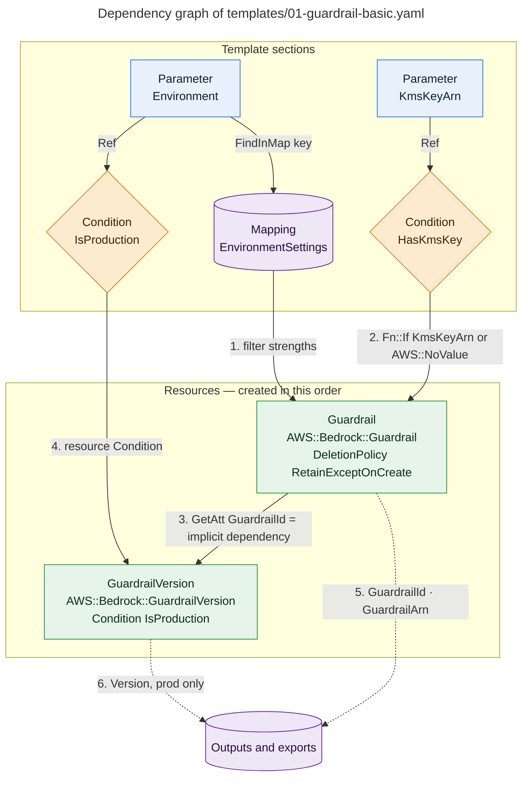

# Template anatomy: parameters, mappings, conditions, resources and outputs

> **Level:** Intermediate · **Verified:** 2026-11-15 · **Feature status:** n/a · **Time:** ~25 min

A CloudFormation template is the contract between you and the AWS CloudFormation service: every
section has a job, and the service reads them in a fixed way. This chapter dissects one small
Amazon Bedrock template, [`templates/01-guardrail-basic.yaml`](templates/01-guardrail-basic.yaml),
so that the AWS CDK output, AWS SAM templates and the rest of this section read like plain text.

## Learning objectives

After this chapter you can:

- Name every top-level section of a template, say which one is required and what each may contain.
- Choose a parameter type and constraint, including the AWS-specific and Systems Manager parameter types.
- Replace hard-coded account IDs and Regions with pseudo parameters.
- Decide when a resource needs `DependsOn`, `DeletionPolicy`, `UpdateReplacePolicy` or `Condition`.
- Explain how CloudFormation turns references into a dependency graph and what that means for create, update and delete order.

## Prerequisites

- [IaC concepts: declarative versus imperative, state, graphs, drift and idempotency](../comparison/01-iac-concepts.md)
- [IAM roles, trust policies and cross-account access](../../00-foundations/security/02-iam-roles-and-trust.md)
- Helpful: [Amazon Bedrock Guardrails](../../01-amazon-bedrock/guardrails/01-guardrails.md), because the example resource is a guardrail.

## Concept in plain language

Think of a template as an order form for a workshop. The **Parameters** are the blanks the
customer fills in. **Rules** are the clerk who refuses an order whose blanks contradict each
other. **Mappings** are the price list pinned to the wall, **Conditions** are the "only if"
boxes, **Resources** are the items to build, and **Outputs** are the receipt. The workshop
(CloudFormation) decides the build order itself by looking at which item needs another one.

The finished order is a **stack**. To change it, you submit a new version of the form and
CloudFormation works out the difference.

## How it really works

### The top-level sections

| Section | Required | What it holds | Intrinsic functions allowed |
|:--|:-:|:--|:--|
| `AWSTemplateFormatVersion` | No | The only valid value is the literal `2010-09-09` | No |
| `Description` | No | A literal string | No |
| `Metadata` | No | Arbitrary data; `AWS::CloudFormation::Interface` orders parameters in the console | No (resource-level `Metadata` is different) |
| `Parameters` | No | Inputs with a type and constraints; at most 200 | No |
| `Rules` | No | Assertions over parameter values, checked before any resource changes | Rule-specific functions only |
| `Mappings` | No | Two-level lookup tables with literal keys; at most 200 | No |
| `Conditions` | No | Named booleans built from `Fn::Equals`, `Fn::And`, `Fn::Or`, `Fn::Not` | Condition functions |
| `Transform` | No | Macros such as `AWS::Serverless` or `AWS::LanguageExtensions` | No |
| `Resources` | **Yes** | Logical ID → `Type`, `Properties` and resource attributes; at most 500 | Yes |
| `Outputs` | No | Values returned after the operation, optionally exported; at most 200 | Yes (not in `Description`) |

> [!NOTE]
> **Documented fact** — `Resources` is the only required section, and a template must not
> repeat a major section: CloudFormation "might accept the template" but its behaviour is
> undefined. YAML templates follow YAML 1.1 without aliases, hash merges or the `binary`,
> `omap`, `pairs`, `set` and `timestamp` tags.
> > The only valid `AWSTemplateFormatVersion` is `2010-09-09`.
> Sources: [Template sections](https://docs.aws.amazon.com/AWSCloudFormation/latest/UserGuide/template-anatomy.html),
> [Format version](https://docs.aws.amazon.com/AWSCloudFormation/latest/UserGuide/format-version-structure.html),
> [Template format](https://docs.aws.amazon.com/AWSCloudFormation/latest/UserGuide/template-formats.html)

### Parameters, types and constraints

A parameter needs only `Type`. A parameter without `Default` must be supplied at create time.

| Type family | Examples | Constraints you can add |
|:--|:--|:--|
| `String` | Names, ARNs, free text | `AllowedValues`, `AllowedPattern` (must match the whole value), `MinLength`, `MaxLength` |
| `Number` | Counts, sizes | `AllowedValues`, `MinValue`, `MaxValue` — `Ref` still returns a **string** |
| `CommaDelimitedList`, `List<Number>` | Lists of IDs | `AllowedPattern` and `AllowedValues` apply to each member |
| AWS-specific | `AWS::EC2::VPC::Id`, `List<AWS::EC2::Subnet::Id>` | Value must exist in the deploying account and Region |
| Systems Manager | `AWS::SSM::Parameter::Value<String>`, `AWS::SSM::Parameter::Name` | You pass the parameter **name**; CloudFormation reads the latest value |

`NoEcho: true` masks the value in describe calls, but not in `Metadata`, `Outputs` or a
resource's `Metadata` attribute, and AWS recommends dynamic references for secrets instead.
For Systems Manager types, CloudFormation reads the value at create, update and change-set
time, validates constraints against the **name** rather than the value, and does not accept
`SecureString`. Sources: [Parameters syntax](https://docs.aws.amazon.com/AWSCloudFormation/latest/UserGuide/parameters-section-structure.html),
[CloudFormation-supplied parameter types](https://docs.aws.amazon.com/AWSCloudFormation/latest/UserGuide/cloudformation-supplied-parameter-types.html).

### Pseudo parameters

| Pseudo parameter | Returns |
|:--|:--|
| `AWS::AccountId` | Account ID of the stack |
| `AWS::Region` | Region of the stack |
| `AWS::Partition` | `aws`, `aws-cn`, `aws-us-gov` … — use it in every ARN you build |
| `AWS::URLSuffix` | Usually `amazonaws.com` |
| `AWS::StackName`, `AWS::StackId` | Stack name and ARN |
| `AWS::NotificationARNs` | List of SNS topic ARNs given at create time |
| `AWS::NoValue` | Removes a property when returned from `Fn::If` |

Source: [Pseudo parameters](https://docs.aws.amazon.com/AWSCloudFormation/latest/UserGuide/pseudo-parameter-reference.html).
Every template in [`templates/`](templates/) uses these instead of literal account IDs or Regions.

### Rules and Metadata, briefly

`Rules` hold an optional `RuleCondition` and one or more `Assertions`, built from
rule-specific functions such as `Fn::Contains`, `Fn::EachMemberEquals` and `Fn::ValueOf`. If
an assertion fails, the stack is not created or updated.
Source: [Rules syntax](https://docs.aws.amazon.com/AWSCloudFormation/latest/UserGuide/rules-section-structure.html).
Template-level `Metadata` never changes what is deployed and is not redacted, so keep
secrets out of it.

### Resource attributes

| Attribute | Effect | Bedrock-flavoured use |
|:--|:--|:--|
| `DependsOn` | Adds an ordering edge that no reference expresses | Enforce a guardrail only after its resource policy exists (template 04) |
| `DeletionPolicy` | `Delete` (default), `Retain`, `RetainExceptOnCreate`, `Snapshot` (supporting types only) when the resource leaves the stack | Keep a guardrail that applications still call |
| `UpdateReplacePolicy` | Same options, applied to the **old** physical resource when an update replaces it | Keep superseded guardrail versions |
| `Condition` | Creates the resource only when the named condition is true | Publish a numbered version in prod only |
| `CreationPolicy`, `UpdatePolicy`, `Metadata` | Signals, rolling updates, resource metadata | Rarely needed for Bedrock types |

`RetainExceptOnCreate` behaves like `Retain`, except that a resource created by an operation
that rolls back is deleted. Retained resources leave CloudFormation's scope and keep costing
money. Sources: [DeletionPolicy](https://docs.aws.amazon.com/AWSCloudFormation/latest/TemplateReference/aws-attribute-deletionpolicy.html),
[UpdateReplacePolicy](https://docs.aws.amazon.com/AWSCloudFormation/latest/TemplateReference/aws-attribute-updatereplacepolicy.html).

### Outputs and exports

An output has a `Value`, an optional literal `Description`, an optional `Condition` and an
optional `Export`. Export names must be unique per account and Region; while another stack
imports an export, you cannot delete the exporting stack or change the exported value.
`Fn::ImportValue` works only in the same account and Region. Since 2026-05-14,
`Fn::GetStackOutput` reads any output across accounts and Regions as a **weak** reference
that nothing protects. CloudFormation does not redact outputs.
Sources: [Outputs syntax](https://docs.aws.amazon.com/AWSCloudFormation/latest/UserGuide/outputs-section-structure.html),
[Fn::GetStackOutput](https://docs.aws.amazon.com/AWSCloudFormation/latest/TemplateReference/intrinsic-function-reference-getstackoutput.html),
[announcement](https://aws.amazon.com/about-aws/whats-new/2026/05/aws-cloudformation-cdk-stack/).

### How CloudFormation builds the dependency graph

> [!NOTE]
> **Documented fact** — A `Ref`, `Fn::GetAtt` or `Fn::Sub` that points at resource B from
> resource A makes B a dependency: B is created first, updated first and deleted last.
> Resources without a dependency are created, updated and deleted in parallel; `DependsOn`
> overrides that parallelism. The longest dependency chain sets the minimum duration, and an
> output that references an attribute makes the operation wait for that value.
> Sources: [DependsOn attribute](https://docs.aws.amazon.com/AWSCloudFormation/latest/TemplateReference/aws-attribute-dependson.html),
> [Stack deployment time](https://docs.aws.amazon.com/AWSCloudFormation/latest/UserGuide/stack-deployment-time.html)

### Quotas worth remembering

| Quota | Value |
|:--|:--|
| Resources / parameters / outputs / mappings per template | 500 / 200 / 200 / 200 |
| Template body in a request / in an Amazon S3 object | 51,200 bytes / 1 MB |
| Dynamic references per template | 60 |

Source: [CloudFormation quotas](https://docs.aws.amazon.com/AWSCloudFormation/latest/UserGuide/cloudformation-limits.html), as of the verification date.

## Architecture diagram

```mermaid
---
title: From template to stack — how CloudFormation processes a template (conceptual)
---
flowchart LR
    subgraph caller["Your workstation or pipeline — your IAM credentials"]
        tmpl[("Template file<br/>01-guardrail-basic.yaml")]:::data
        cli["AWS CLI or console<br/>CreateStack or CreateChangeSet"]:::client
    end
    subgraph account["AWS account 111122223333 · one Region"]
        subgraph cfn["AWS CloudFormation — AWS-managed"]
            xform["Process Transform<br/>macros, if declared"]:::compute
            params["Resolve Parameters<br/>defaults · SSM types"]:::compute
            rules["Evaluate Rules<br/>assertions"]:::security
            conds["Evaluate Conditions<br/>and Mappings"]:::compute
            graphN["Build dependency graph<br/>Ref · GetAtt · Sub · DependsOn"]:::compute
            outs[("Stack record<br/>outputs and exports")]:::data
        end
        role["IAM service role<br/>or caller permissions"]:::security
        bedrock["Amazon Bedrock control plane<br/>CreateGuardrail · CreateGuardrailVersion"]:::ai
    end
    tmpl -- "1. read" --> cli
    cli -- "2. HTTPS · SigV4" --> xform
    xform -- "3." --> params
    params -- "4." --> rules
    rules -- "5. pass" --> conds
    conds -- "6." --> graphN
    graphN -- "7. calls in graph order" --> role
    role -- "8. HTTPS · SigV4" --> bedrock
    bedrock -. "9. IDs and attributes" .-> outs
    outs -. "10. describe-stacks" .-> cli

    classDef client   fill:#E8F1FB,stroke:#1F6FEB,color:#0B1F33
    classDef compute  fill:#FDEBD0,stroke:#D97706,color:#3B2300
    classDef ai       fill:#E6F4EA,stroke:#1E8E3E,color:#0B2E13
    classDef data     fill:#EDE7F6,stroke:#6A1B9A,color:#2A0A3D
    classDef security fill:#FDECEA,stroke:#C62828,color:#3D0A0A
```



**What this shows** — The path from a template file to a stack. Everything in the
CloudFormation box happens in the service; Amazon Bedrock only sees control-plane API calls
made with an IAM service role (or your own permissions). **Our reading:** the order of steps 3
to 6 is a conceptual model assembled from the documentation, not a published internal pipeline.

**Walkthrough**

1. You (or a pipeline) read the template from disk.
2. The CLI calls CloudFormation over HTTPS, signed with your credentials.
3. Macros named in `Transform` expand the template; change sets show this processed template.
4. Parameters are resolved: supplied values, defaults and Systems Manager lookups.
5. Rules are evaluated; a failed assertion stops the operation before any resource changes.
6. Conditions and mappings decide which conditional resources exist.
7. The graph is built from references and `DependsOn`; calls run in that order, in parallel where possible.
8. Each call reaches the Amazon Bedrock control plane under the service role or caller permissions.
9. Physical IDs and attributes are stored in the stack.
10. Outputs become visible once the operation completes.

**Legend** — solid arrow: request or processing step · dashed arrow: data returned ·
cylinder: stored data · red: security control · nested boxes: trust boundaries.

**Variations** — With a change set, steps 3 to 7 happen at change-set creation and
provisioning waits for execution ([Change sets and drift detection](04-change-sets-and-drift.md)).
The full IaC pipeline picture is in [diagram set 26](../../diagrams/mermaid/26-cicd-and-iac-deployment.md).



**What this shows** — Which section feeds which, and the one edge between resources: the
version reads the guardrail's ID, so the guardrail is created first and deleted last.

**Walkthrough**

1. `Fn::FindInMap` picks filter strengths for the chosen environment.
2. `Fn::If` sets `KmsKeyArn` or removes the property with `AWS::NoValue`.
3. `!GetAtt Guardrail.GuardrailId` creates the implicit dependency; no `DependsOn` is needed.
4. In `dev` and `test` the version resource does not exist at all.
5. The guardrail's identifiers are exported for other stacks ([intrinsic functions](02-intrinsic-functions.md) imports them).
6. The conditional output exists only when its condition is true.

**Legend** — blue: inputs · orange diamonds: conditions · green: Amazon Bedrock resources ·
cylinders: data · dashed: values returned after creation.

## Implementation details

Read the template top to bottom; each excerpt below is copied from
[`templates/01-guardrail-basic.yaml`](templates/01-guardrail-basic.yaml).

**1. Constrain inputs where they enter.** The KMS key parameter accepts an empty string or a
full key ARN, so a typo fails at submission rather than half-way through a deployment:

```yaml
  KmsKeyArn:
    Type: String
    Description: Optional customer managed AWS KMS key ARN. Leave empty to use an AWS owned key.
    AllowedPattern: "^$|^arn:aws(-[^:]+)?:kms:[a-z0-9-]+:[0-9]{12}:key/[a-zA-Z0-9-]{36}$"
    Default: ""
```

**2. Use Rules for relationships between parameters.** A single parameter constraint cannot
say "a key is required only in prod"; a rule can:

```yaml
Rules:
  ProductionNeedsCustomerManagedKey:
    RuleCondition: !Equals [!Ref Environment, prod]
    Assertions:
      - Assert: !Not [!Equals [!Ref KmsKeyArn, ""]]
        AssertDescription: A prod guardrail must be encrypted with a customer managed KMS key.
```

**3. Put environment differences in data, not in copies of the template.**

```yaml
Mappings:
  EnvironmentSettings:
    dev:
      HarmfulContentStrength: MEDIUM
      PromptAttackStrength: MEDIUM
```

**4. Make lifecycle decisions explicit.** Applications call a guardrail by ID, so a stack
deletion should not delete it, but a failed first create should not leave litter:

```yaml
  Guardrail:
    Type: AWS::Bedrock::Guardrail
    # Keep the guardrail if the stack is deleted, but clean it up if the very
    # first create fails and rolls back.
    DeletionPolicy: RetainExceptOnCreate
    UpdateReplacePolicy: Retain
```

Every property of `AWS::Bedrock::Guardrail` updates with "No interruption", so
`UpdateReplacePolicy` is a safety net here. `AWS::Bedrock::GuardrailVersion` is different:
both its properties require replacement
([Template Reference](https://docs.aws.amazon.com/AWSCloudFormation/latest/TemplateReference/aws-resource-bedrock-guardrailversion.html)).

**5. Use the documented return values.** The Template Reference page for
`AWS::Bedrock::Guardrail` documents `Fn::GetAtt` attributes (`GuardrailId`, `GuardrailArn`,
`Version` …) but no `Ref` value, so the templates always use `!GetAtt`
([Template Reference](https://docs.aws.amazon.com/AWSCloudFormation/latest/TemplateReference/aws-resource-bedrock-guardrail.html)).

> [!TIP]
> **Academy recommendation** — Treat `cfn-lint` as the compiler for templates. It checks
> property names and patterns against the resource schemas offline, which is how every
> template in this section was validated. This is our guidance, not an official AWS
> reference architecture.

## Example

> **Code status:** [`templates/01-guardrail-basic.yaml`](templates/01-guardrail-basic.yaml) validated with `cfn-lint` 1.60.1 (no errors, warnings or informational findings) · **never deployed**

To try it in your own sandbox account (a guardrail costs nothing until it evaluates content,
but check [Amazon Bedrock pricing](https://aws.amazon.com/bedrock/pricing/) first):

```bash
cfn-lint templates/01-guardrail-basic.yaml          # offline check
aws cloudformation deploy \
  --template-file templates/01-guardrail-basic.yaml \
  --stack-name academy-guardrail-dev \
  --parameter-overrides Environment=dev
# Teardown: the guardrail has DeletionPolicy RetainExceptOnCreate, so delete it too.
aws cloudformation describe-stacks --stack-name academy-guardrail-dev \
  --query "Stacks[0].Outputs[?OutputKey=='GuardrailId'].OutputValue" --output text
aws cloudformation delete-stack --stack-name academy-guardrail-dev
aws bedrock delete-guardrail --guardrail-identifier <GuardrailId from above>
```

## Common mistakes

> [!WARNING]
> **Common mistake** — Expecting `Ref` on a `Number` parameter to give a number. CloudFormation
> validates the input as a number, but `Ref` returns it as a string, so compare it as a string
> in `Fn::Equals`.

| Mistake | Symptom | Fix |
|:--|:--|:--|
| Hard-coding `arn:aws:` in ARNs | Template fails in AWS GovCloud (US) or China Regions | Build ARNs with `${AWS::Partition}` |
| A second `Resources:` block in one file | Undefined behaviour, missing resources | One instance of each section; let `cfn-lint` catch it |
| Output `Description` built with `!Sub` | Validation error | Descriptions of outputs are literal strings |
| Removing an output that another stack imports | Update fails | Remove the `Fn::ImportValue` first |
| Assuming `DeletionPolicy` protects a replaced resource | Old resource deleted on replacement | Set `UpdateReplacePolicy` as well |
| Adding `DependsOn` everywhere "to be safe" | Slower stacks; possible circular dependencies | Rely on references; add `DependsOn` only for ordering no reference expresses |

## Security considerations

- Never put secrets in `Default`, `Metadata` or `Outputs`; `NoEcho` does not mask those places.
  Use dynamic references ([intrinsic functions](02-intrinsic-functions.md)).
- Deploy through an IAM service role scoped to the resource types in the template, so the
  template's power is not the caller's power ([IAM roles and trust](../../00-foundations/security/02-iam-roles-and-trust.md)).
- Encrypt prod guardrails with a customer managed key; the `Rules` block above enforces it.
- Exported values are readable by any principal allowed to call `ListExports` in that account and Region.

## Cost considerations

- CloudFormation adds no charge for resource types in the `AWS::*` namespace; third-party
  resource types and custom hooks are billed per handler operation
  ([CloudFormation pricing](https://aws.amazon.com/cloudformation/pricing/)).
- Guardrail charges are incurred only for the policies the guardrail evaluates, per text unit
  ([How Guardrails works](https://docs.aws.amazon.com/bedrock/latest/userguide/guardrails-how.html),
  [Amazon Bedrock pricing](https://aws.amazon.com/bedrock/pricing/)).
- Retained resources outlive the stack; put their cleanup in your teardown runbook.

## Knowledge check

1. Which single section must every template contain, and in which section may you use only rule-specific functions?
2. You need a template that deploys in `us-east-1` and in an AWS GovCloud (US) Region without edits. Which two pseudo parameters must appear in every ARN you build?
3. In template 01, what happens to `GuardrailVersion` and to the `GuardrailVersionNumber` output if you deploy with `Environment=test`?
4. A colleague adds `DependsOn: Guardrail` to `GuardrailVersion`. What changes?
5. What would happen if the first creation of the stack failed after the guardrail was created, and what if the stack were later deleted?

<details>
<summary>Answers</summary>

1. `Resources`. `Rules`; `Mappings` and `Parameters` accept no intrinsic functions at all.
2. `AWS::Partition` and `AWS::Region` (plus `AWS::AccountId` where the ARN contains an account).
3. Neither exists: the resource and the output carry `Condition: IsProduction`, which is false.
4. Nothing: `!GetAtt Guardrail.GuardrailId` already creates the same dependency.
5. On a failed first create the guardrail is deleted (`RetainExceptOnCreate`); on a later stack deletion it is retained and must be deleted by hand.

</details>

## Further reading

Official sources opened while writing this chapter:

- [CloudFormation template sections](https://docs.aws.amazon.com/AWSCloudFormation/latest/UserGuide/template-anatomy.html) and [template format](https://docs.aws.amazon.com/AWSCloudFormation/latest/UserGuide/template-formats.html) — the sections and YAML limits.
- [Parameters syntax](https://docs.aws.amazon.com/AWSCloudFormation/latest/UserGuide/parameters-section-structure.html) and [CloudFormation-supplied parameter types](https://docs.aws.amazon.com/AWSCloudFormation/latest/UserGuide/cloudformation-supplied-parameter-types.html) — types, constraints, `NoEcho`, Systems Manager types.
- [Pseudo parameters](https://docs.aws.amazon.com/AWSCloudFormation/latest/UserGuide/pseudo-parameter-reference.html) — the full list.
- [Rules syntax](https://docs.aws.amazon.com/AWSCloudFormation/latest/UserGuide/rules-section-structure.html) and [Mappings syntax](https://docs.aws.amazon.com/AWSCloudFormation/latest/UserGuide/mappings-section-structure.html).
- [Resources syntax](https://docs.aws.amazon.com/AWSCloudFormation/latest/UserGuide/resources-section-structure.html), [DependsOn](https://docs.aws.amazon.com/AWSCloudFormation/latest/TemplateReference/aws-attribute-dependson.html), [DeletionPolicy](https://docs.aws.amazon.com/AWSCloudFormation/latest/TemplateReference/aws-attribute-deletionpolicy.html), [UpdateReplacePolicy](https://docs.aws.amazon.com/AWSCloudFormation/latest/TemplateReference/aws-attribute-updatereplacepolicy.html).
- [Outputs syntax](https://docs.aws.amazon.com/AWSCloudFormation/latest/UserGuide/outputs-section-structure.html) and [Fn::GetStackOutput](https://docs.aws.amazon.com/AWSCloudFormation/latest/TemplateReference/intrinsic-function-reference-getstackoutput.html).
- [Understand stack deployment time](https://docs.aws.amazon.com/AWSCloudFormation/latest/UserGuide/stack-deployment-time.html) — how the graph drives duration.
- [CloudFormation quotas](https://docs.aws.amazon.com/AWSCloudFormation/latest/UserGuide/cloudformation-limits.html).
- [AWS::Bedrock::Guardrail](https://docs.aws.amazon.com/AWSCloudFormation/latest/TemplateReference/aws-resource-bedrock-guardrail.html) and [AWS::Bedrock::GuardrailVersion](https://docs.aws.amazon.com/AWSCloudFormation/latest/TemplateReference/aws-resource-bedrock-guardrailversion.html) — properties, update behaviour and return values.
- [CloudFormation pricing](https://aws.amazon.com/cloudformation/pricing/), [How Amazon Bedrock Guardrails works](https://docs.aws.amazon.com/bedrock/latest/userguide/guardrails-how.html), [Amazon Bedrock pricing](https://aws.amazon.com/bedrock/pricing/).
