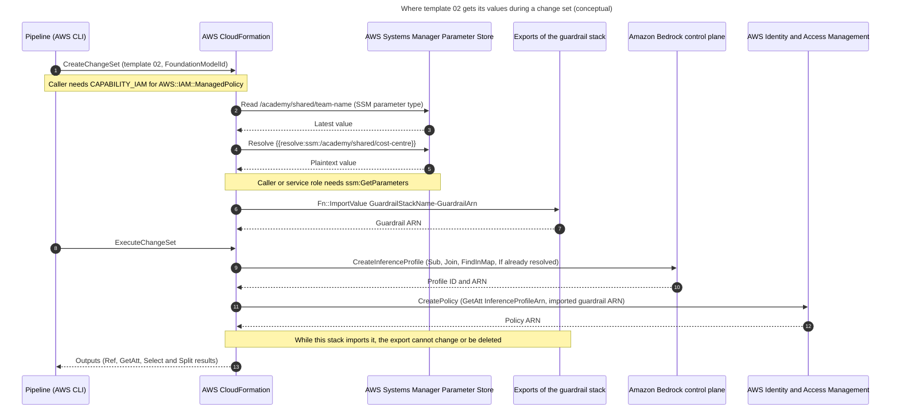

# Intrinsic functions

> **Level:** Intermediate · **Verified:** 2026-11-15 · **Feature status:** n/a · **Time:** ~25 min

Intrinsic functions are how a static template says "the ARN of the thing I am about to
create" or "the value stored somewhere else". This chapter covers the functions you will meet
in every Bedrock template, when CloudFormation resolves each one, where each is allowed, and
how to pull values from Parameter Store and Secrets Manager without leaking them. The worked
example is [`templates/02-intrinsic-functions.yaml`](templates/02-intrinsic-functions.yaml).

## Learning objectives

After this chapter you can:

- Use `Ref`, `Fn::GetAtt`, `Fn::Sub`, `Fn::Join`, `Fn::If`, `Fn::FindInMap`, `Fn::Select`, `Fn::Split` and `Fn::ImportValue` correctly.
- Explain when each function is resolved and in which template sections it may appear.
- Choose between `Fn::ImportValue`, `Fn::GetStackOutput`, a parameter and a dynamic reference.
- Reference Parameter Store and Secrets Manager values without exposing secrets.
- Decide whether `Fn::ForEach` and the `AWS::LanguageExtensions` transform are worth it.

## Prerequisites

- [Template anatomy](01-template-anatomy.md)
- Helpful: [AWS KMS, Secrets Manager and Parameter Store](../../02-related-aws-services/security/02-kms-secrets-manager-parameter-store.md) and [Application inference profiles](../../01-amazon-bedrock/inference/05-application-inference-profiles.md)

## Concept in plain language

An intrinsic function is a mail-merge field. You write `Dear ${Name}` once and the printer
fills in each name when the letter is produced. In a template the printer is CloudFormation:
it fills the fields while it creates or updates the stack, using parameter values, facts about
the account and Region, and the IDs of resources it has just created. Your laptop never sees
the final values, which is why a template can describe resources that do not exist yet.

## How it really works

> [!NOTE]
> **Documented fact** — Intrinsic functions may be used only in resource properties, outputs,
> metadata attributes and update policy attributes, and to create resources conditionally.
> `Parameters`, `Mappings` and the template format version take literals only.
> Sources: [Intrinsic function reference](https://docs.aws.amazon.com/AWSCloudFormation/latest/TemplateReference/intrinsic-function-reference.html),
> [Mappings syntax](https://docs.aws.amazon.com/AWSCloudFormation/latest/UserGuide/mappings-section-structure.html)

### The common functions compared

The "resolved" column is **our classification**, drawn from the cited pages: *stack
operation* means CloudFormation resolves it while creating, updating or creating a change set;
*after a resource exists* means the value needs a provisioned resource, which also creates a
dependency.

| Function | Returns | Resolved | Main restrictions | Source |
|:--|:--|:--|:--|:--|
| `Ref` | Parameter value, pseudo parameter, or a resource's identifier (type-specific) | Stack operation; after a resource exists for resources | What a resource returns differs by type — check its Template Reference page | [Ref](https://docs.aws.amazon.com/AWSCloudFormation/latest/TemplateReference/intrinsic-function-reference-ref.html) |
| `Fn::GetAtt` | A named attribute of a resource | After the resource exists | Logical ID and attribute are literals unless you add `AWS::LanguageExtensions` | [Fn::GetAtt](https://docs.aws.amazon.com/AWSCloudFormation/latest/TemplateReference/intrinsic-function-reference-getatt.html) |
| `Fn::Sub` | A string with `${…}` replaced | Stack operation; `${Resource.Attr}` after the resource exists | The string itself cannot contain functions; values in the variable map can. `${!Literal}` escapes | [Fn::Sub](https://docs.aws.amazon.com/AWSCloudFormation/latest/TemplateReference/intrinsic-function-reference-sub.html) |
| `Fn::Join` | Values concatenated with a delimiter | Same as its arguments | The delimiter must be a literal; the page points to `Fn::Sub` for similar results | [Fn::Join](https://docs.aws.amazon.com/AWSCloudFormation/latest/TemplateReference/intrinsic-function-reference-join.html) |
| `Fn::If` (+ `Fn::Equals`, `And`, `Or`, `Not`) | One of two values; `AWS::NoValue` removes the property | Stack operation | Conditions are defined in `Conditions`; `Fn::If` is allowed in resource properties, outputs, `Metadata` and `UpdatePolicy` attributes | [Condition functions](https://docs.aws.amazon.com/AWSCloudFormation/latest/TemplateReference/intrinsic-function-reference-conditions.html) |
| `Fn::FindInMap` | A value from a two-level mapping | Stack operation | Without the transform only `Ref` and `Fn::FindInMap` may be nested; `DefaultValue` no longer needs the transform | [Fn::FindInMap](https://docs.aws.amazon.com/AWSCloudFormation/latest/TemplateReference/intrinsic-function-reference-findinmap.html), [enhancements](https://docs.aws.amazon.com/AWSCloudFormation/latest/TemplateReference/intrinsic-function-reference-findinmap-enhancements.html) |
| `Fn::Split` + `Fn::Select` | A list, then one element of it | Same as their arguments | The `Fn::Split` delimiter must be a literal | [Fn::Split](https://docs.aws.amazon.com/AWSCloudFormation/latest/TemplateReference/intrinsic-function-reference-split.html) |
| `Fn::ImportValue` | An export of another stack | Stack operation | Same account and Region; cannot depend on a resource; exporting stack is locked while imported | [Fn::ImportValue](https://docs.aws.amazon.com/AWSCloudFormation/latest/TemplateReference/intrinsic-function-reference-importvalue.html) |
| `Fn::GetStackOutput` | Any output of another stack, across accounts and Regions | Stack operation | Weak reference; not allowed directly as an `Outputs` value, inside `Fn::Sub` variable maps, `Fn::Base64`, `Fn::Equals` or `Fn::ImportValue`; no cross-partition | [Fn::GetStackOutput](https://docs.aws.amazon.com/AWSCloudFormation/latest/TemplateReference/intrinsic-function-reference-getstackoutput.html) |
| `Fn::ForEach`, `Fn::Length`, `Fn::ToJsonString` | Expanded template fragments; list length; JSON string | When the transform processes the template | Need `Transform: AWS::LanguageExtensions`; only in `Resources`, `Conditions`, `Outputs`; no YAML short form for `Fn::Length` and `Fn::ToJsonString` | [Fn::ForEach](https://docs.aws.amazon.com/AWSCloudFormation/latest/TemplateReference/intrinsic-function-reference-foreach.html), [transform](https://docs.aws.amazon.com/AWSCloudFormation/latest/TemplateReference/transform-aws-languageextensions.html) |

> [!IMPORTANT]
> **Status** — `Fn::GetStackOutput` was announced on 2026-05-14 and is newer than many
> tutorials. Its own page lists the template positions it does not support yet.
> Source: [What's New, 2026-05-14](https://aws.amazon.com/about-aws/whats-new/2026/05/aws-cloudformation-cdk-stack/)

### Dynamic references

A dynamic reference is a string, `{{resolve:service:…}}`, that CloudFormation replaces with a
value from another service during stack and change-set operations.

| Pattern | Reads | Notes |
|:--|:--|:--|
| `{{resolve:ssm:name}}` or `{{resolve:ssm:name:version}}` | Parameter Store `String`/`StringList` | Without a version, the latest value at each create or update. A version is required inside `Parameters`. No cross-account use and no drift detection |
| `{{resolve:ssm-secure:name:version}}` | Parameter Store `SecureString` | Only in properties listed as supporting it (for example `AWS::RDS::DBInstance` `MasterUserPassword`); never returned by any API |
| `{{resolve:secretsmanager:secret-id:SecretString:json-key:version-stage:version-id}}` | Secrets Manager | Prefer versionless references so rotation works; another account's secret needs the full ARN |

General limits: at most 60 per template; secure values are not supported in custom resources;
none in `AWS::CloudFormation::Init` metadata or EC2 `UserData`; never inside a property that
forms the resource's primary identifier, because the plaintext may appear in the resource ID;
and a transform such as `AWS::Serverless` receives the literal reference string. Changing a
secret does **not** update the stack — CloudFormation reads it again only when it updates the
resource that contains the reference.
Sources: [Dynamic references](https://docs.aws.amazon.com/AWSCloudFormation/latest/UserGuide/dynamic-references.html),
[ssm](https://docs.aws.amazon.com/AWSCloudFormation/latest/UserGuide/dynamic-references-ssm.html),
[ssm-secure](https://docs.aws.amazon.com/AWSCloudFormation/latest/UserGuide/dynamic-references-ssm-secure-strings.html),
[secretsmanager](https://docs.aws.amazon.com/AWSCloudFormation/latest/UserGuide/dynamic-references-secretsmanager.html).

## Architecture diagram



**What this shows** — Which values CloudFormation fetches before it touches Amazon Bedrock,
and which it can only know afterwards. Step 11 can run only after step 10 returns, because the
policy needs the profile's ARN — the implicit dependency created by `Fn::GetAtt`. **Our
reading:** the documentation states that Parameter Store values are fixed when the change set
is created; the exact moment other stack-time functions resolve is not published.

**Walkthrough**

1. The pipeline asks for a change set; nothing is provisioned yet.
2. The `AWS::SSM::Parameter::Value<String>` parameter is resolved by name.
3. Its latest value is recorded in the change set; executing later uses this value.
4. The `ssm` dynamic reference in a tag is resolved.
5. The value to use is fixed for this change set.
6. `Fn::ImportValue` reads the export created by template 01.
7. The guardrail ARN is returned.
8. You review and execute the change set.
9. CloudFormation creates the inference profile with every stack-time function already resolved.
10. The profile's ID (`Ref`) and ARN (`Fn::GetAtt`) come back.
11. The managed policy is created with the profile ARN and the imported guardrail ARN.
12. IAM returns the policy ARN. From now on the guardrail stack cannot change or delete the export.
13. Outputs are available once the operation completes.

**Legend** — solid arrow: request · dashed arrow: response · `Note`: permission or capability needed.

**Variations** — With `Fn::GetStackOutput` instead of `Fn::ImportValue`, step 6 can read a
stack in another account or Region through a role you name, and nothing locks the producer.

## Implementation details

Excerpts from [`templates/02-intrinsic-functions.yaml`](templates/02-intrinsic-functions.yaml).

**`Fn::Sub` in both forms.** The one-string form substitutes parameters, pseudo parameters and
resource attributes; the list form adds local variables:

```yaml
      Description: !Sub
        - "Cost tracking for ${App} in ${Env}"
        - App: !Ref ApplicationName
          Env: !Ref Environment
      ModelSource:
        # Fn::Sub with pseudo parameters: no hard-coded partition or Region.
        CopyFrom: !Sub "arn:${AWS::Partition}:bedrock:${AWS::Region}::foundation-model/${FoundationModelId}"
```

**`Fn::Select` with `Fn::Split`** turns `provider.model-name` into `provider`:

```yaml
        - Key: ModelProvider
          Value: !Select [0, !Split [".", !Ref FoundationModelId]]
```

**`Fn::If` with `AWS::NoValue`** removes a whole list element outside prod:

```yaml
        - !If
          - IsProduction
          - Key: DataClassification
            Value: confidential
          - !Ref AWS::NoValue
```

**`Fn::ImportValue` must use the long form around a short-form `!Sub`:**

```yaml
            Resource:
              Fn::ImportValue: !Sub "${GuardrailStackName}-GuardrailArn"
```

**`Ref` versus `Fn::GetAtt`.** For `AWS::Bedrock::ApplicationInferenceProfile`, `Ref` returns
the profile **ID**, while the ARN that `Converse` and IAM need is `!GetAtt
InferenceProfile.InferenceProfileArn`
([Template Reference](https://docs.aws.amazon.com/AWSCloudFormation/latest/TemplateReference/aws-resource-bedrock-applicationinferenceprofile.html)).
`AWS::Bedrock::Prompt` returns its **ARN** from `Ref`
([Template Reference](https://docs.aws.amazon.com/AWSCloudFormation/latest/TemplateReference/aws-resource-bedrock-prompt.html)),
and `AWS::Bedrock::Guardrail` documents no `Ref` value at all. Never assume — read the
"Return values" section of each type.

**`Fn::ForEach`.** The transform expands loops before provisioning, so one block can declare a
profile per team. Quotas apply to the expanded template.

> **Code status:** validated with `cfn-lint` 1.60.1 as a standalone template in a scratch directory · **never deployed**

```yaml
AWSTemplateFormatVersion: "2010-09-09"
Transform: AWS::LanguageExtensions
Parameters:
  Teams:
    Type: CommaDelimitedList
    Default: search,support,marketing
  FoundationModelId:
    Type: String
    AllowedPattern: "^[a-z0-9-]+\\.[a-z0-9.:-]+$"
Resources:
  Fn::ForEach::TeamProfiles:
    - Team
    - !Ref Teams
    - Profile${Team}:
        Type: AWS::Bedrock::ApplicationInferenceProfile
        Properties:
          InferenceProfileName: !Sub "${Team}-profile"
          ModelSource:
            CopyFrom: !Sub "arn:${AWS::Partition}:bedrock:${AWS::Region}::foundation-model/${FoundationModelId}"
          Tags:
            - Key: Team
              Value: !Ref Team
Outputs:
  ProfileCount:
    Value:
      Fn::Length: !Ref Teams
```

> [!WARNING]
> **Common mistake** — Updating a stack that uses `AWS::LanguageExtensions` with "Use existing
> template" (`--use-previous-template`). The transform has already turned parameters into
> literals, so new parameter values are ignored. Always resubmit the original template.
> Source: [AWS::LanguageExtensions transform](https://docs.aws.amazon.com/AWSCloudFormation/latest/TemplateReference/transform-aws-languageextensions.html)

> [!TIP]
> **Academy recommendation** — Reach for `Fn::ForEach` only when the repetition is real and
> the reviewers read the processed template in the change set. Two or three copies are easier
> to review than a loop, and a StackSet or the AWS CDK may be the better tool for scale. This is
> our guidance, not an official AWS reference architecture.

## Example

> **Code status:** [`templates/02-intrinsic-functions.yaml`](templates/02-intrinsic-functions.yaml) validated with `cfn-lint` 1.60.1 (no errors, warnings or informational findings) · **never deployed**

The template needs a stack from template 01 and two Parameter Store values. Check
Systems Manager pricing for the parameters; the profile itself has no separate charge listed
(see [Application inference profiles](../../01-amazon-bedrock/inference/05-application-inference-profiles.md)),
and tokens are billed only when you invoke through it.

```bash
aws ssm put-parameter --name /academy/shared/team-name --type String --value platform
aws ssm put-parameter --name /academy/shared/cost-centre --type String --value cc-1234
aws cloudformation deploy --template-file templates/02-intrinsic-functions.yaml \
  --stack-name academy-intrinsics-dev --capabilities CAPABILITY_IAM \
  --parameter-overrides FoundationModelId=<model ID from the model catalog> \
                        GuardrailStackName=academy-guardrail-dev
# Teardown (delete this stack before the guardrail stack: it imports an export)
aws cloudformation delete-stack --stack-name academy-intrinsics-dev
aws ssm delete-parameters --names /academy/shared/team-name /academy/shared/cost-centre
```

## Common mistakes

| Mistake | Symptom | Fix |
|:--|:--|:--|
| `!ImportValue !Sub '…'` (two short forms) | Template parse error | `Fn::ImportValue: !Sub '…'` |
| `Ref` on a guardrail or profile where an ARN is needed | IAM policy or `modelId` rejected | Use the documented `Fn::GetAtt` attribute |
| `${AWS::Region}` inside a `Mappings` value | Not substituted: mappings accept no pseudo parameters or functions | Substitute in the resource, not in the mapping |
| Secret in a tag, description or output via a dynamic reference | Secret visible to anyone with describe access | Use dynamic references only in properties built for secrets |
| Expecting a rotated secret to reach the resource | Old password still in use | Update the resource, or let the service read the secret itself |
| `ssm` reference without a version in `Parameters` | Validation error | Use an SSM parameter type, or add `:version` |
| Deleting the exporting stack first | `DELETE_FAILED`, export in use | Delete importers first, or switch to `Fn::GetStackOutput` knowingly |

## Security considerations

- Resolved values of SSM parameter types appear in `describe-stacks` and `describe-change-set`;
  treat plaintext `ssm` references as equally visible and keep them for non-secret configuration.
- `ssm-secure` and `secretsmanager` values are not persisted by CloudFormation, but the target
  service may echo them; review where each property ends up.
- The identity that runs the operation needs `ssm:GetParameters` or `secretsmanager:GetSecretValue`
  on exactly those names; scope them by path.
- `Fn::GetStackOutput` with a `RoleArn` creates a cross-account trust; restrict that role to
  `cloudformation:DescribeStacks` on the producer stack ARN, as the function's page recommends.

## Cost considerations

- Functions and dynamic references add no CloudFormation charge for `AWS::*` types
  ([CloudFormation pricing](https://aws.amazon.com/cloudformation/pricing/)).
- The cost-relevant resource here is the application inference profile: it is how you attribute
  token spend per application through tags. Pricing dimensions are in
  [Application inference profiles](../../01-amazon-bedrock/inference/05-application-inference-profiles.md);
  account-wide cost practice is in [Pricing model and cost drivers](../../08-cost-performance-and-reliability/01-pricing-model-and-cost-drivers.md).

## Knowledge check

1. Why does `!GetAtt InferenceProfile.InferenceProfileArn` in the IAM policy make CloudFormation create the profile first?
2. Your template must read the guardrail ARN from a stack in the security account. Which function do you use, and what do you lose compared with `Fn::ImportValue`?
3. A team rotates the API key in Secrets Manager. The template references it with a versionless `secretsmanager` reference. What does the resource use after rotation if nobody updates the stack?
4. What would happen if you wrote `!FindInMap [EnvironmentConfig, !Select [0, !Ref Envs], CostTier]` without the transform?

<details>
<summary>Answers</summary>

1. `Fn::GetAtt` on a resource is an implicit dependency, and the attribute exists only after creation.
2. `Fn::GetStackOutput` with `RoleArn` (and `Region` if needed). It is a weak reference: the producer stack is not protected and changes are not propagated.
3. The old value: CloudFormation reads the secret only when it updates the resource that contains the reference.
4. It is rejected: standard `Fn::FindInMap` accepts only `Ref` and `Fn::FindInMap` as nested functions; `Fn::Select` needs `AWS::LanguageExtensions`.

</details>

## Further reading

Official sources opened while writing this chapter:

- [Intrinsic function reference](https://docs.aws.amazon.com/AWSCloudFormation/latest/TemplateReference/intrinsic-function-reference.html) — where functions may be used.
- [Ref](https://docs.aws.amazon.com/AWSCloudFormation/latest/TemplateReference/intrinsic-function-reference-ref.html), [Fn::Join](https://docs.aws.amazon.com/AWSCloudFormation/latest/TemplateReference/intrinsic-function-reference-join.html), [Fn::GetAtt](https://docs.aws.amazon.com/AWSCloudFormation/latest/TemplateReference/intrinsic-function-reference-getatt.html), [Fn::Sub](https://docs.aws.amazon.com/AWSCloudFormation/latest/TemplateReference/intrinsic-function-reference-sub.html), [Fn::Split](https://docs.aws.amazon.com/AWSCloudFormation/latest/TemplateReference/intrinsic-function-reference-split.html), [Fn::FindInMap](https://docs.aws.amazon.com/AWSCloudFormation/latest/TemplateReference/intrinsic-function-reference-findinmap.html) and its [enhancements](https://docs.aws.amazon.com/AWSCloudFormation/latest/TemplateReference/intrinsic-function-reference-findinmap-enhancements.html).
- [Condition functions](https://docs.aws.amazon.com/AWSCloudFormation/latest/TemplateReference/intrinsic-function-reference-conditions.html) — `Fn::If` placement and `AWS::NoValue`.
- [Fn::ImportValue](https://docs.aws.amazon.com/AWSCloudFormation/latest/TemplateReference/intrinsic-function-reference-importvalue.html) and [Fn::GetStackOutput](https://docs.aws.amazon.com/AWSCloudFormation/latest/TemplateReference/intrinsic-function-reference-getstackoutput.html), plus the [2026-05-14 announcement](https://aws.amazon.com/about-aws/whats-new/2026/05/aws-cloudformation-cdk-stack/).
- [Fn::ForEach](https://docs.aws.amazon.com/AWSCloudFormation/latest/TemplateReference/intrinsic-function-reference-foreach.html) and the [AWS::LanguageExtensions transform](https://docs.aws.amazon.com/AWSCloudFormation/latest/TemplateReference/transform-aws-languageextensions.html).
- [Dynamic references](https://docs.aws.amazon.com/AWSCloudFormation/latest/UserGuide/dynamic-references.html): [ssm](https://docs.aws.amazon.com/AWSCloudFormation/latest/UserGuide/dynamic-references-ssm.html), [ssm-secure](https://docs.aws.amazon.com/AWSCloudFormation/latest/UserGuide/dynamic-references-ssm-secure-strings.html), [secretsmanager](https://docs.aws.amazon.com/AWSCloudFormation/latest/UserGuide/dynamic-references-secretsmanager.html).
- [CloudFormation-supplied parameter types](https://docs.aws.amazon.com/AWSCloudFormation/latest/UserGuide/cloudformation-supplied-parameter-types.html) — Systems Manager parameter types.
- [AWS::Bedrock::ApplicationInferenceProfile](https://docs.aws.amazon.com/AWSCloudFormation/latest/TemplateReference/aws-resource-bedrock-applicationinferenceprofile.html), [AWS::Bedrock::Prompt](https://docs.aws.amazon.com/AWSCloudFormation/latest/TemplateReference/aws-resource-bedrock-prompt.html), [AWS::Bedrock::Guardrail](https://docs.aws.amazon.com/AWSCloudFormation/latest/TemplateReference/aws-resource-bedrock-guardrail.html) — return values.
- [CloudFormation pricing](https://aws.amazon.com/cloudformation/pricing/).
