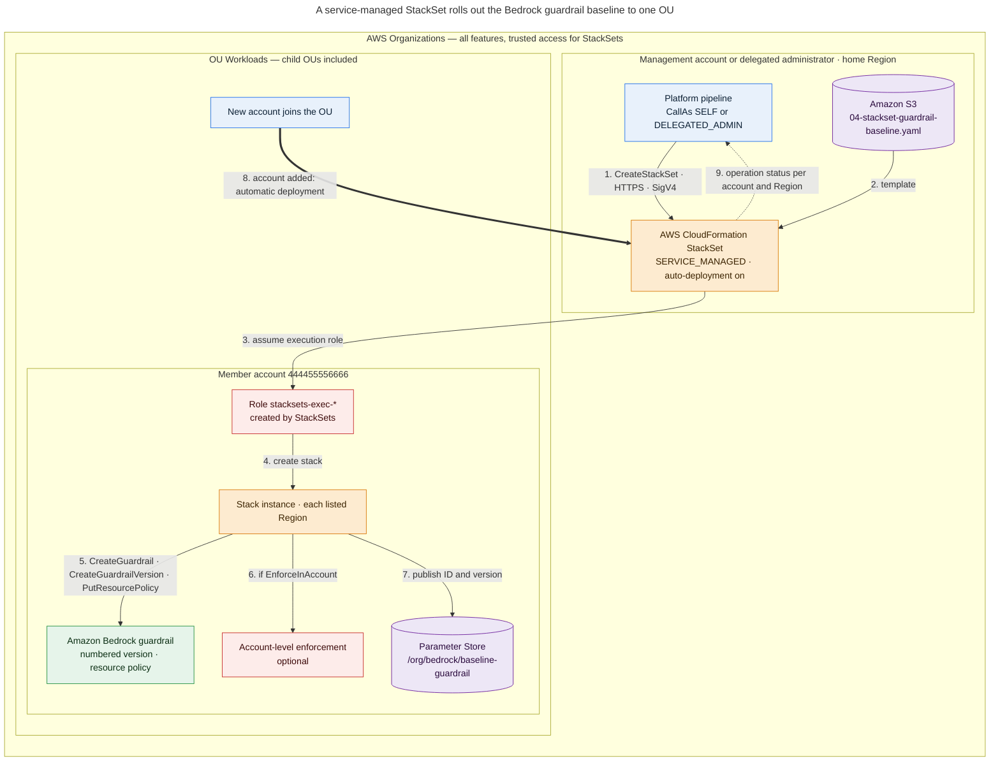
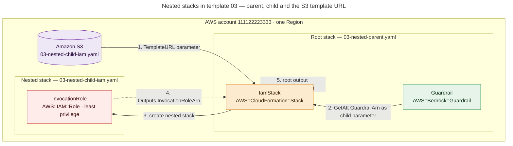

# Nested stacks and StackSets

> **Level:** Intermediate · **Verified:** 2026-11-15 · **Feature status:** n/a · **Time:** ~30 min

One template per application stops scaling long before one account does. This chapter
compares the three ways CloudFormation splits and reuses templates — nested stacks,
cross-stack references and modules — and then shows StackSets, which deploy one template to
many accounts and Regions. The running example is an organization-wide Amazon Bedrock
guardrail baseline, [`templates/04-stackset-guardrail-baseline.yaml`](templates/04-stackset-guardrail-baseline.yaml).

## Learning objectives

After this chapter you can:

- Choose between a nested stack, a cross-stack reference and a module for a given reuse problem.
- Wire a parent and a child stack through parameters, `TemplateURL` and `Outputs`.
- Explain StackSet administrator and target accounts, self-managed versus service-managed permissions, and organizational unit (OU) targeting.
- Configure automatic deployment, operation preferences and deployment ordering.
- Decide how to roll out a Bedrock guardrail baseline across an organization, and when an Organizations Bedrock policy is the better tool.

## Prerequisites

- [Template anatomy](01-template-anatomy.md) and [Intrinsic functions](02-intrinsic-functions.md)
- [AWS Organizations and AWS Control Tower](../../00-foundations/aws-fundamentals/05-organizations-control-tower.md)

## Concept in plain language

A **nested stack** is a sub-assembly built and shipped inside one product: the parent decides
when it is built and the child cannot be updated on its own. A **cross-stack reference** is two
products where one reads the label on the other. A **module** is a standard part from a
catalogue that is copied into your design. A **StackSet** is a franchise: one blueprint, built
the same way in every shop (account) in every city (Region) you choose, with head office
pushing each change.

## How it really works

### Three ways to split or reuse templates

| | Nested stack | Cross-stack reference | Module |
|:--|:--|:--|:--|
| Mechanism | `AWS::CloudFormation::Stack` resource with a `TemplateURL` | `Export` + `Fn::ImportValue`, or `Fn::GetStackOutput` | A versioned type registered in the CloudFormation registry |
| Lifecycle | Created, updated and deleted with the root stack | Independent stacks | Expanded into the consuming stack |
| Passing values | Parameters down, `!GetAtt Child.Outputs.Name` up | Export names, or stack and output names | Module parameters |
| Accounts and Regions | Same as the root | `Fn::ImportValue`: same account and Region; `Fn::GetStackOutput`: any, within a partition | Wherever the module is registered |
| Coupling | Tight — update from the root | Exports are locked while imported; `Fn::GetStackOutput` is weak | Versioned in the registry |
| Typical use | Reusable building blocks owned by one team | Shared platform outputs (network, guardrail ARN) | Organisation-approved patterns |

Facts behind the table: nested stacks should be updated from the root, and a root update
initiates an update of every nested stack to detect changes; a single operation on a nested
hierarchy may touch at most 2,500 resources; drift detection on a stack does not include its
nested stacks; modules are versioned, have no extra charge and are limited to 100 per account
and Region. Sources: [Nested stacks](https://docs.aws.amazon.com/AWSCloudFormation/latest/UserGuide/using-cfn-nested-stacks.html),
[AWS::CloudFormation::Stack](https://docs.aws.amazon.com/AWSCloudFormation/latest/TemplateReference/aws-resource-cloudformation-stack.html),
[Update behaviours](https://docs.aws.amazon.com/AWSCloudFormation/latest/UserGuide/using-cfn-updating-stacks-update-behaviors.html),
[Quotas](https://docs.aws.amazon.com/AWSCloudFormation/latest/UserGuide/cloudformation-limits.html),
[Drift detection](https://docs.aws.amazon.com/AWSCloudFormation/latest/UserGuide/using-cfn-stack-drift.html),
[Modules](https://docs.aws.amazon.com/AWSCloudFormation/latest/UserGuide/modules.html).
Modules get their own chapter: [CloudFormation modules and reuse](06-modules-and-reuse.md).

### StackSets

| Concept | What it means |
|:--|:--|
| Administrator account | Where the StackSet lives. For service-managed StackSets: the management account or a registered delegated administrator |
| Target account | An account that receives a stack |
| Stack instance | A reference to one stack in one target account and Region; it can exist even if the stack failed |
| StackSet scope | A Regional resource, visible only in the Region where you created it |
| Self-managed permissions | You create `AWSCloudFormationStackSetAdministrationRole` in the administrator account and `AWSCloudFormationStackSetExecutionRole` in every target; works with any account where you can create the role |
| Service-managed permissions | Needs AWS Organizations with all features and trusted access; StackSets creates the roles; targets OUs or the whole organization; enables automatic deployment |

> [!NOTE]
> **Documented fact** — Service-managed StackSets never deploy to the management account,
> even if it sits in a targeted OU; targeting a parent OU includes its child OUs; delegated
> administrators can deploy to any account in the organization; and service-managed StackSets
> do not support nested stacks or templates with macros or transforms.
> Source: [Create StackSets with service-managed permissions](https://docs.aws.amazon.com/AWSCloudFormation/latest/UserGuide/stacksets-orgs-associate-stackset-with-org.html)

**Operation preferences** control blast radius: *maximum concurrent accounts* (number or
percentage, rounded down), *failure tolerance* per Region, *Region concurrency* (sequential by
default, or parallel), *Region order*, and *concurrency mode* (strict failure tolerance lowers
concurrency after failures; soft keeps it). *Managed execution* runs non-conflicting operations
concurrently and queues conflicting ones; AWS recommends it with automatic deployment.
Sources: [StackSets concepts](https://docs.aws.amazon.com/AWSCloudFormation/latest/UserGuide/stacksets-concepts.html),
[Automatic deployments](https://docs.aws.amazon.com/AWSCloudFormation/latest/UserGuide/stacksets-orgs-manage-auto-deployment.html).

**Automatic deployment** adds stack instances when an account joins a targeted OU and removes
or retains them when it leaves (`RetainStacksOnAccountRemoval`). It is a StackSet-wide switch,
parameter overrides apply only to accounts present at the time, and account-level filters are
ignored for new accounts.

> [!IMPORTANT]
> **Status** — **Deployment ordering** (2025-11-21): `AutoDeployment.DependsOn` lists StackSet
> ARNs that must finish before this StackSet's automatic deployment starts — up to 10 per
> StackSet and 100 per account, with cycle detection. It applies to automatic deployments only.
> Sources: [What's New](https://aws.amazon.com/about-aws/whats-new/2025/11/aws-cloudformation-stacksets-deployment-ordering/),
> [Automatic deployments](https://docs.aws.amazon.com/AWSCloudFormation/latest/UserGuide/stacksets-orgs-manage-auto-deployment.html),
> [AutoDeployment property](https://docs.aws.amazon.com/AWSCloudFormation/latest/TemplateReference/aws-properties-cloudformation-stackset-autodeployment.html)

Quotas: 1,000 StackSets per administrator account and 100,000 stack instances per StackSet
([Quotas](https://docs.aws.amazon.com/AWSCloudFormation/latest/UserGuide/cloudformation-limits.html)).
Express mode is not supported for StackSet operations
([Express mode](https://docs.aws.amazon.com/AWSCloudFormation/latest/UserGuide/cloudformation-express-mode.html)).

## Architecture diagram



**What this shows** — One StackSet in the administrator account pushes the same template into
every account of an OU, in each Region you list. Each member account ends up with its own
guardrail and Parameter Store entries; nothing is shared across accounts. The management
account itself is never a target.

**Walkthrough**

1. The pipeline creates the StackSet (or updates it) with service-managed permissions.
2. The template comes from Amazon S3 or the request body.
3. StackSets uses the execution role it created in the member account.
4. One stack per account and Region is created, within the operation preferences.
5. The stack creates the guardrail, a numbered version and a same-account resource policy.
6. Enforcement is created only when the `EnforceInAccount` parameter is `true`.
7. The guardrail ID and version are published at a well-known Parameter Store path.
8. An account that joins the OU later triggers an automatic deployment (thick arrow: asynchronous).
9. Operation and stack-instance statuses report back to the administrator.

**Legend** — solid arrow: request · dashed arrow: response · thick arrow: asynchronous event ·
cylinders: data stores · red: identity and enforcement controls · nested boxes: organization,
account and OU boundaries.

**Variations** — Self-managed permissions replace the created roles with the two roles you
create and allow targets outside the organization, but give up OU targeting and automatic
deployment. The organization-wide picture is in [diagram set 25](../../diagrams/mermaid/25-multi-account-aws.md).



**What this shows** — The child template lives in Amazon S3 and is addressed by URL; values
flow down as parameters and back up as outputs.

**Walkthrough**

1. The parent reads the child template from the URL passed in `ChildTemplateUrl`.
2. The guardrail ARN becomes a child parameter, so the guardrail is created first.
3. CloudFormation creates the child stack with the root stack's capabilities.
4. The child returns the role ARN as an output.
5. The parent re-exposes it with `!GetAtt IamStack.Outputs.InvocationRoleArn`.

**Legend** — as above; the inner boxes are stack boundaries.

## Implementation details

**Parent and child** ([`03-nested-parent.yaml`](templates/03-nested-parent.yaml),
[`03-nested-child-iam.yaml`](templates/03-nested-child-iam.yaml)). The URL is a parameter, so
the same parent works with any packaged copy of the child:

```yaml
  IamStack:
    Type: AWS::CloudFormation::Stack
    # Stated explicitly: deleting the parent deletes the child stack and its role.
    DeletionPolicy: Delete
    UpdateReplacePolicy: Delete
    Properties:
      TemplateURL: !Ref ChildTemplateUrl
      TimeoutInMinutes: 30
      Parameters:
        NamePrefix: !Ref NamePrefix
        GuardrailArn: !GetAtt Guardrail.GuardrailArn
```

**The baseline** ([`04-stackset-guardrail-baseline.yaml`](templates/04-stackset-guardrail-baseline.yaml))
uses no transform, macro or nested stack and only pseudo parameters, so it is valid for a
service-managed StackSet. Enforcement waits for the resource policy and needs a numbered version:

```yaml
  AccountEnforcement:
    Type: AWS::Bedrock::EnforcedGuardrailConfiguration
    Condition: EnforceGuardrail
    DependsOn: GuardrailResourcePolicy
    Properties:
      GuardrailIdentifier: !GetAtt BaselineGuardrail.GuardrailId
      # Enforcement needs a numbered version, never DRAFT.
      GuardrailVersion: !GetAtt BaselineGuardrailVersion.Version
```

Bumping `BaselineRevision` changes the version's create-only `Description`, so CloudFormation
replaces the version resource — that is how a StackSet update publishes a new numbered version
everywhere, while `UpdateReplacePolicy: Retain` keeps the previous one.

**The StackSet itself**, created from the management or delegated administrator account:

> **Code status:** validated with `cfn-lint` 1.60.1 as a standalone template in a scratch directory · **never deployed**

```yaml
Resources:
  GuardrailBaseline:
    Type: AWS::CloudFormation::StackSet
    Properties:
      StackSetName: org-bedrock-guardrail-baseline
      Description: Per-account Bedrock guardrail baseline
      PermissionModel: SERVICE_MANAGED
      CallAs: SELF                        # DELEGATED_ADMIN from a delegated administrator
      TemplateURL: !Ref BaselineTemplateUrl
      AutoDeployment:
        Enabled: true                     # new accounts in the OU get the baseline
        RetainStacksOnAccountRemoval: false
      ManagedExecution:
        Active: true
      OperationPreferences:
        RegionConcurrencyType: SEQUENTIAL
        MaxConcurrentPercentage: 25
        FailureTolerancePercentage: 10
        ConcurrencyMode: SOFT_FAILURE_TOLERANCE
      Parameters:
        - ParameterKey: EnforceInAccount
          ParameterValue: "false"
      StackInstancesGroup:
        - DeploymentTargets:
            OrganizationalUnitIds:
              - !Ref TargetOuId
          Regions: !Ref TargetRegions
```

If a networking or IAM baseline must exist first, add its StackSet ARN to
`AutoDeployment.DependsOn`.

### Organisation-wide Bedrock baselines: which tool?

Amazon Bedrock now offers guardrail **enforcement**: account-level (one guardrail version
applied to every Bedrock model invocation in an account and Region, set with
`PutEnforcedGuardrailConfiguration`) and organization-level (an Organizations *Amazon Bedrock
policy* pointing to a guardrail in the management account, which needs a resource-based
policy). Enforced guardrails do not support Automated Reasoning policies, and callers without
`bedrock:ApplyGuardrail` on the enforced guardrail start failing with `AccessDenied`.
Sources: [Guardrail enforcement](https://docs.aws.amazon.com/bedrock/latest/userguide/guardrails-enforcements.html),
[Resource-based policies for guardrails](https://docs.aws.amazon.com/bedrock/latest/userguide/guardrails-resource-based-policies.html),
[Amazon Bedrock policies](https://docs.aws.amazon.com/organizations/latest/userguide/orgs_manage_policies_bedrock.html).

| Need | Organizations Bedrock policy | Service-managed StackSet (template 04) | Nested stacks / cross-stack |
|:--|:--|:--|:--|
| One central guardrail, members cannot change it | **Best fit** — guardrail lives in the management account | Each account owns a copy | No |
| Per-account guardrail, local Parameter Store discovery | No | **Best fit** | No |
| Covers the management account | **UNVERIFIED — REQUIRES DOCUMENTATION REVIEW** (the policy page does not say) | **Never deploys there** | Deploy separately |
| New accounts covered automatically | Through policy inheritance | Through automatic deployment | No |
| Several Regions | Create the guardrail in every Region | List Regions in the StackSet | One stack per Region |
| Application-specific guardrails on top | Combined with the enforced one; most restrictive control wins | Same | Same |

> [!TIP]
> **Academy recommendation** — Use the Organizations Bedrock policy for the non-negotiable
> organization floor, and a StackSet like template 04 for per-account resources that teams
> consume (application guardrails, Parameter Store pointers, invocation logging, IAM roles).
> Keep `EnforceInAccount` off until every calling role passes an `ApplyGuardrail` test. The
> academy's designs are in [Pattern: multi-account generative AI platform](../../03-architecture-patterns/multi-account/README.md)
> and [Project F](../../05-practical-projects/project-06-multi-account-platform/README.md);
> this is our guidance, not an official AWS reference architecture.

## Example

> **Code status:** templates [`03-nested-parent.yaml`](templates/03-nested-parent.yaml), [`03-nested-child-iam.yaml`](templates/03-nested-child-iam.yaml) and [`04-stackset-guardrail-baseline.yaml`](templates/04-stackset-guardrail-baseline.yaml) validated with `cfn-lint` 1.60.1 (no errors, warnings or informational findings) · **never deployed**

In a sandbox organization only — a StackSet creates resources in every targeted account, and
an enforced guardrail is billed on every model invocation it evaluates:

```bash
# Nested stack: upload the child, then pass its URL to the parent
aws s3 cp templates/03-nested-child-iam.yaml s3://<your-bucket>/03-nested-child-iam.yaml
aws cloudformation deploy --template-file templates/03-nested-parent.yaml \
  --stack-name academy-nested --capabilities CAPABILITY_IAM \
  --parameter-overrides ChildTemplateUrl=https://<your-bucket>.s3.<region>.amazonaws.com/03-nested-child-iam.yaml \
                        FoundationModelId=<model ID from the model catalog>
# Teardown: delete the root stack only; it deletes the nested stack
aws cloudformation delete-stack --stack-name academy-nested
```

To tear down a StackSet, delete its stack instances first (`delete-stack-instances`), then the
StackSet: a StackSet can be deleted only when it has no stack instances.

## Common mistakes

| Mistake | Symptom | Fix |
|:--|:--|:--|
| Updating a nested stack directly | The root template no longer describes what is deployed | Update from the root, as AWS recommends |
| Expecting the management account to receive the baseline | No stack instance there | Deploy it separately, or use an Organizations Bedrock policy |
| `Transform` or nested stacks in a service-managed StackSet template | Not supported | Keep StackSet templates flat |
| Enforcing a guardrail before callers can apply it | `AccessDenied` on every model call in the account | Grant `bedrock:ApplyGuardrail` and test first |
| Parameter overrides for an OU with automatic deployment | New accounts get default values | Put the value in the StackSet parameters, or a separate StackSet |
| Failure tolerance 0 across many accounts | One failure stops the whole rollout | Size tolerance and concurrency for the OU |

## Security considerations

- Delegated administrators can deploy to any account in the organization, and the management
  account cannot narrow that; register them sparingly.
- The sample self-managed execution role grants administrator access; AWS tells you to scope it
  to the resource types your StackSets create
  ([self-managed permissions](https://docs.aws.amazon.com/AWSCloudFormation/latest/UserGuide/stacksets-prereqs-self-managed.html)).
- Use the guardrail resource-based policy patterns from the Bedrock documentation; template 04
  uses the same-account pattern.
- A nested stack's `Capabilities` are set by the parent, so (**our reading**) `CAPABILITY_IAM` on
  the root covers every IAM resource in every child — review children like any other code.

## Cost considerations

- CloudFormation's price list charges only for third-party resource types and custom hooks
  ([CloudFormation pricing](https://aws.amazon.com/cloudformation/pricing/)); the cost is in the
  resources each stack instance creates, multiplied by accounts and Regions.
- Guardrails are billed per text unit for each policy that evaluates content; account-level
  enforcement means every model invocation in the account is evaluated
  ([Amazon Bedrock pricing](https://aws.amazon.com/bedrock/pricing/)).
- `RetainStacksOnAccountRemoval: true` leaves resources running in accounts that left the OU.

## Knowledge check

1. Your platform team wants every new account in the `Workloads` OU to get a guardrail and a Parameter Store pointer within minutes of joining. Which permission model and which StackSet setting do you need?
2. Why does template 04 avoid `Transform: AWS::LanguageExtensions`, even though `Fn::ForEach` would shorten the filter list?
3. A child stack must read a value from a stack in the security account in another Region. Nested stack, `Fn::ImportValue`, or `Fn::GetStackOutput`?
4. What would happen if `EnforceInAccount` were `true` but an existing Lambda role in the account lacked `bedrock:ApplyGuardrail`?
5. The networking StackSet must finish before the baseline in new accounts. What do you configure?

<details>
<summary>Answers</summary>

1. Service-managed permissions with `AutoDeployment.Enabled: true`, targeting the OU.
2. Service-managed StackSets do not support templates that contain macros or transforms.
3. `Fn::GetStackOutput` with `RoleArn` and `Region`: `Fn::ImportValue` is same account and Region only, and a nested stack shares the root's account and Region.
4. That role's model invocations would fail with `AccessDenied`, because enforced guardrails require permission to apply the guardrail.
5. Add the networking StackSet's ARN to `AutoDeployment.DependsOn` of the baseline StackSet (automatic deployments only).

</details>

## Further reading

Official sources opened while writing this chapter:

- [Nested stacks](https://docs.aws.amazon.com/AWSCloudFormation/latest/UserGuide/using-cfn-nested-stacks.html) and [AWS::CloudFormation::Stack](https://docs.aws.amazon.com/AWSCloudFormation/latest/TemplateReference/aws-resource-cloudformation-stack.html).
- [Fn::ImportValue](https://docs.aws.amazon.com/AWSCloudFormation/latest/TemplateReference/intrinsic-function-reference-importvalue.html) and [Fn::GetStackOutput](https://docs.aws.amazon.com/AWSCloudFormation/latest/TemplateReference/intrinsic-function-reference-getstackoutput.html).
- [CloudFormation modules](https://docs.aws.amazon.com/AWSCloudFormation/latest/UserGuide/modules.html).
- [StackSets concepts](https://docs.aws.amazon.com/AWSCloudFormation/latest/UserGuide/stacksets-concepts.html), [self-managed permissions](https://docs.aws.amazon.com/AWSCloudFormation/latest/UserGuide/stacksets-prereqs-self-managed.html), [trusted access](https://docs.aws.amazon.com/AWSCloudFormation/latest/UserGuide/stacksets-orgs-activate-trusted-access.html), [service-managed StackSets](https://docs.aws.amazon.com/AWSCloudFormation/latest/UserGuide/stacksets-orgs-associate-stackset-with-org.html), [automatic deployments](https://docs.aws.amazon.com/AWSCloudFormation/latest/UserGuide/stacksets-orgs-manage-auto-deployment.html).
- [StackSets deployment ordering announcement](https://aws.amazon.com/about-aws/whats-new/2025/11/aws-cloudformation-stacksets-deployment-ordering/) and the [AutoDeployment property](https://docs.aws.amazon.com/AWSCloudFormation/latest/TemplateReference/aws-properties-cloudformation-stackset-autodeployment.html).
- [Express mode](https://docs.aws.amazon.com/AWSCloudFormation/latest/UserGuide/cloudformation-express-mode.html) — StackSets not supported.
- [CloudFormation quotas](https://docs.aws.amazon.com/AWSCloudFormation/latest/UserGuide/cloudformation-limits.html) and [pricing](https://aws.amazon.com/cloudformation/pricing/).
- [Guardrail enforcement](https://docs.aws.amazon.com/bedrock/latest/userguide/guardrails-enforcements.html), [resource-based policies for guardrails](https://docs.aws.amazon.com/bedrock/latest/userguide/guardrails-resource-based-policies.html), [Amazon Bedrock policies in AWS Organizations](https://docs.aws.amazon.com/organizations/latest/userguide/orgs_manage_policies_bedrock.html).
- [AWS::Bedrock::EnforcedGuardrailConfiguration](https://docs.aws.amazon.com/AWSCloudFormation/latest/TemplateReference/aws-resource-bedrock-enforcedguardrailconfiguration.html) and [AWS::Bedrock::ResourcePolicy](https://docs.aws.amazon.com/AWSCloudFormation/latest/TemplateReference/aws-resource-bedrock-resourcepolicy.html).
- [Amazon Bedrock pricing](https://aws.amazon.com/bedrock/pricing/).
