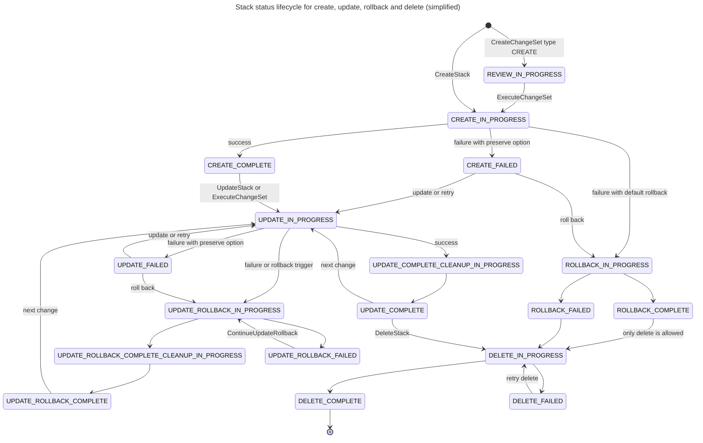
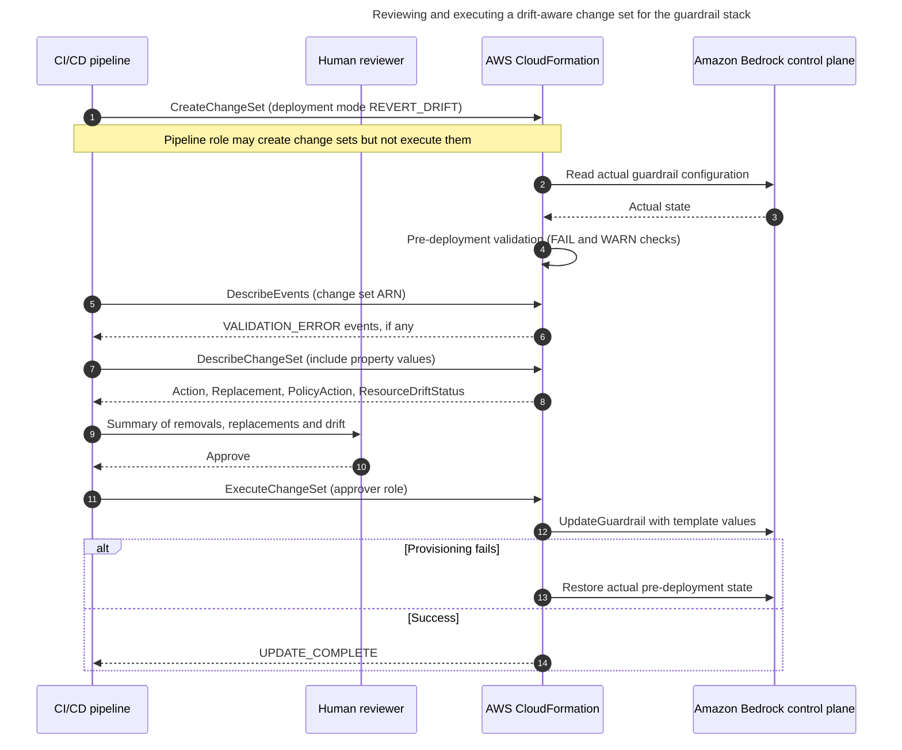

# Change sets and drift detection

> **Level:** Intermediate · **Verified:** 2026-11-15 · **Feature status:** n/a · **Time:** ~30 min

Every production change to a CloudFormation stack should be previewed, validated and
reviewed before it runs, and every stack should be checked for changes made behind its back.
This chapter covers change sets, pre-deployment validation, rollback options, drift detection,
drift-aware change sets and, briefly, import and stack refactoring.

## Learning objectives

After this chapter you can:

- Explain the difference between a direct update and a change set, and choose one.
- Read a change set: action, replacement, scope, change source, causing entity and policy action.
- Use pre-deployment validation and the `DescribeEvents` API to catch errors before provisioning.
- Choose a rollback or failure option and recover a stack from `UPDATE_ROLLBACK_FAILED`.
- Detect drift, know what drift detection cannot see, and reconcile it with a drift-aware change set.

## Prerequisites

- [Template anatomy](01-template-anatomy.md) and [Intrinsic functions](02-intrinsic-functions.md)
- Useful comparison: [Plan, apply and drift detection](../terraform/08-plan-apply-drift.md) in Terraform

## Concept in plain language

A **direct update** is telling a builder "make it look like this drawing" and walking away. A
**change set** is a written quote first: what will be added, changed, knocked down and
rebuilt. **Drift** is someone moving walls without telling the builder. Drift detection is an
inspection that lists the moved walls; a **drift-aware change set** is a quote based on the
building as it stands today, which puts the walls back unless you change the drawing.

## How it really works

### Direct update or change set

| | Direct update (`UpdateStack`) | Change set (`CreateChangeSet` → `ExecuteChangeSet`) |
|:--|:--|:--|
| Preview | None | Full list of resource changes, optionally property-level (`--include-property-values`) |
| Validation | Pre-deployment validation: property syntax and name conflicts | The same, plus the WARN-mode checks |
| Approval gate | No | Yes — execution is a separate API call and IAM permission |
| Parameter Store values | Read at update time | Fixed when the change set is created |
| Types | Update | `CREATE`, `UPDATE`, `IMPORT` |

A change set for a stack that does not exist yet creates the stack in `REVIEW_IN_PROGRESS`.

### Reading a change set

Each entry in `Changes` is a `ResourceChange`:

| Field | Values | What to look for |
|:--|:--|:--|
| `Action` | `Add`, `Modify`, `Remove`, `Import`, `Dynamic`, `SyncWithActual` | `Remove` deletes unless a policy retains; `Dynamic` means CloudFormation cannot tell yet |
| `Replacement` | `True`, `False`, `Conditional` | `True`: new physical ID, references change; `Conditional`: depends on a dynamic value |
| `Scope` | `Properties`, `Metadata`, `CreationPolicy`, `UpdatePolicy`, `DeletionPolicy`, `UpdateReplacePolicy`, `Tags` | Which part of the resource changed |
| `Details[].ChangeSource` | `DirectModification`, `ParameterReference`, `ResourceReference`, `ResourceAttribute`, `Automatic`, `NoModification` | Why — `Automatic` is a nested stack that might have changed |
| `Details[].CausingEntity` | Parameter or resource name | Which parameter or resource caused it; empty for direct edits |
| `Details[].Evaluation` | `Static`, `Dynamic` | `Dynamic` values resolve only at execution |
| `PolicyAction` | `Delete`, `Retain`, `Snapshot`, `ReplaceAndDelete`, `ReplaceAndRetain`, `ReplaceAndSnapshot` | What happens to the old physical resource |
| `ResourceDriftStatus` | `IN_SYNC`, `MODIFIED`, `DELETED`, `UNSUPPORTED` … | Drift-aware change sets only |

Sources: [ResourceChange](https://docs.aws.amazon.com/AWSCloudFormation/latest/APIReference/API_ResourceChange.html),
[ResourceChangeDetail](https://docs.aws.amazon.com/AWSCloudFormation/latest/APIReference/API_ResourceChangeDetail.html),
[View a change set](https://docs.aws.amazon.com/AWSCloudFormation/latest/UserGuide/using-cfn-updating-stacks-changesets-view.html).

Replacement follows from each property's documented update behaviour — *No interruption*,
*Some interruption* or *Replacement*
([update behaviours](https://docs.aws.amazon.com/AWSCloudFormation/latest/UserGuide/using-cfn-updating-stacks-update-behaviors.html)).
For the Bedrock types in this section's templates:

| Resource type | Properties that force replacement | Consequence |
|:--|:--|:--|
| `AWS::Bedrock::Guardrail` | None | Name, policies and tags update in place |
| `AWS::Bedrock::GuardrailVersion` | `Description`, `GuardrailIdentifier` | A new version number — the trick template 04 uses to publish versions |
| `AWS::Bedrock::ApplicationInferenceProfile` | `InferenceProfileName`, `Description`, `ModelSource` | New profile ID and ARN; any client that stored the old ARN breaks |
| `AWS::Bedrock::ResourcePolicy` | `ResourceArn` | Policy recreated |

Sources: Template Reference pages for [Guardrail](https://docs.aws.amazon.com/AWSCloudFormation/latest/TemplateReference/aws-resource-bedrock-guardrail.html),
[GuardrailVersion](https://docs.aws.amazon.com/AWSCloudFormation/latest/TemplateReference/aws-resource-bedrock-guardrailversion.html),
[ApplicationInferenceProfile](https://docs.aws.amazon.com/AWSCloudFormation/latest/TemplateReference/aws-resource-bedrock-applicationinferenceprofile.html),
[ResourcePolicy](https://docs.aws.amazon.com/AWSCloudFormation/latest/TemplateReference/aws-resource-bedrock-resourcepolicy.html).

### Pre-deployment validation

> [!IMPORTANT]
> **Status** — Pre-deployment validation launched for change sets in November 2025 and, since
> 2026-06-30, runs on every `CreateStack`, `UpdateStack` and `CreateChangeSet` by default.
> Property syntax and resource name conflicts are **FAIL** checks on all three operations (the
> operation stops, or the change set is `FAILED`). S3 bucket emptiness, service quotas, AWS Config
> recorder conflicts and ECR repository delete readiness are **WARN** checks that the user guide
> lists for change set creation only.
> Results come from `DescribeEvents` (events with `EventType` `VALIDATION_ERROR`), not from
> `DescribeStackEvents`. `DisableValidation` skips the checks for one operation.
> Sources: [Validate stack deployments](https://docs.aws.amazon.com/AWSCloudFormation/latest/UserGuide/validate-stack-deployments.html),
> [What's New 2026-06-30](https://aws.amazon.com/about-aws/whats-new/2026/06/aws-cloudformation/),
> [DescribeEvents](https://docs.aws.amazon.com/AWSCloudFormation/latest/APIReference/API_DescribeEvents.html),
> [launch blog 2025-11-18](https://aws.amazon.com/blogs/devops/accelerate-infrastructure-development-with-cloudformation-pre-deployment-validation-and-simplified-troubleshooting/)

Validation reduces common failures; it does not guarantee success.

### Rollback and failure options

| Option | Behaviour |
|:--|:--|
| Default | A failed create rolls back (`ROLLBACK_COMPLETE`, after which only delete is allowed); a failed update rolls back to the previous state |
| `OnFailure` on create (`ROLLBACK`, `DELETE`, `DO_NOTHING`) / `OnStackFailure` on change sets | What to do when creation fails |
| *Preserve successfully provisioned resources* (`--disable-rollback`) | Stops at the first failure in each independent path, leaves the stack `CREATE_FAILED` or `UPDATE_FAILED`, then you **Retry**, **Update** or **Roll back** |
| `RetainExceptOnCreate` (API parameter) | Applies the `RetainExceptOnCreate` deletion behaviour without editing the template ([DeletionPolicy](https://docs.aws.amazon.com/AWSCloudFormation/latest/TemplateReference/aws-attribute-deletionpolicy.html)) |
| Rollback triggers | Up to five CloudWatch alarms watched during the operation and for 0–180 minutes after it |
| `ContinueUpdateRollback` | Recovers `UPDATE_ROLLBACK_FAILED`, optionally skipping resources or with `--force-rollback` |
| Express mode (2026-06-30) | Completes when configuration is applied, not when resources are stable; **rollback disabled by default** |

Sources: [Stack failure options](https://docs.aws.amazon.com/AWSCloudFormation/latest/UserGuide/stack-failure-options.html),
[Rollback triggers](https://docs.aws.amazon.com/AWSCloudFormation/latest/UserGuide/using-cfn-rollback-triggers.html),
[Continue rolling back an update](https://docs.aws.amazon.com/AWSCloudFormation/latest/UserGuide/using-cfn-updating-stacks-continueupdaterollback.html),
[Express mode](https://docs.aws.amazon.com/AWSCloudFormation/latest/UserGuide/cloudformation-express-mode.html),
[Stack status codes](https://docs.aws.amazon.com/AWSCloudFormation/latest/UserGuide/view-stack-events.html).

### Drift detection and its limits

`DetectStackDrift` compares each supported resource's current configuration with the template
and parameters. It runs on stacks in `CREATE_COMPLETE`, `UPDATE_COMPLETE`,
`UPDATE_ROLLBACK_COMPLETE` or `UPDATE_ROLLBACK_FAILED`, and reports `IN_SYNC`, `MODIFIED`,
`DELETED` or `NOT_CHECKED` per resource.

> [!WARNING]
> **Common mistake** — Reading `IN_SYNC` as "nobody touched it". Drift detection only compares
> properties set explicitly in the template (not defaults), skips nested stacks (run it on each),
> never checks `KMSKeyId` properties, cannot compare values it cannot map back (such as Lambda
> code) or values the service does not return, can misreport attachments made from another
> stack, and does not cover `ssm` dynamic references. Unsupported types report `NOT_CHECKED`;
> on the verification date `AWS::Bedrock::Guardrail` supports drift detection while
> `AWS::Bedrock::KnowledgeBase` and `AWS::CloudFormation::Stack` do not.
> Sources: [Drift detection](https://docs.aws.amazon.com/AWSCloudFormation/latest/UserGuide/using-cfn-stack-drift.html),
> [Resource type support](https://docs.aws.amazon.com/AWSCloudFormation/latest/UserGuide/resource-import-supported-resources.html),
> [ssm dynamic references](https://docs.aws.amazon.com/AWSCloudFormation/latest/UserGuide/dynamic-references-ssm.html)

### Drift-aware change sets (`REVERT_DRIFT`)

> [!NOTE]
> **Documented fact** — Since 2025-11-18, `CreateChangeSet --deployment-mode REVERT_DRIFT`
> builds a three-way comparison of actual state, previous deployment state and desired state.
> Executing it sets every resource to the template, even resources the template did not
> change, and recreates resources deleted outside CloudFormation. It preserves AWS-managed
> properties (such as an Auto Scaling group's desired capacity) and tag keys not in the
> template, cannot reconcile immutable properties, compares write-only properties with the
> previous deployment, and on failure restores the **actual** pre-deployment state. Types without
> support fall back to a normal comparison — `AWS::Bedrock::AgentAlias` is on that list.
> Sources: [Drift-aware change sets](https://docs.aws.amazon.com/AWSCloudFormation/latest/UserGuide/drift-aware-change-sets.html),
> [What's New](https://aws.amazon.com/about-aws/whats-new/2025/11/configuration-drift-enhanced-cloudformation-sets/)

### Import and refactoring at a glance

- **Import** brings an existing resource under a stack with an `IMPORT` change set, or
  automatically with `--import-existing-resources` when the resource has a static custom name
  and `DeletionPolicy: Retain` or `RetainExceptOnCreate`
  ([auto-import](https://docs.aws.amazon.com/AWSCloudFormation/latest/UserGuide/import-resources-automatically.html)).
- **Stack refactoring** (since 2025-02-06) moves resources between up to five stacks and renames
  logical IDs without touching the resources; it cannot change configuration and does not work
  on stacks with stack policies
  ([Stack refactoring](https://docs.aws.amazon.com/AWSCloudFormation/latest/UserGuide/stack-refactoring.html)).

Procedures are in [Version upgrades, refactoring and importing existing resources](../maintenance/05-upgrades-refactoring-import.md).

## Architecture diagram



**What this shows** — The stack statuses you meet most often and how they connect.
`*_IN_PROGRESS` statuses are transient; a stack rests in a `*_COMPLETE` or `*_FAILED` status. **Our reading:** the transitions are drawn from
the status descriptions and failure-option pages; not every API path is shown (for example,
`CREATE_COMPLETE` and `UPDATE_ROLLBACK_COMPLETE` can also be deleted).

**Walkthrough**

1. A `CREATE` change set parks a new stack in `REVIEW_IN_PROGRESS` until you execute it.
2. A failed create with default settings rolls back; the only next step is delete.
3. With *preserve successfully provisioned resources*, the stack stops in `CREATE_FAILED` or `UPDATE_FAILED` so you can fix and retry, update or roll back.
4. A successful update cleans up replaced resources in `UPDATE_COMPLETE_CLEANUP_IN_PROGRESS`; this is when `UpdateReplacePolicy` acts.
5. A failed rollback leaves `UPDATE_ROLLBACK_FAILED`; `ContinueUpdateRollback` resumes it.
6. `DELETE_FAILED` usually means a resource could not be deleted; fix it and delete again.

**Legend** — boxes: stack statuses · arrows: transitions labelled with the triggering action ·
`[*]`: no stack. Import adds `IMPORT_IN_PROGRESS`, `IMPORT_COMPLETE` and three
`IMPORT_ROLLBACK_*` statuses, not drawn here.



**What this shows** — A review gate built from documented APIs: validate, inspect, approve, then
execute with a different role.

**Walkthrough**

1. The pipeline creates a drift-aware change set; nothing changes yet.
2. CloudFormation reads the live guardrail through the service API.
3. The actual configuration becomes the "before" value for drifted properties.
4. Validation runs while the change set is created.
5. The pipeline asks for validation results by change set ARN.
6. A FAIL result makes the change set `FAILED`; WARN results allow execution.
7. The pipeline reads the change set with property values.
8. Each change shows action, replacement, policy action and drift status.
9. A human gets a short summary, not raw JSON.
10. The reviewer approves.
11. A separate role executes the change set.
12. Template values overwrite drift.
13. On failure, the actual pre-deployment state is restored.
14. On success, the stack reaches `UPDATE_COMPLETE`.

**Legend** — solid arrow: request · dashed arrow: response · `alt`: alternative outcomes ·
`Note`: security control.

**Variations** — A standard change set compares only with the previous template, so step 2
does not happen and drifted values are silently kept or overwritten. The wider pipeline is in
[From developer change to drift detection](../../07-devops-and-cicd/01-pipeline-overview.md).

## Implementation details

1. **Separate create and execute permissions.** Give the pipeline `cloudformation:CreateChangeSet`
   and `DescribeChangeSet`; give `cloudformation:ExecuteChangeSet` to an approval step only.
2. **Fail on validation errors, surface warnings.** Read `DescribeEvents` for the change set and
   stop on any `ValidationFailureMode` of `FAIL`.
3. **Flag the dangerous rows automatically** — `Remove`, `Replacement` `True` or `Conditional`,
   `PolicyAction` `Delete` or `ReplaceAndDelete`, and drifted resources (code below).
4. **Run drift detection on a schedule**, per nested stack, and investigate before reverting:
   drift is often an incident fix that belongs in the template
   ([post-deployment validation and drift](../../07-devops-and-cicd/07-post-deploy-validation-and-drift.md)).
5. **Use `REVERT_DRIFT` deliberately.** It changes every drifted property in the stack, not
   just the ones your template edit touches.

> [!TIP]
> **Academy recommendation** — For Bedrock stacks, treat any `Replacement: True` on an
> `AWS::Bedrock::ApplicationInferenceProfile` as a breaking change: the ARN that applications
> pass as `modelId` changes. Publish the ARN through Parameter Store or an output, and never
> hard-code it. This is our guidance, not an official AWS reference architecture.

## Example

A change-set reviewer that a pipeline can run before the approval step.

> **Code status:** syntax-checked (`python -m py_compile`) and mock-tested with `botocore.stub.Stubber` (boto3/botocore 1.44.3, two pages of stubbed `DescribeChangeSet` responses) · **never deployed**

```python
"""Flag risky changes in a CloudFormation change set before anyone executes it."""

RISKY_POLICY_ACTIONS = {"Delete", "ReplaceAndDelete"}


def risky_changes(cfn, stack_name: str, change_set_name: str) -> list[dict]:
    """Return one finding per resource that is removed, replaced or drifted."""
    findings, token = [], None
    while True:
        kwargs = {"StackName": stack_name, "ChangeSetName": change_set_name}
        if token:
            kwargs["NextToken"] = token
        page = cfn.describe_change_set(**kwargs)
        for change in page.get("Changes", []):
            rc = change.get("ResourceChange", {})
            reasons = []
            if rc.get("Action") == "Remove":
                reasons.append("removed")
            if rc.get("Replacement") in ("True", "Conditional"):
                reasons.append(f"replacement={rc['Replacement']}")
            if rc.get("PolicyAction") in RISKY_POLICY_ACTIONS:
                reasons.append(f"policy={rc['PolicyAction']}")
            if rc.get("ResourceDriftStatus") in ("MODIFIED", "DELETED"):
                reasons.append(f"drift={rc['ResourceDriftStatus']}")
            if reasons:
                findings.append({"logical_id": rc.get("LogicalResourceId"),
                                 "type": rc.get("ResourceType"), "reasons": reasons})
        token = page.get("NextToken")
        if not token:
            return findings
```

The matching commands, for your own sandbox stack built from template 01 (illustrative, not run;
a change set itself creates nothing until executed):

```bash
aws cloudformation create-change-set --stack-name academy-guardrail-dev \
  --change-set-name rev-2 --template-body file://templates/01-guardrail-basic.yaml \
  --parameters ParameterKey=Environment,UsePreviousValue=true \
  --deployment-mode REVERT_DRIFT
aws cloudformation describe-events --change-set-name <change-set ARN from the previous command>
aws cloudformation describe-change-set --stack-name academy-guardrail-dev \
  --change-set-name rev-2 --include-property-values
aws cloudformation execute-change-set --stack-name academy-guardrail-dev --change-set-name rev-2
aws cloudformation detect-stack-drift --stack-name academy-guardrail-dev
```

## Common mistakes

| Mistake | Symptom | Fix |
|:--|:--|:--|
| Reading only the console summary | A `Conditional` replacement surprises you at execution | Inspect `Replacement`, `Evaluation` and `PolicyAction` |
| Looking for validation errors in `describe-stack-events` | Nothing found, change set `FAILED` | Use `describe-events` |
| Executing an old change set after Parameter Store changed | Stale value deployed | Recreate the change set just before execution |
| Leaving a stack in `ROLLBACK_COMPLETE` | Updates refused | Delete and recreate |
| Using express mode in production pipelines | Failed resources left in place, no rollback | Keep the default mode, or set `disableRollback` to `false` |
| `REVERT_DRIFT` right after an incident | The emergency fix is reverted | Put the fix in the template first |

## Security considerations

- Drift is a security signal: an IAM policy or guardrail filter edited outside the pipeline
  should page someone.
- A change set records resolved Parameter Store values; never feed secrets through parameters.
- Restrict `ContinueUpdateRollback` with skipped resources and `--force-rollback` to operators:
  both leave resources inconsistent with the template.
- Termination protection and stack policies add guard rails (stack refactoring refuses stacks
  with stack policies).

## Cost considerations

- CloudFormation's price list has no line for change sets, validation or drift detection; it
  charges only for third-party resource types and custom hooks
  ([CloudFormation pricing](https://aws.amazon.com/cloudformation/pricing/)).
- Preserved or retained resources from failed operations keep running and keep costing.
- Rollback triggers rely on CloudWatch alarms, which are billed by CloudWatch.

## Knowledge check

1. A change set shows `Action: Modify`, `Replacement: Conditional`, `ChangeSource: ResourceAttribute`. What does that tell you?
2. Someone raised a guardrail filter from `MEDIUM` to `HIGH` in the console during an incident. What does a standard change set do with that on the next deployment, and what does a `REVERT_DRIFT` change set show?
3. Your stack is in `UPDATE_ROLLBACK_FAILED`. Which operation do you run, and what is the risk of skipping resources?
4. Why can drift detection report `IN_SYNC` for a resource whose default settings were changed by hand?
5. You rename `InferenceProfileName` in template 02. What appears in the change set, and who is affected?

<details>
<summary>Answers</summary>

1. The resource may be replaced, depending on a value from another resource's attribute that is only known at execution.
2. A standard change set compares only templates, so it neither shows nor deliberately handles the console edit. A drift-aware change set shows the property as drifted, with actual and previous values, and sets it back to the template value on execution unless you first change the template.
3. `ContinueUpdateRollback`; skipped resources no longer match the template and later updates can fail.
4. It compares only properties set explicitly in the template.
5. `Modify` with `Replacement: True` for the profile and a dependent change for the IAM policy; any client that stored the old profile ARN breaks.

</details>

## Further reading

Official sources opened while writing this chapter:

- [View a change set](https://docs.aws.amazon.com/AWSCloudFormation/latest/UserGuide/using-cfn-updating-stacks-changesets-view.html), [ResourceChange](https://docs.aws.amazon.com/AWSCloudFormation/latest/APIReference/API_ResourceChange.html), [ResourceChangeDetail](https://docs.aws.amazon.com/AWSCloudFormation/latest/APIReference/API_ResourceChangeDetail.html).
- [Update behaviours of stack resources](https://docs.aws.amazon.com/AWSCloudFormation/latest/UserGuide/using-cfn-updating-stacks-update-behaviors.html).
- [Validate stack deployments](https://docs.aws.amazon.com/AWSCloudFormation/latest/UserGuide/validate-stack-deployments.html), [DescribeEvents](https://docs.aws.amazon.com/AWSCloudFormation/latest/APIReference/API_DescribeEvents.html), [What's New 2026-06-30](https://aws.amazon.com/about-aws/whats-new/2026/06/aws-cloudformation/), [launch blog](https://aws.amazon.com/blogs/devops/accelerate-infrastructure-development-with-cloudformation-pre-deployment-validation-and-simplified-troubleshooting/).
- [Stack failure options](https://docs.aws.amazon.com/AWSCloudFormation/latest/UserGuide/stack-failure-options.html), [rollback triggers](https://docs.aws.amazon.com/AWSCloudFormation/latest/UserGuide/using-cfn-rollback-triggers.html), [continue update rollback](https://docs.aws.amazon.com/AWSCloudFormation/latest/UserGuide/using-cfn-updating-stacks-continueupdaterollback.html), [stack status codes](https://docs.aws.amazon.com/AWSCloudFormation/latest/UserGuide/view-stack-events.html).
- [Express mode](https://docs.aws.amazon.com/AWSCloudFormation/latest/UserGuide/cloudformation-express-mode.html).
- [Drift detection](https://docs.aws.amazon.com/AWSCloudFormation/latest/UserGuide/using-cfn-stack-drift.html) and [resource type support](https://docs.aws.amazon.com/AWSCloudFormation/latest/UserGuide/resource-import-supported-resources.html).
- [Drift-aware change sets](https://docs.aws.amazon.com/AWSCloudFormation/latest/UserGuide/drift-aware-change-sets.html) and the [2025-11-18 announcement](https://aws.amazon.com/about-aws/whats-new/2025/11/configuration-drift-enhanced-cloudformation-sets/).
- [Automatic import](https://docs.aws.amazon.com/AWSCloudFormation/latest/UserGuide/import-resources-automatically.html) and [stack refactoring](https://docs.aws.amazon.com/AWSCloudFormation/latest/UserGuide/stack-refactoring.html).
- [CloudFormation pricing](https://aws.amazon.com/cloudformation/pricing/).
