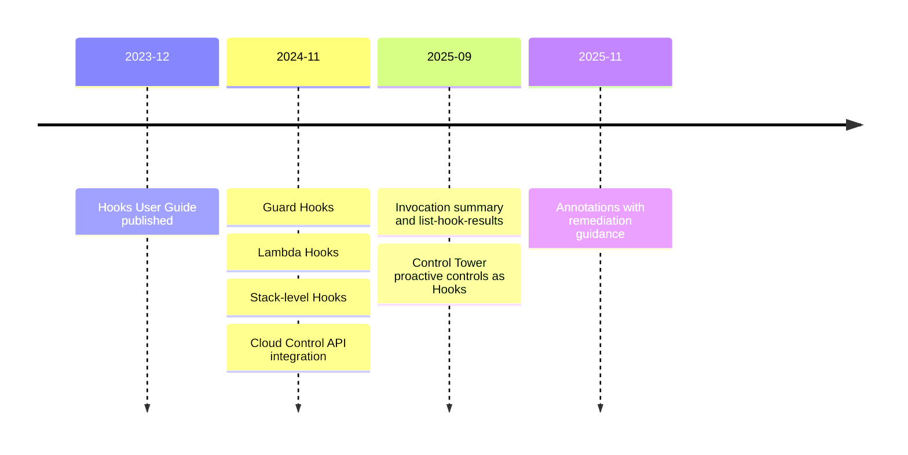
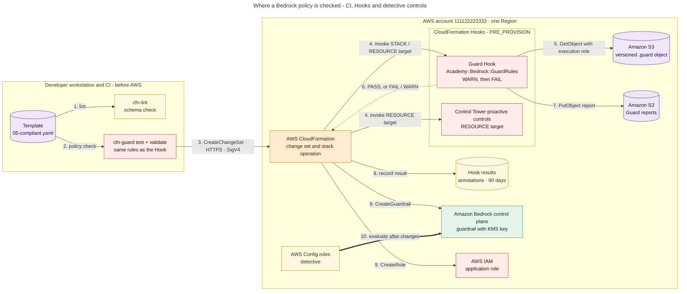

# Hooks and CloudFormation Guard

> **Level:** Advanced · **Verified:** 2026-11-15 · **Feature status:** GA · **Time:** ~40 min

CloudFormation Hooks stop a non-compliant resource *before* CloudFormation creates it; AWS
CloudFormation Guard is a language for writing those checks. This chapter enforces three Bedrock
rules — encrypted guardrails, prompt-attack filters, no wildcard model access — with real rules and
real output.

## Learning objectives

After this chapter you can:

- Place preventive, proactive and detective controls in a Bedrock pipeline.
- Choose and configure a Guard, Lambda, custom or Control Tower Hook: targets, actions, filters, failure mode.
- Write and unit-test Guard rules with filters, `when`, `some` and named rules.
- Explain what cfn-lint, Guard, cdk-nag, Checkov and Hooks each catch.
- Recognise what a policy check cannot see, and close the gap.

## Prerequisites

- [Template anatomy](01-template-anatomy.md) and [Change sets and drift detection](04-change-sets-and-drift.md)
- [IAM fundamentals: principals, policies and evaluation](../../00-foundations/security/01-iam-fundamentals.md)
- [AWS Organizations and AWS Control Tower](../../00-foundations/aws-fundamentals/05-organizations-control-tower.md)

## Concept in plain language

Think of a flight. **Guard in your pipeline** is checking your own suitcase at home — fast, but
skippable. A **Hook** is airport security: everything CloudFormation deploys passes it, and it can
refuse boarding (`FAIL`) or note a problem (`WARN`). **AWS Config** is the audit after landing.

A **linter** (cfn-lint) is a spell checker; a **policy engine** (Guard) is your company style
guide ("every guardrail uses our own encryption key"). The
[non-compliant example](templates/05-noncompliant.yaml) is spelled perfectly and breaks the style guide.

## How it really works

### Three kinds of control

| Behavior | When it acts | Implemented with | Typical Bedrock use |
|:--|:--|:--|:--|
| Preventive | On the API call, any tool | Service control policies, resource control policies, declarative policies (AWS Organizations) | Deny Bedrock calls outside approved Regions; require a guardrail through IAM conditions |
| **Proactive** | Before CloudFormation provisions | **CloudFormation Hooks** | Refuse a guardrail without a customer managed key |
| Detective | After the resource exists | AWS Config rules | Report guardrails changed outside IaC |

Source: [Control behavior and guidance](https://docs.aws.amazon.com/controltower/latest/controlreference/control-behavior.html).
The organisation-wide view is in [Governance at scale](../../06-security-governance/06-governance-at-scale.md).

### Hooks: targets, actions and failure modes

A Hook is code that CloudFormation invokes immediately before it creates, updates or deletes a
stack or resource, or while it creates a change set; it can also run before Cloud Control API operations.

| Target (`TargetOperations`) | What the Hook evaluates | Actions it can run on |
|:--|:--|:--|
| `RESOURCE` | One resource's proposed properties, with functions, parameters and transforms resolved, plus its previous properties | `CREATE`, `UPDATE`, `DELETE` |
| `STACK` | The whole template passed to the stack operation, plus the last deployed template | `CREATE`, `UPDATE`, `DELETE` |
| `CHANGE_SET` | The template, the previous template and the list of resource changes | `CREATE` only |
| `CLOUD_CONTROL` | A resource created, updated or deleted through Cloud Control API | `CREATE`, `UPDATE`, `DELETE` |

Sources: [Hooks concepts](https://docs.aws.amazon.com/cloudformation-cli/latest/hooks-userguide/hooks-concepts.html),
[Write Guard rules for Guard Hooks](https://docs.aws.amazon.com/cloudformation-cli/latest/hooks-userguide/guard-hooks-write-rules.html).

`FAIL` stops the operation and rolls the stack back; `WARN` continues with a warning. Each
invocation has a 30-second timeout and up to 3 retries.

> [!NOTE]
> **Documented fact** — AWS recommends activating a Hook in `WARN` mode first to see which
> operations it would affect, then switching it to `FAIL`.
> Source: [Hooks concepts](https://docs.aws.amazon.com/cloudformation-cli/latest/hooks-userguide/hooks-concepts.html)

> [!WARNING]
> **Common mistake** — Expecting a delete check on every removal. Operations in `UpdateCleanup` do
> not invoke Hooks: removing a resource from the template, or deleting the old copy of a replaced
> resource, is not checked.

### Four ways to implement a Hook

| Option | Activated as | You supply | Notes |
|:--|:--|:--|:--|
| Control Tower proactive control | Type `AWS::ControlTower::Hook`, property `ControlsToApply` (control IDs) | Nothing but the control IDs | `RESOURCE` target only; `CREATE` and `UPDATE` actions |
| **Guard Hook** | Type `AWS::Hooks::GuardHook` (publisher `aws-hooks`), or the `AWS::CloudFormation::GuardHook` resource | Guard rules in Amazon S3 (`.guard`, `.zip` or `.tar.gz`) and an execution role | Rules are downloaded on every invocation; reports can go to an S3 log bucket |
| Lambda Hook | Type `AWS::Hooks::LambdaHook`, or the `AWS::CloudFormation::LambdaHook` resource | A Lambda function (ARN, or a qualified ARN with a version or alias) and an execution role | Any runtime; the function's `FAILED` response triggers the failure mode |
| Custom Hook | Your own type, built with the CloudFormation CLI and registered in the registry | Handlers `preCreate`, `preUpdate`, `preDelete` | Most flexible; shareable publicly or privately; billed per handler operation |

Sources: [What are CloudFormation Hooks?](https://docs.aws.amazon.com/cloudformation-cli/latest/hooks-userguide/what-is-cloudformation-hooks.html),
[Activate a Guard Hook](https://docs.aws.amazon.com/cloudformation-cli/latest/hooks-userguide/guard-hooks-activate-hooks.html),
[Activate a Lambda Hook](https://docs.aws.amazon.com/cloudformation-cli/latest/hooks-userguide/lambda-hooks-activate-hooks.html),
[Activate a proactive control-based Hook](https://docs.aws.amazon.com/cloudformation-cli/latest/hooks-userguide/proactive-controls-hooks-activate-hooks.html).

> [!IMPORTANT]
> **Status** — We found no Bedrock-specific proactive control in the Control Catalog pages read.
> **UNVERIFIED — REQUIRES DOCUMENTATION REVIEW**: check with the Control Catalog `ListControls` API;
> until then, write Bedrock rules yourself.
> Source searched: [Proactive controls](https://docs.aws.amazon.com/controltower/latest/controlreference/proactive-controls.html)

### Activation and targeting

Hooks are per account and Region. Activate one with `ActivateType` and configure it with
`SetTypeConfiguration`, or declare the resource types above in a template. The configuration holds
`HookInvocationStatus`, `TargetOperations`, `FailureMode`, type-specific `Properties` (Guard:
`ruleLocation`, `logBucket`) and two filters:

| Filter | Fields | Notes |
|:--|:--|:--|
| `TargetFilters` | `Actions`, `InvocationPoints` (`PRE_PROVISION`), `TargetNames` — or a `Targets` list combining them | Up to 50 resource type names; wildcards allowed |
| `StackFilters` | `FilteringCriteria` (`ALL` or `ANY`), `StackNames`, `StackRoles` with `Include` / `Exclude` | Up to 50 entries per list; ignored for Cloud Control API operations |

Sources: [Hook configuration schema](https://docs.aws.amazon.com/cloudformation-cli/latest/hooks-userguide/hook-configuration-schema.html),
[Target filters](https://docs.aws.amazon.com/cloudformation-cli/latest/hooks-userguide/hooks-target-filtering.html),
[Stack level filters](https://docs.aws.amazon.com/cloudformation-cli/latest/hooks-userguide/hooks-stack-level-filtering.html).
Quotas: 100 Hooks per account per Region, 100 per resource, 100 versions per Hook
([CloudFormation quotas](https://docs.aws.amazon.com/AWSCloudFormation/latest/UserGuide/cloudformation-limits.html)).
The configuration size limit is 204.8 KB on the quotas page but 300 KB on the schema page; design
for the smaller.

**Results.** The console's *Invocation summary* covers the last 90 days. `ListHookResults`
filters by Hook, status (`HOOK_IN_PROGRESS`, `HOOK_COMPLETE_SUCCEEDED`, `HOOK_COMPLETE_FAILED`,
`HOOK_FAILED`) or target; `GetHookResult` returns **annotations** — per-check status, message,
remediation and severity, encryptable with your KMS key (set from the AWS CLI only). Sources:
[View invocation results](https://docs.aws.amazon.com/cloudformation-cli/latest/hooks-userguide/hooks-view-invocations.html),
[Hooks concepts](https://docs.aws.amazon.com/cloudformation-cli/latest/hooks-userguide/hooks-concepts.html).



Source: [Document history for the Hooks User Guide](https://docs.aws.amazon.com/cloudformation-cli/latest/hooks-userguide/doc-history.html).

### Guard: the rule language

Guard is an open-source policy-as-code tool for any JSON or YAML — templates, change sets,
Terraform JSON, Kubernetes files. It does not check template validity (cfn-lint does) or enforce
server-side (a Hook does). The major version is 3; Guard 3.0 added built-in functions, the
`--structured` flag and corrected intrinsic-function handling in `test`.
Sources: [What is Guard?](https://docs.aws.amazon.com/cfn-guard/latest/ug/what-is-guard.html),
[Guard README](https://raw.githubusercontent.com/aws-cloudformation/cloudformation-guard/main/README.md).

| Construct | Syntax | Meaning |
|:--|:--|:--|
| Clause | `Properties.KmsKeyArn exists` | Boolean check: unary (`exists`, `empty`, `is_string`, `is_list`, `is_struct`, `not`) or binary (`==`, `!=`, `<`, `<=`, `>`, `>=`, `IN`) |
| Query with filter | `Resources.*[ Type == 'AWS::Bedrock::Guardrail' ]` | Traverse with `.`; `*` and `[*]` fan out; `[ ... ]` keeps matching elements |
| Variable | `let guardrails = ...` then `%guardrails` | Assign once, reuse |
| `some` | `some Resource[*] == '*'` | At least one value must match (default is all) |
| Combination | one clause per line; `or` at line end | Lines are AND-ed; `or` binds first (conjunctive normal form) |
| `when` block | `when %guardrails !empty { ... }` | Evaluate only if the condition passes; otherwise `SKIP` |
| Named rule | `rule name when ... { ... }` | Reusable, reported as `PASS`, `FAIL` or `SKIP` |
| Custom message | `<< Violation: ... Fix: ... >>` | Shown in `validate` and `test` output |

Sources: [Writing Guard rules](https://docs.aws.amazon.com/cfn-guard/latest/ug/writing-rules.html),
[Queries and filtering](https://docs.aws.amazon.com/cfn-guard/latest/ug/query-and-filtering.html).

A missing key is a retrieval error and fails a clause, but a filter that matches nothing returns
an empty result and the block is skipped — hence `when %selection !empty` on every rule below.

**Testing:** a test file lists inputs and the expected `PASS`, `FAIL` or `SKIP` per rule, starting
with an empty input ([Testing Guard rules](https://docs.aws.amazon.com/cfn-guard/latest/ug/testing-rules.html)).
**Validating:** `cfn-guard validate` exits `0` when all rules pass and writes `json`, `yaml`,
`single-line-summary`, `junit` or `sarif` ([validate](https://docs.aws.amazon.com/cfn-guard/latest/ug/cfn-guard-validate.html)).
With cfn-guard 3.2.1 we observed exit code 19 on failure, and `junit` required `--structured`.

### How Guard, cfn-lint, cdk-nag, Checkov and Hooks fit together

| Tool | Reads | Checks | Runs | Can block a deployment? |
|:--|:--|:--|:--|:--|
| cfn-lint | CloudFormation and SAM templates | Template against the resource provider schemas: properties, allowed values, best practices | Editor, CI | Only if CI fails the build |
| **Guard** | Any JSON/YAML | Your organisation's rules | CI, and inside a Guard Hook | Yes, as a Hook |
| cdk-nag | A CDK app (or a template through the CDK) | Rule packs: AWS Solutions, HIPAA, NIST 800-53, PCI DSS, Serverless | `cdk synth` | Only if synthesis fails |
| Checkov | Terraform, CloudFormation, SAM, Kubernetes and more | Over 1,000 built-in security policies | CI | Only if CI fails the build |
| Hooks | What CloudFormation or Cloud Control API is about to provision | Guard rules, Lambda logic, Control Tower controls | Server-side | Yes (`FAIL`) |

Sources: [cfn-lint README](https://raw.githubusercontent.com/aws-cloudformation/cfn-lint/main/README.md),
[cdk-nag README](https://raw.githubusercontent.com/cdklabs/cdk-nag/main/README.md),
[Checkov README](https://raw.githubusercontent.com/bridgecrewio/checkov/main/README.md).
The pipeline view of these tools is in
[Formatting, linting and security scanning](../../07-devops-and-cicd/02-static-analysis-and-security-scanning.md)
and [Policy validation, cost estimation and human approval](../../07-devops-and-cicd/06-policy-cost-and-approvals.md).

> [!TIP]
> **Academy recommendation** — Run the same Guard rules in CI (fast feedback) and as a Guard Hook
> (enforcement nobody can skip). Keep generic scanners alongside; put *organisation-specific* rules
> in Guard. This is our design guidance, not an official AWS reference architecture.

## Architecture diagram



**What this shows** — One rules file runs in CI, where it can be skipped, and in a Guard Hook,
where it cannot. Control Tower proactive controls add AWS-written checks on the same path; AWS
Config inspects what exists afterwards.

**Walkthrough**

1. cfn-lint checks the template against the resource schemas.
2. Guard tests and validates the organisation's rules.
3. The pipeline creates a change set.
4. CloudFormation invokes every Hook whose targets, actions and filters match.
5. The Guard Hook reads the pinned rules object.
6. It returns its verdict; in `FAIL` mode a failure stops the operation.
7. The detailed report (with `Violation` and `Fix` text) goes to the log bucket.
8. The result and annotations are recorded.
9. Only then are the guardrail and role created.
10. AWS Config evaluates resources after any change, including changes made outside CloudFormation.

| Legend | Meaning |
|:--|:--|
| Solid arrow | Request |
| Dashed arrow | Response |
| Thick arrow | Asynchronous evaluation |
| Cylinder | Stored data |
| Red boxes | Policy and identity controls |

**Variations** — A `CHANGE_SET` target sees the list of changes and runs only on change-set
creation. A `CLOUD_CONTROL` target covers Cloud Control API callers and ignores stack filters.
Proactive controls may not affect requests made through the console, APIs, SDKs or other IaC tools
([Proactive controls](https://docs.aws.amazon.com/controltower/latest/controlreference/proactive-controls.html)).

## Implementation details

1. **Write rules and tests together**, next to the templates; fail CI on a non-zero exit code.
2. **Publish the rules** to a versioned S3 bucket and pin `VersionId` in `RuleLocation`: the Hook
   downloads them on every invocation, so an overwrite would silently change policy.
3. **Activate in `WARN`**, review the invocation summary, then switch to `FAIL`.
4. **Choose the target.** `STACK` sees the template as submitted; `RESOURCE` sees resolved
   properties. **Our reading:** only `RESOURCE` sees resources that modules and macros add.
5. **Roll out per account and Region** with StackSets
   ([Nested stacks and StackSets](03-nested-stacks-and-stacksets.md),
   [Multi-account and multi-Region deployments](../maintenance/06-multi-account-multi-region.md)),
   excluding the Hook's own stack with `StackFilters`.

> [!WARNING]
> **Common mistake** — Assuming `STACK` and `RESOURCE` input look the same. The guide's input
> syntax names the keys `ResourceType` and `ResourceProperties`; its example input and rules use
> `Type` and `Properties`. Our rules were tested against templates only. **UNVERIFIED — REQUIRES
> DOCUMENTATION REVIEW**: confirm with a `WARN`-mode Hook before relying on `RESOURCE`.
> Source: [Write Guard rules for Guard Hooks](https://docs.aws.amazon.com/cloudformation-cli/latest/hooks-userguide/guard-hooks-write-rules.html)

## Example

### The rules

[`templates/05-bedrock-guardrail-rules.guard`](templates/05-bedrock-guardrail-rules.guard) holds
three named rules. The IAM rule uses filters, `some` and a case-insensitive expression:

> **Code status:** tested with `cfn-guard test` (15 of 15 cases pass) and run with `cfn-guard validate` (cfn-guard 3.2.1) · **never deployed**

```text
let role_inline_statements = Resources.*[
    Type == 'AWS::IAM::Role'
    Properties.Policies exists
].Properties.Policies[*].PolicyDocument.Statement[*]

let role_wildcard_invoke = %role_inline_statements[
    Effect == 'Allow'
    some Resource[*] == '*'
    some Action[*] == /(?i)^(\*|bedrock:\*|bedrock:invoke\*|bedrock:invokemodel.*)$/
]

rule iam_no_wildcard_bedrock_invoke when %iam_resources !empty {
    %role_wildcard_invoke empty
    <<
        Violation: An IAM role inline policy allows Bedrock model invocation on Resource "*".
        Fix: Name the foundation model, inference profile or provisioned model ARNs in Resource.
    >>
    %policy_wildcard_invoke empty
}
```

Only `Allow` statements are selected, so the compliant template's broad `Deny` that requires a
guardrail ([Enforce specific guardrails](https://docs.aws.amazon.com/bedrock/latest/userguide/guardrails-permissions-id.html))
passes. The guardrail rules check `KmsKeyArn` and a `PROMPT_ATTACK` filter of `MEDIUM` or `HIGH`.

### Real output

> **Code status:** commands run on 2026-11-15 with cfn-lint 1.60.1 and cfn-guard 3.2.1; output trimmed and paths shortened · **never deployed**

```text
$ cfn-lint 05-compliant.yaml 05-noncompliant.yaml
$ echo $?
0

$ cfn-guard test --rules-file 05-bedrock-guardrail-rules.guard --test-data 05-bedrock-guardrail-rules_tests.yaml
Test Case #13
Name: A Deny on star is allowed (it removes access)
  PASS Rules:
    iam_no_wildcard_bedrock_invoke: Expected = PASS
...                                   # 15 test cases, 0 "FAIL Rules", exit code 0

$ cfn-guard validate --rules 05-bedrock-guardrail-rules.guard --data 05-compliant.yaml --show-summary all
05-compliant.yaml Status = PASS
PASS rules
05-bedrock-guardrail-rules.guard/bedrock_guardrail_kms_key_required         PASS
05-bedrock-guardrail-rules.guard/bedrock_guardrail_blocks_prompt_attacks    PASS
05-bedrock-guardrail-rules.guard/iam_no_wildcard_bedrock_invoke             PASS

$ cfn-guard validate --rules 05-bedrock-guardrail-rules.guard --data 05-noncompliant.yaml
05-noncompliant.yaml Status = FAIL
FAILED rules
05-bedrock-guardrail-rules.guard/bedrock_guardrail_kms_key_required         FAIL
05-bedrock-guardrail-rules.guard/bedrock_guardrail_blocks_prompt_attacks    FAIL
05-bedrock-guardrail-rules.guard/iam_no_wildcard_bedrock_invoke             FAIL
...
Resource = Guardrail/Properties/ContentPolicyConfig/FiltersConfig/1 {
  Type      = PROMPT_ATTACK
  Rule = bedrock_guardrail_blocks_prompt_attacks {
          PropertyPath    = /Resources/Guardrail/Properties/ContentPolicyConfig/FiltersConfig/1/InputStrength[L:33,C:27]
          Operator        = IN
          Value           = "LOW"
          ComparedWith    = [["MEDIUM","HIGH"]]
$ echo $?
19
```

The template cfn-lint accepts without a finding fails all three policies.

### Activating the rules as a Guard Hook

> **Code status:** validated with cfn-lint 1.60.1 in a scratch directory (not stored in `templates/`) · **never deployed**

```yaml
  BedrockGuardHook:
    Type: AWS::CloudFormation::GuardHook
    Properties:
      Alias: Academy::Bedrock::GuardRules
      ExecutionRole: !GetAtt GuardHookRole.Arn      # trusts hooks.cloudformation.amazonaws.com
      RuleLocation:
        Uri: !Sub "s3://${RulesBucketName}/${RulesObjectKey}"
        VersionId: !Ref RulesObjectVersion          # pin the rules
      LogBucket: !Ref ReportBucketName
      TargetOperations: [STACK]
      TargetFilters:
        Actions: [CREATE, UPDATE]
      StackFilters:
        FilteringCriteria: ALL
        StackNames:
          Exclude: [!Ref AWS::StackName]            # do not police the stack that manages the Hook
      FailureMode: WARN                             # switch to FAIL after reviewing results
      HookStatus: ENABLED
```

The execution role needs `s3:GetObject`, `s3:GetObjectVersion` and `s3:ListBucket` on the rules
and `s3:PutObject` on the reports
([Prepare to create a Guard Hook](https://docs.aws.amazon.com/cloudformation-cli/latest/hooks-userguide/guard-hooks-prepare-to-create-hook.html),
[`AWS::CloudFormation::GuardHook`](https://docs.aws.amazon.com/AWSCloudFormation/latest/TemplateReference/aws-resource-cloudformation-guardhook.html)).

### What a CI-time check cannot see

Against [`templates/06-module-usage.yaml`](templates/06-module-usage.yaml) both guardrail rules
return `SKIP`: the guardrail sits inside a registry module that CloudFormation expands only when it
processes the template. Also run Guard on the module's own fragment in CI
([CloudFormation modules and reuse](06-modules-and-reuse.md)).

## Common mistakes

| Mistake | Symptom | Fix |
|:--|:--|:--|
| Treating cfn-lint as a security gate | Non-compliant templates pass CI | Add Guard (or Checkov/cdk-nag) as a separate step |
| Rules without `when ... !empty` guards | Rules `FAIL` on templates that have no such resource | Guard every rule on its selection |
| Rule file in S3 without a pinned version | Policy changes with no review trail | Version the bucket and set `VersionId` |
| Going straight to `FAIL` | Unrelated stacks blocked on day one | Start in `WARN`, read the invocation summary |
| Hook policing its own stack | The Hook cannot be updated or removed cleanly | Exclude it with `StackFilters` |
| Believing a Hook covers everything | Terraform, console or SDK changes go unchecked | Pair Hooks with SCPs and AWS Config rules |
| Matching `bedrock:InvokeModel` case-sensitively | `bedrock:invokemodel` slips through | IAM actions are case-insensitive; use `(?i)` |

## Security considerations

- Keep the Hook execution role to reading rules and writing reports; restrict who can change the Hook and the rules bucket.
- Reports and annotations can contain resource configuration; encrypt them.
- Secure strings and secrets reach Hooks unresolved, so rules cannot inspect them ([Proactive controls](https://docs.aws.amazon.com/controltower/latest/controlreference/proactive-controls.html)).
- The IAM rule ignores `NotAction`, `NotResource` and policies attached elsewhere — one layer of least privilege, not all of it ([Identity and least privilege](../../06-security-governance/02-identity-and-least-privilege.md)).

## Cost considerations

- Managed Hooks in the `AWS::*` namespace carry no additional CloudFormation charge. Custom Hooks
  are billed per handler operation — the pricing page's examples use $0.0009 per operation after
  1,000 free-tier operations — plus $0.00008 per second beyond 30 seconds
  ([CloudFormation pricing](https://aws.amazon.com/cloudformation/pricing/)).
- **Our reading:** Guard and Lambda Hooks are activated from `AWS::Hooks::*` types, so you pay for
  the Lambda invocations, S3 storage and AWS Config evaluations, not for the Hook.
- The CI tools cost only build minutes.

## Knowledge check

1. A template passes cfn-lint with no findings. Why can a Guard Hook still reject it?
2. Your Guard Hook targets `STACK`. A team adds a guardrail through a registry module. What does the Hook see, and what do you change?
3. Why does the IAM rule select only `Allow` statements?

<details>
<summary>Answers</summary>

1. cfn-lint checks the template against the resource schemas; it knows nothing about your policies, such as "every guardrail needs a customer managed key".
2. The submitted template: the module reference, not the guardrail. Use a `RESOURCE` target (proven in `WARN` mode first) and run the rules on the module fragment in CI.
3. A `Deny` on `"*"` removes access — it is the documented way to require a guardrail on every inference call. Selecting it would fail compliant templates.

</details>

## Further reading

Official sources opened while writing this chapter:

- [What are CloudFormation Hooks?](https://docs.aws.amazon.com/cloudformation-cli/latest/hooks-userguide/what-is-cloudformation-hooks.html) — implementation options.
- [Hooks concepts](https://docs.aws.amazon.com/cloudformation-cli/latest/hooks-userguide/hooks-concepts.html) — targets, actions, failure modes, timeouts, `UpdateCleanup`.
- [Write Guard rules for Guard Hooks](https://docs.aws.amazon.com/cloudformation-cli/latest/hooks-userguide/guard-hooks-write-rules.html) — input shapes for each target.
- [Prepare to create a Guard Hook](https://docs.aws.amazon.com/cloudformation-cli/latest/hooks-userguide/guard-hooks-prepare-to-create-hook.html) and [Activate a Guard Hook](https://docs.aws.amazon.com/cloudformation-cli/latest/hooks-userguide/guard-hooks-activate-hooks.html).
- [Activate a Lambda Hook](https://docs.aws.amazon.com/cloudformation-cli/latest/hooks-userguide/lambda-hooks-activate-hooks.html).
- [Proactive controls as Hooks](https://docs.aws.amazon.com/cloudformation-cli/latest/hooks-userguide/proactive-controls-hooks.html) and [activation](https://docs.aws.amazon.com/cloudformation-cli/latest/hooks-userguide/proactive-controls-hooks-activate-hooks.html).
- [Hook configuration schema](https://docs.aws.amazon.com/cloudformation-cli/latest/hooks-userguide/hook-configuration-schema.html), [target filters](https://docs.aws.amazon.com/cloudformation-cli/latest/hooks-userguide/hooks-target-filtering.html), [stack level filters](https://docs.aws.amazon.com/cloudformation-cli/latest/hooks-userguide/hooks-stack-level-filtering.html).
- [View invocation results](https://docs.aws.amazon.com/cloudformation-cli/latest/hooks-userguide/hooks-view-invocations.html) — invocation summary, statuses, annotations.
- [Hooks document history](https://docs.aws.amazon.com/cloudformation-cli/latest/hooks-userguide/doc-history.html).
- [`AWS::CloudFormation::GuardHook`](https://docs.aws.amazon.com/AWSCloudFormation/latest/TemplateReference/aws-resource-cloudformation-guardhook.html).
- [What is AWS CloudFormation Guard?](https://docs.aws.amazon.com/cfn-guard/latest/ug/what-is-guard.html), [Writing rules](https://docs.aws.amazon.com/cfn-guard/latest/ug/writing-rules.html), [Queries and filtering](https://docs.aws.amazon.com/cfn-guard/latest/ug/query-and-filtering.html), [Testing rules](https://docs.aws.amazon.com/cfn-guard/latest/ug/testing-rules.html), [validate](https://docs.aws.amazon.com/cfn-guard/latest/ug/cfn-guard-validate.html), [Validating input data](https://docs.aws.amazon.com/cfn-guard/latest/ug/validating-rules.html).
- [Guard README](https://raw.githubusercontent.com/aws-cloudformation/cloudformation-guard/main/README.md) — Guard 3 changes.
- [Control behavior and guidance](https://docs.aws.amazon.com/controltower/latest/controlreference/control-behavior.html) and [Proactive controls](https://docs.aws.amazon.com/controltower/latest/controlreference/proactive-controls.html) — AWS Control Tower.
- [CloudFormation quotas](https://docs.aws.amazon.com/AWSCloudFormation/latest/UserGuide/cloudformation-limits.html) and [CloudFormation pricing](https://aws.amazon.com/cloudformation/pricing/).
- [Enforce the use of specific guardrails](https://docs.aws.amazon.com/bedrock/latest/userguide/guardrails-permissions-id.html) and [Guardrail KMS keys](https://docs.aws.amazon.com/bedrock/latest/userguide/guardrails-permissions-kms.html) — the Bedrock behaviour the rules protect.
- [cfn-lint README](https://raw.githubusercontent.com/aws-cloudformation/cfn-lint/main/README.md), [cdk-nag README](https://raw.githubusercontent.com/cdklabs/cdk-nag/main/README.md), [Checkov README](https://raw.githubusercontent.com/bridgecrewio/checkov/main/README.md).
