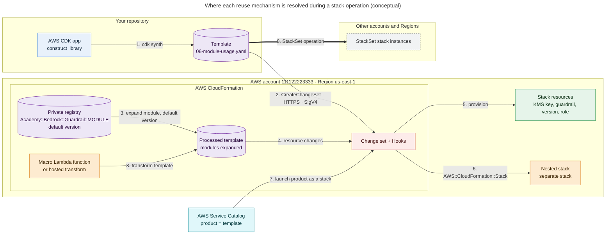
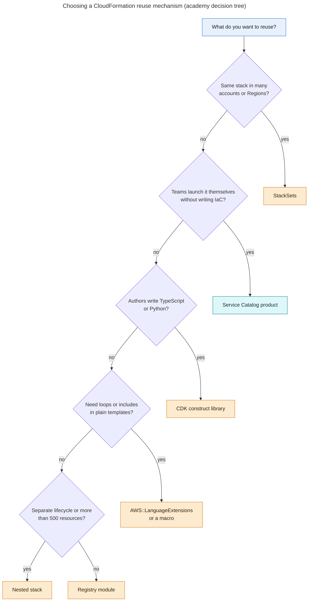

# CloudFormation modules and reuse

> **Level:** Intermediate · **Verified:** 2026-11-15 · **Feature status:** GA · **Time:** ~35 min

Every Bedrock platform repeats the same building blocks — an encrypted guardrail, a least-privilege
invocation role. CloudFormation offers seven ways to reuse them, differing in *when* the piece is
expanded, *who* controls its version and *where* it is deployed. This chapter compares them and
builds a guardrail module.

## Learning objectives

After this chapter you can:

- Compare modules, nested stacks, StackSets, macros and transforms, Service Catalog, the AWS CDK and AWS SAM as reuse mechanisms.
- Build, register, version and consume a CloudFormation module, and reference resources inside it.
- Predict how a module's default version and a macro change what a stack deploys.
- Choose a mechanism with a decision tree.
- Say what IaC generator and Git sync add to a CloudFormation workflow.

## Prerequisites

- [Template anatomy](01-template-anatomy.md) and [Intrinsic functions](02-intrinsic-functions.md)
- [Nested stacks and StackSets](03-nested-stacks-and-stacksets.md)

## Concept in plain language

Think of a restaurant group. A **module** is a meal kit: its ingredients become part of *your*
dish and appear on your plate's ingredient list. A **nested stack** orders a side dish from another
kitchen: it arrives as its own unit. A **StackSet** is a franchise that cooks the same dish in many
restaurants. A **macro** is a sous-chef who rewrites your recipe before cooking. **Service Catalog**
is a menu of approved dishes that guests order themselves. The **CDK** is writing recipes with code
that prints the final recipe card.

## How it really works

### Modules

A module is a registry extension named `organization::service::use-case::MODULE`. It consists of a
**template fragment** (resources, parameters, outputs, conditions) and a **schema** generated from
that fragment. You declare it in `Resources` like a resource; its parameters become properties.
When a stack operation starts, CloudFormation generates a *processed template* in which the module
is replaced by its resources.

| Topic | Documented behaviour |
|:--|:--|
| Referencing inside resources | `ModuleName.ResourceName` or `ModuleNameResourceName`, with `Ref` and `Fn::GetAtt` |
| Outputs | Propagated to the stack, with the logical ID `ModuleName` + output name |
| Parameters | Not propagated to the template; no constraint enforcement — put constraints on a template parameter and pass it in |
| Tags | Not allowed at module level; stack-level tags reach the module's resources |
| Resource attributes | `DeletionPolicy` and `UpdateReplacePolicy` at module level apply to every resource inside; `CreationPolicy` and `UpdatePolicy` are not allowed |
| Not allowed inside a module | `Fn::ImportValue`, `Export`, macros and transforms, nested stacks, StackSets |
| Nesting | Modules can contain modules, up to three levels deep |
| Quotas | 100 modules per account and Region; 100 versions per module; stack quotas apply to the processed template |
| Price | No charge for modules; you pay for the resources they create |

Sources: [Modules](https://docs.aws.amazon.com/AWSCloudFormation/latest/UserGuide/modules.html),
[Reference module resources](https://docs.aws.amazon.com/AWSCloudFormation/latest/UserGuide/module-ref-resources.html),
[Module parameters](https://docs.aws.amazon.com/AWSCloudFormation/latest/UserGuide/module-using-params.html),
[Module structure and requirements](https://docs.aws.amazon.com/cloudformation-cli/latest/userguide/modules-structure.html),
[CloudFormation quotas](https://docs.aws.amazon.com/AWSCloudFormation/latest/UserGuide/cloudformation-limits.html).

**Registering.** With the CloudFormation CLI, `cfn init` creates a project whose `fragments`
folder holds one file; `cfn validate` regenerates the schema and `cfn submit` registers it. Or
declare `AWS::CloudFormation::ModuleVersion` and `ModuleDefaultVersion` in a template; updating a
version resource registers a new version, deleting it marks the version `DEPRECATED`. Sources:
[Develop a module](https://docs.aws.amazon.com/cloudformation-cli/latest/userguide/modules-develop.html),
[`AWS::CloudFormation::ModuleVersion`](https://docs.aws.amazon.com/AWSCloudFormation/latest/TemplateReference/aws-resource-cloudformation-moduleversion.html).

> [!IMPORTANT]
> **Status** — Every stack operation uses the module version that is the **default in that account
> and Region at that moment**, nested modules included. Changing the default updates no stack; the
> next operation picks it up, except an update with *use previous template*. The first version
> registered stays the default until you change it. StackSets need the same default everywhere.
> Sources: [Module versioning](https://docs.aws.amazon.com/AWSCloudFormation/latest/UserGuide/module-versioning.html),
> [`AWS::CloudFormation::ModuleDefaultVersion`](https://docs.aws.amazon.com/AWSCloudFormation/latest/TemplateReference/aws-resource-cloudformation-moduledefaultversion.html)

### Nested stacks and StackSets

A nested stack is an `AWS::CloudFormation::Stack` resource whose `TemplateURL` points to another
template — a separate stack with its own events and outputs; one operation on a nested hierarchy can
touch at most 2,500 resources. A **StackSet** deploys one template to many accounts and Regions,
with self-managed roles or service-managed permissions through AWS Organizations. Both are covered in
[Nested stacks and StackSets](03-nested-stacks-and-stacksets.md); the academy's StackSet example
is [`templates/04-stackset-guardrail-baseline.yaml`](templates/04-stackset-guardrail-baseline.yaml).
Sources: [Nested stacks](https://docs.aws.amazon.com/AWSCloudFormation/latest/UserGuide/using-cfn-nested-stacks.html),
[StackSets concepts](https://docs.aws.amazon.com/AWSCloudFormation/latest/UserGuide/stacksets-concepts.html).

### Macros and transforms

A **macro** is a Lambda function registered with `AWS::CloudFormation::Macro`. In the `Transform`
section it receives the whole template; through `Fn::Transform`, its sibling nodes. Macros run
before intrinsic functions, are not recursive, cannot use `Fn::ImportValue`, exist only in their own
account and cannot return modules. Because they can add resources (including IAM), use a change set;
creating a stack directly needs `CAPABILITY_AUTO_EXPAND`. Service-managed StackSets cannot use them.

**Transforms** are macros hosted by CloudFormation, free and available in every account:
`AWS::Include` inserts snippets from S3, `AWS::Serverless` expands AWS SAM syntax, and
`AWS::LanguageExtensions` adds `Fn::ForEach`, `Fn::Length` and `Fn::ToJsonString`. Sources:
[Macros](https://docs.aws.amazon.com/AWSCloudFormation/latest/UserGuide/template-macros.html),
[Macro overview](https://docs.aws.amazon.com/AWSCloudFormation/latest/UserGuide/template-macros-overview.html),
[Macro definition and evaluation order](https://docs.aws.amazon.com/AWSCloudFormation/latest/UserGuide/template-macros-author.html),
[Transform reference](https://docs.aws.amazon.com/AWSCloudFormation/latest/TemplateReference/transform-reference.html),
[`AWS::LanguageExtensions`](https://docs.aws.amazon.com/AWSCloudFormation/latest/TemplateReference/transform-aws-languageextensions.html).

### Service Catalog, the CDK and SAM

**AWS Service Catalog** turns a CloudFormation template (or Terraform configuration) into a
*product* in a *portfolio*; a launched product is a stack. Launch constraints provision with a role
the user does not hold; template constraints narrow parameter values
([Service Catalog overview](https://docs.aws.amazon.com/servicecatalog/latest/adminguide/what-is_concepts.html)).
The **AWS CDK** reuses code — construct libraries that synthesize to CloudFormation — and a CDK
synthesis can even produce a module fragment
([Module structure](https://docs.aws.amazon.com/cloudformation-cli/latest/userguide/modules-structure.html)).
**AWS SAM** is the `AWS::Serverless` transform plus a CLI. See
[Reusable construct libraries](../aws-cdk/08-construct-libraries.md), [AWS SAM](../aws-sam/01-aws-sam.md)
and, for comparison, [Terraform modules](../terraform/03-modules.md).

### At a glance: IaC generator and Git sync

- **IaC generator** scans a Region for resources that CloudFormation does not manage (a scan
  expires after 30 days), builds a template of up to 500 resources, and imports them into a stack
  or, with `cdk migrate`, a CDK app. It supports only types that Cloud Control API supports in the
  Region ([IaC generator](https://docs.aws.amazon.com/AWSCloudFormation/latest/UserGuide/generate-IaC.html)).
  **Our reading:** useful for adopting Bedrock resources first created in the console — if their
  types are on the supported list, which we did not check.
- **Git sync** watches a template and a *stack deployment file* in GitHub, GitHub Enterprise,
  GitLab, GitLab self-managed or Bitbucket and updates the stack on each commit; it can comment on
  pull requests. It is available in 17 Regions
  ([Git sync](https://docs.aws.amazon.com/AWSCloudFormation/latest/UserGuide/git-sync.html)).

## Architecture diagram



**What this shows** — Reuse happens at different moments. CDK reuse happens before CloudFormation
sees anything. Modules and macros are resolved inside CloudFormation into one processed template,
so their resources belong to *your* stack. Nested stacks and StackSets create *other* stacks.

**Walkthrough**

1. A CDK app synthesizes a plain template (optional).
2. The template is submitted as a change set.
3. CloudFormation expands modules from the registry's current default version and runs macros or transforms.
4. The processed template becomes the list of resource changes, which Hooks evaluate.
5. The module's resources are created in this stack.
6. A nested stack resource creates a separate child stack.
7. Service Catalog launches a product through the same path, using its launch role.
8. A StackSet deploys the template as stacks in other accounts and Regions.

| Legend | Meaning |
|:--|:--|
| Solid arrow | Request or processing step |
| Thick arrow | Asynchronous, multi-account operation |
| Cylinder | Stored template or registry entry |
| Dashed box | Outside this account |

**Variations** — The documentation does not state the relative order of module expansion and macro
processing; it states only that a macro cannot return modules and a module cannot contain macros.

### Comparison matrix

| Mechanism | Unit of reuse | Resolved | Versioned by | Cross-account | Academy example use |
|:--|:--|:--|:--|:--|:--|
| Module | Template fragment + schema | At stack operation, into your stack | Registry default version per account and Region | Register in each account | Standard encrypted guardrail; invocation role |
| Nested stack | Whole template | As a child stack | The `TemplateURL` object you point to | No — part of the parent's stack hierarchy | Splitting a large knowledge base stack |
| StackSet | Whole template | As stacks in target accounts | The StackSet's template | Yes | Guardrail baseline in every workload account |
| Macro | Lambda code | Before intrinsic functions | Your Lambda deployment | Define per account | Generating per-model IAM statements |
| Transform | AWS-hosted macro | Same as macros | AWS | Everywhere | `Fn::ForEach` over model IDs |
| Service Catalog | Product (template) | Launch as a stack | Product versions | Portfolio sharing | Self-service "RAG starter" for teams |
| CDK construct | Code library | Before CloudFormation (synth) | Package manager | Through the package | L2/L3 constructs for AgentCore |

## Implementation details



**What this shows** — Our order of questions: distribution, audience, authoring language, then
template mechanics. Answers combine: a StackSet can deploy a template that uses modules.

> [!TIP]
> **Academy recommendation** — Treat a module like a library release: keep the fragment in Git,
> lint it and run [the Guard rules](05-hooks-and-guard.md) on it, register each change as a new
> version, and promote the *default* version through development, test and production accounts
> on purpose — the default is what every stack picks up next. See
> [Module and construct versioning](../maintenance/02-module-and-construct-versioning.md). This is
> our design guidance, not an official AWS reference architecture.

## Example

The module `Academy::Bedrock::Guardrail::MODULE` packages the compliant guardrail from the
[previous chapter](05-hooks-and-guard.md): a KMS key with rotation, a guardrail that uses it with a
prompt-attack filter, and a published version.

> **Code status:** fragment validated with cfn-lint 1.60.1 and `cfn-guard validate` (PASS) as a standalone template in a scratch directory; not registered · **never deployed**

```yaml
# Template fragment for Academy::Bedrock::Guardrail::MODULE (fragments/guardrail.yaml)
AWSTemplateFormatVersion: "2010-09-09"
Description: Academy::Bedrock::Guardrail::MODULE - a guardrail that passes the academy Guard rules.
Parameters:
  GuardrailName:
    Type: String
  VersionDescription:
    Type: String
    Description: Change this value to publish a new guardrail version.
Resources:
  Key:
    Type: AWS::KMS::Key
    Properties:
      EnableKeyRotation: true
      PendingWindowInDays: 7
      KeyPolicy:
        Version: "2012-10-17"
        Statement:
          - Sid: EnableIamPolicies
            Effect: Allow
            Principal:
              AWS: !Sub "arn:${AWS::Partition}:iam::${AWS::AccountId}:root"
            Action: "kms:*"
            Resource: "*"
  Guardrail:
    Type: AWS::Bedrock::Guardrail
    Properties:
      Name: !Ref GuardrailName
      BlockedInputMessaging: Sorry, this request cannot be processed.
      BlockedOutputsMessaging: Sorry, the response was blocked.
      KmsKeyArn: !GetAtt Key.Arn
      ContentPolicyConfig:
        FiltersConfig:
          - { Type: HATE, InputStrength: HIGH, OutputStrength: HIGH }
          - { Type: VIOLENCE, InputStrength: HIGH, OutputStrength: HIGH }
          - { Type: PROMPT_ATTACK, InputStrength: HIGH, OutputStrength: NONE }
  Version:
    Type: AWS::Bedrock::GuardrailVersion
    Properties:
      GuardrailIdentifier: !GetAtt Guardrail.GuardrailId
      Description: !Ref VersionDescription
Outputs:
  GuardrailArn:
    Value: !GetAtt Guardrail.GuardrailArn   # becomes <ModuleLogicalId>GuardrailArn in the stack
```

Register it with the CLI (`cfn init` → choose module, put the fragment in `fragments/`,
`cfn validate`, `cfn submit`) or declaratively:

> **Code status:** validated with cfn-lint 1.60.1 in a scratch directory · **never deployed**

```yaml
Resources:
  GuardrailModuleVersion:
    Type: AWS::CloudFormation::ModuleVersion
    Properties:
      ModuleName: Academy::Bedrock::Guardrail::MODULE
      ModulePackage: !Ref ModulePackageUrl          # s3:// URL of the package the CLI builds
  GuardrailModuleDefault:
    Type: AWS::CloudFormation::ModuleDefaultVersion
    Properties:
      Arn: !Ref GuardrailModuleVersion             # Ref returns the module version ARN
```

The consumer, [`templates/06-module-usage.yaml`](templates/06-module-usage.yaml), declares the
module and references resources inside it:

> **Code status:** validated with cfn-lint 1.60.1 — cfn-lint checks this template's structure but cannot see inside a registry module · **never deployed**

```yaml
  BaselineGuardrail:
    Type: Academy::Bedrock::Guardrail::MODULE
    Properties:
      GuardrailName: !Sub "${Environment}-baseline-guardrail"
      VersionDescription: Baseline policy reviewed 2026-11-15
  # ...
              - Sid: ApplyModuleGuardrail
                Effect: Allow
                Action: bedrock:ApplyGuardrail
                Resource: !GetAtt BaselineGuardrail.Guardrail.GuardrailArn
```

> [!WARNING]
> **Common mistake** — Trusting a clean lint of a module consumer. With a reference to a
> non-existent resource inside the module and an unknown module property, cfn-lint 1.60.1 still
> reported nothing (it does flag `UpdatePolicy` on a module, rule E5001). Such errors surface only
> when CloudFormation processes the template — create a change set in a test account.

## Common mistakes

| Mistake | Symptom | Fix |
|:--|:--|:--|
| Registering a new module version and expecting stacks to change | Nothing happens until the next stack operation | Set the default version, then update the stacks you intend to change |
| Different default versions across accounts | The same StackSet template deploys different resources | Promote the default deliberately and record it per account and Region |
| Using `Export` or `Fn::ImportValue` in a fragment | Registration or processing fails | Pass values in as module parameters |
| Constraints on module parameters | Constraints are ignored | Constrain a template parameter and pass it to the module |
| Creating a stack with macros directly | Unreviewed resources appear | Use a change set; grant `CAPABILITY_AUTO_EXPAND` only when you trust the macro |
| Nested stacks for a 5-resource pattern | Extra stacks, events and drift to manage | A module keeps resources in one stack |

## Security considerations

- Registry access is account-wide: whoever can register a module version or change the default changes every future deployment that uses it. Restrict the registry and macro Lambda functions with IAM.
- CloudFormation impersonates the caller when it runs a macro, and the caller needs invoke permission on the function ([Macro overview](https://docs.aws.amazon.com/AWSCloudFormation/latest/UserGuide/template-macros-overview.html)).
- Service Catalog launch constraints let users provision without holding the underlying permissions — scope the launch role as tightly as any deployment role.
- Run Hooks with a `RESOURCE` target if modules or macros generate the security-relevant resources ([Hooks and CloudFormation Guard](05-hooks-and-guard.md)).

## Cost considerations

- Modules and CloudFormation-hosted transforms are free; you pay for the resources they create.
- A macro's Lambda invocations are billed to the function owner ([Macros](https://docs.aws.amazon.com/AWSCloudFormation/latest/UserGuide/template-macros.html)).
- CloudFormation adds no charge for `AWS::*` resource types, so nested stacks and StackSets cost what their resources cost — in every account a StackSet reaches ([CloudFormation pricing](https://aws.amazon.com/cloudformation/pricing/)).

## Knowledge check

1. You register version 2 of a guardrail module in production but stacks still deploy version 1's guardrail. Give two possible reasons.
2. A team wants the same encrypted guardrail in 40 workload accounts. Which mechanisms would you combine, and why?
3. Why does a CI-time Guard check of a module *consumer* not catch a missing KMS key inside the module?

<details>
<summary>Answers</summary>

1. The first registered version stays the default until you change it; and stacks pick up the default only on their next operation (not with *use previous template*).
2. A StackSet deploying a template that uses the module — with the same default module version in every target account and Region.
3. The consumer contains only the module reference; the guardrail appears in the processed template. Check the fragment in CI and use a `RESOURCE`-target Hook.

</details>

## Further reading

Official sources opened while writing this chapter:

- [Modules](https://docs.aws.amazon.com/AWSCloudFormation/latest/UserGuide/modules.html), [Use modules](https://docs.aws.amazon.com/AWSCloudFormation/latest/UserGuide/modules-using.html), [Module versioning](https://docs.aws.amazon.com/AWSCloudFormation/latest/UserGuide/module-versioning.html), [Module parameters](https://docs.aws.amazon.com/AWSCloudFormation/latest/UserGuide/module-using-params.html), [Reference module resources](https://docs.aws.amazon.com/AWSCloudFormation/latest/UserGuide/module-ref-resources.html).
- [Module structure and requirements](https://docs.aws.amazon.com/cloudformation-cli/latest/userguide/modules-structure.html) and [Develop a module](https://docs.aws.amazon.com/cloudformation-cli/latest/userguide/modules-develop.html) — CloudFormation CLI.
- [`AWS::CloudFormation::ModuleVersion`](https://docs.aws.amazon.com/AWSCloudFormation/latest/TemplateReference/aws-resource-cloudformation-moduleversion.html) and [`ModuleDefaultVersion`](https://docs.aws.amazon.com/AWSCloudFormation/latest/TemplateReference/aws-resource-cloudformation-moduledefaultversion.html).
- [Introducing AWS CloudFormation modules](https://aws.amazon.com/blogs/mt/introducing-aws-cloudformation-modules/) — launch post with a CLI walkthrough.
- [Nested stacks](https://docs.aws.amazon.com/AWSCloudFormation/latest/UserGuide/using-cfn-nested-stacks.html) and [StackSets concepts](https://docs.aws.amazon.com/AWSCloudFormation/latest/UserGuide/stacksets-concepts.html).
- [Macros](https://docs.aws.amazon.com/AWSCloudFormation/latest/UserGuide/template-macros.html), [Macro overview](https://docs.aws.amazon.com/AWSCloudFormation/latest/UserGuide/template-macros-overview.html), [Create a macro definition](https://docs.aws.amazon.com/AWSCloudFormation/latest/UserGuide/template-macros-author.html), [Transform reference](https://docs.aws.amazon.com/AWSCloudFormation/latest/TemplateReference/transform-reference.html), [`AWS::LanguageExtensions`](https://docs.aws.amazon.com/AWSCloudFormation/latest/TemplateReference/transform-aws-languageextensions.html).
- [What is Service Catalog?](https://docs.aws.amazon.com/servicecatalog/latest/adminguide/introduction.html) and [Service Catalog overview](https://docs.aws.amazon.com/servicecatalog/latest/adminguide/what-is_concepts.html).
- [IaC generator](https://docs.aws.amazon.com/AWSCloudFormation/latest/UserGuide/generate-IaC.html) and [Git sync](https://docs.aws.amazon.com/AWSCloudFormation/latest/UserGuide/git-sync.html).
- [CloudFormation quotas](https://docs.aws.amazon.com/AWSCloudFormation/latest/UserGuide/cloudformation-limits.html), [CloudFormation pricing](https://aws.amazon.com/cloudformation/pricing/) and [CloudFormation best practices](https://docs.aws.amazon.com/AWSCloudFormation/latest/UserGuide/best-practices.html) (which recommends modules, StackSets and Guard).
