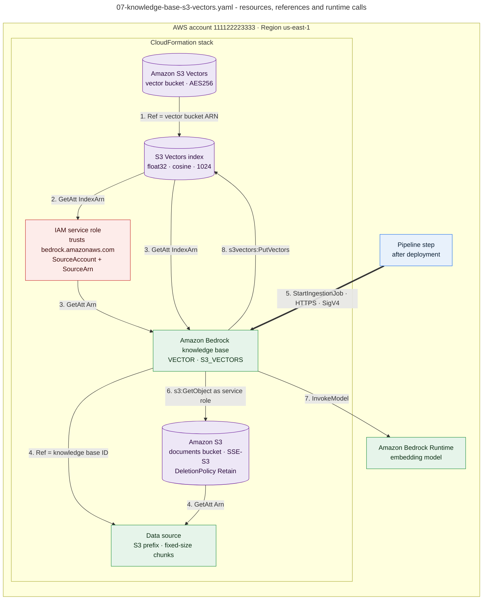
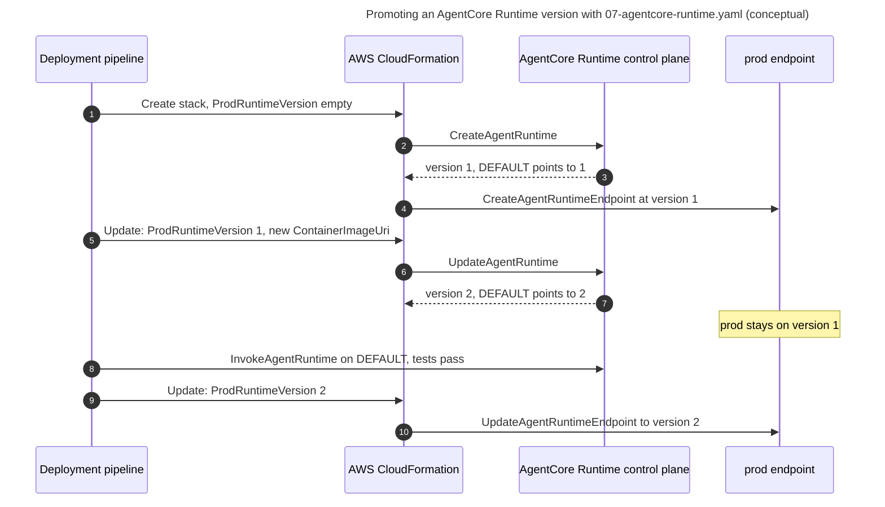

# CloudFormation coverage for Amazon Bedrock

> **Level:** Intermediate · **Verified:** 2026-11-15 · **Feature status:** n/a · **Time:** ~45 min

Which Bedrock and AgentCore features can you declare in a CloudFormation template, which ones can
you not, and what do you do instead? This chapter answers feature by feature, compares the answer
with Terraform and the CDK, flags the resources that are silently *replaced* when you edit them,
and walks through two working templates: a knowledge base on Amazon S3 Vectors and an AgentCore
Runtime with a pinned endpoint.

## Learning objectives

After this chapter you can:

- Say whether a Bedrock or AgentCore feature has a CloudFormation type, and name the alternative when it does not.
- Compare CloudFormation, Terraform and CDK coverage for the same feature.
- Identify replacement-sensitive properties and version resources before they delete something in production.
- Build a customer-managed knowledge base on S3 Vectors and an AgentCore Runtime with CloudFormation.

## Prerequisites

- [Template anatomy](01-template-anatomy.md), [Intrinsic functions](02-intrinsic-functions.md), [Change sets and drift detection](04-change-sets-and-drift.md)
- [Customer-managed knowledge bases and vector stores](../../01-amazon-bedrock/knowledge-bases/03-customer-managed-knowledge-bases.md)
- [AgentCore Runtime](../../01-amazon-bedrock/agentcore/02-agentcore-runtime.md)

## Concept in plain language

A CloudFormation **resource type** is an item on a menu. If Bedrock's feature is on the menu, you
declare it and CloudFormation creates, updates and deletes it for you. If it is not — buying
Provisioned Throughput, running a batch job — you have to order it another way: a pipeline step
that calls the API, a custom resource, or another tool. Some items also come "as served": once a
*version* is created you cannot edit it, only make a new one.

## How it really works

### Where the type list comes from

CloudFormation types are defined by resource provider schemas. The CDK generates its L1 constructs
from them and cfn-lint validates against them, so each tool carries a snapshot. On 2026-11-15 the
live Template Reference listed **23** `AWS::Bedrock::*`, **27** `AWS::BedrockAgentCore::*` and **3**
`AWS::S3Vectors::*` types — the same set as `aws-cdk-lib` 2.277.0 and cfn-lint 1.60.1 (schemas dated
2026-11-12). Both tools also have `AWS::BedrockMantle::Project`; its reference page could not be
retrieved on that date. Sources:
[Amazon Bedrock types](https://docs.aws.amazon.com/AWSCloudFormation/latest/TemplateReference/AWS_Bedrock.html),
[Bedrock AgentCore types](https://docs.aws.amazon.com/AWSCloudFormation/latest/TemplateReference/AWS_BedrockAgentCore.html),
[S3 Vectors types](https://docs.aws.amazon.com/AWSCloudFormation/latest/TemplateReference/AWS_S3Vectors.html),
[generated CDK / CloudFormation reference](../../references/cdk-and-cloudformation-bedrock.md).

> [!WARNING]
> **Common mistake** — Assuming the three snapshots agree on properties. The `CfnRuntime` L1 in
> `aws-cdk-lib` 2.277.0 has `hooksConfiguration` and `resourceConfigurations`; neither the live
> [`AWS::BedrockAgentCore::Runtime` page](https://docs.aws.amazon.com/AWSCloudFormation/latest/TemplateReference/aws-resource-bedrockagentcore-runtime.html)
> nor cfn-lint's schema lists them. **UNVERIFIED — REQUIRES DOCUMENTATION REVIEW**: do not use
> them until the template reference documents them.

### Feature-by-feature coverage

| Feature | CloudFormation | Types and notes |
|:--|:-:|:--|
| Application inference profiles | ✅ | `AWS::Bedrock::ApplicationInferenceProfile` |
| Intelligent prompt routing | ✅ | `AWS::Bedrock::IntelligentPromptRouter` |
| Projects on `bedrock-mantle` | ✅ | `AWS::BedrockMantle::Project` |
| Service tiers, system cross-Region profiles, prompt caching | n/a | Request options or AWS-owned, nothing to provision |
| Provisioned Throughput | ❌ | — |
| Batch inference jobs | ❌ | — |
| Model invocation logging | ❌ | — |
| Model access agreements and the use-case form | ❌ | — |
| Customization jobs, Custom Model Import, custom model deployments | ❌ | — |
| Bedrock Marketplace endpoints | ❌ | — |
| Model and RAG evaluation jobs; Advanced Prompt Optimization jobs | ❌ | — |
| Prompt management | ✅ | `Prompt`, `PromptVersion` |
| Flows | ✅ | `Flow`, `FlowVersion`, `FlowAlias` |
| Guardrails | ✅ | `Guardrail`, `GuardrailVersion` |
| Automated Reasoning checks | ✅ | `AutomatedReasoningPolicy`, `AutomatedReasoningPolicyVersion` |
| Guardrail enforcement and sharing | ✅ | `EnforcedGuardrailConfiguration`, `ResourcePolicy` |
| Managed Knowledge Base | ✅ | `KnowledgeBase` with type `MANAGED`; `DataSource` type `MANAGED_KNOWLEDGE_BASE_CONNECTOR` |
| Customer-managed knowledge bases | ✅ | `KnowledgeBase` (`VECTOR`, `KENDRA`, `SQL`), `DataSource`, `KnowledgeBasePolicy`. Storage: OpenSearch Serverless, OpenSearch managed cluster, Aurora (`RDS`), Neptune Analytics, S3 Vectors, Pinecone, MongoDB Atlas — **not** Redis Enterprise Cloud |
| Retrieval instructions (agentic retrieval) | ✅ | `RetrievalInstruction` |
| Ingestion jobs | ❌ | An operation (`StartIngestionJob`), not a resource |
| Amazon S3 Vectors | ✅ | `AWS::S3Vectors::VectorBucket`, `Index`, `VectorBucketPolicy` |
| Agents Classic (maintenance mode) | ✅ | `Agent` (action groups, knowledge bases and collaborators are properties), `AgentAlias` |
| Bedrock Data Automation | ✅ | `DataAutomationProject`, `Blueprint`, `DataAutomationLibrary` |
| Sessions | ✅ | `Session` — the feature itself is **UNVERIFIED** (register item U14) |
| AgentCore | ✅ | 27 types: Runtime, endpoints, harness, gateway, memory, identity, policy, evaluations, payments and more |
| AgentCore Registry; token vault customer managed key | ❌ | — |

Types without a prefix are `AWS::Bedrock::*`. Absence was checked against the live type lists
above; the Redis exclusion is stated on the
[`AWS::Bedrock::KnowledgeBase` page](https://docs.aws.amazon.com/AWSCloudFormation/latest/TemplateReference/aws-resource-bedrock-knowledgebase.html)
and in the schema's storage-type list. Feature status (GA, maintenance) is in the
[feature verification matrix](../../FEATURE-VERIFICATION.md).

### Gaps and the verified alternatives

| Gap | API (SDK model) | Terraform 6.73.0 | Alternative in a CloudFormation shop |
|:--|:--|:--|:--|
| Provisioned Throughput | `CreateProvisionedModelThroughput` | `aws_bedrock_provisioned_model_throughput` | Pipeline step or custom resource; store the ARN in configuration. See [Provisioned Throughput](../../01-amazon-bedrock/inference/07-provisioned-throughput.md) |
| Batch inference | `CreateModelInvocationJob` | `aws_bedrock_model_invocation_job` | A job, not infrastructure: run it from AWS Step Functions or a pipeline. See [Batch inference](../../01-amazon-bedrock/inference/08-batch-inference.md) |
| Invocation logging | `PutModelInvocationLoggingConfiguration` | `aws_bedrock_model_invocation_logging_configuration` | Custom resource, or keep this account setting in Terraform |
| Model access | `CreateFoundationModelAgreement`, `PutUseCaseForModelAccess` | `aws_bedrock_foundation_model_agreement`, `aws_bedrock_use_case_for_model_access` | One-time account bootstrap step. See [Model access](../../01-amazon-bedrock/overview/03-model-access-and-subscriptions.md) |
| Customization | `CreateModelCustomizationJob` | `aws_bedrock_custom_model` | Pipeline step; IaC owns the S3 data, role and KMS key |
| Custom Model Import | `CreateModelImportJob`, `CreateCustomModelDeployment` | none | Pipeline step. See [Custom Model Import](../../01-amazon-bedrock/foundation-models/04-custom-model-import.md) |
| Evaluation | `CreateEvaluationJob` | `aws_bedrock_evaluation_job` | Pipeline step after each model or prompt change |
| Prompt optimization | `CreateAdvancedPromptOptimizationJob` | none | Pipeline step |
| Marketplace | `CreateMarketplaceModelEndpoint` | none | Pipeline step |
| Ingestion | `StartIngestionJob` | none | Pipeline step after the stack and after every document upload |
| Token vault key | `SetTokenVaultCMK` | `aws_bedrockagentcore_token_vault_cmk` | Terraform or a custom resource |

API names are from [the API operations reference](../../references/bedrock-api-operations.md);
Terraform names from [the provider reference](../../references/terraform-aws-provider-bedrock.md).
A custom resource (`Custom::*` backed by Lambda) lets CloudFormation call any API on create, update
and delete ([custom resources](https://docs.aws.amazon.com/AWSCloudFormation/latest/UserGuide/template-custom-resources.html)).
**Our reading:** for long-running jobs it must also poll status and answer CloudFormation before
its timeout, so a pipeline step is usually simpler.

### Three-way comparison: CloudFormation, Terraform and the CDK

| Feature | CloudFormation | Terraform 6.73.0 | AWS CDK 2.277.0 |
|:--|:--|:--|:--|
| Provisioned Throughput, invocation logging, batch, evaluation, customization, agreements | ❌ | ✅ | ❌ |
| Intelligent prompt routing | ✅ | ❌ | L1 · alpha `PromptRouter` |
| Automated Reasoning policies | ✅ | ❌ | L1 |
| Prompt versions; flow versions and aliases | ✅ | ❌ (prompt and flow only) | L1 · alpha `PromptVersion` |
| `KnowledgeBasePolicy`, `RetrievalInstruction`, `Session` | ✅ | ❌ | L1 |
| Projects on `bedrock-mantle` | ✅ | ❌ | L1 |
| Redis Enterprise Cloud as a vector store | ❌ | ✅ (block accepted) | ❌ |
| AgentCore Registry, token vault key | ❌ | ✅ | ❌ |
| AgentCore harness endpoint, gateway rate limit, payments, consent portal, capacity provider, datasets, configuration bundles | ✅ | ❌ | L1 |
| AgentCore memory strategies | ✅ (property of `Memory`) | ✅ (separate resource) | L1 · stable L2 `Memory` |
| Higher-level constructs | — | Modules | Stable L2 for 14 AgentCore types; experimental alpha L2 for Bedrock |

The CDK's native coverage cannot exceed CloudFormation's, because its L1 constructs *are* the
CloudFormation types (it can still call APIs through custom resources). Terraform calls the service
APIs directly, so its gaps are different. Sources: the
[Terraform reference](../../references/terraform-aws-provider-bedrock.md) and the
[CDK / CloudFormation reference](../../references/cdk-and-cloudformation-bedrock.md); details in
[Terraform coverage for Amazon Bedrock](../terraform/10-terraform-for-bedrock.md) and
[CDK coverage for Amazon Bedrock](../aws-cdk/09-cdk-for-bedrock.md).

### Replacement-sensitive resources

"Update requires: Replacement" means CloudFormation creates a new resource, repoints references and
then **deletes the old one** — unless `UpdateReplacePolicy: Retain`
([update behaviors](https://docs.aws.amazon.com/AWSCloudFormation/latest/UserGuide/using-cfn-updating-stacks-update-behaviors.html),
[`UpdateReplacePolicy`](https://docs.aws.amazon.com/AWSCloudFormation/latest/TemplateReference/aws-attribute-updatereplacepolicy.html)).

| Type | Create-only properties (change = replacement) | What you lose |
|:--|:--|:--|
| `Bedrock::KnowledgeBase` | `StorageConfiguration`; the knowledge base type and its vector, managed, Kendra or SQL configuration | Knowledge base ID; every data source; ingested vectors |
| `Bedrock::DataSource` | `KnowledgeBaseId`, data source type, chunking and parsing configuration | Data source ID; its vectors (with `DataDeletionPolicy: DELETE`) |
| `S3Vectors::Index` | Everything except `Tags` | The index and its vectors; forces a new knowledge base |
| `S3Vectors::VectorBucket` | `VectorBucketName`, `EncryptionConfiguration` | Deleting the old bucket fails unless it is empty |
| `Bedrock::GuardrailVersion` | `GuardrailIdentifier`, `Description` (no update handler) | The published version number callers pin |
| `Bedrock::PromptVersion`, `FlowVersion`, `AutomatedReasoningPolicyVersion` | All their properties | The version |
| `Bedrock::AgentAlias`, `FlowAlias` | `AgentId`, `FlowArn` | Alias ID used by callers |
| `Bedrock::ApplicationInferenceProfile` | `InferenceProfileName`, `Description`, `ModelSource` | Profile ARN used for cost allocation |
| `Bedrock::IntelligentPromptRouter` | Name, models, fallback model, routing criteria, description | Router ARN |
| `BedrockAgentCore::Runtime` | `AgentRuntimeName` | Runtime ID, its versions and endpoints |
| `BedrockAgentCore::RuntimeEndpoint` | `Name`, `AgentRuntimeId` | Endpoint ARN |
| `BedrockAgentCore::Memory` | `Name`, `EncryptionKeyArn` | **Our reading:** the stored memories |
| `Bedrock::Guardrail` | none — every property updates in place | — |

Extracted from the resource schemas bundled with cfn-lint 1.60.1 and checked against the template
reference pages linked in Further reading. One inconsistency: the knowledge base page lists
`KnowledgeBaseConfiguration` as "No interruption", while the schema marks its type and vector
settings create-only — plan for replacement.

> [!CAUTION]
> **Cost or security hazard** — **Version resources do not follow their parent** (our reading of
> the update rules above). Editing a guardrail, prompt or flow leaves its version resources
> untouched, so nothing new is published. Editing the *version* resource replaces
> it — creating version 2 and **deleting version 1**, which production may still call. Add a new
> version resource (new logical ID) for every release, keep the old ones until nothing uses them,
> and consider `DeletionPolicy` and `UpdateReplacePolicy: Retain` on versions.

**`Ref` is not always an ID.** `KnowledgeBase` returns the ID; `DataSource` returns
`KBID|DSID`; `GuardrailVersion` returns `guardrailId|version`; `AgentAlias` returns
`agentId|aliasId`; `FlowVersion` returns `flowArn|version`; `PromptVersion`, `Runtime`,
`RuntimeEndpoint`, `VectorBucket` and `Index` return ARNs. Use `Fn::GetAtt` for the exact attribute.

## Architecture diagram



**What this shows** — Edges 1–4 are template references, which give CloudFormation its creation
order. Edges 5–8 happen after the stack exists: ingestion is not a CloudFormation resource.

**Walkthrough**

1. The index is created inside the vector bucket (`Ref` returns the bucket ARN).
2. The service role's policy is scoped to the index ARN.
3. The knowledge base needs the role and the index.
4. The data source needs the knowledge base ID and the documents bucket.
5. A pipeline step starts ingestion.
6. Bedrock reads documents under the prefix with the service role.
7. It embeds each chunk with the embedding model.
8. It writes vectors to the index.

| Legend | Meaning |
|:--|:--|
| Solid arrow | Reference or request |
| Thick arrow | Asynchronous job start |
| Cylinder | Data store |
| Red box | Identity control |

**Variations** — With a Managed Knowledge Base, AWS manages storage and embedding: no vector bucket,
index or vector permissions — see [Managed Knowledge Base](../../01-amazon-bedrock/knowledge-bases/02-managed-knowledge-base.md).

## Implementation details

### Walk-through: `07-knowledge-base-s3-vectors.yaml`

[The template](templates/07-knowledge-base-s3-vectors.yaml) is the CloudFormation twin of the
Terraform example in the customer-managed knowledge base chapter.

| Decision | In the template | Why |
|:--|:--|:--|
| Index metadata | `NonFilterableMetadataKeys: [AMAZON_BEDROCK_TEXT, AMAZON_BEDROCK_METADATA]` | The Bedrock setup page tells you to add both keys ([prerequisites](https://docs.aws.amazon.com/bedrock/latest/userguide/knowledge-base-setup.html)) |
| Vector type | `DataType: float32`, `EmbeddingDataType: FLOAT32` | S3 Vectors supports floating-point vectors only ([S3 Vectors with knowledge bases](https://docs.aws.amazon.com/AmazonS3/latest/userguide/s3-vectors-bedrock-kb.html)) |
| Storage reference | `S3VectorsConfiguration.IndexArn` | Give `IndexArn` **or** `VectorBucketArn` + `IndexName`, never both (schema `oneOf`) |
| Service role | Trust with `aws:SourceAccount` and `aws:SourceArn`; S3 read on one prefix; five `s3vectors` actions on the index | [Knowledge base service role](https://docs.aws.amazon.com/bedrock/latest/userguide/kb-permissions.html) |
| Documents bucket | `DeletionPolicy` and `UpdateReplacePolicy: Retain` | Source documents outlive the stack |
| Data source | `DataDeletionPolicy: DELETE` | Vectors go when the data source goes |
| Embedding model | Parameter, default `amazon.titan-embed-text-v2:0` | Confirm the ID; [ADR-010](../../ARCHITECTURE-DECISIONS.md#adr-010-model-and-inference-profile-ids-are-always-configuration) |

### Walk-through: `07-agentcore-runtime.yaml`

[The template](templates/07-agentcore-runtime.yaml) creates the execution role from the documented
policy, the runtime and a `prod` endpoint. Every runtime update creates a new immutable version and
moves `DEFAULT`; named endpoints move only when told to
([Runtime versioning and endpoints](https://docs.aws.amazon.com/bedrock-agentcore/latest/devguide/agent-runtime-versioning.html)).
The `ProdRuntimeVersion` parameter makes that explicit: empty on the first deployment, then pinned.



**What this shows** — The CloudFormation calls that move a release from `DEFAULT` to `prod`.

**Walkthrough** — Steps 1–4 create the runtime (version 1) and the endpoint. Steps 5–7 pin `prod`
to version 1 *in the same update* that ships a new image, so only `DEFAULT` moves to version 2.
Step 8 tests through `DEFAULT`. Steps 9–10 promote `prod`. Without the pin, step 5 would move
`prod` too, because its version would come from `Fn::GetAtt AgentRuntime.AgentRuntimeVersion`.

**Variations** — VPC mode (`NetworkMode: VPC` with subnets and security groups), JWT inbound auth
(`AuthorizerConfiguration`) and Instances compute (`CapacityProviderConfiguration`) are covered in
[AgentCore Runtime](../../01-amazon-bedrock/agentcore/02-agentcore-runtime.md).

## Example

> **Code status:** both templates validated with cfn-lint 1.60.1 (no findings) and `cfn-guard validate` against the academy rules (PASS) · **never deployed**

```text
$ cfn-lint templates/07-knowledge-base-s3-vectors.yaml templates/07-agentcore-runtime.yaml && echo clean
clean
$ cfn-guard validate --rules templates/05-bedrock-guardrail-rules.guard \
    --data templates/07-knowledge-base-s3-vectors.yaml --data templates/07-agentcore-runtime.yaml
$ echo $?
0
```

To deploy in **your own sandbox account** (never done for this academy):

```bash
# Knowledge base: creates billable storage; ingestion calls the embedding model.
aws cloudformation deploy --stack-name academy-kb \
  --template-file templates/07-knowledge-base-s3-vectors.yaml --capabilities CAPABILITY_IAM
aws bedrock-agent start-ingestion-job --knowledge-base-id <KnowledgeBaseId> --data-source-id <DataSourceId>

# Teardown: delete the stack, then empty and delete the retained documents bucket yourself.
aws cloudformation delete-stack --stack-name academy-kb
```

> [!CAUTION]
> **Cost or security hazard** — These commands create resources that cost money. Read the
> parameters, use a sandbox account, and run the teardown. The documents bucket is retained on
> purpose.

## Common mistakes

| Mistake | Symptom | Fix |
|:--|:--|:--|
| Changing the embedding dimension in place | Index and knowledge base replaced; retrieval empty until re-ingested | Plan a blue/green knowledge base; re-ingest |
| Editing a `GuardrailVersion` to "publish" | Old version deleted; callers pinned to it fail | Add a new version resource |
| Expecting the stack to ingest documents | Knowledge base exists but returns nothing | Run `StartIngestionJob` after deployment |
| Passing `!Ref` of a data source as its ID | The value is `KBID\|DSID`, not an ID | Use `!GetAtt DocumentsDataSource.DataSourceId` |
| Both `IndexArn` and `VectorBucketArn` + `IndexName` | cfn-lint error E3018 (schema `oneOf`) | Use one form |
| Renaming a runtime | New runtime ID; callers' ARNs break | Treat `AgentRuntimeName` as permanent |
| Endpoint version from `Fn::GetAtt` forever | `prod` moves on every deploy | Pin `ProdRuntimeVersion` |

## Security considerations

- Both service roles trust their service principal only for this account (`aws:SourceAccount`) and resource pattern (`aws:SourceArn`), as the knowledge base and Runtime permission pages show.
- Model permissions name model ARNs, never `"*"`; the [Guard rules](05-hooks-and-guard.md) enforce that.
- The vector bucket uses SSE-S3 here; for SSE-KMS set `SseType: aws:kms` and `KmsKeyArn` at creation (both create-only) and grant the service role the key permissions — the exact actions are **UNVERIFIED — REQUIRES DOCUMENTATION REVIEW** (see the [customer-managed knowledge base chapter](../../01-amazon-bedrock/knowledge-bases/03-customer-managed-knowledge-bases.md)).
- Runtime inbound auth is IAM SigV4 by default; JWT requires `AuthorizerConfiguration`.

## Cost considerations

- CloudFormation adds no charge for `AWS::*` types ([pricing](https://aws.amazon.com/cloudformation/pricing/)); you pay for what the resources do: vector storage and queries, embedding tokens during ingestion, Runtime CPU and memory per second.
- A replacement can double cost temporarily (old and new knowledge base) and always costs a full re-ingestion.
- Retained resources (documents bucket, retained versions) keep billing until you delete them.

## Knowledge check

1. Your team needs Provisioned Throughput and invocation logging, and everything else is in CloudFormation. What are your options?
2. You change `Dimension` from 1024 to 512 in the knowledge base template. List what CloudFormation replaces and what you must do afterwards.
3. Why does the runtime template pin `prod` to a parameter instead of always using the runtime's current version?

<details>
<summary>Answers</summary>

1. No CloudFormation type exists for either. Use a pipeline step or Lambda-backed custom resource calling `CreateProvisionedModelThroughput` and `PutModelInvocationLoggingConfiguration`, or manage those two account-level settings in Terraform.
2. The index (create-only `Dimension`), therefore the knowledge base (create-only `StorageConfiguration` and embedding configuration) and its data source; then run a new ingestion job. Callers need the new knowledge base ID.
3. Every update creates a new version and `DEFAULT` follows it; pinning lets you test version N through `DEFAULT` while `prod` stays on N−1, then promote deliberately.

</details>

## Further reading

Official sources opened while writing this chapter:

- Type lists: [Amazon Bedrock](https://docs.aws.amazon.com/AWSCloudFormation/latest/TemplateReference/AWS_Bedrock.html), [Bedrock AgentCore](https://docs.aws.amazon.com/AWSCloudFormation/latest/TemplateReference/AWS_BedrockAgentCore.html), [S3 Vectors](https://docs.aws.amazon.com/AWSCloudFormation/latest/TemplateReference/AWS_S3Vectors.html).
- Types used here: [`KnowledgeBase`](https://docs.aws.amazon.com/AWSCloudFormation/latest/TemplateReference/aws-resource-bedrock-knowledgebase.html), [`DataSource`](https://docs.aws.amazon.com/AWSCloudFormation/latest/TemplateReference/aws-resource-bedrock-datasource.html), [`S3Vectors::VectorBucket`](https://docs.aws.amazon.com/AWSCloudFormation/latest/TemplateReference/aws-resource-s3vectors-vectorbucket.html), [`S3Vectors::Index`](https://docs.aws.amazon.com/AWSCloudFormation/latest/TemplateReference/aws-resource-s3vectors-index.html), [`BedrockAgentCore::Runtime`](https://docs.aws.amazon.com/AWSCloudFormation/latest/TemplateReference/aws-resource-bedrockagentcore-runtime.html), [`RuntimeEndpoint`](https://docs.aws.amazon.com/AWSCloudFormation/latest/TemplateReference/aws-resource-bedrockagentcore-runtimeendpoint.html).
- Version and alias types: [`GuardrailVersion`](https://docs.aws.amazon.com/AWSCloudFormation/latest/TemplateReference/aws-resource-bedrock-guardrailversion.html), [`PromptVersion`](https://docs.aws.amazon.com/AWSCloudFormation/latest/TemplateReference/aws-resource-bedrock-promptversion.html), [`FlowVersion`](https://docs.aws.amazon.com/AWSCloudFormation/latest/TemplateReference/aws-resource-bedrock-flowversion.html), [`AgentAlias`](https://docs.aws.amazon.com/AWSCloudFormation/latest/TemplateReference/aws-resource-bedrock-agentalias.html).
- [Update behaviors of stack resources](https://docs.aws.amazon.com/AWSCloudFormation/latest/UserGuide/using-cfn-updating-stacks-update-behaviors.html), [`UpdateReplacePolicy`](https://docs.aws.amazon.com/AWSCloudFormation/latest/TemplateReference/aws-attribute-updatereplacepolicy.html), [custom resources](https://docs.aws.amazon.com/AWSCloudFormation/latest/UserGuide/template-custom-resources.html), [CloudFormation pricing](https://aws.amazon.com/cloudformation/pricing/).
- Bedrock: [Prerequisites for your own vector store](https://docs.aws.amazon.com/bedrock/latest/userguide/knowledge-base-setup.html), [Knowledge base service role](https://docs.aws.amazon.com/bedrock/latest/userguide/kb-permissions.html), [S3 Vectors with knowledge bases](https://docs.aws.amazon.com/AmazonS3/latest/userguide/s3-vectors-bedrock-kb.html).
- AgentCore: [Runtime versioning and endpoints](https://docs.aws.amazon.com/bedrock-agentcore/latest/devguide/agent-runtime-versioning.html), [IAM permissions for Runtime](https://docs.aws.amazon.com/bedrock-agentcore/latest/devguide/runtime-permissions.html).
