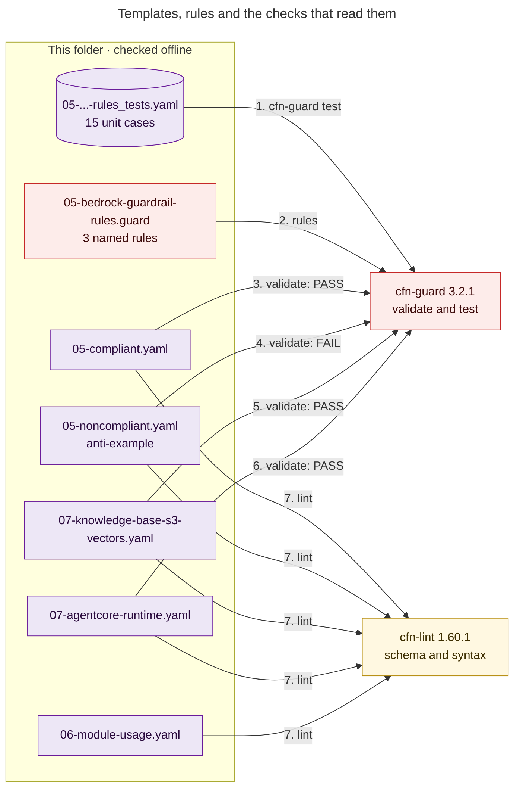

# CloudFormation templates

> **Verified:** 2026-11-15 · cfn-lint 1.60.1 (resource schemas dated 2026-11-12) · cfn-guard 3.2.1 · every template is checked offline, **never deployed**

The example templates used by the [CloudFormation chapters](../README.md). Each file is short,
self-contained and written for one chapter, so you can read it next to the explanation. None of
them has been deployed: they are proven consistent with the CloudFormation resource schemas, not
proven to deploy (see [ADR-003](../../../ARCHITECTURE-DECISIONS.md#adr-003-validate-offline-never-deploy)).

[CloudFormation chapters](../README.md) · [Infrastructure as Code](../../README.md) · [Generated CDK / CloudFormation reference](../../../references/cdk-and-cloudformation-bedrock.md)

## Index

| File | Kind | Purpose | Explaining chapter | Code status |
|:--|:--|:--|:--|:--|
| [`01-guardrail-basic.yaml`](01-guardrail-basic.yaml) | Template | A first Bedrock template: a guardrail with parameters and exported outputs | [Template anatomy](../01-template-anatomy.md) | `cfn-lint`: no findings (folder check) · details in the chapter |
| [`02-intrinsic-functions.yaml`](02-intrinsic-functions.yaml) | Template | Intrinsic functions applied to Bedrock resources, including importing values exported by `01` | [Intrinsic functions](../02-intrinsic-functions.md) | `cfn-lint`: no findings (folder check) · details in the chapter |
| [`03-nested-parent.yaml`](03-nested-parent.yaml) | Template (parent stack) | Parent stack of a nested-stack pair | [Nested stacks and StackSets](../03-nested-stacks-and-stacksets.md) | `cfn-lint`: no findings (folder check) · details in the chapter |
| [`03-nested-child-iam.yaml`](03-nested-child-iam.yaml) | Template (nested stack) | Child stack that holds IAM resources for the parent | [Nested stacks and StackSets](../03-nested-stacks-and-stacksets.md) | `cfn-lint`: no findings (folder check) · details in the chapter |
| [`04-stackset-guardrail-baseline.yaml`](04-stackset-guardrail-baseline.yaml) | Template (StackSet) | Guardrail baseline intended for deployment to many accounts with StackSets | [Nested stacks and StackSets](../03-nested-stacks-and-stacksets.md) (confirm in the file header) | `cfn-lint`: no findings (folder check) · details in the chapter |
| [`05-bedrock-guardrail-rules.guard`](05-bedrock-guardrail-rules.guard) | Guard rules | Three rules: guardrails need a customer managed KMS key; guardrails filter prompt attacks; no IAM `Allow` of Bedrock invocation on `"*"` | [Hooks and CloudFormation Guard](../05-hooks-and-guard.md) | `cfn-guard test`: 15 of 15 cases pass |
| [`05-bedrock-guardrail-rules_tests.yaml`](05-bedrock-guardrail-rules_tests.yaml) | Guard unit tests | Expected `PASS` / `FAIL` / `SKIP` per rule for 15 small inputs | [Hooks and CloudFormation Guard](../05-hooks-and-guard.md) | Run by `cfn-guard test` (not a template) |
| [`05-compliant.yaml`](05-compliant.yaml) | Template | Guardrail with a KMS key and prompt-attack filter, a published version and a scoped application role | [Hooks and CloudFormation Guard](../05-hooks-and-guard.md) | `cfn-lint`: no findings · `cfn-guard validate`: PASS |
| [`05-noncompliant.yaml`](05-noncompliant.yaml) | Template (anti-example) | Valid CloudFormation that breaks all three rules — shows that a linter is not a policy engine. **Do not deploy** | [Hooks and CloudFormation Guard](../05-hooks-and-guard.md) | `cfn-lint`: no findings · `cfn-guard validate`: FAIL (by design) |
| [`06-module-usage.yaml`](06-module-usage.yaml) | Template | Consumes the private module `Academy::Bedrock::Guardrail::MODULE` and references resources inside it | [CloudFormation modules and reuse](../06-modules-and-reuse.md) | `cfn-lint`: no findings (cfn-lint cannot see inside a registry module) |
| [`07-knowledge-base-s3-vectors.yaml`](07-knowledge-base-s3-vectors.yaml) | Template | Customer-managed knowledge base on Amazon S3 Vectors: documents bucket, vector bucket and index, service role, knowledge base, S3 data source | [CloudFormation coverage for Amazon Bedrock](../07-cloudformation-for-bedrock.md) | `cfn-lint`: no findings · `cfn-guard validate`: PASS |
| [`07-agentcore-runtime.yaml`](07-agentcore-runtime.yaml) | Template | AgentCore Runtime (container, microVMs, HTTP, IAM inbound auth), a pinned `prod` endpoint and the execution role | [CloudFormation coverage for Amazon Bedrock](../07-cloudformation-for-bedrock.md) | `cfn-lint`: no findings · `cfn-guard validate`: PASS |

Files `01`–`04` are written and maintained with chapters 01–03 and are described there; the
folder check on 2026-11-15 (`cfn-lint` over every template in this folder) reported no findings.

> [!NOTE]
> **Documented fact** — Guard checks rules, not template validity; AWS points to cfn-lint for
> syntax and allowed property values, and to CloudFormation Hooks for server-side enforcement.
> Source: [What is AWS CloudFormation Guard?](https://docs.aws.amazon.com/cfn-guard/latest/ug/what-is-guard.html)

## How the files relate



**What this shows** — The rules file is exercised twice: by its own unit tests, and against every
template that contains Bedrock or IAM resources. Every template, including the deliberate
anti-example, also passes cfn-lint, because policy violations are not syntax errors.

**Walkthrough**

1. `cfn-guard test` runs the 15 cases in the test file against the rules.
2. The rules file is loaded by every `cfn-guard validate` run.
3. The compliant template passes all three rules.
4. The non-compliant template fails all three, on purpose.
5. The knowledge base template passes the IAM rule; the guardrail rules are skipped (it has no guardrail).
6. The runtime template passes the IAM rule: its model permissions name ARNs, not `"*"`.
7. cfn-lint reports no findings for any of them.

| Legend | Meaning |
|:--|:--|
| Purple box or cylinder | File in this folder |
| Red box | Policy rules and the policy engine |
| Yellow box | Linter |

## Run the checks yourself

> **Code status:** commands run on 2026-11-15 with the versions in the header · no AWS credentials needed · **never deployed**

```bash
cd 04-infrastructure-as-code/cloudformation/templates

# 1. Schema and syntax — every template, including the anti-example, must be clean.
cfn-lint *.yaml --ignore-templates 05-bedrock-guardrail-rules_tests.yaml

# 2. Unit-test the rules (expects 15 passing cases).
cfn-guard test --rules-file 05-bedrock-guardrail-rules.guard \
  --test-data 05-bedrock-guardrail-rules_tests.yaml

# 3. Policy check — exit code 0 on PASS, non-zero (19 with cfn-guard 3.2.1) on FAIL.
cfn-guard validate --rules 05-bedrock-guardrail-rules.guard \
  --data 05-compliant.yaml --data 07-knowledge-base-s3-vectors.yaml --data 07-agentcore-runtime.yaml
cfn-guard validate --rules 05-bedrock-guardrail-rules.guard --data 05-noncompliant.yaml || echo "failed as expected"
```

The academy-wide check is `bash scripts/validate-cfn.sh 04-infrastructure-as-code/cloudformation/templates`
from the repository root; it lints every file that declares `AWSTemplateFormatVersion`.

## Deploying an example in your own sandbox

These templates were never deployed while building the academy. If you deploy one, do it in a
sandbox account, read the template's parameters first, and delete the stack when you are done.

> [!CAUTION]
> **Cost or security hazard** — The knowledge base and runtime templates create billable
> resources (vector storage, embedding calls during ingestion, Runtime sessions). The documents
> bucket in `07-knowledge-base-s3-vectors.yaml` has `DeletionPolicy: Retain`; empty and delete it
> yourself after deleting the stack. Never deploy `05-noncompliant.yaml`.
