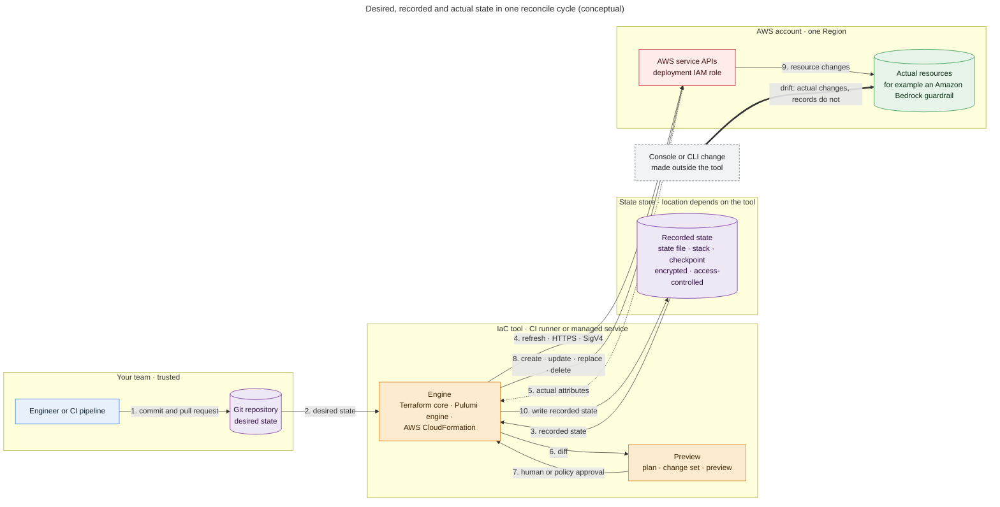
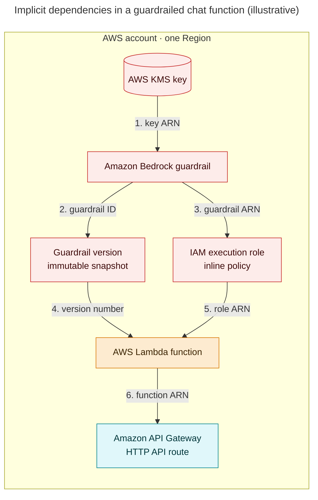

# IaC concepts: declarative versus imperative, state, graphs, drift and idempotency

> **Level:** Beginner · **Verified:** 2026-11-15 · **Feature status:** n/a · **Time:** ~30 min

Every infrastructure-as-code (IaC) tool in this course solves the same problems: describe what
should exist, remember what does exist, and turn one into the other safely. This chapter defines
each problem once and shows in compact tables how Terraform, AWS CDK, AWS CloudFormation, AWS SAM
and Pulumi handle it, so the tool chapters can concentrate on syntax.

## Learning objectives

After this chapter you can:

- Explain declarative and imperative authoring, desired state and the reconcile loop.
- Say who owns the state in each tool, and what follows for drift, locking and secrets.
- Predict creation, update and deletion order from a dependency graph.
- Distinguish drift detection from drift remediation, and idempotency from rollback.
- Map secrets, policy, testing, import, refactoring, upgrades and multi-account work to each tool's mechanism.

## Prerequisites

- [IAM fundamentals: principals, policies and evaluation](../../00-foundations/security/01-iam-fundamentals.md)
- [AWS Organizations and AWS Control Tower](../../00-foundations/aws-fundamentals/05-organizations-control-tower.md)
- The section overview [Infrastructure as Code](../README.md), especially "How the tools relate".

## Concept in plain language

You can give a builder a list of instructions ("pour a slab, raise four walls") or a floor plan
("this is the house"). A list is **imperative**: it describes steps. A floor plan is
**declarative**: it describes the result, and the builder works out the steps. IaC tools take
floor plans.

To compare the plan with reality the builder keeps a **site log**: which wall on the plan is
which wall on site. That log is the tool's **state**. If someone moves a wall without updating
the plan, reality has **drifted**. Hand over the same plan twice and a good builder does
nothing the second time; that property is **idempotency**.

## How it really works

### Three versions of the truth

| Version | Where it lives | Who changes it |
|:--|:--|:--|
| **Desired state** | Your code: HCL, a template, or a program | Engineers, through pull requests |
| **Recorded state** | The tool's state: a state file, a CloudFormation stack, a Pulumi checkpoint | Only the tool |
| **Actual state** | The resources behind the AWS APIs | The tool, and anyone with IAM permissions |

Every run compares them and computes a **plan**: the creates, updates, replacements and deletes
that make actual equal desired, then records the result.

> [!NOTE]
> **Documented fact** — Terraform's state maps each resource in the configuration to a remote
> object, and Terraform "expects that each remote object is bound to only one resource
> instance"; otherwise it "may behave unexpectedly".
> Source: [Purpose of Terraform state](https://developer.hashicorp.com/terraform/language/state/purpose)

### Concepts, defined once

| Concept | Definition used in this academy |
|:--|:--|
| Declarative | You state the end result; the engine derives the steps |
| Imperative | You state the steps. CDK and Pulumi programs are imperative code whose *output* is a declarative description |
| Desired state | The resources and properties your code declares |
| State | The tool's record that binds each declared resource to a real resource ID, plus metadata such as dependencies |
| Dependency graph | Resources as nodes, references as edges; the engine walks it to order and parallelise work |
| Resource lifecycle | Create, update in place, **replace** (new physical resource, often a new ID), delete |
| Drift | Actual state differs from recorded state because of a change made outside the tool |
| Drift detection / remediation | Finding drift / either reverting it (re-apply the code) or adopting it (change the code) |
| Idempotency | Applying unchanged code to unchanged infrastructure produces no changes |
| Reusability | Packaging resources into a versioned unit others can instantiate |
| Secrets | Values that must not appear in code, logs, previews or state |
| Policy as code | Machine-checked rules evaluated against code or a planned change before deployment |
| Testing | Checks that need no AWS account (lint, validate, unit tests with mocks) and checks that do |
| Rollback | What happens to half-applied changes when a deployment fails |
| Import | Bringing an existing resource under management without recreating it |
| Refactoring | Renaming or moving a resource in code without replacing the real resource |
| Version upgrades | Moving the tool, providers or libraries to newer releases safely |
| Multi-account / multi-Region | Deploying the same code to several accounts and Regions with separate credentials and state |

### How each tool handles the core model

| | Terraform | CloudFormation | AWS CDK | AWS SAM | Pulumi |
|:--|:--|:--|:--|:--|:--|
| Authoring | Declarative HCL | Declarative JSON or YAML | Program (TypeScript, JavaScript, Python, Java, C#/.NET, Go) that synthesizes a template | Declarative template expanded by the `AWS::Serverless-2016-10-31` transform | Program (Node.js, Python, Go, .NET, Java) or YAML or HCL; resource registrations form the desired state |
| Engine that calls AWS | Terraform core + AWS provider | The CloudFormation service | CloudFormation | CloudFormation | Pulumi engine + provider (`aws` via the AWS SDK, `aws-native` via the Cloud Control API) |
| Who holds state | You: a state file in a backend (S3 with native locking, or HCP Terraform) | AWS: the stack | AWS: the stack | AWS: the stack | Pulumi Cloud by default, or a DIY backend you run (S3, Azure Blob, Google Cloud Storage, PostgreSQL, local) |
| Dependencies from | References between blocks; `depends_on` | `Ref`, `Fn::GetAtt`, `Fn::Sub`; `DependsOn` | Construct references, rendered into the template | As CloudFormation, after the transform | Outputs passed as inputs |
| Preview | `terraform plan` | Change set | `cdk diff` | `sam deploy` shows the change set and asks to confirm | `pulumi preview` |
| Reads actual state before diffing | Yes, by default on plan and apply | Not by default; drift detection is a separate operation and drift-aware change sets are opt-in | As CloudFormation | As CloudFormation | No; `pulumi refresh` or `--refresh` |
| Drift detection | `terraform plan -refresh-only`; HCP Terraform health assessments | Stack and resource drift detection | `cdk drift` | CloudFormation drift detection | `pulumi refresh --preview-only`; scheduled drift runs in Pulumi Cloud |
| Drift remediation | Next `apply` reverts to the code | Update the stack; drift-aware change sets (`REVERT_DRIFT`) | `cdk deploy --revert-drift` | Redeploy | `pulumi up --refresh` |

### How each tool handles the lifecycle concerns

| | Terraform | CloudFormation | AWS CDK | AWS SAM | Pulumi |
|:--|:--|:--|:--|:--|:--|
| Reuse unit | Module | Module (registry), nested stack | Construct (L1, L2, L3), construct library | Nested application, `Globals`, policy templates | Component resource, Pulumi package |
| Secrets | State holds values in plain text; `sensitive` only redacts output; `ephemeral` (1.10) and write-only arguments (1.11) keep values out of state | Dynamic references to Parameter Store or Secrets Manager | The same CloudFormation mechanisms | Dynamic references pass through the transform unresolved | Per-stack encryption of secret values in state; pluggable KMS providers; Pulumi ESC across stacks |
| Policy as code | HCP Terraform policy sets (Terraform policy from 1.17, Sentinel, OPA); OPA, Conftest or Checkov on plan JSON | CloudFormation Guard; Hooks | Aspects and cdk-nag; Guard on the synthesized template | Guard and cfn-lint on the template | Pulumi Policies (TypeScript, JavaScript, Python, OPA) |
| Testing without AWS | `validate`; `terraform test` with mock providers (1.7) | `cfn-lint`; `cfn-guard test` | Fine-grained and snapshot assertions | `sam validate --lint`; `sam local invoke` (Docker) | Unit tests with mocks |
| Rollback on failure | None: state records what succeeded; fix and apply again | Automatic to the last stable state, unless you preserve provisioned resources | Inherited; `--no-rollback` then `cdk rollback` | Inherited; `sam deploy --guided` asks "Disable rollback" | None: revert the code and run `pulumi up` |
| Import | `import` blocks (1.5); `-generate-config-out`; bulk discovery with `terraform query` (1.14) | Resource import, IaC generator, auto-import | `cdk import`; `cdk deploy --import-existing-resources` | Through the CloudFormation stack | `pulumi import`; `import` resource option |
| Refactor without replacement | `moved` (1.1); `removed` with `destroy = false` (1.7) to stop managing | Stack refactoring | `cdk refactor --unstable=refactor` | Generated logical IDs derive from SAM IDs, so renames cascade | `aliases` resource option |
| Upgrades | Constrain `required_version` and providers; commit the lock file; AWS provider v6 via the latest 5.x | Service-side; your linter's version decides what it understands | CLI release date must be on or after the library's | SAM CLI release bundles a translator and a cfn-lint version | Provider major versions ship migration guides |
| Multi-account / multi-Region | Provider configuration per account or Region; `region` argument on most AWS v6 resources | StackSets | One environment (account + Region) per stack | One stack per deployment target | Explicit provider per Region or account; a stack per environment |

> [!NOTE]
> **Documented fact** — Rollback differs fundamentally. When `terraform apply` fails, Terraform
> records the changes that succeeded and "does not automatically roll back a partially-completed
> apply". Pulumi likewise "does not automatically rollback changes". CloudFormation rolls back to
> the last known stable state unless you choose **Preserve successfully provisioned resources**.
> Sources: [terraform apply](https://developer.hashicorp.com/terraform/cli/commands/apply),
> [Pulumi FAQ](https://www.pulumi.com/docs/support/faq/infrastructure/),
> [Stack failure options](https://docs.aws.amazon.com/AWSCloudFormation/latest/UserGuide/stack-failure-options.html)

> [!NOTE]
> **Documented fact** — CloudFormation drift detection checks only properties set explicitly in
> the template or parameters, not defaults; unsupported resource types report `NOT_CHECKED`;
> nested stacks are checked separately. Pulumi deliberately does not refresh before
> `pulumi preview` or `pulumi up`, so an out-of-band change can be silently overwritten.
> Sources: [CloudFormation drift detection](https://docs.aws.amazon.com/AWSCloudFormation/latest/UserGuide/using-cfn-stack-drift.html),
> [Pulumi state and backends](https://www.pulumi.com/docs/iac/concepts/state-and-backends/)

Version numbers in brackets are the Terraform releases that introduced each feature, taken from
the [verification matrix](../../FEATURE-VERIFICATION.md#c-infrastructure-as-code-tooling).

## Architecture diagram



**What this shows** — The loop every IaC engine runs: read desired and recorded state, optionally
read actual state, preview the difference, apply it with a deployment role, record the result. A
change made outside the tool alters only actual state; that is drift.

**Walkthrough**

1. A change reaches the repository through review.
2. The engine evaluates the code: HCL is parsed, a CDK program is synthesized, a Pulumi program runs.
3. It loads the last recorded state (Terraform state file, CloudFormation stack, Pulumi checkpoint).
4. Terraform refreshes by default; Pulumi only with `refresh`; CloudFormation compares against its stack record unless you ask for a drift-aware change set.
5. Current attributes come back.
6. The engine computes the difference.
7. A person or a policy gate approves the preview.
8. The engine calls the service APIs in dependency order, in parallel where it can.
9. The resources change.
10. The new recorded state is written; with Terraform this happens even after a partial failure.

| Legend | Meaning |
|:--|:--|
| Solid arrow | Request or write |
| Dashed arrow | Response |
| Thick arrow | A change that happens outside the tool |
| Cylinder | Stored data |
| Boxes | Trust and ownership boundaries |

**Variations** — For CloudFormation, CDK and SAM the engine and the state store are one AWS
service. Terraform state usually sits in an S3 bucket in a dedicated account; Pulumi state in
Pulumi Cloud unless you choose a DIY backend. Diagram sets
[26](../../diagrams/mermaid/26-cicd-and-iac-deployment.md),
[27](../../diagrams/mermaid/27-terraform-state-and-modules.md) and
[28](../../diagrams/mermaid/28-cdk-and-cloudformation-synthesis.md) show each tool in full.

### Dependency graph



**What this shows** — Each arrow is a reference: the target reads an attribute of the source.
No one wrote an ordering; the references are the ordering.

**Walkthrough**

1. The guardrail references the key, so the key is created first.
2. The version references the guardrail ID.
3. The role's policy references the guardrail ARN; steps 2 and 3 can run in parallel.
4. The function's environment references the published version number.
5. The function also needs the role.
6. The API route integrates the function and is created last. Deletion runs in reverse.

> [!NOTE]
> **Documented fact** — If resource A uses `Ref` to resource B, CloudFormation creates B before A,
> deletes A before B and updates B before A; otherwise it works in parallel. Terraform walks its
> graph in parallel too, up to 10 nodes at a time by default (`-parallelism`).
> Sources: [DependsOn attribute](https://docs.aws.amazon.com/AWSCloudFormation/latest/TemplateReference/aws-attribute-dependson.html),
> [Terraform dependency graph](https://developer.hashicorp.com/terraform/internals/graph)

## Implementation details

1. **Decide where state lives before writing the first resource.** For Terraform that is a
   versioned, encrypted S3 bucket with native locking (ADR-011); see
   [State, remote backends and state locking](../terraform/04-state-backends-locking.md). For
   Pulumi, choose Pulumi Cloud or a DIY backend deliberately.
2. **Read every preview for replacements.** Replacement creates a new physical resource and
   usually a new ID. For a Bedrock guardrail that means a new ARN that IAM policies and
   application configuration must follow. CloudFormation's reference pages mark each property
   "Update requires: No interruption" or "Replacement".
3. **Keep runs idempotent.** Timestamps, random values without state, and "latest" lookups at
   plan or synthesis time produce a different desired state on every run. Model IDs belong in
   configuration ([ADR-010](../../ARCHITECTURE-DECISIONS.md#adr-010-model-and-inference-profile-ids-are-always-configuration)).
4. **Plan for drift.** Schedule detection and decide per resource whether you remediate or
   adopt. `sam sync --code` updates functions directly through service APIs, and the SAM CLI
   warns that this causes drift; use it on development stacks only.
5. **Know your failure mode.** With CloudFormation, CDK and SAM a failed deployment rolls back.
   With Terraform and Pulumi you roll forward: fix the code and apply again.

> [!TIP]
> **Academy recommendation** — Treat "who owns this resource?" as a design question with exactly
> one answer per resource, and write the answer down. Most IaC incidents start with two owners.
> This is our design guidance, not an official AWS reference architecture.

## Example

A toy reconciler in plain Python that reproduces the reconcile loop, idempotency and drift.

> **Code status:** illustrative · syntax-checked (`python -m py_compile`) and run locally ·
> standard library only, no AWS calls · **never deployed**

```python
"""A toy reconciler: desired, recorded and actual state; drift; idempotency.

It shows the idea behind every IaC engine. It is not how any real tool is implemented.
"""
from __future__ import annotations

from copy import deepcopy


def plan(desired: dict, recorded: dict, actual: dict, refresh: bool = True) -> list[tuple[str, str]]:
    """Return the (action, name) steps that make the world match `desired`."""
    seen = actual if refresh else recorded  # without a refresh, the tool trusts its records
    steps = []
    for name, props in desired.items():
        if name not in seen:
            steps.append(("create", name))
        elif seen[name] != props:
            steps.append(("update", name))
    steps += [("delete", name) for name in recorded if name not in desired]
    return steps


def apply(steps: list[tuple[str, str]], desired: dict, recorded: dict, actual: dict) -> None:
    for action, name in steps:
        if action == "delete":
            recorded.pop(name, None)
            actual.pop(name, None)
        else:
            actual[name] = deepcopy(desired[name])  # the API call
            recorded[name] = deepcopy(desired[name])  # the state write


desired = {"guardrail": {"pii": "ANONYMIZE"}, "function": {"memory_mb": 256}}
recorded: dict = {}
actual: dict = {}

first = plan(desired, recorded, actual)
apply(first, desired, recorded, actual)
print("first run :", first)
print("second run:", plan(desired, recorded, actual))  # [] - idempotent

actual["function"]["memory_mb"] = 1024  # someone edits the function in the console
print("no refresh:", plan(desired, recorded, actual, refresh=False))  # drift unseen
print("refresh   :", plan(desired, recorded, actual))  # drift found and reverted
```

Output:

```text
first run : [('create', 'guardrail'), ('create', 'function')]
second run: []
no refresh: []
refresh   : [('update', 'function')]
```

The third line is the Pulumi default and the CloudFormation update behaviour: without a refresh
the console edit is invisible. The fourth line is Terraform's default.

## Common mistakes

> [!WARNING]
> **Common mistake** — Managing one resource with two tools, for example a guardrail created by a
> CloudFormation stack and also imported into Terraform. Each tool reverts the other's changes on
> every run, and deleting either stack can delete the shared resource.

| Mistake | Symptom | Fix |
|:--|:--|:--|
| Hot-fixing in the console | The next run silently reverts the fix, or Pulumi overwrites it without warning | Make the change in code; run drift detection on a schedule |
| Renaming a resource in code | The preview shows destroy and create; data or IDs are lost | `moved` (Terraform), `aliases` (Pulumi), `cdk refactor` or stack refactoring |
| Secrets as plain variables | Values in Terraform state and plan files or in logs | Ephemeral values and write-only arguments, dynamic references, Pulumi secrets |
| Expecting Terraform or Pulumi to roll back | Half-applied changes after a failure | Roll forward; keep changes small |
| Trusting a clean drift report | Defaults and unsupported types are not checked | Set important properties explicitly; read `NOT_CHECKED` results |

## Security considerations

- State is sensitive. Terraform state can hold secrets in plain text; restrict reads to the
  deployment role and encrypt the backend. Pulumi encrypts values marked secret, but a resource's
  physical ID is always stored in plain text.
- The deployment role can change anything the code declares. Scope it per environment and per
  stack; see [Identity, least privilege and IAM isolation](../../06-security-governance/02-identity-and-least-privilege.md).
- Drift detection is a security control: it surfaces out-of-band edits to IAM policies or guardrails.
- Run policy as code in the pipeline, not only on laptops; see
  [Secrets management and policy as code](../maintenance/04-secrets-and-policy-as-code.md).

## Cost considerations

- The open-source CLIs cost nothing to run; managed features cost money: HCP Terraform health
  assessments need the Standard or Premium edition, and scheduled drift detection in Pulumi
  Cloud needs Pro or Enterprise. CloudFormation modules carry no additional charge.
- Integration tests that deploy real stacks bill like any other deployment; tear them down.
- An unnoticed replacement can be expensive: a recreated knowledge base must ingest again.

## Knowledge check

1. Your Terraform plan shows "no changes", yet a colleague changed a Lambda function's memory in
   the console yesterday. Under what condition is that possible?
2. A Pulumi stack and a CloudFormation stack both declare the same IAM role. What happens over
   time?
3. A CloudFormation update fails half-way. What state are the resources in, and how does that
   differ from a failed `terraform apply`?
4. Why does renaming a resource in code usually replace the real resource, and how do you avoid it?

<details>
<summary>Answers</summary>

1. Only if refresh was disabled (`-refresh=false`) or the configuration tells Terraform to ignore
   that attribute. A default plan refreshes and proposes changing memory back to the code's value.
2. Each deployment reverts the other's changes, and a delete in either tool removes the role.
3. By default CloudFormation rolls back to the last stable state. Terraform keeps what succeeded,
   records it in state, and expects you to fix the code and apply again.
4. Tools identify resources by address or logical ID, so a new name looks like a new resource.
   Use `moved`, `aliases`, `cdk refactor` or CloudFormation stack refactoring.

</details>

## Further reading

Official sources opened while writing this chapter:

- HashiCorp: [What is Terraform?](https://developer.hashicorp.com/terraform/intro) · [Purpose of state](https://developer.hashicorp.com/terraform/language/state/purpose) · [Dependency graph](https://developer.hashicorp.com/terraform/internals/graph) · [Manage resource drift](https://developer.hashicorp.com/terraform/tutorials/state/resource-drift) · [terraform apply](https://developer.hashicorp.com/terraform/cli/commands/apply) · [Manage sensitive data](https://developer.hashicorp.com/terraform/language/manage-sensitive-data) · [Import](https://developer.hashicorp.com/terraform/language/import) · [Refactor modules](https://developer.hashicorp.com/terraform/language/modules/develop/refactoring) · [removed block](https://developer.hashicorp.com/terraform/language/block/removed) · [HCP Terraform policy enforcement](https://developer.hashicorp.com/terraform/cloud-docs/policy-enforcement)
- AWS CloudFormation: [Drift detection](https://docs.aws.amazon.com/AWSCloudFormation/latest/UserGuide/using-cfn-stack-drift.html) · [Stack failure options](https://docs.aws.amazon.com/AWSCloudFormation/latest/UserGuide/stack-failure-options.html) · [DependsOn](https://docs.aws.amazon.com/AWSCloudFormation/latest/TemplateReference/aws-attribute-dependson.html) · [Import options](https://docs.aws.amazon.com/AWSCloudFormation/latest/UserGuide/import-resources.html) · [Modules](https://docs.aws.amazon.com/AWSCloudFormation/latest/UserGuide/modules.html) · [Dynamic references](https://docs.aws.amazon.com/AWSCloudFormation/latest/UserGuide/dynamic-references.html) · [StackSets](https://docs.aws.amazon.com/AWSCloudFormation/latest/UserGuide/what-is-cfnstacksets.html)
- AWS CDK: [What is the AWS CDK?](https://docs.aws.amazon.com/cdk/v2/guide/home.html) · [Testing](https://docs.aws.amazon.com/cdk/v2/guide/testing.html) · [Environments](https://docs.aws.amazon.com/cdk/v2/guide/environments.html) · [CDK CLI README](https://raw.githubusercontent.com/aws/aws-cdk-cli/main/packages/aws-cdk/README.md)
- AWS SAM: [Template anatomy](https://docs.aws.amazon.com/serverless-application-model/latest/developerguide/sam-specification-template-anatomy.html) · [sam sync](https://docs.aws.amazon.com/serverless-application-model/latest/developerguide/using-sam-cli-sync.html) · [Generated CloudFormation resources](https://docs.aws.amazon.com/serverless-application-model/latest/developerguide/sam-specification-generated-resources.html)
- Pulumi: [How Pulumi works](https://www.pulumi.com/docs/iac/concepts/how-pulumi-works/) · [State and backends](https://www.pulumi.com/docs/iac/concepts/state-and-backends/) · [Secrets](https://www.pulumi.com/docs/iac/concepts/secrets/) · [Testing](https://www.pulumi.com/docs/iac/guides/testing/) · [aliases](https://www.pulumi.com/docs/iac/concepts/resources/options/aliases/) · [Providers](https://www.pulumi.com/docs/iac/concepts/providers/) · [Drift detection](https://www.pulumi.com/docs/deployments/deployments/drift/) · [FAQ: rollbacks](https://www.pulumi.com/docs/support/faq/infrastructure/)
