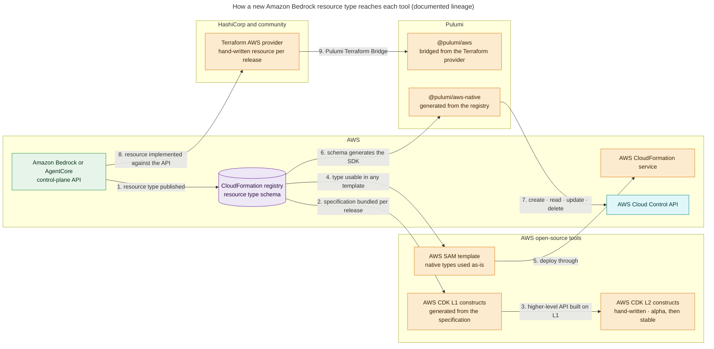

# Terraform, AWS CDK, CloudFormation, SAM and Pulumi compared

> **Level:** Intermediate · **Verified:** 2026-11-15 · **Feature status:** n/a · **Time:** ~35 min

The five tools differ less in what they can build than in where they keep state, how they fail,
and how quickly a new Amazon Bedrock feature reaches them. This chapter compares them across
twenty documented dimensions, keeps the academy's opinions in a separate table, and counts
Bedrock and AgentCore coverage from the [generated references](../../references/README.md)
rather than from memory.

## Learning objectives

After this chapter you can:

- Compare the five tools on engine, state, preview, drift, rollback, testing and policy.
- Read Bedrock and AgentCore coverage numbers and name the gaps in each direction.
- Compare the units of reuse: modules, CloudFormation modules, nested stacks, constructs,
  nested applications and Pulumi components.
- Separate documented facts from the academy's assessments of learning curve and fit.

## Prerequisites

- [IaC concepts: declarative versus imperative, state, graphs, drift and idempotency](01-iac-concepts.md)

## Concept in plain language

Think of CloudFormation as a removal company that keeps the inventory of your house in its own
office. AWS CDK and AWS SAM are two different order forms for that same company: one you fill in
by writing a program, one in shorthand. Terraform and Pulumi are independent companies with
their own vans and their own inventory books, which you store. All five can move the same
furniture; they differ in paperwork, in who holds the inventory, and in what happens when a box
breaks on the stairs.

## How it really works

### Documented facts across twenty dimensions

| # | Dimension | Terraform | CloudFormation | AWS CDK | AWS SAM | Pulumi |
|--:|:--|:--|:--|:--|:--|:--|
| 1 | You write | HCL | JSON or YAML template | TypeScript, JavaScript, Python, Java, C#/.NET or Go | Template with SAM shorthand and the `AWS::Serverless-2016-10-31` transform | TypeScript/JavaScript, Python, Go, .NET, Java, YAML or HCL |
| 2 | What calls the AWS APIs | Terraform core with the `hashicorp/aws` provider | The CloudFormation service | CloudFormation, from the synthesized template | CloudFormation, after the transform | Pulumi engine with a provider: `aws` (AWS SDK) or `aws-native` (Cloud Control API) |
| 3 | State | State file in a backend you run (S3 with `use_lockfile`) or HCP Terraform | Stack, held by AWS | Stack | Stack | Pulumi Cloud (default) or a DIY backend: S3, Azure Blob, Google Cloud Storage, PostgreSQL, local |
| 4 | Preview | `terraform plan` | Change set | `cdk diff` | Change set shown by `sam deploy` | `pulumi preview` |
| 5 | Ordering | Dependency graph, parallel walk (default 10) | Implicit from `Ref`, `Fn::GetAtt`, `Fn::Sub`; `DependsOn` | As CloudFormation | As CloudFormation | Engine processes independent registrations in parallel |
| 6 | Drift detection | `plan -refresh-only`; HCP Terraform health assessments | Stack and resource drift detection | `cdk drift` | CloudFormation drift detection | `pulumi refresh --preview-only`; scheduled in Pulumi Cloud |
| 7 | Rollback on failure | None automatic | Automatic, or preserve provisioned resources | Inherited; `cdk rollback` after `--no-rollback` | Inherited | None automatic |
| 8 | Built-in offline testing | `terraform test` with mock providers | — (use `cfn-lint`, `cfn-guard`) | `aws-cdk-lib/assertions` | `sam validate --lint`, `sam local invoke` | Unit tests with mocks |
| 9 | Policy as code | HCP Terraform: Terraform policy, Sentinel, OPA | Guard; Hooks | Aspects; Guard on output | Guard and cfn-lint on the template | Pulumi Policies (TypeScript, JavaScript, Python, OPA) |
| 10 | Unit of reuse | Module | Module; nested stack | Construct library | Nested application; `Globals` | Component resource; Pulumi package |
| 11 | Multi-account, multi-Region | Provider configurations; per-resource `region` (provider v6) | StackSets | One environment per stack | One stack per target | Explicit providers; one stack per environment |
| 12 | Import | `import` blocks; `terraform query` for discovery | Resource import, IaC generator, auto-import | `cdk import`; `--import-existing-resources` | Through the stack | `pulumi import` |
| 13 | Refactor without replacement | `moved`, `removed` | Stack refactoring | `cdk refactor` (unstable flag) | Logical IDs of generated resources derive from SAM IDs | `aliases` |
| 14 | Secrets kept out of state | `ephemeral` values and write-only arguments | Dynamic references | Dynamic references | Dynamic references (resolved after the transform) | Secret values encrypted per stack |
| 15 | Local emulation of functions | SAM CLI, beta (`--hook-name terraform`) | — | Through the SAM CLI | `sam local invoke` in Docker | — |
| 16 | Beyond AWS | Any platform with a provider in the Terraform Registry | AWS, plus private types in the CloudFormation registry | AWS, through CloudFormation | AWS, through CloudFormation | Pulumi Registry packages, including bridged Terraform providers |
| 17 | Bedrock resources (non-AgentCore) | 24 resource types | 23 `AWS::Bedrock::*` + 1 `AWS::BedrockMantle::Project` | L1 for each type; 0 stable L2; 8 experimental L2 classes | The CloudFormation types; no `AWS::Serverless::*` Bedrock type | `aws` 7.55.0: 18 in `aws.bedrock` + 2 in `aws.bedrockmodel`; `aws-native` 1.85.0: 23 + 1 |
| 18 | AgentCore resources | 21 `aws_bedrockagentcore_*` | 27 `AWS::BedrockAgentCore::*` | 27 L1; 14 stable L2 | The CloudFormation types | `aws`: 21 `Agentcore*` in `aws.bedrock`; `aws-native`: 27 in `bedrockagentcore` |
| 19 | Licence | Business Source License 1.1 from 1.6.0; the fork OpenTofu is MPL 2.0 | Managed AWS service | Apache 2.0 | Apache 2.0 (CLI and specification) | Apache 2.0 (engine and providers) |
| 20 | Versions on 2026-11-15 | Terraform 1.17.2, `hashicorp/aws` 6.73.0 | Specification in `aws-cdk-lib` 2.277.0; cfn-lint 1.60.1 | `aws-cdk-lib` 2.277.0, CLI 2.1148.1 | SAM CLI 1.172.1 (aws-sam-translator 1.116.0) | `@pulumi/aws` 7.55.0, `@pulumi/aws-native` 1.85.0 |

How rows 17 and 18 were counted: Terraform's 24 are 12 `aws_bedrock_*`, 9 `aws_bedrockagent_*`
and 3 `aws_bedrockdataautomation_*` resource types; with AgentCore and the S3 Vectors and
OpenSearch Serverless types the [Terraform reference](../../references/terraform-aws-provider-bedrock.md)
lists 55. CloudFormation and CDK numbers come from the
[CDK and CloudFormation reference](../../references/cdk-and-cloudformation-bedrock.md). Pulumi
numbers are the resources listed on the registry module pages on the verification date.

> [!NOTE]
> **Documented fact** — Pulumi's `aws` package "is based on the `aws` Terraform Provider", and the
> AWS Cloud Control provider (`aws-native`) is generated from the CloudFormation registry and
> "typically supports new AWS features on the day of launch". Pulumi nevertheless recommends
> that new projects start with the `aws` provider and add Cloud Control resources as needed,
> because some AWS resources are not yet available through Cloud Control.
> Sources: [aws.bedrock module](https://www.pulumi.com/registry/packages/aws/api-docs/bedrock/), [AWS Cloud Control provider](https://www.pulumi.com/registry/packages/aws-native/)

> [!NOTE]
> **Documented fact** — Terraform from 1.6.0 is licensed under the Business Source License 1.1
> (the licensor named in the file is IBM Corp.). Production use is permitted unless it offers
> Terraform to third parties on a hosted or embedded basis to compete with the licensor's paid
> versions; each version converts to MPL 2.0 four years after publication. OpenTofu is a fork
> under the Linux Foundation, licensed MPL 2.0, created in response to the licence change.
> Sources: [Terraform LICENSE](https://raw.githubusercontent.com/hashicorp/terraform/main/LICENSE), [OpenTofu](https://opentofu.org/), [OpenTofu LICENSE](https://raw.githubusercontent.com/opentofu/opentofu/main/LICENSE)

> [!IMPORTANT]
> **Status** — CDK for Terraform (CDKTF) was archived on 2025-12-10 and is not compared here.
> Source: [CDKTF README](https://raw.githubusercontent.com/hashicorp/terraform-cdk/main/README.md)

### Where Bedrock coverage differs

Neither Terraform nor CloudFormation is a superset of the other. The rows below come from the
[verification matrix](../../FEATURE-VERIFICATION.md) (Terraform 6.73.0; CloudFormation as bundled
in `aws-cdk-lib` 2.277.0).

| Feature | Terraform | CloudFormation, CDK L1, SAM, Pulumi `aws-native` | Pulumi `aws` |
|:--|:-:|:-:|:-:|
| Provisioned Throughput | ✅ | ❌ | ✅ |
| Batch inference job, invocation logging | ✅ | ❌ | ✅ (`aws.bedrockmodel`) |
| Model customization, evaluation jobs | ✅ | ❌ | ✅ |
| AgentCore Registry, token vault KMS key | ✅ | ❌ | ✅ |
| Intelligent prompt router, Automated Reasoning policy | ❌ | ✅ | ❌ |
| Retrieval instructions (agentic retrieval) | ❌ | ✅ | ❌ |
| Prompt and flow versions, flow aliases | ❌ | ✅ | ❌ |
| `bedrock-mantle` Project | ❌ | ✅ | ❌ |
| AgentCore Optimization, Payments, harness endpoint, gateway rate limit | ❌ | ✅ | ❌ |

A ❌ in the Pulumi `aws` column means the resource is not on the `aws.bedrock` or
`aws.bedrockmodel` module pages; use `aws-native` for it in the same program.

### Units of reuse, including CloudFormation modules

| Unit | Tool | What it packages | Shared and versioned through | Worth knowing |
|:--|:--|:--|:--|:--|
| Module | Terraform | Any set of resources, variables and outputs | Registry or Git, with version constraints | The academy's [modules](../terraform/modules/README.md) |
| CloudFormation module | CloudFormation | Resources resolved into your stack | CloudFormation registry, versioned per account and Region | No extra charge; outputs propagate, parameters do not |
| Nested stack | CloudFormation | A whole template as one resource | S3 template URL | Drift detection does not recurse into nested stacks |
| Construct (L1, L2, L3) | AWS CDK | Classes that emit CloudFormation resources | Language package managers | The academy's [construct library](../aws-cdk/construct-library/README.md) |
| Nested application | AWS SAM | `AWS::Serverless::Application` generates an `AWS::CloudFormation::Stack` | Its template location, like a nested stack | Policy templates and `Globals` also cut repetition |
| Component resource, Pulumi package | Pulumi | Child resources behind one typed resource | Language package managers; Pulumi Registry | A component written in one language can be used from another |

### Academy assessments

> [!TIP]
> **Academy recommendation** — The ratings below are the academy's judgement for teams building
> on Amazon Bedrock, based on the facts above and on running the examples in this section. They
> are opinions, not measurements, and not an official AWS reference architecture.

| Dimension | Terraform | CloudFormation | AWS CDK | AWS SAM | Pulumi |
|:--|:--|:--|:--|:--|:--|
| Learning curve | Medium: HCL plus state operations | Low to read, high to write at scale | Medium: a language plus CloudFormation underneath | Low for serverless apps | Medium: a language plus state operations |
| Abstraction for Bedrock | Resource-level | Resource-level | Highest: stable AgentCore L2s; alpha L2s for the rest | Resource-level for Bedrock; high for Lambda and APIs | Resource-level; components are yours to write |
| Reviewability of a change | High: one plan for everything | High: change sets | Medium: review `cdk diff`, not the program | High: change sets | High: preview with property diffs |
| State operations burden | Yours (backend, locking, access) | None | None | None | Low with Pulumi Cloud; yours with DIY |
| Failure recovery | Roll forward by hand | Automatic rollback | Automatic rollback | Automatic rollback | Roll forward by hand |
| New Bedrock types | Frequent provider releases; fills some gaps first | Often early; some features absent (see gaps) | Follows CloudFormation for L1 | Follows CloudFormation | Both lineages in one program |
| Multi-cloud | Strong | None | None | None | Strong |

## Architecture diagram



**What this shows** — There are two lineages. One starts from a CloudFormation resource type and
feeds CloudFormation, SAM, CDK L1 constructs and Pulumi `aws-native` mechanically. The other
starts from a hand-written resource in the Terraform AWS provider and feeds Pulumi `aws`. That
explains the coverage table: a feature appears in a lineage when someone adds it there.

**Walkthrough**

1. A Bedrock or AgentCore resource becomes a CloudFormation resource type.
2. Each `aws-cdk-lib` release bundles the specification and generates `Cfn*` classes.
3. L2 constructs are written by hand on top; Bedrock agent, knowledge base and guardrail L2s are
   still experimental, while AgentCore L2s graduated to stable in 2.255.0.
4. A SAM template can use the type immediately; SAM adds no wrapper.
5. Deployment goes through the CloudFormation service.
6. Pulumi generates `aws-native` from the same registry.
7. `aws-native` manages resources through the Cloud Control API.
8. The Terraform provider implements each resource by hand.
9. Pulumi bridges that provider into `@pulumi/aws`.

| Legend | Meaning |
|:--|:--|
| Solid arrow | Documented derivation or call |
| Green box | The AWS service |
| Purple cylinder | The CloudFormation registry schema |
| Orange boxes | Tools and libraries |

**Variations** — Timing is not documented for any lineage. Check the generated references after
each upgrade, as [ADR-006](../../ARCHITECTURE-DECISIONS.md#adr-006-pin-tool-versions-and-generate-iac-references-from-the-tools) describes.

## Implementation details

1. **Start from the features you need, not the tool you like.** List the Bedrock and AgentCore
   resources your design creates, then look each one up in the
   [verification matrix](../../FEATURE-VERIFICATION.md). A missing resource means a custom
   resource, a console step or a second tool.
2. **Count the operational work of state.** CloudFormation, CDK and SAM give it to AWS. Terraform
   and Pulumi DIY backends give it to you: bucket, encryption, locking, access, backups.
3. **Decide how failures should behave.** If an automatic rollback is a requirement, that points
   to the CloudFormation family. If small, reviewed, roll-forward changes suit your team, all
   five work.
4. **Treat licences as a procurement fact.** The Business Source License affects vendors who
   embed or host Terraform for others; check with your legal team rather than assuming.
5. **Pin everything.** The numbers in this chapter change with every release of each tool.

## Example

The same guardrail with one prompt-attack filter and a published version, in each syntax. The
differences in shape are the point; the [SAM chapter](../aws-sam/01-aws-sam.md) has a complete
application.

**Terraform**

> **Code status:** validated with `terraform validate` (provider 6.73.0) · **never deployed**

```hcl
resource "aws_bedrock_guardrail" "chat" {
  name                      = var.name
  blocked_input_messaging   = "Sorry, I can't help with that request."
  blocked_outputs_messaging = "Sorry, I can't share that response."

  content_policy_config {
    filters_config {
      type            = "PROMPT_ATTACK"
      input_strength  = "HIGH"
      output_strength = "NONE"
    }
  }
}

resource "aws_bedrock_guardrail_version" "chat" {
  guardrail_arn = aws_bedrock_guardrail.chat.guardrail_arn
  description   = "v1 - change to publish a new version"
}
```

**CloudFormation** — add `Transform: AWS::Serverless-2016-10-31` and the same text is a valid SAM template.

> **Code status:** validated with `cfn-lint` 1.60.1, with and without the SAM transform · **never deployed**

```yaml
AWSTemplateFormatVersion: "2010-09-09"
Resources:
  ChatGuardrail:
    Type: AWS::Bedrock::Guardrail
    Properties:
      Name: chat
      BlockedInputMessaging: Sorry, I can't help with that request.
      BlockedOutputsMessaging: Sorry, I can't share that response.
      ContentPolicyConfig:
        FiltersConfig:
          - Type: PROMPT_ATTACK
            InputStrength: HIGH
            OutputStrength: NONE
  ChatGuardrailVersion:
    Type: AWS::Bedrock::GuardrailVersion
    Properties:
      GuardrailIdentifier: !GetAtt ChatGuardrail.GuardrailId
      Description: v1 - change to publish a new version
```

**AWS CDK (TypeScript, stable L1 constructs)**

> **Code status:** validated with `tsc` and `cdk synth` (`aws-cdk-lib` 2.277.0); the synthesized template passes `cfn-lint` · **never deployed**

```typescript
import { App, CfnOutput, Stack } from 'aws-cdk-lib';
import { aws_bedrock as bedrock } from 'aws-cdk-lib';

const app = new App();
const stack = new Stack(app, 'GuardrailStack');

const guardrail = new bedrock.CfnGuardrail(stack, 'ChatGuardrail', {
  name: 'chat',
  blockedInputMessaging: "Sorry, I can't help with that request.",
  blockedOutputsMessaging: "Sorry, I can't share that response.",
  contentPolicyConfig: {
    filtersConfig: [{ type: 'PROMPT_ATTACK', inputStrength: 'HIGH', outputStrength: 'NONE' }],
  },
});

const version = new bedrock.CfnGuardrailVersion(stack, 'ChatGuardrailVersion', {
  guardrailIdentifier: guardrail.attrGuardrailId,
  description: 'v1 - change to publish a new version',
});

new CfnOutput(stack, 'GuardrailVersion', { value: version.attrVersion });
```

**Pulumi (TypeScript, `aws` provider)**

> **Code status:** illustrative — not executed (Pulumi is not installed in the build environment) · resource names checked on the Pulumi Registry · TypeScript syntax checked with esbuild · **never deployed**

```typescript
import * as aws from "@pulumi/aws";

const guardrail = new aws.bedrock.Guardrail("chat", {
    name: "chat",
    blockedInputMessaging: "Sorry, I can't help with that request.",
    blockedOutputsMessaging: "Sorry, I can't share that response.",
    contentPolicyConfig: {
        filtersConfigs: [{ type: "PROMPT_ATTACK", inputStrength: "HIGH", outputStrength: "NONE" }],
    },
});

const version = new aws.bedrock.GuardrailVersion("chat-v1", {
    guardrailArn: guardrail.guardrailArn,
    description: "v1 - change to publish a new version",
});

export const guardrailVersion = version.version;
```

## Common mistakes

> [!WARNING]
> **Common mistake** — Assuming AWS SAM adds Bedrock abstractions. It has no `AWS::Serverless::*`
> type and no policy template for Bedrock; you write native CloudFormation types and inline IAM.

| Mistake | Symptom | Fix |
|:--|:--|:--|
| Choosing on resource counts alone | The one resource you need is in the other lineage | Check your feature list against the coverage table |
| Using CDK alpha constructs in production without pinning | A minor upgrade breaks synthesis | Pin the exact alpha version, or use L1 ([ADR-012](../../ARCHITECTURE-DECISIONS.md#adr-012-cdk-in-typescript-stable-constructs-first)) |
| Expecting Terraform or Pulumi to roll back | Half-applied changes after an error | Plan for roll-forward; keep changes small |
| Treating `aws-native` as complete | A type exists in CloudFormation but not through Cloud Control | Start with `aws`, add `aws-native` where needed, as Pulumi recommends |
| Ignoring the licence change | A hosted or embedded product conflicts with the BUSL terms | Review the licence, or evaluate OpenTofu |

## Security considerations

- **Where state lives is a data-residency decision.** CloudFormation keeps stacks inside AWS;
  Terraform state sits wherever you put it; Pulumi Cloud is a third-party service unless you use a
  DIY backend. Pulumi documents that its state never contains your cloud credentials.
- **Who can deploy is a privilege decision.** Every tool deploys with an IAM role; scope it per
  environment ([ADR-013](../../ARCHITECTURE-DECISIONS.md#adr-013-one-aws-account-per-environment)).
- **Policy gates differ by tool** but can all run before deployment; see
  [Policy validation, cost estimation and human approval](../../07-devops-and-cicd/06-policy-cost-and-approvals.md).

## Cost considerations

- The open-source tools (Terraform CLI, OpenTofu, CDK, SAM CLI, Pulumi CLI and providers) cost
  nothing to run. Managed services add editions: HCP Terraform features such as health
  assessments, and Pulumi Cloud features such as scheduled drift detection.
- The bigger cost is engineering time: state operations, upgrades across many stacks, and
  working around coverage gaps with custom resources.

## Knowledge check

1. Your design needs Provisioned Throughput and an intelligent prompt router. Which single tool
   in this chapter can declare both, and how?
2. Why does a new CloudFormation resource type often appear in Pulumi `aws-native` before it
   appears in Pulumi `aws`?
3. A team wants automatic rollback on failed deployments and has no one to operate a state
   backend. Which tools fit, and why?
4. Is a CloudFormation module the same as a nested stack? Name one difference that matters for drift.

<details>
<summary>Answers</summary>

1. Pulumi, by using `aws` for `ProvisionedModelThroughput` and `aws-native` for
   `IntelligentPromptRouter` in one program. Terraform lacks the router; CloudFormation lacks
   Provisioned Throughput.
2. `aws-native` is generated from the CloudFormation registry; `aws` is bridged from the Terraform
   provider, where each resource is written by hand.
3. CloudFormation, AWS CDK and AWS SAM: all deploy through CloudFormation, which rolls back
   automatically and keeps state as stacks inside AWS.
4. No. A module resolves into resources inside your stack; a nested stack is a separate stack, and
   drift detection on the parent does not check it.

</details>

## Further reading

Official sources opened while writing this chapter:

- [What is Terraform?](https://developer.hashicorp.com/terraform/intro) · [Terraform LICENSE](https://raw.githubusercontent.com/hashicorp/terraform/main/LICENSE) · [HCP Terraform policy enforcement](https://developer.hashicorp.com/terraform/cloud-docs/policy-enforcement) · [terraform apply](https://developer.hashicorp.com/terraform/cli/commands/apply)
- [OpenTofu](https://opentofu.org/) · [OpenTofu FAQ](https://opentofu.org/faq/) · [OpenTofu LICENSE](https://raw.githubusercontent.com/opentofu/opentofu/main/LICENSE)
- [What is the AWS CDK?](https://docs.aws.amazon.com/cdk/v2/guide/home.html) · [CDK CLI README](https://raw.githubusercontent.com/aws/aws-cdk-cli/main/packages/aws-cdk/README.md) · [aws-cdk LICENSE](https://raw.githubusercontent.com/aws/aws-cdk/main/LICENSE)
- [What is CloudFormation?](https://docs.aws.amazon.com/AWSCloudFormation/latest/UserGuide/Welcome.html) · [Modules](https://docs.aws.amazon.com/AWSCloudFormation/latest/UserGuide/modules.html) · [Drift detection](https://docs.aws.amazon.com/AWSCloudFormation/latest/UserGuide/using-cfn-stack-drift.html) · [Import options](https://docs.aws.amazon.com/AWSCloudFormation/latest/UserGuide/import-resources.html) · [AWS::Bedrock::Guardrail](https://docs.aws.amazon.com/AWSCloudFormation/latest/TemplateReference/aws-resource-bedrock-guardrail.html) · [AWS::Bedrock::GuardrailVersion](https://docs.aws.amazon.com/AWSCloudFormation/latest/TemplateReference/aws-resource-bedrock-guardrailversion.html)
- [What is AWS SAM?](https://docs.aws.amazon.com/serverless-application-model/latest/developerguide/what-is-sam.html) · [Generated CloudFormation resources](https://docs.aws.amazon.com/serverless-application-model/latest/developerguide/sam-specification-generated-resources.html) · [Policy templates](https://docs.aws.amazon.com/serverless-application-model/latest/developerguide/serverless-policy-templates.html) · [SAM CLI releases](https://github.com/aws/aws-sam-cli/releases)
- [Pulumi providers](https://www.pulumi.com/docs/iac/concepts/providers/) · [aws.bedrock](https://www.pulumi.com/registry/packages/aws/api-docs/bedrock/) · [aws.bedrockmodel](https://www.pulumi.com/registry/packages/aws/api-docs/bedrockmodel/) · [aws-native.bedrock](https://www.pulumi.com/registry/packages/aws-native/api-docs/bedrock/) · [aws-native.bedrockagentcore](https://www.pulumi.com/registry/packages/aws-native/api-docs/bedrockagentcore/) · [aws-native.bedrockmantle](https://www.pulumi.com/registry/packages/aws-native/api-docs/bedrockmantle/) · [Pulumi compared with CDKTF](https://www.pulumi.com/docs/iac/comparisons/cdktf/)
