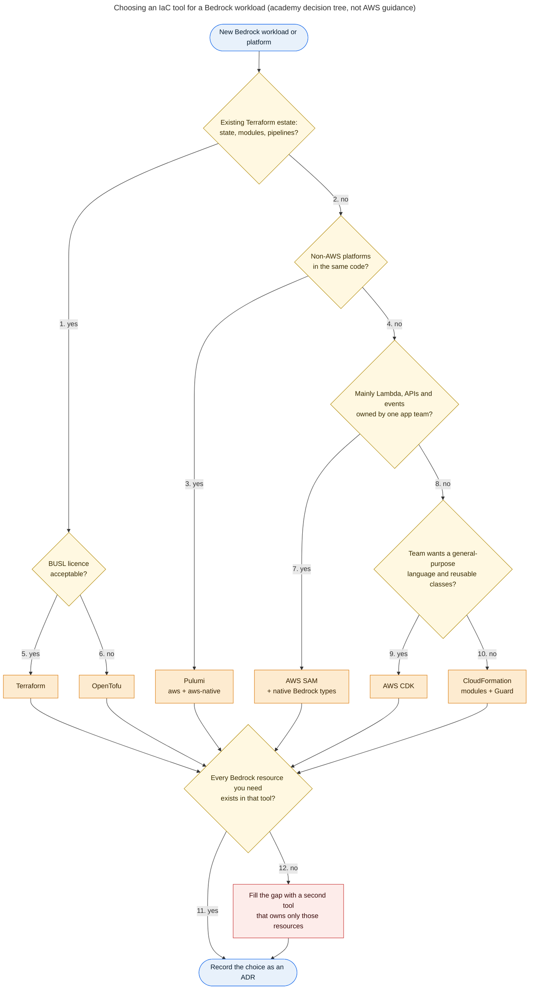
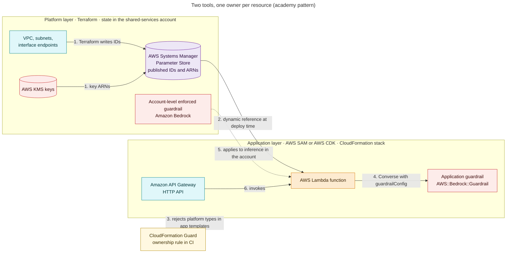

# Choosing an IaC tool

> **Level:** Intermediate · **Verified:** 2026-11-15 · **Feature status:** n/a · **Time:** ~25 min

Choosing an infrastructure-as-code tool for Amazon Bedrock work is mostly a question of what you
already run, who will maintain it, and whether the Bedrock resources you need exist in that tool
today. This chapter turns the [comparison](02-tool-comparison.md) into a decision tree, a
scenario table, migration paths and rules for mixing tools without two owners per resource.

## Learning objectives

After this chapter you can:

- Walk the academy's decision tree for a new Bedrock workload and justify the result.
- Match six common situations to a tool, including Bedrock-heavy designs that need new resource types.
- Plan a migration between tools without deleting live resources.
- Split ownership between tools so that no resource is managed twice.

## Prerequisites

- [Terraform, AWS CDK, CloudFormation, SAM and Pulumi compared](02-tool-comparison.md)
- [Feature verification matrix](../../FEATURE-VERIFICATION.md), sections B3 and C

## Concept in plain language

Picking an IaC tool is like picking the language a team writes in. The best language on paper
loses to the one your colleagues already read, review and debug at three in the morning. Change
language only for a reason you can name: a missing capability, a licence you cannot accept, or a
team that will genuinely be faster.

Mixing tools is normal in large organisations. The rule that keeps it safe is the one every
landlord knows: each flat has exactly one owner, and the owners agree where the walls are.

## How it really works

Four documented facts constrain the choice more than any preference.

| Constraint | What the documentation says | Consequence |
|:--|:--|:--|
| One owner per resource | Terraform "expects that each remote object is bound to only one resource instance" | Two tools must never declare the same resource |
| Coverage lineages | CloudFormation types feed CDK L1, SAM and Pulumi `aws-native`; the Terraform provider feeds Pulumi `aws` | A missing Bedrock resource in one lineage may exist in the other ([gap table](02-tool-comparison.md#where-bedrock-coverage-differs)) |
| Failure model | CloudFormation rolls back; Terraform and Pulumi do not | Teams without roll-forward discipline benefit from the CloudFormation family |
| Licence | Terraform is BUSL 1.1 from 1.6.0; OpenTofu is MPL 2.0 and works with state files up to those created by Terraform 1.5.x | Licence-sensitive organisations have a drop-in path, with compatibility to check |

> [!NOTE]
> **Documented fact** — A Terraform `removed` block with `lifecycle { destroy = false }` removes a
> resource from state without destroying it, which HashiCorp describes as a way "to hand off
> management responsibilities to another tool or team". A CloudFormation `DeletionPolicy: Retain`
> keeps the physical resource when it is removed from the template, taking it out of
> CloudFormation's scope; it does not apply when an update replaces the resource.
> Sources: [removed block](https://developer.hashicorp.com/terraform/language/block/removed),
> [DeletionPolicy attribute](https://docs.aws.amazon.com/AWSCloudFormation/latest/TemplateReference/aws-attribute-deletionpolicy.html)

## Architecture diagram



**What this shows** — The academy's default path. Existing investment is asked about first,
because migrating a working estate is rarely worth it. Every branch ends with the same coverage
check, because no single tool covers every Bedrock and AgentCore resource.

**Walkthrough**

1–2. An existing Terraform estate is the strongest single signal; keep it.
3–4. Without one, other platforms in the same code favour Pulumi (or Terraform); AWS-only work continues down the tree.
5–6. OpenTofu is the documented drop-in for organisations that cannot accept the BUSL.
7–8. One team's serverless application fits AWS SAM.
9–10. Teams that want classes, loops and unit tests choose AWS CDK; others write CloudFormation with modules.
11–12. Check the [verification matrix](../../FEATURE-VERIFICATION.md); fill a gap with a second tool under the rules below.

| Legend | Meaning |
|:--|:--|
| Yellow diamond | Question |
| Orange box | Tool |
| Red box | Extra ownership boundary |
| Rounded box | Start and end |

**Variations** — A platform team that serves many application teams often runs two tools on
purpose; see the second diagram.

### Mixing tools with one owner per resource



**What this shows** — Terraform owns slow-changing shared resources and publishes their
identifiers; application stacks read them and own everything else. A Guard rule in CI stops an
application template from declaring a platform-owned type.

**Walkthrough**

1. Terraform writes VPC, endpoint and key identifiers to Parameter Store.
2. The application template reads them by dynamic reference when CloudFormation deploys it.
3. The CI pipeline runs the Guard rule from the example below against every application template.
4. The function calls Converse with its own application guardrail.
5. An account-level enforced guardrail, owned by the platform, applies on top.
6. The API invokes the function.

**Variations** — The contract can be stack outputs, Parameter Store or a Pulumi stack
reference; Parameter Store works across all five tools. Enforced guardrails are covered in
[Automated Reasoning checks and guardrail enforcement](../../01-amazon-bedrock/guardrails/02-automated-reasoning-and-enforcement.md).

## Implementation details

### Scenarios

> [!TIP]
> **Academy recommendation** — The recommendations in this table are the academy's judgement,
> not an official AWS reference architecture. Re-check the coverage columns on every upgrade.

| Scenario | Recommendation | Why | Watch out for |
|:--|:--|:--|:--|
| Existing Terraform estate | Terraform; OpenTofu if the licence is a problem | State, modules, pipelines and skills already exist; 45 Bedrock-family and 21 AgentCore resource types | Router, Automated Reasoning, flow and prompt versions, mantle Projects, AgentCore Optimization and Payments are missing |
| AWS-only team that writes TypeScript or Python | AWS CDK | Stable AgentCore L2 constructs, assertion tests, automatic rollback | Guardrail, knowledge base and agent L2s are alpha; Provisioned Throughput and batch jobs are not CloudFormation types |
| Serverless application owned by one team | AWS SAM | Shorthand for functions, APIs and events; `sam local invoke`; `sam sync` for development | No Bedrock types or policy templates; inline IAM ([SAM chapter](../aws-sam/01-aws-sam.md)) |
| Multi-cloud or SaaS alongside AWS | Terraform, OpenTofu or Pulumi | Provider ecosystems beyond AWS | You operate state; Bedrock gaps as in the first row |
| Platform team building golden paths | CDK construct library or Terraform modules; Pulumi components if consumers use several languages | Versioned units with policy gates | Versioning discipline: [Module and construct versioning](../maintenance/02-module-and-construct-versioning.md) |
| Bedrock-heavy workload needing day-one resource types | Pulumi with `aws` and `aws-native` in one program, or a CloudFormation-family tool plus a narrow Terraform layer | Two lineages; `aws-native` is generated from the CloudFormation registry | Some types exist in neither; then a custom resource or API call, documented as such |

### Migration considerations

| From → to | How | Pitfalls |
|:--|:--|:--|
| CloudFormation, SAM or CDK → Terraform | Set `DeletionPolicy: Retain`, update, remove from the template, update again; then `import` blocks in Terraform | Retain does not cover replacement; write the Terraform resource to match the live configuration exactly |
| Terraform → CloudFormation family | `removed` with `destroy = false`; then CloudFormation resource import, IaC generator or `cdk import` | Which Bedrock types support CloudFormation import is **UNVERIFIED — REQUIRES DOCUMENTATION REVIEW**: check the resource type support list per type |
| Terraform → OpenTofu | Replace the binary; keep providers and state | The OpenTofu FAQ promises state compatibility up to Terraform 1.5.x; Terraform policy and Stacks are HashiCorp-only |
| Terraform → Pulumi | `pulumi import` per resource; Pulumi can also run HCL programs (`runtime: hcl`) | State is not shared; do not let both tools own a resource during the cut-over |
| CloudFormation → CDK | `cdk migrate` (experimental), or wrap templates | Logical IDs must not change, or resources are replaced |
| AWS SAM ↔ AWS CDK | Both deploy CloudFormation stacks; the SAM CLI can test CDK functions locally | Moving resources between stacks needs stack refactoring |

### Rules for mixing tools safely

1. **One owner per resource**, written down, and visible as a tag on the resource.
2. **Layer by rate of change.** Accounts, networks, keys and organisation-wide guardrails change
   slowly; functions, APIs and agents change daily.
3. **Publish a contract**, not state. Read identifiers from Parameter Store or stack outputs;
   never read another tool's state file.
4. **Hand off with retain or removed**, never delete and recreate: a new guardrail ARN breaks every
   IAM policy and application that references the old one.
5. **Enforce the boundary** with policy as code in CI, and run drift detection in both tools.

## Example

A CloudFormation Guard rule that keeps application stacks from declaring platform-owned types,
and a hand-off of a guardrail from CloudFormation to Terraform without deleting it.

> **Code status:** Guard rule passes `cfn-guard test` (two cases) and `cfn-guard validate`
> against [`../aws-sam/template.yaml`](../aws-sam/template.yaml) with cfn-guard 3.2.1 ·
> CloudFormation step validated with `cfn-lint` 1.60.1 · Terraform step validated with
> `terraform validate` (provider 6.73.0) · **never deployed**

```text
# ownership.guard - application stacks must not declare platform-owned resource types.
let platform_owned = Resources.*[
    Type in [
        "AWS::Bedrock::EnforcedGuardrailConfiguration",
        "AWS::Bedrock::ResourcePolicy",
        "AWS::EC2::VPC",
        "AWS::KMS::Key"
    ]
]

rule app_stack_declares_no_platform_resources {
    %platform_owned empty
    <<
        This resource type is owned by the platform layer (Terraform).
        Read its ID or ARN from Parameter Store instead of declaring it here.
    >>
}
```

Step 1 of the hand-off, in the CloudFormation stack that owns the guardrail today: retain it,
update the stack, then delete both resources from the template and update again.

```yaml
  ChatGuardrail:
    Type: AWS::Bedrock::Guardrail
    DeletionPolicy: Retain
    UpdateReplacePolicy: Retain
    Properties:
      Name: chat
      BlockedInputMessaging: Sorry, I can't help with that request.
      BlockedOutputsMessaging: Sorry, I can't share that response.
      ContentPolicyConfig:
        FiltersConfig:
          - Type: PROMPT_ATTACK
            InputStrength: HIGH
            OutputStrength: NONE
  ChatGuardrailVersion:
    Type: AWS::Bedrock::GuardrailVersion
    DeletionPolicy: Retain
    UpdateReplacePolicy: Retain
    Properties:
      GuardrailIdentifier: !GetAtt ChatGuardrail.GuardrailId
      Description: v1 - change this text to publish a new guardrail version
```

Step 2, in Terraform: adopt both. The import ID formats come from the provider documentation
(`guardrail_id,version` and `guardrail_arn,version`).

```hcl
import {
  to = aws_bedrock_guardrail.chat
  id = "${var.guardrail_id},DRAFT"
}

import {
  to = aws_bedrock_guardrail_version.chat
  id = "${var.guardrail_arn},${var.guardrail_version}"
}

resource "aws_bedrock_guardrail" "chat" {
  # Must match the live configuration exactly, or the first plan proposes changes.
  name                      = "chat"
  blocked_input_messaging   = "Sorry, I can't help with that request."
  blocked_outputs_messaging = "Sorry, I can't share that response."

  content_policy_config {
    filters_config {
      type            = "PROMPT_ATTACK"
      input_strength  = "HIGH"
      output_strength = "NONE"
    }
  }

  lifecycle {
    prevent_destroy = true
  }
}

resource "aws_bedrock_guardrail_version" "chat" {
  guardrail_arn = aws_bedrock_guardrail.chat.guardrail_arn
  description   = "v1 - change this text to publish a new guardrail version"
  skip_destroy  = true
}
```

The variables `guardrail_id`, `guardrail_arn` and `guardrail_version` take the old stack's
outputs. Run `terraform plan` and accept it only if it shows imports and no changes. The reverse
direction starts with `removed { from = aws_bedrock_guardrail.chat  lifecycle { destroy = false } }`.

## Common mistakes

> [!WARNING]
> **Common mistake** — Migrating by "delete in the old tool, create in the new one". For a
> guardrail, knowledge base or AgentCore resource the new copy gets a new ID and ARN, so IAM
> policies, enforced-guardrail configurations and application settings silently point at nothing.

| Mistake | Symptom | Fix |
|:--|:--|:--|
| Choosing a tool before listing the Bedrock resources | A key resource is missing after months of work | Check the matrix first |
| Importing a resource that another tool still owns | Both tools revert each other | Release first (`Retain` or `removed`), then import |
| Reading another tool's state file directly | Coupling to an internal format; secrets exposure | Publish a contract in Parameter Store or outputs |
| Platform-owned types in application templates | Two teams change the same resource | Guard rule in CI |
| Switching tools to fix a team problem | Same problems, new syntax | Fix the process (reviews, drift, tests) first |

## Security considerations

- Hand-offs change who can modify a resource. Update deployment-role policies in both tools in
  the same change, so the old owner loses write access.
- Parameter Store contracts hold identifiers, not secrets; if a value is sensitive, use
  `SecureString` or Secrets Manager and dynamic references.
- A second tool is a second supply chain: pin its versions and pipeline Actions by commit SHA
  ([ADR-014](../../ARCHITECTURE-DECISIONS.md#adr-014-pipelines-use-oidc-and-pin-actions-by-commit-sha)).

## Cost considerations

- Migrations cost engineering time and risk, not AWS charges, as long as resources are retained
  rather than recreated. Recreating a Managed Knowledge Base, for example, means paying for
  storage and ingestion again.
- Each extra tool adds pipeline minutes, state storage and, for managed offerings, an edition.

## Knowledge check

1. A team with a large Terraform estate needs an intelligent prompt router. What do you recommend?
2. Why does the decision tree ask about the existing estate before asking about language preference?
3. You must move a guardrail from a SAM stack to Terraform. In what order do you change the two tools, and why?
4. What stops an application team from declaring a KMS key in its SAM template under the pattern in this chapter?

<details>
<summary>Answers</summary>

1. Keep Terraform for everything else and declare the router (`AWS::Bedrock::IntelligentPromptRouter`)
   in a small CloudFormation stack that owns only that resource, publishing its ARN to Parameter Store.
2. Migrating a working estate costs time and carries deletion risk; language preference rarely repays that.
3. SAM first: set `DeletionPolicy: Retain`, deploy, remove the resource, deploy again. Then import
   into Terraform. Otherwise two tools own it at once, or the stack deletes it.
4. The Guard rule `app_stack_declares_no_platform_resources` fails the pipeline.

</details>

## Further reading

Official sources opened while writing this chapter:

- [Purpose of Terraform state](https://developer.hashicorp.com/terraform/language/state/purpose) · [removed block](https://developer.hashicorp.com/terraform/language/block/removed) · [Import overview](https://developer.hashicorp.com/terraform/language/import) · [Terraform LICENSE](https://raw.githubusercontent.com/hashicorp/terraform/main/LICENSE)
- [aws_bedrock_guardrail](https://raw.githubusercontent.com/hashicorp/terraform-provider-aws/main/website/docs/r/bedrock_guardrail.html.markdown) and [aws_bedrock_guardrail_version](https://raw.githubusercontent.com/hashicorp/terraform-provider-aws/main/website/docs/r/bedrock_guardrail_version.html.markdown) provider documentation — import ID formats.
- [OpenTofu](https://opentofu.org/) · [OpenTofu FAQ](https://opentofu.org/faq/) — Linux Foundation stewardship, state compatibility.
- [DeletionPolicy attribute](https://docs.aws.amazon.com/AWSCloudFormation/latest/TemplateReference/aws-attribute-deletionpolicy.html) · [Import AWS resources into a stack](https://docs.aws.amazon.com/AWSCloudFormation/latest/UserGuide/import-resources.html) · [Dynamic references](https://docs.aws.amazon.com/AWSCloudFormation/latest/UserGuide/dynamic-references.html)
- [CDK CLI README](https://raw.githubusercontent.com/aws/aws-cdk-cli/main/packages/aws-cdk/README.md) — `cdk import`, `cdk migrate`, `cdk refactor`.
- [What is AWS SAM?](https://docs.aws.amazon.com/serverless-application-model/latest/developerguide/what-is-sam.html) — when to use SAM; SAM with CDK.
- [AWS Cloud Control provider for Pulumi](https://www.pulumi.com/registry/packages/aws-native/) · [Pulumi projects](https://www.pulumi.com/docs/iac/concepts/projects/) — runtimes including `hcl`.
