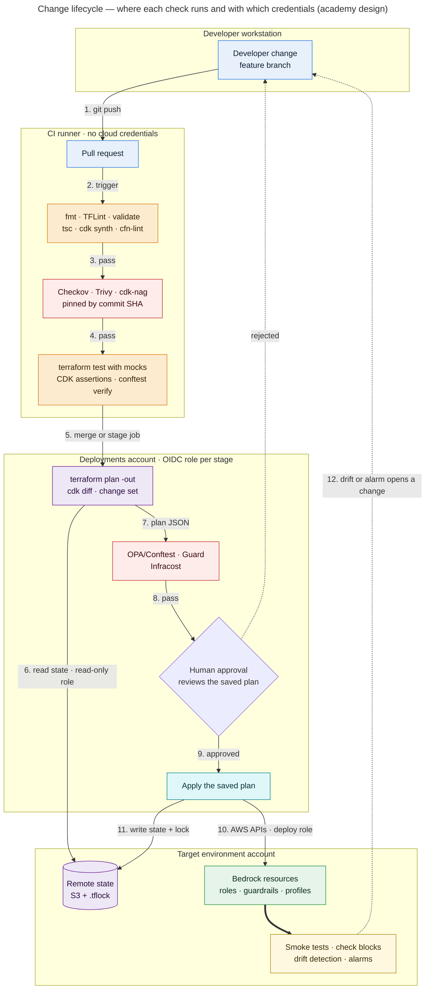

# The infrastructure change lifecycle

> **Level:** Intermediate · **Verified:** 2026-11-15 · **Feature status:** n/a · **Time:** ~25 min

Every change to a Bedrock platform — a new model ID, a wider IAM policy, a guardrail version —
travels the same road from a developer's editor to production. This chapter names each stage,
says what it proves and what it cannot, and maps the tools onto it. The
[DevOps and CI/CD](../../07-devops-and-cicd/README.md) section then builds the pipeline stage by stage.

## Learning objectives

After this chapter you can:

- List the stages of an infrastructure change, in order, and say what each one proves.
- Choose the tool for each stage for Terraform, the AWS CDK and CloudFormation, and explain where two tools overlap.
- Explain why the cheap, credential-free checks run first and the plan runs with a read-only role.
- Describe the limits of static analysis and policy checks, and what post-deployment validation and drift detection add.
- Spot the supply-chain risk in a pipeline and the controls that address it.

## Prerequisites

- [IaC concepts: declarative versus imperative, state, graphs, drift and idempotency](../comparison/01-iac-concepts.md)
- [Plan, apply and drift detection](../terraform/08-plan-apply-drift.md) and [Synthesis and CloudFormation templates](../aws-cdk/03-synthesis-and-cloudformation.md)

## Concept in plain language

Think of an airport. Your bag is weighed, X-rayed, matched to a passenger and only then loaded;
after landing, someone checks that it arrived. Each checkpoint catches a different problem: a
scale cannot find a forbidden item, and an X-ray cannot tell you the bag went to the wrong city.

An infrastructure change is the same. Formatting and validation catch typos. Security scanners
catch known bad patterns. Tests catch broken logic. The **plan** shows what will really change.
Policy checks catch changes that are valid but not allowed. A person approves what automation
cannot judge. After deployment, smoke tests and drift detection confirm that reality matches the code.

## How it really works

| # | Stage | What it proves | What it cannot prove | Terraform | AWS CDK / CloudFormation |
|--:|:--|:--|:--|:--|:--|
| 1 | Branch and pull request | The change is reviewable and traceable | That it works | Git | Git |
| 2 | Format and lint | Consistent style; deprecated syntax, unused declarations, provider-specific mistakes (with plugins) | Correct behaviour | `terraform fmt -check`, TFLint | ESLint, `cfn-lint` |
| 3 | Validate / compile | Syntax, argument names and types are internally consistent | Anything about the target account | `terraform validate` | `tsc`, `cdk synth` |
| 4 | Security scanning | Known misconfigurations are absent | Organisation-specific rules; values known only at plan time | Checkov, Trivy | cdk-nag, Checkov, Trivy |
| 5 | Unit and integration tests | Module logic produces the intended resources; integration tests prove they work | Unit: real API behaviour. Integration: everything else in prod | `terraform test` (mocks), Terratest | `aws-cdk-lib/assertions`, integration tests |
| 6 | Plan / change set | Exactly which resources will be created, updated or replaced in **this** account | Whether the change is allowed or wise | `terraform plan -out` | `cdk diff`, CloudFormation change sets |
| 7 | Policy and cost | The planned change obeys organisation rules; its cost delta | Runtime behaviour | OPA/Conftest on plan JSON, Terraform Policy, Sentinel, Infracost | CloudFormation Guard, Hooks, Infracost |
| 8 | Human approval | Someone accountable accepted the risk | Anything they did not read | GitHub environments, CodePipeline approval | same |
| 9 | Deployment | — | — | `terraform apply <saved plan>` | `cdk deploy`, change set execution |
| 10 | Post-deployment validation | The deployed system answers correctly | Long-term correctness | `check` blocks, smoke tests | smoke tests, alarms |
| 11 | Monitoring and drift detection | Reality still matches the code | Why it drifted | `plan -refresh-only`, `-detailed-exitcode`, HCP Terraform health | `cdk drift`, CloudFormation drift detection |

> [!NOTE]
> **Documented fact** — `terraform validate` "does not validate remote services, such as remote
> state or provider APIs", so it runs safely in CI without credentials after `terraform init -backend=false`.
> Source: [`terraform validate`](https://developer.hashicorp.com/terraform/cli/commands/validate)

### The tools, and how they differ

- **TFLint** is a pluggable linter: it finds possible errors, deprecated syntax, unused
  declarations and naming problems; provider-specific checks come from plugins such as the AWS
  ruleset. Source: [TFLint README](https://raw.githubusercontent.com/terraform-linters/tflint/master/README.md).
- **Checkov** scans HCL and, with more context, a plan rendered as JSON; it supports custom
  policies in Python and YAML. Source: [Checkov plan scanning](https://www.checkov.io/7.Scan%20Examples/Terraform%20Plan%20Scanning.html).
- **Trivy** is a general scanner whose scanners include "IaC issues and misconfigurations" and
  secrets. tfsec is folded into Trivy ([register](../../FEATURE-VERIFICATION.md#c-infrastructure-as-code-tooling)).
  Source: [Trivy README](https://raw.githubusercontent.com/aquasecurity/trivy/main/README.md).
- **`terraform test`** runs `apply` by default, which **creates real infrastructure**; set
  `command = plan` and use `mock_provider` for credential-free unit tests. Source:
  [Tests](https://developer.hashicorp.com/terraform/language/tests).
- **Terratest** is a Go library for automated tests of real infrastructure — the integration
  layer. Source: [Terratest README](https://raw.githubusercontent.com/gruntwork-io/terratest/main/README.md).
- **CDK assertions** come in two kinds: fine-grained assertions and snapshot tests. AWS warns that
  CDK upgrades can change synthesized templates, so snapshots alone cannot prove correctness.
  Source: [Testing CDK applications](https://docs.aws.amazon.com/cdk/v2/guide/testing.html).
- **cdk-nag** checks CDK apps or templates against rule packs (AWS Solutions, HIPAA, NIST).
  Source: [cdk-nag README](https://raw.githubusercontent.com/cdklabs/cdk-nag/main/README.md).
- **CloudFormation Guard** validates any JSON or YAML, but "doesn't validate CloudFormation
  templates for valid syntax" (use `cfn-lint`) and "doesn't provide server-side enforcement" (use
  Hooks). Source: [What is Guard?](https://docs.aws.amazon.com/cfn-guard/latest/ug/what-is-guard.html)
- **OPA / Conftest** evaluate Rego policies against plan JSON. OPA warns that unknown values,
  dynamic blocks and unevaluated function calls may be missing at plan time. Source:
  [OPA and Terraform](https://www.openpolicyagent.org/docs/terraform).
- **Terraform Policy** became generally available in Terraform 1.17.0 (`-policies` on `plan`,
  `apply` and `query`); policies are written in HCL and enforced by HCP Terraform. Sources:
  [Terraform 1.17 changelog](https://raw.githubusercontent.com/hashicorp/terraform/v1.17/CHANGELOG.md),
  [Terraform policy](https://developer.hashicorp.com/terraform/policy).
- **Infracost** estimates cost for Terraform, CloudFormation and the CDK before deployment, but
  not your token volume. Source:
  [Infracost README](https://raw.githubusercontent.com/infracost/infracost/master/README.md).

> [!CAUTION]
> **Cost or security hazard** — On 2026-03-19 an attacker force-pushed 76 of 77 version tags of
> `aquasecurity/trivy-action` and all tags of `setup-trivy` to credential-stealing code. Workflows
> pinned to a safe commit SHA were not affected. Pin every third-party Action to a full commit SHA
> ([ADR-014](../../ARCHITECTURE-DECISIONS.md#adr-014-pipelines-use-oidc-and-pin-actions-by-commit-sha)).
> GitHub now also documents workflow dependency lockfiles as the strongest protection where a
> repository adopts them. Sources: [Trivy advisory](https://github.com/aquasecurity/trivy/security/advisories/GHSA-69fq-xp46-6x23),
> [GitHub secure use reference](https://docs.github.com/en/actions/reference/security/secure-use)

## Architecture diagram



**What this shows** — Three trust zones. Everything that needs no cloud credentials runs first,
on the CI runner. Only the plan and the apply touch AWS, from a deployments account, through a
separate role per environment; only the apply, after approval, writes resources and state.

**Walkthrough**

1. The developer pushes a branch; nothing touches AWS from the laptop.
2. The pull request triggers the credential-free checks.
3. Formatting, linting, validation and synthesis must pass before anything slower runs.
4. Scanners run, each Action pinned by SHA.
5. Unit tests run with mocks; policy unit tests (`conftest verify`) prove the policies themselves.
6. The plan job reads the target environment's state with a read-only role.
7. The saved plan is rendered as JSON and evaluated by policy and cost tools.
8. Only a passing plan reaches a person.
9. The approver reviews the same saved plan that will be applied.
10. The apply job uses the deploy role and executes exactly that plan.
11. State is written under the S3 lock.
12. Monitoring and drift detection turn surprises into new changes, which start the loop again.

| Legend | Meaning |
|:--|:--|
| Solid arrow | Request or hand-off |
| Dashed arrow | Return path (rejection, drift) |
| Thick arrow | Continuous, asynchronous signal |
| Red boxes | Security controls |

**Variations** — With the AWS CDK, stage 6 is `cdk diff` or a change set and stage 7 runs Guard
on the synthesized template. With HCP Terraform, plan, policy (Sentinel or Terraform Policy) and
apply run in the workspace. The full pipeline picture is
[diagram set 26](../../diagrams/mermaid/26-cicd-and-iac-deployment.md).

## Implementation details

1. **Order checks by cost and by credentials.** A formatting failure should cost seconds, not a
   plan in four accounts, and nothing before the plan needs AWS access.
2. **Apply the plan you approved.** `terraform plan -out=FILE` saves a plan that `terraform apply
   FILE` executes; without `-out` the plan is only speculative, and other changes in the meantime
   can make the result differ. Source: [`terraform plan`](https://developer.hashicorp.com/terraform/cli/commands/plan).
3. **Separate roles per stage and per environment.** Plan needs read access and state read;
   apply needs write. See [Environments, isolation and controlled promotion](03-environments-and-promotion.md).
   An approval should expire: a CodePipeline manual approval that nobody answers within seven
   days fails the execution. Source: [CodePipeline manual approval](https://docs.aws.amazon.com/codepipeline/latest/userguide/approvals.html).
4. **Post-deployment checks are not gates.** A failing `check` block "reports a warning and
   continues". Use it to surface problems, and smoke tests to fail a deployment. Source:
   [`check` block](https://developer.hashicorp.com/terraform/language/block/check).
5. **Schedule drift detection.** `terraform plan -refresh-only -detailed-exitcode` exits `2` when
   something changed; `cdk drift --fail` returns non-zero on drift. Sources:
   [`terraform plan`](https://developer.hashicorp.com/terraform/cli/commands/plan),
   [CDK CLI README](https://raw.githubusercontent.com/aws/aws-cdk-cli/main/packages/aws-cdk/README.md).
6. **Add Bedrock-specific rules.** Generic scanners do not know that a guardrail version must be
   pinned in production or that `bedrock:InvokeModel` on `*` reaches every model; write those as
   variable validations and policies ([chapter 4](04-secrets-and-policy-as-code.md)).

> [!TIP]
> **Academy recommendation** — Make the merge to `main` produce one immutable artifact (commit
> SHA, or synthesized cloud assembly) and promote that artifact through every environment.
> This is our design guidance, not an official AWS reference architecture.

Where to go deeper: [static analysis](../../07-devops-and-cicd/02-static-analysis-and-security-scanning.md) ·
[testing](../../07-devops-and-cicd/03-testing-iac.md) · [GitHub Actions](../../07-devops-and-cicd/04-github-actions.md) ·
[CodePipeline and CodeBuild](../../07-devops-and-cicd/05-codepipeline-and-codebuild.md) ·
[policy, cost and approval](../../07-devops-and-cicd/06-policy-cost-and-approvals.md) ·
[post-deployment and drift](../../07-devops-and-cicd/07-post-deploy-validation-and-drift.md).

## Example

The credential-free part of the lifecycle as one script, for a pull request or a laptop. It was
run against the [environments example](environments/README.md) and the
[policy example](policies/README.md).

> **Code status:** `bash -n` ✅ · run locally on 2026-11-15: all seven stages passed (Terraform 1.17.2, TFLint 0.66.0, Checkov 3.4.5, Conftest with OPA 1.21.1) · **never deployed**

```bash
#!/usr/bin/env bash
# Pull-request checks that need no AWS credentials. Run from the environments directory.
set -euo pipefail

echo "== 1. format";        terraform fmt -check -recursive
echo "== 2. init (no backend)"; terraform init -backend=false -input=false >/dev/null
echo "== 3. validate";      terraform validate
echo "== 4. lint";          tflint --format=compact
echo "== 5. security scan"; checkov -d . --framework terraform --quiet --compact --skip-download
echo "== 6. unit tests";    terraform test
echo "== 7. policy tests";  conftest verify --policy ../policies/policy
# Stages 8+ need credentials for the target account and run in the pipeline:
#   terraform plan -var-file=env/dev/terraform.tfvars -out=dev.tfplan
#   terraform show -json dev.tfplan > dev.tfplan.json
#   conftest test --policy ../policies/policy dev.tfplan.json
```

Lab 8 walks through the same checks: [Run the IaC pipeline checks locally](../../labs/lab-08-pipeline-dry-run.md).

## Common mistakes

> [!WARNING]
> **Common mistake** — Treating a green security scan as approval. Scanners know generic
> patterns, not your account layout or that a model ID was retired last month. Keep the plan
> review and the Bedrock-specific policies.

| Mistake | Symptom | Fix |
|:--|:--|:--|
| `terraform test` without `command = plan` and mocks | Tests create real resources, or fail in CI for lack of credentials | Default to plan-mode unit tests with `mock_provider`; run apply-mode tests only in a sandbox account |
| Applying a fresh plan instead of the approved one | The approver saw one diff, production got another | `plan -out`, approve, then `apply <file>` |
| Third-party Actions referenced by tag | A force-pushed tag runs attacker code with your OIDC role | Pin to a full commit SHA or adopt a workflow lockfile |
| Policy checks on HCL only | Values computed in modules or from variables slip through | Evaluate the plan JSON as well |
| No drift schedule | Console hot-fixes are overwritten or silently persist | Scheduled `plan -refresh-only -detailed-exitcode` or `cdk drift --fail` |

## Security considerations

- Keep CI stages before the plan credential-free; that shrinks what a malicious pull request can reach.
- Use OIDC, not stored keys, and a distinct role per environment and per stage (plan vs apply).
- A saved plan and its JSON contain every known value, sensitive ones included; keep them inside the pipeline.
- Scanner and Action supply chains are part of your attack surface: pin, verify, and update deliberately.

## Cost considerations

- The checks before the plan cost only CI minutes. Plans make read-only API calls; applies create billable resources.
- Integration tests (Terratest, apply-mode `terraform test`) create real resources — budget for them and always destroy.
- Cost estimators price infrastructure, not tokens. Model Bedrock token cost separately; see
  [Pricing model and cost drivers](../../08-cost-performance-and-reliability/01-pricing-model-and-cost-drivers.md).

## Knowledge check

1. Why does `terraform validate` belong before the plan stage, and what can it never detect?
2. A pull request widens an IAM policy to `bedrock:*` on `*`. Which two stages should stop it, and why is one of them not enough?
3. What would happen if the apply job ran `terraform plan` and `apply` again instead of applying the approved plan file?
4. Your `check` block that calls the model endpoint fails after deployment. Does the deployment fail?

<details>
<summary>Answers</summary>

1. It is offline and fast, so it fails cheaply; it cannot see the target account, state or provider APIs.
2. The security scan (for example Checkov's IAM checks) and the plan-time policy (Conftest on plan JSON). Scanners may miss values computed at plan time; plan policies cannot see unknown values — layered, they cover each other.
3. Anything that changed between approval and apply (another merge, drift) would be applied without review.
4. No. A failing `check` assertion is reported as a warning; use a smoke test to fail the stage.

</details>

## Further reading

Official sources opened while writing this chapter:

- [`terraform validate`](https://developer.hashicorp.com/terraform/cli/commands/validate) — offline validation.
- [`terraform plan`](https://developer.hashicorp.com/terraform/cli/commands/plan) — saved plans, refresh-only mode, detailed exit codes.
- [Terraform tests](https://developer.hashicorp.com/terraform/language/tests) — `command`, mocks, variable precedence.
- [`check` block](https://developer.hashicorp.com/terraform/language/block/check) — non-blocking assertions.
- [Health assessments in HCP Terraform](https://developer.hashicorp.com/terraform/cloud-docs/workspaces/health) — drift detection and continuous validation.
- [Terraform policy](https://developer.hashicorp.com/terraform/policy) and [Terraform 1.17 changelog](https://raw.githubusercontent.com/hashicorp/terraform/v1.17/CHANGELOG.md) — Terraform Policy GA.
- [OPA and Terraform](https://www.openpolicyagent.org/docs/terraform) and [Conftest](https://www.conftest.dev/) — plan JSON policies.
- [Checkov Terraform plan scanning](https://www.checkov.io/7.Scan%20Examples/Terraform%20Plan%20Scanning.html) — scanning plan JSON.
- [TFLint](https://raw.githubusercontent.com/terraform-linters/tflint/master/README.md), [Trivy](https://raw.githubusercontent.com/aquasecurity/trivy/main/README.md), [Terratest](https://raw.githubusercontent.com/gruntwork-io/terratest/main/README.md), [cdk-nag](https://raw.githubusercontent.com/cdklabs/cdk-nag/main/README.md), [Infracost](https://raw.githubusercontent.com/infracost/infracost/master/README.md) — tool READMEs.
- [What is CloudFormation Guard?](https://docs.aws.amazon.com/cfn-guard/latest/ug/what-is-guard.html) — scope and limits.
- [Testing CDK applications](https://docs.aws.amazon.com/cdk/v2/guide/testing.html) — assertions and snapshots.
- [CDK CLI README](https://raw.githubusercontent.com/aws/aws-cdk-cli/main/packages/aws-cdk/README.md) — `cdk drift`, `cdk diff`.
- [CodePipeline manual approval](https://docs.aws.amazon.com/codepipeline/latest/userguide/approvals.html) — approval actions and the seven-day timeout.
- [Trivy advisory GHSA-69fq-xp46-6x23](https://github.com/aquasecurity/trivy/security/advisories/GHSA-69fq-xp46-6x23) and [GitHub secure use reference](https://docs.github.com/en/actions/reference/security/secure-use) — supply-chain controls.
