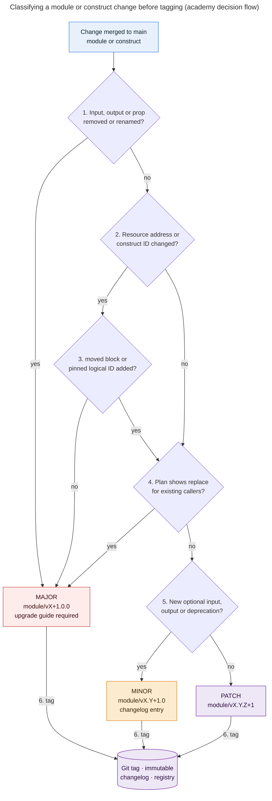
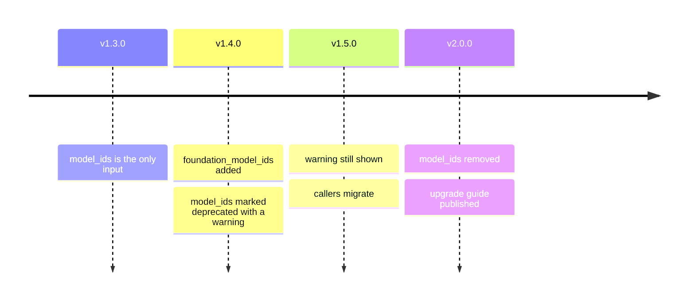

# Module and construct versioning

> **Level:** Intermediate · **Verified:** 2026-11-15 · **Feature status:** n/a · **Time:** ~25 min

A shared Terraform module or CDK construct is a product with customers: every team that
calls it. Its version number is a promise about what an upgrade will do to their Bedrock roles,
guardrails and knowledge bases. This chapter shows how to keep that promise — what counts as
breaking, how to tag and publish, how to deprecate, and how to refactor without replacing
deployed resources.

## Learning objectives

After this chapter you can:

- Classify a module or construct change as major, minor or patch, including changes that look harmless but replace resources.
- Publish module versions with `module-name/vX.Y.Z` tags and consume them by tag or commit.
- Deprecate an input or output with a warning and a removal date instead of a surprise.
- Refactor with `moved` blocks, the `Default` construct ID and `renameLogicalId` so callers keep their resources.

## Prerequisites

- [Modules](../terraform/03-modules.md) and [Reusable construct libraries](../aws-cdk/08-construct-libraries.md)
- The academy's [module standard and versioning convention](../terraform/modules/README.md)

## Concept in plain language

A version number is a label on a box that tells the person opening it how careful to be. **Patch**
means "same thing, fixed". **Minor** means "same thing, plus something new you may ignore".
**Major** means "read the instructions — something you relied on changed".

Infrastructure adds a twist that application libraries do not have: an upgrade can **destroy and
recreate** a real resource. Renaming a variable breaks a caller's build, which is annoying.
Renaming a resource inside a module can delete a production IAM role and create a new one,
which is an outage. Versioning infrastructure code is mostly about that second kind of change.

## How it really works

> [!NOTE]
> **Documented fact** — Semantic Versioning increments MAJOR for incompatible API changes, MINOR
> for backward-compatible functionality — and MINOR "MUST be incremented if any public API
> functionality is marked as deprecated" — and PATCH for backward-compatible fixes. A released
> version "MUST NOT be modified". Source: [Semantic Versioning 2.0.0](https://semver.org/)

### What the "public API" is

| Part | Terraform module | CDK construct |
|:--|:--|:--|
| Inputs | Variables: names, types, defaults, validation | Props interface: names, types, defaults |
| Outputs | Outputs | `public readonly` members |
| **Identity of what is deployed** | Resource addresses (`aws_iam_role.this`) recorded in callers' state | Logical IDs in the synthesized template, derived from the construct path |
| Behaviour | Planned resources and their arguments | Synthesized resources and properties |
| Requirements | `required_version`, provider constraints | `aws-cdk-lib` peer range, feature flags |

The third row is the one teams forget. In Terraform, a resource's address is its identity in
state; by default "Terraform interprets a change as an instruction to destroy the existing
resource and create a new resource at the new address". Source:
[Refactoring](https://developer.hashicorp.com/terraform/language/modules/develop/refactoring).
In the CDK, the logical ID is computed from the construct path plus an 8-character hash, and
CloudFormation treats a new logical ID as a new resource. Source:
[Identifiers](https://docs.aws.amazon.com/cdk/v2/guide/identifiers.html).

### Classifying a change

| Change | Bump | Why |
|:--|:-:|:--|
| Remove or rename a variable, prop, output or public member | Major | Callers' code no longer compiles or plans |
| Add a **required** input | Major | Existing calls fail |
| Change a default so that planned resources change | Major | Callers get a different deployment without editing anything |
| Change an argument that forces replacement (a role `name`, a resource's `region` in provider v6, an AgentCore credential provider `name`) | Major | The resource is destroyed and recreated |
| Rename or move a resource **without** a `moved` block, or change a construct ID | Major | Same as above |
| Rename or move a resource **with** a `moved` block, or keep the logical ID | Minor or patch | No caller-visible effect |
| Deprecate an input or output | Minor | SemVer requires it |
| Add an optional input, output or resource behind a flag that defaults off | Minor | Existing calls plan the same |
| Fix an error message or documentation | Patch | No behaviour change |

> [!NOTE]
> **Documented fact** — In AWS provider v6, "Changing the value of `region` will force resource
> replacement". The provider documentation marks other replacement-forcing arguments, for example
> `name` on `aws_iam_role` ("Forces new resource") and `name` on
> `aws_bedrockagentcore_api_key_credential_provider`.
> Sources: [Enhanced Region Support](https://raw.githubusercontent.com/hashicorp/terraform-provider-aws/main/website/docs/guides/enhanced-region-support.html.markdown),
> [`aws_iam_role`](https://raw.githubusercontent.com/hashicorp/terraform-provider-aws/main/website/docs/r/iam_role.html.markdown),
> [API key credential provider](https://raw.githubusercontent.com/hashicorp/terraform-provider-aws/main/website/docs/r/bedrockagentcore_api_key_credential_provider.html.markdown)

### Publishing and consuming

- **Tags.** The academy tags each module in the monorepo as `module-name/vMAJOR.MINOR.PATCH`
  ([convention](../terraform/modules/README.md#versioning-convention)) and never moves a tag.
- **Git sources** select a version with `?ref=`, which accepts a tag or a commit SHA. Source:
  [Module sources](https://developer.hashicorp.com/terraform/language/modules/sources).
- **Registries** add the `version` argument, which "only applies when installing modules from a
  registry". Source: [`module` block](https://developer.hashicorp.com/terraform/language/block/module).
- **The HCP Terraform private registry** publishes from tags that are semantic versions
  (optionally `v`-prefixed); for several modules in one repository you set a **Module Tag
  Prefix** — its documented example is `app-` for tags like `app-v1.0.0`. Source:
  [Publish private modules](https://developer.hashicorp.com/terraform/cloud-docs/registry/publish-modules).
  Whether a prefix ending in `/` (our `module-name/` form) is accepted is **UNVERIFIED — REQUIRES
  DOCUMENTATION REVIEW**; the page shows only a hyphen. Use `module-name-v1.2.0` if you plan to
  publish there.
- **Lock files do not pin modules.** "Terraform does not remember version selections for remote
  modules"; pin them in the `source` or `version` yourself. Source:
  [Dependency lock file](https://developer.hashicorp.com/terraform/language/files/dependency-lock).
- **Constructs** are packages: publish with a SemVer version to a private package registry and
  declare `aws-cdk-lib` as a peer dependency, as the
  [construct library](../aws-cdk/construct-library/README.md) does.

### Deprecating

Terraform 1.15 added a `deprecated` argument to `variable` blocks and to `output` blocks in
child modules; callers see the message as a warning. Sources:
[`variable` block](https://developer.hashicorp.com/terraform/language/block/variable),
[`output` block](https://developer.hashicorp.com/terraform/language/block/output). In the CDK, mark
the prop or method `@deprecated` in its doc comment and emit a synth-time warning with
`Annotations.of(this).addDeprecation(...)` or `addWarningV2(...)` (both in the installed
`aws-cdk-lib` 2.277.0 typings).

### Refactoring without breaking callers

- **Terraform `moved` blocks** rename or move resources and module calls without destroying them.
  "Removing a `moved` block is a breaking change"; HashiCorp recommends keeping historical
  `moved` blocks and chaining them. Source: [Refactoring](https://developer.hashicorp.com/terraform/language/modules/develop/refactoring).
- **CDK `Default` ID**: a path component named `Default` is removed from the logical ID, so
  wrapping an existing resource in a new construct with the inner ID `Default` keeps the logical
  ID. Source: [Identifiers](https://docs.aws.amazon.com/cdk/v2/guide/identifiers.html).
- **CDK `renameLogicalId` / `overrideLogicalId`** pin a logical ID after a rename
  (`Stack.renameLogicalId(oldId, newId)` and `CfnElement.overrideLogicalId(id)` in `aws-cdk-lib` 2.277.0).
- **`cdk refactor`** moves already-deployed resources to new logical IDs or stacks through
  CloudFormation stack refactoring — see [chapter 5](05-upgrades-refactoring-import.md).

## Architecture diagram



**What this shows** — The questions to answer, in order, before choosing the next version. The
fourth question is answered by evidence, not opinion: run the caller-facing tests and a plan
against an existing state (for example the module's example root in a sandbox) and look for
`must be replaced`.

**Walkthrough**

1. Any removed or renamed part of the interface makes the release major.
2. An address or ID change is checked next, because it decides what happens to deployed resources.
3. A `moved` block or a pinned logical ID turns that change into a non-event.
4. Any replacement visible in a plan makes the release major, whatever the reason.
5. Additions and deprecations are minor; everything else is a patch.
6. The tag is created once and never moved.

| Legend | Meaning |
|:--|:--|
| Diamond | Decision |
| Red box | Major release — callers must act |
| Cylinder | Immutable release record |

**Variations** — For a CDK construct, question 2 is "did any construct ID or nesting change?",
and question 4 is answered by `cdk diff` against a deployed stack or by comparing logical IDs in
a unit test (see the example).



## Implementation details

1. **Write the changelog entry in the same pull request** as the change, with a section per
   bump type and an "Upgrade" note for anything major.
2. **Test the public contract**, not the implementation: plan-mode tests that assert on outputs
   and resource arguments, as in the [module's tests](../terraform/modules/bedrock-invocation-role/tests/policy.tftest.hcl).
3. **Keep every `moved` block** until you are certain every caller has applied the version that
   introduced it — for a widely used module, forever.
4. **Raise `required_version`** when you use a newer language feature (`deprecated` needs 1.15);
   treat that as at least a minor release and say so in the changelog.
5. **Consumers pin exactly** (`?ref=bedrock-invocation-role/v1.4.0` or a commit SHA) and upgrade
   through a pull request whose plan is reviewed like any other change.

> [!TIP]
> **Academy recommendation** — Deprecate in a minor release, keep the old input working for at
> least one further minor release or 90 days (whichever is longer), and remove it only in the
> next major release with an upgrade guide.
> This is our design guidance, not an official AWS reference architecture.

## Example

**Terraform — deprecate an input and rename a resource in a minor release.**

> **Code status:** `terraform fmt` ✅ · `terraform validate` ✅ (Terraform 1.17.2, provider 6.73.0) — both deprecation warnings shown below were produced by it · **never planned or applied against AWS**

```hcl
# modules/invoke-policy v1.4.0 (requires Terraform >= 1.15 for `deprecated`).
# Excerpt of the validated module: variable "role_name" and output "policy_name" omitted.
variable "foundation_model_ids" {
  description = "Model IDs the role may invoke (added in v1.4.0)."
  type        = list(string)
  default     = []
}

variable "model_ids" {
  description = "Deprecated alias of foundation_model_ids; removed in v2.0.0."
  type        = list(string)
  default     = []
  deprecated  = "model_ids is deprecated since v1.4.0 and will be removed in v2.0.0. Use foundation_model_ids."
}

locals {
  model_ids = distinct(concat(var.foundation_model_ids, var.model_ids))
}

# v1.4.0 renamed this resource from "invoke" to "inference".
resource "aws_iam_role_policy" "inference" {
  name = "${var.role_name}-bedrock-inference"
  role = var.role_name
  policy = jsonencode({
    Version = "2012-10-17"
    Statement = [{
      Effect   = "Allow"
      Action   = ["bedrock:InvokeModel"]
      Resource = [for id in local.model_ids : "arn:aws:bedrock:us-east-1::foundation-model/${id}"]
    }]
  })
}

moved {
  from = aws_iam_role_policy.invoke
  to   = aws_iam_role_policy.inference
}

output "name" {
  value      = aws_iam_role_policy.inference.name
  deprecated = "Use policy_name. The output name is removed in v2.0.0."
}
```

A caller that still passes `model_ids` and reads `module.invoke.name` gets, from `terraform validate`:

```text
Warning: Deprecated variable got a value
  model_ids is deprecated since v1.4.0 and will be removed in v2.0.0. Use foundation_model_ids.
Warning: Deprecated value used
  Use policy_name. The output name is removed in v2.0.0.
```

To see the `moved` block's effect without AWS, the same rename was applied to a local
`terraform_data` resource: with the block, the plan reported "`terraform_data.invoke has moved to
terraform_data.inference` … Plan: 0 to add, 0 to change, 0 to destroy"; without it, "Plan: 1 to
add, 0 to change, 1 to destroy".

**AWS CDK — prove in a unit test that a refactor keeps the logical ID.**

> **Code status:** excerpt of a scratch project that passed `tsc` (TypeScript 7.0.2), Jest (2 tests) and `cdk synth` (`aws-cdk-lib` 2.277.0) · **never deployed**

```ts
import { App } from 'aws-cdk-lib';
import { Template } from 'aws-cdk-lib/assertions';
import * as iam from 'aws-cdk-lib/aws-iam';
import { Construct } from 'constructs';

/** v2 of a construct that wraps the role callers used to create directly. */
export class ChatInvoke extends Construct {
  public readonly role: iam.Role;
  constructor(scope: Construct, id: string) {
    super(scope, id);
    // 'Default' is dropped from the logical ID, so the role keeps its old identity.
    this.role = new iam.Role(this, 'Default', {
      assumedBy: new iam.ServicePrincipal('lambda.amazonaws.com'),
    });
  }
}

// In the stack, v3 renames the construct and pins the logical ID already deployed:
//   const invoke = new ChatInvoke(this, 'ChatInferenceRole');
//   this.renameLogicalId(this.getLogicalId(invoke.role.node.defaultChild as iam.CfnRole), 'InvokeRoleC9AEA952');

test('wrapping the role with the ID Default keeps its logical ID', () => {
  expect(roleLogicalIds('v2-wrapped')).toEqual(roleLogicalIds('v1')); // both: ['InvokeRoleC9AEA952']
});
```

`roleLogicalIds(layout)` synthesizes the stack in memory and returns
`Object.keys(Template.fromStack(stack).findResources('AWS::IAM::Role'))`.

## Common mistakes

> [!WARNING]
> **Common mistake** — Moving a Git tag to "fix" a release. Callers who already pulled the old
> commit and callers who pull the new one now have different code under the same version, and
> SemVer forbids modifying a released version. Release a new patch instead.

| Mistake | Symptom | Fix |
|:--|:--|:--|
| Resource renamed in a "minor" release without `moved` | Callers' plans show destroy and create of roles or guardrails | Add the `moved` block; re-release as a patch |
| `moved` blocks deleted during a clean-up | Callers skipping versions lose resources on upgrade | Keep them; chain them for repeated renames |
| Construct ID changed for readability | `cdk diff` shows replacement of stateful resources | Use `Default`, `renameLogicalId`, or `cdk refactor` |
| Consumers reference `?ref=main` | Every plan may pull new module code | Pin a tag or commit SHA |
| Deprecation without a date | Old inputs live forever, or vanish unannounced | Put the removal version in the message |

## Security considerations

- A Git tag is mutable at the source; a commit SHA is not. For modules that create IAM policies, pin callers to a SHA or to a registry that keeps versions immutable.
- Review module upgrades by their **plan**, not their changelog alone: a security fix should not widen any permission.
- Restrict who may create release tags on the module repository.

## Cost considerations

- A replacement caused by an unplanned major change can cost more than downtime: recreated resources may lose data or need re-ingestion (for example a knowledge base's vector index).
- Keeping several majors alive costs maintenance time; a published deprecation window bounds it.

## Knowledge check

1. A module release only renames `aws_iam_role.this` to `aws_iam_role.invoke` and adds a `moved` block. Which bump, and why?
2. You change a prop default from `allowStreaming: true` to `false`. No caller code breaks. Which bump?
3. What happens to a caller on v1.2 who upgrades straight to v1.6 if v1.5 removed the `moved` block added in v1.3?

<details>
<summary>Answers</summary>

1. Patch or minor: with the `moved` block, existing state is re-addressed and nothing is replaced; no interface changed.
2. Major: callers get a different policy without editing anything — a changed default that changes resources.
3. Their plan treats the old address as deleted and the new one as new: the role is destroyed and recreated. That is why removing a `moved` block is a breaking change.

</details>

## Further reading

Official sources opened while writing this chapter:

- [Semantic Versioning 2.0.0](https://semver.org/) — the rules for MAJOR, MINOR and PATCH.
- [Refactoring](https://developer.hashicorp.com/terraform/language/modules/develop/refactoring) and [`moved` block](https://developer.hashicorp.com/terraform/language/block/moved) — renames, splits, keeping `moved` blocks.
- [`variable` block](https://developer.hashicorp.com/terraform/language/block/variable) and [`output` block](https://developer.hashicorp.com/terraform/language/block/output) — `deprecated` (Terraform 1.15+).
- [Module sources](https://developer.hashicorp.com/terraform/language/modules/sources) and [`module` block](https://developer.hashicorp.com/terraform/language/block/module) — `?ref=` and `version`.
- [Publishing modules](https://developer.hashicorp.com/terraform/language/modules/develop/publish), [Terraform Registry publishing](https://developer.hashicorp.com/terraform/registry/modules/publish) and [HCP Terraform private registry](https://developer.hashicorp.com/terraform/cloud-docs/registry/publish-modules) — tag formats and prefixes.
- [Dependency lock file](https://developer.hashicorp.com/terraform/language/files/dependency-lock) — what is and is not locked.
- [Identifiers and the AWS CDK](https://docs.aws.amazon.com/cdk/v2/guide/identifiers.html) — logical ID generation and the `Default` heuristic.
- [Enhanced Region Support](https://raw.githubusercontent.com/hashicorp/terraform-provider-aws/main/website/docs/guides/enhanced-region-support.html.markdown), [`aws_iam_role`](https://raw.githubusercontent.com/hashicorp/terraform-provider-aws/main/website/docs/r/iam_role.html.markdown) and [`aws_bedrockagentcore_api_key_credential_provider`](https://raw.githubusercontent.com/hashicorp/terraform-provider-aws/main/website/docs/r/bedrockagentcore_api_key_credential_provider.html.markdown) — replacement-forcing arguments.
