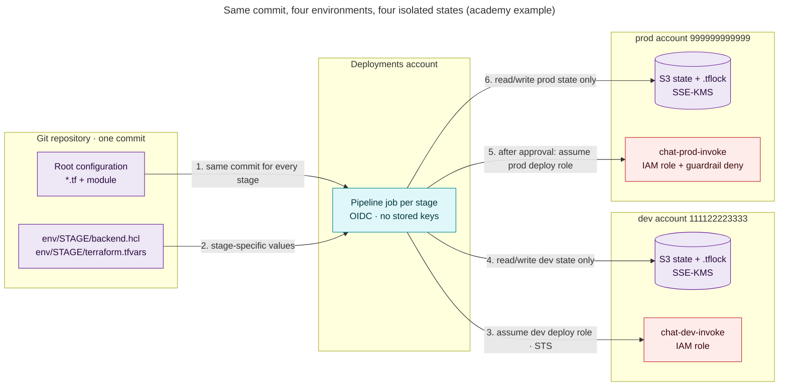

# Environments example: one root configuration, four accounts

> **Code status:** `terraform fmt` ✅ · `terraform init -backend=false` ✅ · `terraform validate` ✅ (Terraform 1.17.2, provider 6.73.0) · `terraform test` ✅ 8 runs with a mock provider · TFLint 0.66 (core rules) ✅ · Checkov 3.4.5 ✅ (one documented skip) · **never planned or applied against AWS, never deployed**

A single Terraform root configuration that is deployed to **dev, test, staging and prod** — four
separate AWS accounts ([ADR-013](../../../ARCHITECTURE-DECISIONS.md#adr-013-one-aws-account-per-environment))
with **one state object per environment** in an S3 backend with native locking
([ADR-011](../../../ARCHITECTURE-DECISIONS.md#adr-011-terraform-state-in-s3-with-native-locking-one-state-per-environment)).
It creates a least-privilege Bedrock invocation role from the
[`bedrock-invocation-role`](../../terraform/modules/bedrock-invocation-role/README.md) module and
publishes the runtime configuration (model, guardrail version, token cap) to Parameter Store.

[IaC maintenance](../README.md) · [Environments, isolation and controlled promotion](../03-environments-and-promotion.md) · [Policy-as-code example](../policies/README.md) · [Module catalog](../../terraform/modules/README.md)

## Layout

```text
environments/
├── versions.tf           Terraform >= 1.11, hashicorp/aws ~> 6.73
├── backend.tf            backend "s3" with use_lockfile = true, encrypt = true (partial)
├── main.tf               provider (allowed_account_ids, optional assume_role, default_tags),
│                         module "invocation_role", aws_ssm_parameter.runtime_config
├── variables.tf          typed and validated inputs, including cross-environment rules
├── outputs.tf            role, profile ARNs, rendered policy, parameter name
├── env/
│   ├── dev/      backend.hcl · terraform.tfvars.example   account 111122223333
│   ├── test/     backend.hcl · terraform.tfvars.example   account 444455556666
│   ├── staging/  backend.hcl · terraform.tfvars.example   account 777788889999
│   └── prod/     backend.hcl · terraform.tfvars.example   account 999999999999
└── tests/
    └── environments.tftest.hcl   one run per environment + four rejection cases
```

All account IDs, bucket names, role names, KMS key IDs and the guardrail ID are placeholders.

## How the pieces fit



**What this shows** — The code never changes between environments; only the two small files under
`env/<stage>/` do. Each stage's state lives in that stage's own account, and the provider refuses
to run against any other account (`allowed_account_ids`), so a dev credential cannot touch prod by
mistake. test and staging follow the same path and are omitted to keep the diagram readable.

**Walkthrough**

1. The pipeline checks out one commit; the code is the same for every stage.
2. It adds only that stage's `backend.hcl` and `terraform.tfvars`.
3. The dev job assumes the dev deployment role through STS (`assume_role` in the provider, or OIDC directly).
4. `terraform init -backend-config=env/dev/backend.hcl` points at the dev bucket; the `.tflock` object serialises runs.
5. After the earlier stages pass and a person approves the saved prod plan, the prod job assumes the prod role.
6. The prod job reads and writes only the prod state object.

| Legend | Meaning |
|:--|:--|
| Solid arrow | Request made by the pipeline |
| Cylinder | Data store (state bucket) |
| Red box | IAM role (security control) |

## What differs per environment

| Setting | dev | test | staging | prod |
|:--|:--|:--|:--|:--|
| Account | 111122223333 | 444455556666 | 777788889999 | 999999999999 |
| Role name (tested) | `chat-dev-invoke` | `chat-test-invoke` | `chat-staging-invoke` | `chat-prod-invoke` |
| Guardrail version | `DRAFT` | `DRAFT` | `3` (pinned) | `3` (pinned) |
| Guardrail enforced by IAM deny | no | yes | yes | yes |
| Permissions boundary | — | — | yes | yes |
| Output-token cap (application setting) | 512 | 1024 | 1024 | 1024 |
| Model and inference profile | `amazon.nova-2-lite-v1:0` through `us.amazon.nova-2-lite-v1:0` in all four |

The rules that keep higher environments safe are **variable validations**, so a bad prod value
fails at plan time with a readable message: staging and prod must pin a numeric guardrail
version, must enforce it, and must name a guardrail.

> [!NOTE]
> **Documented fact** — The model ID `amazon.nova-2-lite-v1:0`, the US Geo profile ID
> `us.amazon.nova-2-lite-v1:0`, and its destinations from `us-east-1` (us-east-1, us-east-2,
> us-west-2) are taken from the model card. Model IDs change; confirm them before use (ADR-010).
> Source: [Nova 2 Lite model card](https://docs.aws.amazon.com/bedrock/latest/userguide/model-card-amazon-nova-2-lite.html)

## Use it (in your own sandbox accounts)

> [!CAUTION]
> **Cost or security hazard** — These commands create IAM roles and a Parameter Store parameter in
> real accounts. Run them only in sandbox accounts you control, check the current pricing pages,
> and destroy afterwards. They were never run while building this repository.

```bash
cd 04-infrastructure-as-code/maintenance/environments
cp env/dev/terraform.tfvars.example env/dev/terraform.tfvars    # edit the placeholders

terraform init -reconfigure -backend-config=env/dev/backend.hcl
terraform plan  -var-file=env/dev/terraform.tfvars -out=dev.tfplan
terraform apply dev.tfplan

# Promote the same commit: re-initialise against the next environment's state.
terraform init -reconfigure -backend-config=env/test/backend.hcl
terraform plan  -var-file=env/test/terraform.tfvars -out=test.tfplan

# Tear down a sandbox environment when finished.
terraform destroy -var-file=env/dev/terraform.tfvars
```

`-reconfigure` matters. Re-running `init` with different backend settings requires either
`-reconfigure` (ignore the previous backend, migrate nothing) or `-migrate-state` (copy the existing
state to the new location). Copying dev state into the prod location is exactly the
cross-environment mistake this layout prevents. Source:
[`terraform init`](https://developer.hashicorp.com/terraform/cli/commands/init). In a pipeline each
stage runs in a fresh working directory, so the question never arises.

> [!TIP]
> **Academy recommendation** — Commit `.terraform.lock.hcl` for a real root configuration so that
> every environment installs the same provider build. This example does not ship one because the
> repository validates offline against a local provider mirror.
> This is our design guidance, not an official AWS reference architecture.

## Test (offline)

```bash
terraform init -backend=false
terraform validate
terraform test        # 8 runs: dev, test, staging, prod + 4 rejection cases
```

| Run | Checks |
|:--|:--|
| `dev`, `test`, `staging`, `prod` | Role name per environment; parameter path; profile ARN built for the right account; guardrail deny present or absent; published guardrail version; the application is told to call the profile ID |
| `prod_rejects_draft_guardrail` | `guardrail_version = "DRAFT"` fails validation in prod |
| `prod_rejects_unenforced_guardrail` | `require_guardrail = false` fails validation in prod |
| `staging_requires_a_guardrail` | A missing `guardrail_arn` fails validation in staging |
| `rejects_unknown_environment` | `environment = "qa"` fails validation |

In addition, each `env/*/terraform.tfvars.example` was planned under the mock provider with
`terraform test -var-file=...` and a throwaway assertion file (role name and profile ARN account),
and each `backend.hcl` was parsed and format-checked as HCL. A backend file cannot be fully
validated offline: `terraform init` with a backend contacts S3.

## Design notes

- **Directories of variable files, not CLI workspaces.** HashiCorp states that CLI workspaces are
  not suitable when deployments need separate credentials and access controls, because they share
  one backend. Source: [Workspaces](https://developer.hashicorp.com/terraform/language/state/workspaces).
- **The backend file names the environment's own bucket.** The S3 backend accepts `assume_role`,
  `allowed_account_ids` and `kms_key_id`, so each environment's state access is pinned to its
  account. Source: [S3 backend](https://developer.hashicorp.com/terraform/language/backend/s3).
- **Model and guardrail choices are configuration** (ADR-010), published to Parameter Store so the
  application does not need a redeploy to read them — but they still change only through a
  reviewed commit.
- **Checkov `CKV2_AWS_34`** (encrypt SSM parameters) is skipped in-line with a reason: the
  parameter holds IDs, not secrets. Secrets belong in Secrets Manager — see
  [Secrets management and policy as code](../04-secrets-and-policy-as-code.md).

## Limitations

- Validated and mock-tested only. IAM, S3 and Parameter Store have never evaluated this code.
- The guardrail, the state buckets and the deployment roles are assumed to exist; they belong to
  other components with their own state.
- Bedrock quotas are per account and Region and are not managed here.
