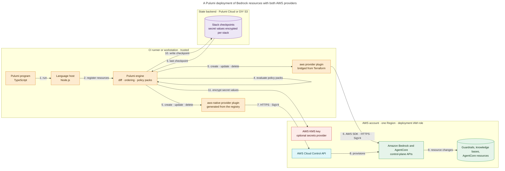

# Pulumi

> **Level:** Intermediate · **Verified:** 2026-11-15 · **Feature status:** n/a · **Time:** ~30 min

Pulumi lets you declare AWS infrastructure in a general-purpose language and deploys it with its
own engine and state, not through CloudFormation. For Amazon Bedrock it is unusual in one useful
way: in the same program you can use resources bridged from the Terraform AWS provider and
resources generated from the CloudFormation registry, so the two coverage lineages from the
[tool comparison](../comparison/02-tool-comparison.md) are both available.

## Learning objectives

After this chapter you can:

- Explain projects, stacks, programs, the engine, providers and state backends.
- Choose between the `aws` and `aws-native` providers for each Bedrock and AgentCore resource.
- Keep secrets out of plain-text state, gate changes with Pulumi Policies, and test with mocks.
- Describe how Pulumi handles refresh, drift, rollback, import, refactoring and multiple Regions.
- Decide when Pulumi fits a Bedrock workload better than the AWS-native tools or Terraform.

## Prerequisites

- [IaC concepts: declarative versus imperative, state, graphs, drift and idempotency](../comparison/01-iac-concepts.md)
- [Terraform, AWS CDK, CloudFormation, SAM and Pulumi compared](../comparison/02-tool-comparison.md)

## Concept in plain language

A Pulumi program is like a shopping list written by a person who can use loops and functions: "for
each environment, buy one guardrail and one role". Running the program does not buy anything. It
hands the list to a store manager, the **engine**, who compares it with the receipt from last
time, the **state**, and buys, returns or exchanges only what changed. The suppliers the manager
calls are **providers**.

## How it really works

### Building blocks

| Concept | What it is |
|:--|:--|
| Project | A folder with a `Pulumi.yaml` file naming the runtime: `nodejs`, `python`, `dotnet`, `go`, `java`, `yaml` or `hcl` |
| Stack | An isolated, independently configured instance of the program, typically one per environment (`pulumi stack init staging`) |
| Language host | Runs your program; each `new` resource sends a **registration** to the engine and returns immediately |
| Engine | Compares registrations with the last recorded state, orders work by dependencies, runs independent operations in parallel |
| Provider | Plugin that turns engine requests into cloud API calls. **Bridged** providers wrap a Terraform or OpenTofu provider; **native** providers are generated from an API specification |
| Default or explicit provider | Default providers take configuration such as `aws:region`; explicit providers are resources you declare and pass with the `provider` option, for example one per Region |
| State backend | Pulumi Cloud (the default) or a DIY backend: S3, Azure Blob Storage, Google Cloud Storage, an S3-compatible server, PostgreSQL or the local filesystem |
| Checkpoint | The transactional snapshot of state that Pulumi writes "early and often" during an update |

> [!NOTE]
> **Documented fact** — Pulumi does **not** refresh state before `pulumi preview` or `pulumi up`.
> An out-of-band change is invisible until you run `pulumi refresh`, or add `--refresh` to an
> update, and an update can overwrite it. Pulumi also does not roll back a failed update; it
> finishes in-flight operations and stops, and you roll forward by reverting code.
> Sources: [State and backends](https://www.pulumi.com/docs/iac/concepts/state-and-backends/),
> [Pulumi FAQ](https://www.pulumi.com/docs/support/faq/infrastructure/)

### The `aws` and `aws-native` providers

| | `aws` ("AWS Classic") | `aws-native` ("AWS Cloud Control") |
|:--|:--|:--|
| Built from | The Terraform AWS provider, through the Pulumi Terraform Bridge | Resource types in the CloudFormation registry |
| Calls AWS through | The AWS SDK | The AWS Cloud Control API |
| Version on the registry, 2026-11-15 | 7.55.0 (published 2026-11-13) | 1.85.0 (published 2026-11-02) |
| Bedrock modules | `aws.bedrock` (39 resources, 21 of them `Agentcore*`) and `aws.bedrockmodel` (2) | `bedrock` (23), `bedrockagentcore` (27), `bedrockmantle` (1) |
| Pulumi's guidance | Start here | Add resources "on an as needed basis"; some AWS resources are not yet in Cloud Control |
| Licence | Apache 2.0 | Apache 2.0 |

> [!NOTE]
> **Documented fact** — The `aws-native` provider "typically supports new AWS features on the day
> of launch", because it is generated from the CloudFormation registry; Pulumi nevertheless
> recommends that new projects start with the `aws` provider.
> Source: [AWS Cloud Control provider](https://www.pulumi.com/registry/packages/aws-native/)

### Bedrock and AgentCore coverage

Resource names as listed on the registry module pages on the verification date. The `aws`
names are TypeScript classes in `aws.bedrock` unless marked.

| Area | `aws` | `aws-native` |
|:--|:--|:--|
| Guardrails | `Guardrail`, `GuardrailVersion`, `GuardrailResourcePolicy`, `EnforcedGuardrailConfiguration` | `bedrock.Guardrail`, `GuardrailVersion`, `ResourcePolicy`, `EnforcedGuardrailConfiguration` |
| Knowledge bases | `AgentKnowledgeBase`, `AgentDataSource` | `bedrock.KnowledgeBase`, `DataSource`, `KnowledgeBasePolicy`, `RetrievalInstruction` |
| Prompts and flows | `AgentPrompt`, `AgentFlow` | `bedrock.Prompt`, `PromptVersion`, `Flow`, `FlowVersion`, `FlowAlias` |
| Agents Classic (maintenance mode) | `AgentAgent`, `AgentAgentActionGroup`, `AgentAgentAlias`, `AgentAgentCollaborator`, `AgentAgentKnowledgeBaseAssociation` | `bedrock.Agent`, `AgentAlias` |
| Inference | `InferenceProfile`, `ProvisionedModelThroughput`; `aws.bedrockmodel.InvocationJob`, `InvocationLoggingConfiguration` | `bedrock.ApplicationInferenceProfile`, `IntelligentPromptRouter`; `bedrockmantle.Project` |
| Customization, evaluation, access | `CustomModel`, `EvaluationJob`, `UseCaseForModelAccess` | — |
| Automated Reasoning | — | `bedrock.AutomatedReasoningPolicy`, `AutomatedReasoningPolicyVersion` |
| AgentCore Runtime and harness | `AgentcoreAgentRuntime`, `AgentcoreAgentRuntimeEndpoint`, `AgentcoreHarness` | `bedrockagentcore.Runtime`, `RuntimeEndpoint`, `Harness`, `HarnessEndpoint` |
| AgentCore Gateway | `AgentcoreGateway`, `AgentcoreGatewayTarget`, `AgentcoreGatewayRule` | `Gateway`, `GatewayTarget`, `GatewayRule`, `GatewayRateLimit` |
| AgentCore Memory | `AgentcoreMemory`, `AgentcoreMemoryStrategy` | `Memory` |
| AgentCore Identity | `AgentcoreWorkloadIdentity`, `AgentcoreApiKeyCredentialProvider`, `AgentcoreOauth2CredentialProvider`, `AgentcoreTokenVaultCmk` | `WorkloadIdentity`, `ApiKeyCredentialProvider`, `OAuth2CredentialProvider` |
| AgentCore Policy and Evaluations | `AgentcorePolicy`, `AgentcorePolicyEngine`, `AgentcoreEvaluator`, `AgentcoreOnlineEvaluationConfig` | `Policy`, `PolicyEngine`, `Evaluator`, `OnlineEvaluationConfig`, `Dataset` |
| AgentCore tools | `AgentcoreBrowser`, `AgentcoreBrowserProfile`, `AgentcoreCodeInterpreter` | `BrowserCustom`, `BrowserProfile`, `CodeInterpreterCustom` |
| AgentCore Registry and resource policy | `AgentcoreRegistry`, `AgentcoreResourcePolicy` | `ResourcePolicy` |
| AgentCore Optimization, Payments, consent, capacity | — | `ConfigurationBundle`, `PaymentManager`, `PaymentConnector`, `PaymentCredentialProvider`, `ConsentPortal`, `CapacityProvider` |

Compare with the [Terraform reference](../../references/terraform-aws-provider-bedrock.md) and
the [CDK and CloudFormation reference](../../references/cdk-and-cloudformation-bedrock.md): the
`aws` column mirrors Terraform 6.73.0's AgentCore resources, and the `aws-native` column mirrors
the CloudFormation types one for one.

### Secrets, policy and testing

**Secrets.** Every input and output is recorded in state. Values marked secret, with
`config.requireSecret()` or `pulumi.secret()`, are encrypted with a per-stack key from Pulumi
Cloud or from a provider you choose, and anything derived from a secret stays secret. A
resource's physical ID is always stored in plain text. For values shared across stacks, Pulumi
ESC centralises them with access control and an audit trail.

**Policy as code.** Pulumi Policies (the product formerly called CrossGuard) runs policy packs
written in TypeScript, JavaScript, Python or OPA Rego. Locally, `pulumi preview --policy-pack
<path>` evaluates resources before anything changes; a `mandatory` violation stops the update.
Levels are `advisory`, `mandatory`, `remediate` and `disabled`. Pulumi Cloud adds policy groups,
pre-built compliance packs and audit scans of discovered resources.

**Testing.** Unit tests run in memory with mocked resource calls and need no CLI. Property
tests use policies to assert invariants on real deployments. Integration tests deploy ephemeral
stacks and probe their endpoints.

**Import, refactoring, Regions.** `pulumi import` adopts existing resources and generates code
(a guardrail version is imported as `guardrail-arn,version`). The `aliases` resource option
renames or re-parents resources without replacing them. Explicit providers deploy to several
Regions or accounts from one program.

## Architecture diagram



**What this shows** — Everything that decides what to change runs where you run the CLI; the
state lives in a backend you choose; AWS sees ordinary API calls from your deployment role,
through the SDK for `aws` resources and through Cloud Control for `aws-native` resources.

**Walkthrough**

1. The CLI starts the language host for the project's runtime.
2. Each resource constructor sends a registration and the program continues.
3. The engine loads the stack's last checkpoint; it does not refresh unless asked.
4. Policy packs passed with `--policy-pack` are evaluated before changes.
5. The engine asks the right provider plugin for each change, in dependency order.
6. The `aws` plugin calls the Bedrock and AgentCore APIs through the AWS SDK.
7. The `aws-native` plugin calls the Cloud Control API.
8. Cloud Control provisions the resource.
9. Resources change in the account.
10. The engine writes checkpoints during and after the update.
11. With a KMS secrets provider, secret values are encrypted with your key.

| Legend | Meaning |
|:--|:--|
| Solid arrow | Request or write |
| Cylinder | Stored state or resources |
| Boxes | Trust boundaries: runner, backend, AWS account |

**Variations** — With Pulumi Cloud the checkpoints are written through a transactional API; DIY
backends keep history in object storage and, per Pulumi, cannot transparently recover from some
partial failures. Pulumi Deployments can run the same engine remotely.

## Implementation details

1. **Choose the backend deliberately.** Pulumi Cloud is the default and handles locking,
   history and access control; a DIY S3 backend keeps state in your account and makes those your
   job. `pulumi stack migrate` (CLI 3.254.0 or later) moves a stack between backends.
2. **One stack per environment**, each in its own AWS account
   ([ADR-013](../../ARCHITECTURE-DECISIONS.md#adr-013-one-aws-account-per-environment)). Stack
   names are scoped as `org/project/stack`.
3. **Start with `aws`, add `aws-native` per missing type**, and record why in a comment.
4. **Keep model and profile IDs in stack configuration**, never in code
   ([ADR-010](../../ARCHITECTURE-DECISIONS.md#adr-010-model-and-inference-profile-ids-are-always-configuration)).
5. **Pin provider versions** exactly in `package.json`, and read the migration guide before a
   major upgrade (the `aws` provider publishes v6 and v7 guides).
6. **Make refresh explicit in the pipeline**: `pulumi refresh --preview-only` on a schedule to
   detect drift, and `pulumi up --refresh` when you intend to reconcile.

> [!TIP]
> **Academy recommendation** — Pulumi fits Bedrock work when (a) you also manage non-AWS
> platforms, (b) your design needs resources from both lineages, for example Provisioned
> Throughput and an intelligent prompt router, or (c) a platform team wants to publish components
> usable from several languages. Prefer the CloudFormation family when automatic rollback and
> AWS-held state matter more than language flexibility. This is our design guidance, not an
> official AWS reference architecture.

## Example

A guardrail, its published version and a least-privilege IAM policy for a function that calls
Converse through one inference profile: the Pulumi counterpart of the
[SAM template](../aws-sam/template.yaml).

> **Code status:** illustrative — not executed (Pulumi is not installed in the build environment).
> Resource types and properties are limited to those confirmed on the Pulumi Registry pages for
> `aws.bedrock.Guardrail`, `aws.bedrock.GuardrailVersion`, `aws.iam.Policy` and `aws.Provider` ·
> TypeScript syntax checked with esbuild (no type check) · **never deployed**

```typescript
// Illustrative — not executed (Pulumi is not installed in the build environment).
import * as pulumi from "@pulumi/pulumi";
import * as aws from "@pulumi/aws";

const config = new pulumi.Config();
const region = config.require("bedrockRegion");             // for example "us-east-1"
const profileArn = config.require("inferenceProfileArn");   // confirm in the model catalog
const modelId = config.require("foundationModelId");        // the model behind the profile
const partition = profileArn.split(":")[1];

// An explicit provider pins these resources to one Region; add one per Region you deploy to.
const regional = new aws.Provider("bedrock-region", { region });

const guardrail = new aws.bedrock.Guardrail("chat", {
    name: `chat-${pulumi.getStack()}`,
    description: "Content filters and PII masking for the chat function",
    blockedInputMessaging: "Sorry, I can't help with that request.",
    blockedOutputsMessaging: "Sorry, I can't share that response.",
    contentPolicyConfig: {
        filtersConfigs: [
            { type: "HATE", inputStrength: "HIGH", outputStrength: "HIGH" },
            { type: "PROMPT_ATTACK", inputStrength: "HIGH", outputStrength: "NONE" },
        ],
        tierConfigs: [{ tierName: "CLASSIC" }],
    },
    sensitiveInformationPolicyConfig: {
        piiEntitiesConfigs: [{ type: "EMAIL", action: "ANONYMIZE" }],
    },
}, { provider: regional });

const version = new aws.bedrock.GuardrailVersion("chat-v1", {
    guardrailArn: guardrail.guardrailArn,
    description: "v1 - change to publish a new version",
    skipDestroy: true,   // keep old versions that running code may still reference
}, { provider: regional });

// Attach this policy to the role of the function that calls Converse.
new aws.iam.Policy("chat-invoke", {
    description: "Converse through one inference profile, with the chat guardrail",
    policy: guardrail.guardrailArn.apply(guardrailArn => JSON.stringify({
        Version: "2012-10-17",
        Statement: [
            { Sid: "AllowTheInferenceProfile", Effect: "Allow",
              Action: "bedrock:InvokeModel", Resource: profileArn },
            { Sid: "AllowTheModelOnlyThroughThatProfile", Effect: "Allow",
              Action: "bedrock:InvokeModel",
              Resource: `arn:${partition}:bedrock:*::foundation-model/${modelId}`,
              Condition: { StringEquals: { "bedrock:InferenceProfileArn": profileArn } } },
            { Sid: "UseTheGuardrail", Effect: "Allow",
              Action: ["bedrock:ApplyGuardrail", "bedrock:GetGuardrail"],
              Resource: guardrailArn },
        ],
    })),
});

export const guardrailArn = guardrail.guardrailArn;
export const guardrailVersion = version.version;
```

Types that only `aws-native` offers, such as `IntelligentPromptRouter` or AgentCore
`ConfigurationBundle`, are added the same way from `@pulumi/aws-native`; look up their
properties on the registry before writing them.

## Common mistakes

> [!WARNING]
> **Common mistake** — Assuming `pulumi up` sees console changes. It compares the program with the
> last checkpoint, so a hot-fix made in the console is silently overwritten unless you refresh first.

| Mistake | Symptom | Fix |
|:--|:--|:--|
| Passing a secret as plain config | The value appears in state in plain text | `config.requireSecret()`; use Pulumi ESC across stacks |
| Putting a secret in a resource name or ID | It is stored in plain text regardless | Never derive names or IDs from secrets |
| Renaming a resource variable's logical name | Preview shows delete and create | Add `aliases` with the old name |
| Using `aws-native` for everything | A resource is missing from Cloud Control | Start with `aws`, as Pulumi recommends |
| Declaring the same resource in Pulumi and another tool | Each run reverts the other | One owner per resource ([Choosing an IaC tool](../comparison/03-choosing-an-iac-tool.md)) |

## Security considerations

- Pulumi state never contains your cloud credentials; the CLI uses the credentials where it runs.
  Use a short-lived deployment role through OIDC in CI
  ([ADR-014](../../ARCHITECTURE-DECISIONS.md#adr-014-pipelines-use-oidc-and-pin-actions-by-commit-sha)).
- With Pulumi Cloud, state, including encrypted secrets, is held by a third-party service;
  with a DIY backend, encrypt and restrict the bucket yourself.
- An `apply` callback receives secret values in plain text; do not log them.
- Run policy packs in the pipeline so a mandatory violation blocks the update, and run
  `pulumi refresh --preview-only` on a schedule as a drift control.

## Cost considerations

- The Pulumi CLI and providers are open source. Pulumi Cloud is sold in editions; for example,
  scheduled drift detection and remediation need the Pro or Enterprise edition.
- Integration tests deploy real Bedrock resources; Pulumi warns that even short-lived
  environments can incur notable charges.
- The AWS bill is the same as with any other tool: you pay for the resources, not for how they
  were declared.

## Knowledge check

1. A design needs an AgentCore Registry and an AgentCore Optimization configuration bundle. Which
   Pulumi providers do you use?
2. A teammate changed a guardrail's blocked message in the console. You run `pulumi up` with no
   code changes. What happens?
3. Where do you write a rule that blocks any Bedrock IAM policy using `"Resource": "*"`, and when
   does it run?
4. Why might a team prefer AWS CDK over Pulumi for an AWS-only Bedrock application?

<details>
<summary>Answers</summary>

1. Both: `aws.bedrock.AgentcoreRegistry` exists only in `aws`, and `ConfigurationBundle` only in
   `aws-native.bedrockagentcore`.
2. Nothing, because Pulumi does not refresh by default; the console change stays until a later
   update touches that property. With `--refresh`, Pulumi reads the change and reverts it to the
   program's value.
3. In a Pulumi Policies pack (TypeScript, Python or OPA) passed with `--policy-pack` or attached
   through a policy group; it runs during `pulumi preview` and `pulumi up`, before changes.
4. CDK deploys through CloudFormation, so it gets automatic rollback and AWS-held state, and it
   has stable AgentCore L2 constructs.

</details>

## Further reading

Official sources opened while writing this chapter:

- Concepts: [How Pulumi works](https://www.pulumi.com/docs/iac/concepts/how-pulumi-works/) · [Projects](https://www.pulumi.com/docs/iac/concepts/projects/) · [Stacks](https://www.pulumi.com/docs/iac/concepts/stacks/) · [State and backends](https://www.pulumi.com/docs/iac/concepts/state-and-backends/) · [Providers](https://www.pulumi.com/docs/iac/concepts/providers/) · [Resource providers](https://www.pulumi.com/docs/iac/concepts/resources/providers/) · [provider option](https://www.pulumi.com/docs/iac/concepts/resources/options/provider/) · [aliases](https://www.pulumi.com/docs/iac/concepts/resources/options/aliases/)
- Operations: [Secrets](https://www.pulumi.com/docs/iac/concepts/secrets/) · [Policy as code](https://www.pulumi.com/docs/insights/policy/) · [Testing](https://www.pulumi.com/docs/iac/guides/testing/) · [Drift detection](https://www.pulumi.com/docs/deployments/deployments/drift/) · [FAQ](https://www.pulumi.com/docs/support/faq/infrastructure/) · [Names and terminology (CrossGuard → Pulumi Policies)](https://brand.pulumi.com/voice/names-and-terminology/)
- Registry: [AWS provider](https://www.pulumi.com/registry/packages/aws/) · [aws.bedrock](https://www.pulumi.com/registry/packages/aws/api-docs/bedrock/) · [aws.bedrockmodel](https://www.pulumi.com/registry/packages/aws/api-docs/bedrockmodel/) · [aws.bedrock.Guardrail](https://www.pulumi.com/registry/packages/aws/api-docs/bedrock/guardrail/) · [aws.bedrock.GuardrailVersion](https://www.pulumi.com/registry/packages/aws/api-docs/bedrock/guardrailversion/) · [aws.iam.Policy](https://www.pulumi.com/registry/packages/aws/api-docs/iam/policy/) · [AWS Cloud Control provider](https://www.pulumi.com/registry/packages/aws-native/) · [aws-native.bedrock](https://www.pulumi.com/registry/packages/aws-native/api-docs/bedrock/) · [aws-native.bedrockagentcore](https://www.pulumi.com/registry/packages/aws-native/api-docs/bedrockagentcore/) · [aws-native.bedrockmantle](https://www.pulumi.com/registry/packages/aws-native/api-docs/bedrockmantle/)
- [Pulumi LICENSE](https://raw.githubusercontent.com/pulumi/pulumi/master/LICENSE) · [Pulumi compared with CDKTF](https://www.pulumi.com/docs/iac/comparisons/cdktf/)
