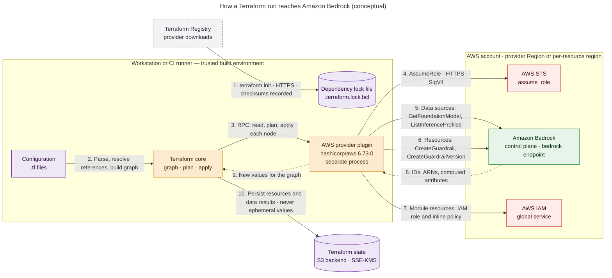
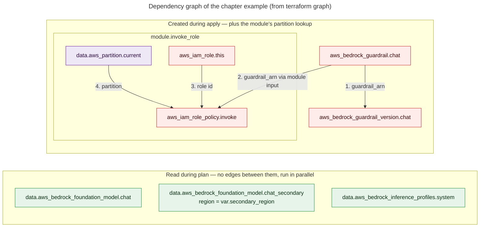

# Providers, resources and data sources

> **Level:** Intermediate · **Verified:** 2026-11-15 · **Feature status:** n/a · **Time:** ~30 min

Every Terraform configuration is made of three building blocks: a **provider** that talks to an API, **resources** that Terraform creates and owns, and **data sources** that it only reads. For Amazon Bedrock this is the difference between owning a guardrail and looking up whether a model is offered in your Region — and getting it wrong shows up as surprise replacements, broken plans and secrets in state.

## Learning objectives

After this chapter you can:

- Explain what the AWS provider does between your configuration and the AWS APIs, and pin its version.
- Configure the provider with `default_tags`, an account guard, aliases, and the per-resource `region` argument of AWS provider 6.
- Choose between a resource, a data source and an ephemeral resource for a given Bedrock object.
- Read the dependency graph that references create, and use `depends_on` only for dependencies Terraform cannot see.
- Recognise where write-only arguments keep a secret out of state.

## Prerequisites

- [IaC concepts: declarative versus imperative, state, graphs, drift and idempotency](../comparison/01-iac-concepts.md)
- [IAM fundamentals: principals, policies and evaluation](../../00-foundations/security/01-iam-fundamentals.md)
- [What Amazon Bedrock is: services, namespaces and planes](../../01-amazon-bedrock/overview/01-what-is-amazon-bedrock.md)

## Concept in plain language

Think of Terraform core as a general contractor. It reads your drawings, works out what must be built first and keeps the paperwork, but it does not speak "AWS". The **provider** is the specialist it hires: it knows that "a guardrail with these filters" means a `CreateGuardrail` call with a particular request body.

A **resource** is something you build and own — delete it from the drawings and the contractor tears it down. A **data source** is a catalogue look-up: "is this model offered in `us-west-2`?" An **ephemeral resource** is a visitor badge: handed out for the job, never filed.

## How it really works

**Providers are separate programs.** Terraform core reads configuration, builds the graph, plans and manages state; each provider plugin runs as a separate process, called over RPC, that authenticates to the service and maps resources and data sources to its API ([How Terraform works with plugins](https://developer.hashicorp.com/terraform/plugin/how-terraform-works)). `terraform init` selects a provider version that matches your constraints and records it in the dependency lock file `.terraform.lock.hcl`, which you commit so every run uses the same build ([`terraform init`](https://developer.hashicorp.com/terraform/cli/commands/init)).

Two blocks are involved, and they live in different places:

| Block | Where | What it holds |
|:--|:--|:--|
| `required_providers` (inside `terraform {}`) | **Every** module | Source address and version constraint, e.g. `hashicorp/aws` `~> 6.73` |
| `provider "aws" {}` | **Root module only** | Configuration: Region, credentials, `assume_role`, `default_tags`, `allowed_account_ids` |

> [!NOTE]
> **Documented fact** — Child modules receive provider configurations from their parent, and HashiCorp strongly recommends against `provider` blocks in child modules. You can only reference values in a provider block that are known before apply — variables, not computed resource attributes.
> Source: [provider block reference](https://developer.hashicorp.com/terraform/language/block/provider)

**Three kinds of object.**

| Block | Terraform does | Stored in state? | Bedrock example (provider 6.73.0) |
|:--|:--|:-:|:--|
| `resource` | Create, read, update, delete | Yes | `aws_bedrock_guardrail`, `aws_bedrock_guardrail_version` |
| `data` | Read only, normally during plan | Yes (the result) | `aws_bedrock_foundation_model`, `aws_bedrock_inference_profiles` |
| `ephemeral` | Open, renew, close during one run | **No** | `aws_secretsmanager_secret_version`, `aws_bedrockruntime_apply_guardrail` |

A data source is read during planning unless one of its arguments depends on something not yet known, such as an attribute of a resource being created in the same plan; then the read is deferred to apply and dependent values show as "known after apply" ([Query data sources](https://developer.hashicorp.com/terraform/language/data-sources)). The provider 6.73.0 schema lists 11 ephemeral resource types (counted from `terraform providers schema -json`).

**Default tags.** `default_tags` on the provider applies tags to every resource that supports `tags`, except `aws_autoscaling_group`. A resource's own `tags` override matching keys, but you cannot exclude a default tag from one resource; the merged set appears in `tags_all` ([AWS provider configuration](https://registry.terraform.io/providers/hashicorp/aws/latest/docs)).

**Account guard.** `allowed_account_ids` makes the provider refuse to run against any other account — cheap insurance against applying production code with development credentials.

**Reaching a second Region: aliases or `region`.**

| | Provider alias (all versions) | Per-resource `region` (AWS provider 6.0+) |
|:--|:--|:--|
| How | A second `provider "aws"` block with `alias`, selected with `provider = aws.secondary` | `region = "us-west-2"` on the resource, data source or ephemeral resource |
| Provider processes and memory | One configuration per Region | One configuration |
| Works with `for_each` over Regions | No — provider references are static | Yes — `region = each.key` |
| Global services (IAM, Organizations, Route 53) | n/a | No `region` argument |

> [!NOTE]
> **Documented fact** — In AWS provider 6.0 most resources, data sources and ephemeral resources gained an optional, computed `region` argument that defaults to the provider's Region. **Changing it forces replacement**; removing it does not (the value in state is kept). Per-Region provider blocks remain valid and are not deprecated. To migrate, upgrade to 6.0, run `terraform apply -refresh-only`, then replace the `provider` meta-argument with `region`.
> Source: [Enhanced Region Support](https://registry.terraform.io/providers/hashicorp/aws/latest/docs/guides/enhanced-region-support)

Two v6 changes touch Bedrock code: the nested blocks of `aws_bedrock_model_invocation_logging_configuration` became lists (references need `logging_config[0]`), and `aws_region.name` is deprecated in favour of `region`. Upgrade to the latest 5.x first ([v6 upgrade guide](https://registry.terraform.io/providers/hashicorp/aws/latest/docs/guides/version-6-upgrade)).

**References build the graph.** A reference such as `aws_bedrock_guardrail.chat.guardrail_arn` becomes an edge; objects with no path between them are processed in parallel. `depends_on` adds an edge Terraform cannot infer, and HashiCorp calls it a last resort because it makes plans more conservative, with more values "known after apply" ([`depends_on`](https://developer.hashicorp.com/terraform/language/meta-arguments/depends_on)).

**Ephemeral values and write-only arguments at a glance.** Ephemeral resources (Terraform 1.10) never reach plan or state and may only feed ephemeral contexts — `locals`, provider configuration, ephemeral variables and outputs, and **write-only arguments** (Terraform 1.11). A write-only argument passes a value to the provider and discards it; its stored companion `*_wo_version` tells Terraform when to send a new one ([Ephemeral values in resources](https://developer.hashicorp.com/terraform/language/resources/ephemeral), [write-only arguments](https://developer.hashicorp.com/terraform/language/manage-sensitive-data/write-only), [Terraform 1.10](https://raw.githubusercontent.com/hashicorp/terraform/v1.10/CHANGELOG.md) and [1.11](https://raw.githubusercontent.com/hashicorp/terraform/v1.11/CHANGELOG.md) changelogs). Full treatment: [Secrets management and policy as code](../maintenance/04-secrets-and-policy-as-code.md).

> [!CAUTION]
> **Security hazard** — `aws_bedrockagentcore_api_key_credential_provider.api_key` is "stored in plain text in the Terraform state"; the provider documentation recommends `api_key_wo` instead ([resource documentation](https://raw.githubusercontent.com/hashicorp/terraform-provider-aws/v6.73.0/website/docs/r/bedrockagentcore_api_key_credential_provider.html.markdown)). The provider 6.73.0 schema marks 17 top-level resource arguments as write-only (more sit inside nested blocks), including `aws_secretsmanager_secret_version.secret_string_wo` and `aws_db_instance.password_wo`.

## Architecture diagram



**What this shows** — Terraform core never calls AWS itself. It hands each graph node to the AWS provider plugin, which authenticates, calls the Bedrock and IAM APIs, and returns the attributes later nodes need. Core writes the result to state.

**Walkthrough**

1. `terraform init` installs the allowed provider version and records its checksums.
2. Core turns references into graph edges.
3. Core asks the plugin to read, plan or apply each node.
4. With `assume_role`, the provider first gets temporary credentials from AWS STS.
5. Data sources call read-only APIs, normally during `plan`.
6. Resources call create, update and delete APIs during `apply`.
7. IAM is global, so the module's role has no `region` argument.
8. AWS returns identifiers such as the guardrail ARN.
9. Dependent nodes can now be planned or applied.
10. Resources and data-source results go to state; ephemeral values do not.

| Legend | Meaning |
|:--|:--|
| Solid arrow | Request or write |
| Dashed arrow | Response |
| Cylinder | Stored data (lock file, state) |
| Dashed grey box | Outside your control (public registry) |
| Nested boxes | Trust boundaries: your build environment, your AWS account |

**Variations** — With HCP Terraform remote runs, steps 2–10 run on HashiCorp-managed workers and state lives in HCP Terraform ([State, remote backends and state locking](04-state-backends-locking.md)). With a provider mirror (as in this academy's offline validation), step 1 reads a local directory instead of the registry.

### The dependency graph of the example

`terraform graph -format=mermaid` (Terraform 1.16+, [changelog](https://raw.githubusercontent.com/hashicorp/terraform/v1.16/CHANGELOG.md)) printed the edges below for the example in this chapter; we redrew them in academy style with arrows in the order Terraform acts.



**What this shows** — Only the inline policy waits for the guardrail; the role itself does not reference it, so Terraform creates the role and the guardrail at the same time. The three data sources have no edges at all.

**Walkthrough** — 1: the version needs the guardrail ARN. 2: the module input `guardrail_arns` flows into the policy document, so the policy waits for the guardrail even though the dependency crosses a module boundary. 3–4: the policy also needs the role and the partition.

## Implementation details

1. **Pin in every module, configure in the root**, with `~> 6.73` ([ADR-006](../../ARCHITECTURE-DECISIONS.md#adr-006-pin-tool-versions-and-generate-iac-references-from-the-tools)), and commit `.terraform.lock.hcl`.
2. **Credentials come from outside the configuration** (environment, shared config, OIDC in CI); the root adds `assume_role` and `allowed_account_ids`.
3. **`default_tags` on the provider**, a `tags` variable on modules for extras.
4. **Resource or data source?** If Terraform should create and delete it, it is a resource. If AWS or another team owns it — the model catalogue, system-defined inference profiles — read it.
5. **Model IDs are variables** ([ADR-010](../../ARCHITECTURE-DECISIONS.md#adr-010-model-and-inference-profile-ids-are-always-configuration)); a data source with a `postcondition` turns a retired or unsuitable model into a plan-time error.
6. **One provider block and `region` per object** for small cross-Region needs; aliases for another account, which needs other credentials.
7. **References over `depends_on`**, which is only for objects linked by API behaviour but sharing no attribute.

> [!TIP]
> **Academy recommendation** — For a Bedrock resource that callers pin by ID (a guardrail, a knowledge base, an agent runtime), treat a change to `region` like a change to its name: a planned replacement means a new ID that every caller must pick up. Review plans for `forces replacement` before approving.
> This is our design guidance, not an official AWS reference architecture.

## Example

A root module that looks up the model in two Regions, finds the system-defined inference profiles that serve it, creates and publishes a guardrail, and passes the guardrail into the academy's [`bedrock-invocation-role`](modules/bedrock-invocation-role/README.md) module. It sits in a folder next to `modules/`.

> **Code status:** validated with `terraform fmt -check` and `terraform validate` (Terraform 1.17.2, provider 6.73.0) · TFLint core rules clean · mock-tested with `terraform test` (2 runs, mock provider) · **never planned or applied against AWS, never deployed**

```hcl
# versions.tf
terraform {
  required_version = ">= 1.11.0"

  required_providers {
    aws = {
      source  = "hashicorp/aws"
      version = "~> 6.73"
    }
  }
}
```

```hcl
# providers.tf — the only provider configuration. Every resource and data source below
# uses it unless it sets its own `region` (AWS provider 6.0 and later).
provider "aws" {
  region              = var.region
  allowed_account_ids = var.allowed_account_ids

  default_tags {
    tags = {
      Project     = "bedrock-chat"
      Environment = var.environment
      ManagedBy   = "terraform"
    }
  }
}
```

```hcl
# variables.tf
variable "region" {
  description = "Primary Region for the chat application."
  type        = string
  default     = "us-east-1"
}

variable "secondary_region" {
  description = "Recovery Region. Used only to check that the model is offered there too."
  type        = string
  default     = "us-west-2"
}

variable "allowed_account_ids" {
  description = "Account IDs this configuration may touch. The provider refuses to run against any other account."
  type        = list(string)
  default     = null
}

variable "environment" {
  description = "Environment name, copied into the default tags."
  type        = string
  default     = "dev"
}

variable "model_id" {
  description = "Foundation model ID. Confirm the current ID in the Amazon Bedrock model catalog before use."
  type        = string
}
```

```hcl
# main.tf
# --- Data sources: read what already exists ---------------------------------

data "aws_bedrock_foundation_model" "chat" {
  model_id = var.model_id

  lifecycle {
    postcondition {
      condition     = self.response_streaming_supported
      error_message = "The chat application streams responses, but ${var.model_id} does not support streaming."
    }
  }
}

# Same data source, second Region, same provider: the v6 per-resource `region`.
data "aws_bedrock_foundation_model" "chat_secondary" {
  region   = var.secondary_region
  model_id = var.model_id
}

data "aws_bedrock_inference_profiles" "system" {
  type = "SYSTEM_DEFINED"
}

locals {
  # System-defined inference profiles in this Region that can serve the chosen model.
  matching_profile_ids = [
    for p in data.aws_bedrock_inference_profiles.system.inference_profile_summaries :
    p.inference_profile_id
    if anytrue([for m in p.models : endswith(m.model_arn, "/${var.model_id}")])
  ]
}

# --- Resources: objects Terraform creates and owns ---------------------------

resource "aws_bedrock_guardrail" "chat" {
  name                      = "chat-${var.environment}"
  description               = "Input and output safeguards for the chat assistant."
  blocked_input_messaging   = "Sorry, I can't help with that request."
  blocked_outputs_messaging = "Sorry, I can't share that response."

  content_policy_config {
    filters_config {
      type            = "HATE"
      input_strength  = "HIGH"
      output_strength = "HIGH"
    }
    filters_config {
      type            = "INSULTS"
      input_strength  = "HIGH"
      output_strength = "HIGH"
    }
    filters_config {
      type            = "MISCONDUCT"
      input_strength  = "HIGH"
      output_strength = "HIGH"
    }
    # The prompt-attack filter evaluates prompts, so its output strength is NONE.
    filters_config {
      type            = "PROMPT_ATTACK"
      input_strength  = "HIGH"
      output_strength = "NONE"
    }
  }

  sensitive_information_policy_config {
    pii_entities_config {
      type   = "EMAIL"
      action = "ANONYMIZE"
    }
    pii_entities_config {
      type   = "AWS_SECRET_KEY"
      action = "BLOCK"
    }
  }

  tags = {
    Component = "guardrail"
  }
}

# Implicit dependency: this reference makes Terraform create the guardrail first.
resource "aws_bedrock_guardrail_version" "chat" {
  guardrail_arn = aws_bedrock_guardrail.chat.guardrail_arn
  description   = "Published by Terraform for ${var.environment}"
}

# A module is a node in the same graph. Passing the guardrail ARN in is enough
# for Terraform to order the role after the guardrail.
module "invoke_role" {
  source = "../modules/bedrock-invocation-role"

  name                 = "chat-invoke-${var.environment}"
  trusted_services     = ["lambda.amazonaws.com"]
  foundation_model_ids = [var.model_id]
  model_regions        = [var.region]

  guardrail_arns                 = [aws_bedrock_guardrail.chat.guardrail_arn]
  required_guardrail_arn_pattern = "${aws_bedrock_guardrail.chat.guardrail_arn}:*"
}
```

```hcl
# outputs.tf
output "model_arn" {
  description = "ARN of the foundation model, read from the Region's catalog."
  value       = data.aws_bedrock_foundation_model.chat.model_arn
}

output "model_offered_in_secondary_region" {
  description = "Model ARN in the recovery Region (the lookup fails if the model is not offered there)."
  value       = data.aws_bedrock_foundation_model.chat_secondary.model_arn
}

output "inference_profile_ids" {
  description = "System-defined inference profiles in this Region that include the model."
  value       = local.matching_profile_ids
}

output "guardrail_id" {
  description = "Guardrail ID to send with Converse requests."
  value       = aws_bedrock_guardrail.chat.guardrail_id
}

output "guardrail_version" {
  description = "Published guardrail version number."
  value       = aws_bedrock_guardrail_version.chat.version
}

output "invoke_role_arn" {
  description = "Role that may invoke the model only with this guardrail."
  value       = module.invoke_role.role_arn
}
```

The test file mocks the two Bedrock data sources and checks the prompt-attack filter, the profile filter and the secondary-Region lookup. Its second run proves the postcondition fires:

```hcl
# tests/main.tftest.hcl (excerpt) — the mock_provider block with mock_data defaults is omitted here
run "rejects_model_without_streaming" {
  command = plan

  override_data {
    target = data.aws_bedrock_foundation_model.chat
    values = {
      model_arn                    = "arn:aws:bedrock:us-east-1::foundation-model/example.model-a-v1:0"
      response_streaming_supported = false
    }
  }

  expect_failures = [data.aws_bedrock_foundation_model.chat]
}
```

Three smaller snippets, validated together in one configuration with the same `versions.tf`:

> **Code status:** validated with `terraform fmt -check` and `terraform validate` (Terraform 1.17.2, provider 6.73.0) · not mock-tested · **never deployed**

```hcl
# 1. Provider alias — the pre-v6 way to reach a second Region, still valid.
provider "aws" {
  region = var.region
}

provider "aws" {
  alias  = "secondary"
  region = var.secondary_region
}

data "aws_bedrock_foundation_model" "chat_secondary_alias" {
  provider = aws.secondary
  model_id = var.model_id
}

# 2. An ephemeral resource feeding a write-only argument: the API key is read from
#    Secrets Manager during the run and never written to plan or state.
ephemeral "aws_secretsmanager_secret_version" "partner_api_key" {
  secret_id = var.partner_api_key_secret_id
}

resource "aws_bedrockagentcore_api_key_credential_provider" "partner" {
  name               = "partner-search-${var.environment}"
  api_key_wo         = ephemeral.aws_secretsmanager_secret_version.partner_api_key.secret_string
  api_key_wo_version = var.partner_api_key_version
}

# 3. depends_on for a dependency Terraform cannot see.
data "aws_caller_identity" "current" {}

resource "aws_s3_bucket" "invocation_logs" {
  bucket = var.log_bucket_name
}

resource "aws_s3_bucket_policy" "invocation_logs" {
  bucket = aws_s3_bucket.invocation_logs.id
  policy = jsonencode({
    Version = "2012-10-17"
    Statement = [{
      Sid       = "AmazonBedrockLogsWrite"
      Effect    = "Allow"
      Principal = { Service = "bedrock.amazonaws.com" }
      Action    = ["s3:PutObject"]
      Resource  = ["${aws_s3_bucket.invocation_logs.arn}/bedrock/AWSLogs/${data.aws_caller_identity.current.account_id}/BedrockModelInvocationLogs/*"]
      Condition = {
        StringEquals = { "aws:SourceAccount" = data.aws_caller_identity.current.account_id }
        ArnLike      = { "aws:SourceArn" = "arn:aws:bedrock:${var.region}:${data.aws_caller_identity.current.account_id}:*" }
      }
    }]
  })
}

resource "aws_bedrock_model_invocation_logging_configuration" "this" {
  # The S3 destination must be ready before logging is enabled, but nothing
  # in this block references the policy, so state the dependency explicitly.
  depends_on = [aws_s3_bucket_policy.invocation_logs]

  logging_config {
    text_data_delivery_enabled = true
    s3_config {
      bucket_name = aws_s3_bucket.invocation_logs.id
      key_prefix  = "bedrock"
    }
  }
}
```

Snippet 3 follows the S3 destination policy on [Model invocation logging](https://docs.aws.amazon.com/bedrock/latest/userguide/model-invocation-logging.html), which says the destination must exist before logging is enabled. For snippet 2, `api_key_secret_source = "EXTERNAL"` with `api_key_secret_config` is safer still: AgentCore reads the secret and Terraform never sees the key.

## Common mistakes

> [!WARNING]
> **Common mistake** — Hard-coding a model ID inside a resource or policy. When the model is retired, `apply` fails somewhere downstream with an access or validation error. Keep the ID in a variable and look it up with `aws_bedrock_foundation_model` plus a `postcondition`, so the plan fails early with your own message.

| Mistake | Symptom | Fix |
|:--|:--|:--|
| `provider` block inside a reusable module | The module cannot be used with `for_each`, `count` or `depends_on`, and cannot be removed cleanly | Configure providers in the root only ([Modules](03-modules.md)) |
| Editing `region` on an existing Bedrock resource | Plan shows `forces replacement`; the new object has a new ID | Treat as a migration: create the new one, move callers, then remove the old one |
| Secret in a normal argument (`api_key`, `password`) | Value readable by anyone who can read state | Use the `_wo` argument, an ephemeral source, or a secret the service reads itself |
| Ephemeral value in a normal argument | `Invalid use of ephemeral value … must be persisted to state` | Use the write-only twin or keep the value out of Terraform |
| `depends_on` "just in case" | More `(known after apply)`, unnecessary replacements | Express the dependency through a reference |
| Expecting to drop one `default_tags` key on one resource | The tag keeps appearing | Defaults can only be overridden, not excluded |
| No lock file committed | Different runners pick different provider builds | Commit `.terraform.lock.hcl`; upgrade with `terraform init -upgrade` deliberately |

## Security considerations

- No credentials in `.tf` files; `assume_role` into one deployment role per account ([IAM roles, trust policies and cross-account access](../../00-foundations/security/02-iam-roles-and-trust.md)).
- `allowed_account_ids` stops a run against the wrong account before anything changes.
- The deployment role needs read permissions for every data source as well as write permissions for resources.
- Everything a resource or data source returns lands in state; use write-only arguments and ephemeral resources for secrets ([State, remote backends and state locking](04-state-backends-locking.md)).
- Provider plugins are executables: pin them, commit the lock file (it records checksums), review upgrades.

## Cost considerations

- Terraform CLI and the AWS provider are free to run; the cost is what the resources do.
- A guardrail is billed per policy for the text it evaluates, not for existing. On 2026-11-15 content filters and denied topics were $0.15 per 1,000 text units and sensitive-information filters $0.10; regular-expression filters and word filters were free; a text unit is up to 1,000 characters ([Amazon Bedrock pricing](https://aws.amazon.com/bedrock/pricing/)). Charges apply only for the policies configured in the guardrail ([How Amazon Bedrock Guardrails works](https://docs.aws.amazon.com/bedrock/latest/userguide/guardrails-how.html)).
- A replacement can briefly duplicate paid resources; check the plan.

## Knowledge check

1. Your module needs both `us-east-1` and `us-west-2` copies of a guardrail, created with `for_each` over a set of Regions. Why will provider aliases not work, and what does?
2. A data source reads `aws_bedrock_foundation_model` with `model_id = aws_bedrockagent_knowledge_base.kb.some_attribute` (a value computed at apply). What does the plan show, and why?
3. What would happen if you removed the `depends_on` from the invocation-logging snippet?
4. A colleague passes an ephemeral variable into `aws_bedrockagentcore_api_key_credential_provider.api_key`. What happens, and what should they use?

<details>
<summary>Answers</summary>

1. The `providers` and `provider` meta-arguments take static references, so instances of one `for_each` cannot choose different provider configurations. With AWS provider 6, set `region = each.key` on the resources (or pass a `region` input into the module).
2. The read is deferred to apply, and everything derived from it shows as `(known after apply)`, because Terraform cannot read a data source whose arguments are unknown.
3. Terraform would see no edge between the bucket policy and the logging configuration and could create them in parallel; the logging configuration could be created before the destination is ready and fail, intermittently.
4. Terraform rejects it with "Invalid use of ephemeral value", because `api_key` is not write-only and must be persisted. Use `api_key_wo` with `api_key_wo_version`, or let AgentCore read an existing secret (`api_key_secret_source = "EXTERNAL"`).

</details>

## Further reading

Official sources opened while writing this chapter:

- [How Terraform works with plugins](https://developer.hashicorp.com/terraform/plugin/how-terraform-works) — core versus plugins, RPC, discovery.
- [provider block reference](https://developer.hashicorp.com/terraform/language/block/provider) — aliases, configuration in the root module, passing configurations to child modules.
- [Query data sources](https://developer.hashicorp.com/terraform/language/data-sources) — when reads happen and when they are deferred.
- [`depends_on` reference](https://developer.hashicorp.com/terraform/language/meta-arguments/depends_on) — hidden dependencies and why it is a last resort.
- [`ephemeral` block reference](https://developer.hashicorp.com/terraform/language/block/ephemeral) and [Ephemeral values in resources](https://developer.hashicorp.com/terraform/language/resources/ephemeral) — lifecycle and allowed contexts.
- [Use temporary write-only arguments](https://developer.hashicorp.com/terraform/language/manage-sensitive-data/write-only) — `_wo` and `_wo_version`.
- [`terraform init`](https://developer.hashicorp.com/terraform/cli/commands/init) — provider installation and the dependency lock file.
- [AWS provider: Enhanced Region Support](https://registry.terraform.io/providers/hashicorp/aws/latest/docs/guides/enhanced-region-support) — the `region` argument, replacement rules, migration.
- [AWS provider: Version 6 upgrade guide](https://registry.terraform.io/providers/hashicorp/aws/latest/docs/guides/version-6-upgrade) — prerequisites and Bedrock-relevant changes.
- [AWS provider configuration reference](https://registry.terraform.io/providers/hashicorp/aws/latest/docs) — `default_tags`, `allowed_account_ids`, `assume_role`.
- Provider 6.73.0 documentation source for [`aws_bedrock_guardrail`](https://raw.githubusercontent.com/hashicorp/terraform-provider-aws/v6.73.0/website/docs/r/bedrock_guardrail.html.markdown), [`aws_bedrock_foundation_model`](https://raw.githubusercontent.com/hashicorp/terraform-provider-aws/v6.73.0/website/docs/d/bedrock_foundation_model.html.markdown), [`aws_bedrock_inference_profiles`](https://raw.githubusercontent.com/hashicorp/terraform-provider-aws/v6.73.0/website/docs/d/bedrock_inference_profiles.html.markdown) and [`aws_bedrockagentcore_api_key_credential_provider`](https://raw.githubusercontent.com/hashicorp/terraform-provider-aws/v6.73.0/website/docs/r/bedrockagentcore_api_key_credential_provider.html.markdown).
- [Monitor model invocation using CloudWatch Logs and Amazon S3](https://docs.aws.amazon.com/bedrock/latest/userguide/model-invocation-logging.html) — S3 destination policy for the `depends_on` snippet.
- [Detect prompt attacks with Amazon Bedrock Guardrails](https://docs.aws.amazon.com/bedrock/latest/userguide/guardrails-prompt-attack.html) — the prompt-attack filter evaluates user input.
- [Amazon Bedrock pricing](https://aws.amazon.com/bedrock/pricing/) and [How Amazon Bedrock Guardrails works](https://docs.aws.amazon.com/bedrock/latest/userguide/guardrails-how.html) — guardrail billing.
- Terraform changelogs [v1.10](https://raw.githubusercontent.com/hashicorp/terraform/v1.10/CHANGELOG.md), [v1.11](https://raw.githubusercontent.com/hashicorp/terraform/v1.11/CHANGELOG.md) and [v1.16](https://raw.githubusercontent.com/hashicorp/terraform/v1.16/CHANGELOG.md) — ephemeral values, write-only attributes, Mermaid graph output.

Related in this academy: [Variables, outputs and locals](02-variables-outputs-locals.md) · [Modules](03-modules.md) · [for_each, count and dynamic blocks](06-for-each-count-dynamic.md) · [Terraform coverage for Amazon Bedrock](10-terraform-for-bedrock.md) · [Amazon Bedrock Guardrails](../../01-amazon-bedrock/guardrails/01-guardrails.md) · [Diagram 27](../../diagrams/mermaid/27-terraform-state-and-modules.md)
