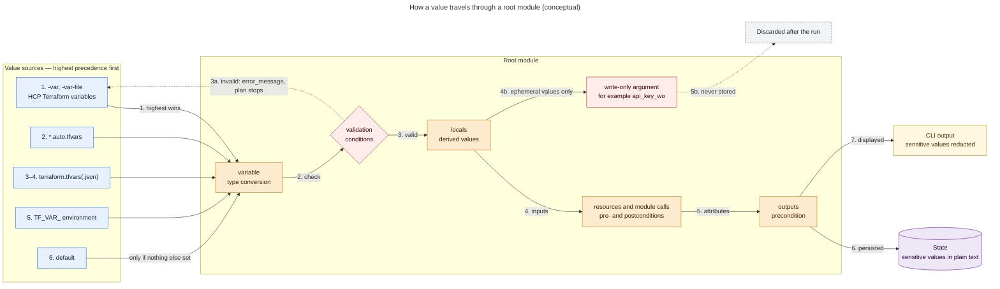

# Variables, outputs and locals

> **Level:** Intermediate · **Verified:** 2026-11-15 · **Feature status:** n/a · **Time:** ~30 min

Variables, locals and outputs are a module's interface: what it accepts, what it works out, and what it hands back. For Bedrock code they carry the values that change most often — model IDs, inference profile ARNs, guardrail ARNs, environment names — so a precise interface is what lets you swap a retired model without touching logic.

## Learning objectives

After this chapter you can:

- Declare typed, documented and validated input variables, including objects with optional attributes.
- Predict which value Terraform uses when a variable is set in several places.
- Choose between `sensitive`, `ephemeral` and `nullable`, and say what each does **not** protect.
- Use locals to name derived values, and outputs to publish a module's contract.
- Put each rule where it fails earliest: variable validation, precondition, postcondition or `check` block.

## Prerequisites

- [Providers, resources and data sources](01-providers-resources-data-sources.md)

## Concept in plain language

Treat a module like a function. **Input variables** are its parameters, **locals** are the named intermediate results inside it, and **outputs** are its return values. A good function says what types it takes, rejects nonsense at the door with a clear message, and returns only what callers need. A Terraform module should do the same — with the twist that its outputs are written down permanently in state.

## How it really works

### Input variables

All arguments of the `variable` block, with the Terraform version that introduced the less familiar ones:

| Argument | Effect | Since |
|:--|:--|:--|
| `type` | Constraint; values are converted or rejected. Default `any` | — |
| `default` | Makes the variable optional. Must be a literal; cannot reference other objects | — |
| `description` | Written for the module's consumer | — |
| `validation` | `condition` + `error_message`, checked while planning | 0.13 |
| `sensitive` | Redacted in plan and apply output — **still stored in state** | 0.15 per the docs |
| `nullable` | `false`: a caller's explicit `null` becomes the default, so the value is never null. Default `true` | 1.1 |
| `ephemeral` | Available during the run, never written to plan or state | 1.10 |
| `const` | Known at `init`; required for variables used in module `source` and `version` | 1.15 |
| `deprecated` | Warning whenever a value is set for the variable | 1.15 |

Sources: [variable block reference](https://developer.hashicorp.com/terraform/language/block/variable), [Manage sensitive data](https://developer.hashicorp.com/terraform/language/state/sensitive-data), changelogs [1.1](https://raw.githubusercontent.com/hashicorp/terraform/v1.1/CHANGELOG.md), [1.10](https://raw.githubusercontent.com/hashicorp/terraform/v1.10/CHANGELOG.md), [1.15](https://raw.githubusercontent.com/hashicorp/terraform/v1.15/CHANGELOG.md).

**Types.** Primitives (`string`, `number`, `bool`), collections (`list`, `set`, `map` of one element type) and structural types (`object`, `tuple`). Since 1.3, object attributes can be `optional(type, default)`, which fills in missing attributes instead of failing ([1.3 changelog](https://raw.githubusercontent.com/hashicorp/terraform/v1.3/CHANGELOG.md)).

**Validation.** The academy's [`bedrock-invocation-role`](modules/bedrock-invocation-role/README.md) module shows the patterns:

```hcl
# From modules/bedrock-invocation-role/variables.tf
variable "foundation_model_ids" {
  description = "Foundation model IDs this role may invoke. Confirm current IDs in the Amazon Bedrock model catalog; they change as models are retired."
  type        = list(string)

  validation {
    condition     = length(var.foundation_model_ids) > 0
    error_message = "Provide at least one foundation model ID. A wildcard on all models is deliberately not supported by this module."
  }

  validation {
    condition     = alltrue([for id in var.foundation_model_ids : !strcontains(id, "*")])
    error_message = "Wildcards are not allowed in foundation_model_ids."
  }
}
```

No `default`, so the caller must decide; two validations, each with a message that says what to do. Since Terraform 1.9 a condition may also refer to **other** variables and objects in the same module ([1.9 changelog](https://raw.githubusercontent.com/hashicorp/terraform/v1.9/CHANGELOG.md)) — "production requires a guardrail ARN" no longer needs a workaround.

**Assigning values.** Child modules get values from the `module` block. Root modules take them from several sources; when more than one sets the same variable, the higher row wins ([Use input variables](https://developer.hashicorp.com/terraform/language/values/variables)):

| Precedence | Source |
|--:|:--|
| 1 (highest) | `-var` and `-var-file` on the command line, in the order given, and HCP Terraform variables |
| 2 | `*.auto.tfvars` and `*.auto.tfvars.json`, in lexical order |
| 3 | `terraform.tfvars.json` |
| 4 | `terraform.tfvars` |
| 5 | `TF_VAR_<name>` environment variables |
| 6 (lowest) | `default` in the `variable` block |

Terraform ignores environment variables with no matching declaration, warns about undeclared names in a `.tfvars` file, and errors on an undeclared `-var`.

### Sensitive is not secret

> [!NOTE]
> **Documented fact** — Terraform stores values with `sensitive = true` in both state and plan files, and `terraform output -json` or `-raw` prints them in plain text. To keep a value out of state and plan, mark it `ephemeral`; ephemeral values may only be used in ephemeral contexts — `locals`, other ephemeral variables, child-module ephemeral outputs, write-only arguments, `ephemeral` blocks, provider configuration and provisioners.
> Source: [Manage sensitive data](https://developer.hashicorp.com/terraform/language/state/sensitive-data)

A root-module output that refers to a sensitive value must itself say `sensitive = true`, or validation fails with "Output refers to sensitive values". Root-module outputs cannot be ephemeral at all; only child modules can pass ephemeral outputs to their callers.

### Locals

A `locals` block names an expression so you can use it several times; locals are visible only inside their module, and multiple `locals` blocks act as one ([locals block reference](https://developer.hashicorp.com/terraform/language/block/locals)). The invocation-role module builds its whole IAM policy in locals — action list, every model ARN in every Region (`setproduct`), and the optional deny statement — then exposes the result as the `policy_json` output. That is a deliberate design choice: logic in locals is pure, so `terraform test` with a mock provider can assert on the exact policy without credentials ([module design notes](modules/bedrock-invocation-role/README.md#design-notes)).

### Outputs

An `output` takes `value` (required), `description`, `sensitive`, `ephemeral` (child modules only), `depends_on`, `precondition`, and since 1.15 `type` and `deprecated` (child modules only) ([output block reference](https://developer.hashicorp.com/terraform/language/block/output)). Root outputs are stored in state, shown after apply, and readable by other configurations through `terraform_remote_state`, which returns root outputs only ([S3 backend](https://developer.hashicorp.com/terraform/language/backend/s3)).

### Where each rule belongs

| Mechanism | Attached to | Evaluated | On failure | Since |
|:--|:--|:--|:--|:--|
| `validation` | A variable | Planning | Error, stops | 0.13 |
| `precondition` | Resource, data source, ephemeral resource, output | Before Terraform acts on it | Error, stops | 1.2 |
| `postcondition` | Resource, data source, ephemeral resource | After apply or read | Error, stops | 1.2 |
| `check` block | Its own block | Last step of plan and apply | **Warning**, continues | 1.5 |

Source: [Validate your configuration](https://developer.hashicorp.com/terraform/language/validate). The module uses two resource preconditions — "a role nobody can assume" and "restrict to profiles with no profile" — because both depend on *combinations* of inputs.

## Architecture diagram



**What this shows** — A value enters from exactly one source (the highest-precedence one that sets it), is converted to the declared type, validated, combined in locals, used by resources, and published through outputs. Ordinary and sensitive values end up in state; ephemeral values take the lower path into a write-only argument and are dropped.

**Walkthrough**

1. Terraform picks the value from the highest-precedence source.
2. The value is converted to the variable's type, then each `validation` runs.
3. A failed validation stops the plan with your `error_message` (3a); otherwise locals derive further values.
4. Resources and module calls consume them; ephemeral values may go only to write-only arguments and other ephemeral contexts (4b, 5b).
5. Resource attributes flow into outputs, whose preconditions run first.
6. Outputs are stored in state — in plain text, even when sensitive.
7. The CLI shows outputs, redacting sensitive ones.

| Legend | Meaning |
|:--|:--|
| Blue | Places a value can be set |
| Red | A control (validation, write-only argument) |
| Cylinder | Persisted data |
| Dashed arrow | Failure or discard path |

**Variations** — In a child module, step 1 is just the argument in the calling `module` block, and outputs go to the parent instead of state. In HCP Terraform, workspace variables and variable sets sit at precedence 1.

## Implementation details

1. **One file each**: `variables.tf`, `outputs.tf`, locals at the top of `main.tf` — the [module standard](modules/README.md#module-standard).
2. **Every variable has a `type` and a consumer-facing `description`.** Say where to confirm values that change (model IDs).
3. **No default for decisions the caller must make** (models, Regions); safe defaults for the rest (`allow_streaming = true`, `allow_global_inference = false`).
4. **`nullable = false` on collections and maps** you iterate over, so a stray `null` becomes the default instead of an error deep inside a `for` expression.
5. **Group related settings into an `object` with `optional()` attributes** rather than ten loose variables.
6. **Validate what the provider cannot**, and anything whose failure would be costly or insecure: wildcards in IAM, missing guardrails in production, Region mismatches. Do not duplicate every API constraint.
7. **Outputs expose IDs and ARNs, never secrets**, and each has a description. If a value must be sensitive, mark it and remember it is still in state.
8. **Deprecate before you remove** (1.15+): keep an old variable or output with `deprecated` for a release, then remove it in the next major version ([Module and construct versioning](../maintenance/02-module-and-construct-versioning.md)).

## Example

A root module for the chat application that wraps the invocation-role module. It shows an object variable with optional attributes, a cross-variable validation, an ephemeral variable feeding a write-only argument, locals, and an output precondition. Layout and module path as in [Providers, resources and data sources](01-providers-resources-data-sources.md#example), with the same `versions.tf`.

> **Code status:** validated with `terraform fmt -check` and `terraform validate` (Terraform 1.17.2, provider 6.73.0) · TFLint core rules clean · mock-tested with `terraform test` (5 runs, mock provider) · **never planned or applied against AWS, never deployed**

```hcl
# variables.tf
variable "environment" {
  description = "Deployment environment."
  type        = string
  nullable    = false

  validation {
    condition     = contains(["dev", "test", "staging", "prod"], var.environment)
    error_message = "environment must be one of dev, test, staging or prod."
  }
}

variable "chat_model" {
  description = "Model the chat application calls. Confirm IDs and profile ARNs in the Amazon Bedrock console or API before use."
  type = object({
    model_id              = string
    regions               = list(string)
    inference_profile_arn = optional(string)
    allow_global          = optional(bool, false)
    max_output_tokens     = optional(number, 1024)
  })
  nullable = false

  validation {
    condition     = !var.chat_model.allow_global || var.chat_model.inference_profile_arn != null
    error_message = "allow_global needs inference_profile_arn: Global routing only happens through a profile."
  }

  validation {
    condition     = var.chat_model.max_output_tokens >= 1 && var.chat_model.max_output_tokens <= 8192
    error_message = "max_output_tokens must be between 1 and 8192 (an academy limit, not a model limit)."
  }
}

variable "guardrail_arn" {
  description = "ARN of the guardrail every call must use. Required in prod."
  type        = string
  default     = null

  # Since Terraform 1.9 a validation may refer to other variables.
  validation {
    condition     = var.environment != "prod" || var.guardrail_arn != null
    error_message = "Production must set guardrail_arn."
  }
}

variable "extra_tags" {
  description = "Tags added to every resource on top of the standard ones."
  type        = map(string)
  default     = {}
  nullable    = false
}

variable "partner_api_key" {
  description = "API key for the partner search service, passed from the pipeline's secret store."
  type        = string
  sensitive   = true
  ephemeral   = true
}

variable "partner_api_key_version" {
  description = "Increase by one whenever partner_api_key changes."
  type        = number
  default     = 1
}
```

```hcl
# main.tf
locals {
  name_prefix = "chat-${var.environment}"

  standard_tags = {
    Application = "chat"
    Environment = var.environment
  }
  tags = merge(local.standard_tags, var.extra_tags)

  # Derived once, used in several places.
  use_profile = var.chat_model.inference_profile_arn != null
}

module "invoke_role" {
  source = "../modules/bedrock-invocation-role"

  name                 = "${local.name_prefix}-invoke"
  trusted_services     = ["lambda.amazonaws.com"]
  foundation_model_ids = [var.chat_model.model_id]
  model_regions        = var.chat_model.regions

  inference_profile_arns         = local.use_profile ? [var.chat_model.inference_profile_arn] : []
  restrict_to_inference_profiles = local.use_profile
  allow_global_inference         = var.chat_model.allow_global

  guardrail_arns                 = var.guardrail_arn == null ? [] : [var.guardrail_arn]
  required_guardrail_arn_pattern = var.guardrail_arn == null ? null : "${var.guardrail_arn}:*"

  tags = local.tags
}

# The ephemeral variable can only flow into an ephemeral context:
# here, a write-only argument. It is never written to plan or state.
resource "aws_bedrockagentcore_api_key_credential_provider" "partner" {
  name               = "${local.name_prefix}-partner-search"
  api_key_wo         = var.partner_api_key
  api_key_wo_version = var.partner_api_key_version
  tags               = local.tags
}
```

```hcl
# outputs.tf
output "invoke_role_arn" {
  description = "Role the chat Lambda function runs as."
  value       = module.invoke_role.role_arn

  precondition {
    condition     = var.environment == "dev" || local.use_profile
    error_message = "Outside dev, the chat model must be called through an inference profile."
  }
}

output "model_invocation_settings" {
  description = "Non-secret settings the application reads at deploy time."
  value = {
    model_or_profile  = coalesce(var.chat_model.inference_profile_arn, var.chat_model.model_id)
    max_output_tokens = var.chat_model.max_output_tokens
    guardrail_arn     = var.guardrail_arn
  }
}

output "partner_credential_provider_arn" {
  description = "AgentCore credential provider that holds the partner API key."
  value       = aws_bedrockagentcore_api_key_credential_provider.partner.credential_provider_arn
}
```

The tests cover each rule, with no credentials:

```hcl
# tests/variables.tftest.hcl (excerpt)
mock_provider "aws" {
  mock_data "aws_partition" {
    defaults = {
      partition = "aws"
    }
  }
}

variables {
  environment     = "dev"
  partner_api_key = "test-value-not-a-secret"
  chat_model = {
    model_id = "example.model-a-v1:0"
    regions  = ["us-east-1"]
  }
}

run "optional_attributes_get_defaults" {
  command = plan

  assert {
    condition     = output.model_invocation_settings.max_output_tokens == 1024
    error_message = "optional(number, 1024) should fill in the default."
  }
}

run "global_without_profile_is_rejected" {
  command = plan

  variables {
    chat_model = {
      model_id     = "example.model-a-v1:0"
      regions      = ["us-east-1"]
      allow_global = true
    }
  }

  expect_failures = [var.chat_model]
}

run "staging_without_profile_fails_output_precondition" {
  command = plan

  variables {
    environment = "staging"
  }

  expect_failures = [output.invoke_role_arn]
}
# Two further runs: prod without guardrail_arn fails var.guardrail_arn;
# prod with a profile and a guardrail plans and yields one Deny statement.
```

Deprecating an input and typing an output (Terraform 1.15 and later, so this snippet sets `required_version = ">= 1.15.0"`):

> **Code status:** validated with `terraform validate` (Terraform 1.17.2); a caller passing `model_ids` received the "Deprecated variable got a value" warning in a local plan with no providers · **never deployed**

```hcl
variable "model_ids" {
  description = "Deprecated: use foundation_model_ids."
  type        = list(string)
  default     = null
  deprecated  = "Use foundation_model_ids instead; model_ids will be removed in v3.0.0 of this module."
}

variable "foundation_model_ids" {
  description = "Foundation model IDs the role may invoke."
  type        = list(string)
  default     = []
}

locals {
  model_ids = var.model_ids != null ? var.model_ids : var.foundation_model_ids
}

output "model_ids" {
  description = "Effective model IDs."
  type        = list(string)
  value       = local.model_ids
}
```

## Common mistakes

> [!WARNING]
> **Common mistake** — Believing `sensitive = true` protects a secret. It only hides the value in CLI output; the value is in state and plan files in plain text. For secrets, use `ephemeral = true` and a write-only argument, or let the service read the secret itself.

| Mistake | Symptom | Fix |
|:--|:--|:--|
| A `prod.auto.tfvars` left in the directory | Its values silently beat `terraform.tfvars` in every run | Pass environment files explicitly with `-var-file` |
| `default = var.other` or a function call in `default` | Error: default must be a literal | Use `null` and resolve in a local |
| Ephemeral variable in a normal argument or root output | "Invalid use of ephemeral value" | Write-only argument, or a child-module ephemeral output |
| Root output of a sensitive value without `sensitive = true` | "Output refers to sensitive values" | Mark the output sensitive — or do not output it |
| Cross-variable validation on Terraform older than 1.9 | Validation may only refer to the variable itself | Raise `required_version` or use a precondition |
| Explicit `null` for a nullable variable that has a default | The default is **not** used; the value is null | `nullable = false` |
| Over-validating API rules | Your rule is stricter than AWS and blocks a valid new value | Validate intent (security, cost), not every format |

## Security considerations

- Variables, locals and outputs that reference secrets put those secrets in state unless every hop is ephemeral.
- `.tfvars` files are code: never put secrets in them, and git-ignore real ones (the academy commits `*.tfvars.example` only).
- `TF_VAR_` environment variables are visible to every process in the CI job; inject secrets per step, or read them in Terraform through an ephemeral resource.
- Validations are a cheap security control: rejecting `*` model IDs and requiring a guardrail ARN in production are both enforced before any API call.

## Cost considerations

- Variables and outputs cost nothing; their defaults decide what you pay for. Defaults such as `allow_global_inference = false` or a modest `max_output_tokens` keep the cheaper or narrower option unless a caller chooses otherwise.
- Each output is stored in every state version; avoid outputting large blobs such as rendered documents.

## Knowledge check

1. A pipeline sets `-var-file=envs/prod.tfvars`, the directory also has `terraform.tfvars` and `TF_VAR_environment=dev` is exported. Which value of `environment` wins?
2. You mark `partner_api_key` as `sensitive = true` only. Where can someone still read it?
3. "Production must have a guardrail" — would you write it as a variable validation, a precondition, or a `check` block, and why?
4. What would happen if `chat_model` were declared without `nullable = false` and a caller passed `chat_model = null`?

<details>
<summary>Answers</summary>

1. The value in `envs/prod.tfvars`: command-line options have the highest precedence, then `terraform.tfvars` (row 4), then environment variables (row 5).
2. In the state file, in saved plan files, and in `terraform output -json` or `-raw`. Only the CLI's plan and apply display is redacted.
3. A variable validation (allowed since Terraform 1.9 because it refers to `var.environment`): it fails at the start of planning with a clear message. A `check` block would only warn and continue.
4. The null would be accepted, and the validation conditions themselves would fail with "Attempt to get attribute from null value" — a confusing error. With `nullable = false` and no default, Terraform rejects the input up front: "required variable may not be set to null".

</details>

## Further reading

Official sources opened while writing this chapter:

- [variable block reference](https://developer.hashicorp.com/terraform/language/block/variable) — every argument, including `ephemeral`, `const` and `deprecated`.
- [Use input variables to add module arguments](https://developer.hashicorp.com/terraform/language/values/variables) — assignment methods and precedence.
- [output block reference](https://developer.hashicorp.com/terraform/language/block/output) — `type`, `ephemeral`, `deprecated`, preconditions.
- [locals block reference](https://developer.hashicorp.com/terraform/language/block/locals) — scope and multiple blocks.
- [Manage sensitive data in your configuration](https://developer.hashicorp.com/terraform/language/state/sensitive-data) — sensitive versus ephemeral, allowed contexts.
- [Validate your configuration](https://developer.hashicorp.com/terraform/language/validate) — validations, pre- and postconditions, checks, version requirements.
- Terraform changelogs [1.1](https://raw.githubusercontent.com/hashicorp/terraform/v1.1/CHANGELOG.md) (`nullable`), [1.3](https://raw.githubusercontent.com/hashicorp/terraform/v1.3/CHANGELOG.md) (optional attributes), [1.9](https://raw.githubusercontent.com/hashicorp/terraform/v1.9/CHANGELOG.md) (cross-object validation), [1.10](https://raw.githubusercontent.com/hashicorp/terraform/v1.10/CHANGELOG.md) (ephemeral values), [1.15](https://raw.githubusercontent.com/hashicorp/terraform/v1.15/CHANGELOG.md) (`deprecated`, output types, variables in module sources).

Related in this academy: [Modules](03-modules.md) · [Testing and version pinning](09-testing-and-version-pinning.md) · [Secrets management and policy as code](../maintenance/04-secrets-and-policy-as-code.md) · [Model lifecycle and selection](../../01-amazon-bedrock/foundation-models/02-model-lifecycle-and-selection.md)
