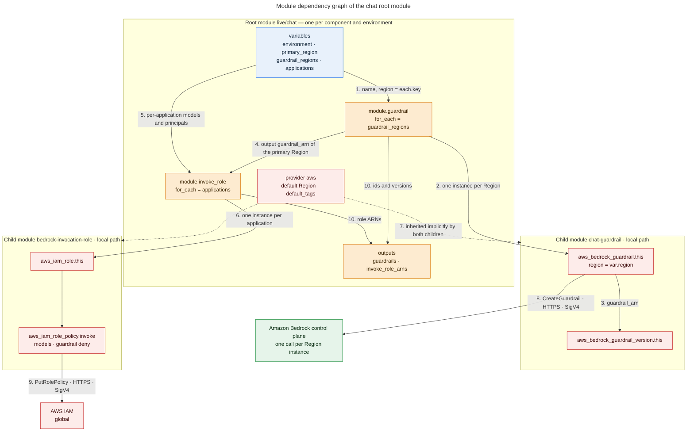

# Modules

> **Level:** Intermediate · **Verified:** 2026-11-15 · **Feature status:** n/a · **Time:** ~35 min

A module packages a tested building block — a least-privilege invocation role, a guardrail, a knowledge base — behind a small interface, so every application and environment builds it the same way. This chapter covers how modules are called, versioned and composed, how providers reach them, and the standard every module in this academy follows.

## Learning objectives

After this chapter you can:

- Distinguish root and child modules and describe a module's contract: inputs, outputs and provider requirements.
- Choose a module source and version constraint, and explain what `terraform init` does with them.
- Compose modules by wiring outputs to inputs, and read the resulting dependency graph.
- Pass providers to a module implicitly, through the `providers` map, or with the AWS provider 6 `region` argument — and use `for_each` on a module call.
- Apply the academy's module standard, and recognise when a module adds nothing.

## Prerequisites

- [Providers, resources and data sources](01-providers-resources-data-sources.md)
- [Variables, outputs and locals](02-variables-outputs-locals.md)

## Concept in plain language

A module is a kit with instructions. The kit for "an IAM role that may call these models only with this guardrail" contains a role and a policy; you hand it the model IDs and the guardrail, and it hands back the role ARN. The **root module** is the finished model on your desk: it opens several kits, connects one kit's output to another kit's input, and decides which AWS account and Region everything goes into. Kits never decide that themselves.

## How it really works

**Root and child.** The `.tf` files in the directory where you run `terraform plan` form the **root module**. Every `module` block calls a **child module**, which may call further modules. HashiCorp recommends keeping the tree flat and composing modules side by side rather than nesting deeply ([Creating modules](https://developer.hashicorp.com/terraform/language/modules/develop)).

**The contract.** A child module's interface is its `variable` blocks (inputs), `output` blocks (results) and its `terraform { required_version, required_providers }` block. It must not contain `provider` blocks: provider configurations are global to the whole configuration, defined only in the root, and a module with its own provider configuration cannot be used with `for_each`, `count` or `depends_on` ([Providers within modules](https://developer.hashicorp.com/terraform/language/modules/develop/providers)).

**Sources.** `source` tells `terraform init` where to fetch the code; it installs remote modules into a hidden subdirectory of the working directory (under `.terraform`) and must be re-run when a source or version changes ([module block reference](https://developer.hashicorp.com/terraform/language/block/module), [Use modules](https://developer.hashicorp.com/terraform/language/modules/sources)).

| Source type | Example `source` | Versioning |
|:--|:--|:--|
| Local path | `"../../modules/chat-guardrail"` | None — the code next to yours, used as is |
| Public registry | `"<namespace>/<name>/<provider>"` | `version` argument with a constraint |
| Private registry (HCP Terraform) | `"app.terraform.io/<org>/<name>/<provider>"` | `version` argument |
| Git | `"git::https://example.com/modules.git//bedrock-invocation-role?ref=bedrock-invocation-role/v1.2.0"` | `ref` = tag, branch or commit; `//` selects a subdirectory |

`version` works only for registry sources. Since Terraform 1.15 `source` and `version` may be expressions built from variables declared `const = true` and locals, because `init` must resolve them before planning ([Use modules](https://developer.hashicorp.com/terraform/language/modules/sources), [1.15 changelog](https://raw.githubusercontent.com/hashicorp/terraform/v1.15/CHANGELOG.md)).

**Version constraints.** `~> 1.2.0` allows only the right-most component to grow (1.2.x); `~> 1.2` allows 1.x from 1.2. HashiCorp's guidance: reusable modules constrain only the **minimum** Terraform and provider versions (`>=`); root modules use `~>` for both a lower and an upper bound; pin third-party modules to specific versions ([Version constraints](https://developer.hashicorp.com/terraform/language/expressions/version-constraints)).

> [!TIP]
> **Academy recommendation** — The academy's modules declare `hashicorp/aws` `~> 6.73`, which is a minimum plus an upper bound at 7.0 — slightly stricter than HashiCorp's "minimum only" advice. We accept that because a major provider release changes resource schemas (the [v6 upgrade guide](https://registry.terraform.io/providers/hashicorp/aws/latest/docs/guides/version-6-upgrade) is long), and we would rather re-test a module than let it break silently. Revisit the bound when you publish modules for teams you do not coordinate with.
> This is our design guidance, not an official AWS reference architecture.

**Composition.** Modules talk to each other only through the root: one module's output becomes another's input. Each reference is a graph edge, exactly as between resources, so Terraform orders and parallelises across module boundaries ([Providers, resources and data sources](01-providers-resources-data-sources.md#the-dependency-graph-of-the-example)). `depends_on` on a whole module is possible but makes every resource in it wait and widens "known after apply" values ([`depends_on`](https://developer.hashicorp.com/terraform/language/meta-arguments/depends_on)).

**Providers reach modules three ways.**

| Way | How | Limits |
|:--|:--|:--|
| Implicit inheritance | The child uses the root's **default** (un-aliased) configuration | Aliased configurations are never inherited |
| `providers` map | `providers = { aws = aws.recovery }` on the `module` block; a child that uses aliases declares `configuration_aliases` | Static: every instance of a `for_each` module gets the same mapping |
| `region` input (AWS provider 6) | The module takes `var.region` and sets `region = var.region` on its resources | Not for global services or a different account |

> [!NOTE]
> **Documented fact** — Because the association between resources and provider configurations is static, module calls using `for_each` or `count` cannot pass different provider configurations to different instances; you need a separate `module` block for each.
> Source: [Providers within modules](https://developer.hashicorp.com/terraform/language/modules/develop/providers)

That limit is why a v6-era module should accept a `region` input: `for_each` over Regions then works with a single provider block.

**`for_each` on modules.** Each instance gets an address such as `module.invoke_role["chat"]`; keys should be stable names, not list positions. Converting an existing single module call to `for_each` changes every address, so add `moved` blocks ([for_each, count and dynamic blocks](06-for-each-count-dynamic.md), [Lifecycle rules, import, moved and removed blocks](07-lifecycle-import-moved-removed.md)).

**When not to write a module.** HashiCorp recommends against modules that are thin wrappers around a single resource type: if the module's best name is the name of its main resource, it adds no abstraction ([Creating modules](https://developer.hashicorp.com/terraform/language/modules/develop)). "An invocation role scoped to models, Regions, profiles and a guardrail" is a concept; "an `aws_s3_bucket`" is not.

### The academy's module standard

Every module under [`modules/`](modules/README.md) follows one contract, summarised from the [module standard](modules/README.md#module-standard):

| Rule | Why |
|:--|:--|
| `README.md`, `versions.tf`, `variables.tf`, `main.tf`, `outputs.tf`, `tests/*.tftest.hcl` | Same layout everywhere |
| No `provider` blocks; `required_providers` with a constraint | The caller owns Region, account and tags; the module states what it was tested with |
| Typed, described, validated variables | Errors at plan time with a readable message |
| No hard-coded account IDs, Regions, ARNs or model IDs | Reusable across accounts, partitions and model generations |
| Pure logic in `locals`, exposed through an output | Testable with a mock provider |
| Plan-mode tests with a mock provider | Run in CI without credentials |
| Secure defaults; outputs are IDs and ARNs, never secrets | The safe path is the default path |

Versions are Git tags `module-name/vMAJOR.MINOR.PATCH` under Semantic Versioning; removing or renaming an input or output is a major change ([versioning convention](modules/README.md#versioning-convention), [Module and construct versioning](../maintenance/02-module-and-construct-versioning.md)).

## Architecture diagram



**What this shows** — The root module owns the only provider configuration, the inputs, and two module calls. The guardrail module is instantiated once per Region and the role module once per application. The single edge between the two calls — the primary Region's `guardrail_arn` — is what makes every role wait for that guardrail.

**Walkthrough**

1. The root passes each Region from `guardrail_regions` into the guardrail module as `region`.
2. Terraform creates one module instance per Region, for example `module.guardrail["us-west-2"]`.
3. Inside the module, the version references the guardrail.
4. The primary Region's `guardrail_arn` output becomes an input of every role instance.
5. Per-application settings come from the `applications` map.
6. One role and policy per application, for example `module.invoke_role["summarize"]`.
7. Neither child has a provider block; both inherit the root's default configuration.
8. Each guardrail instance calls the Bedrock control plane in its own Region through the per-resource `region`.
9. IAM is global, so the role module needs no Region.
10. Outputs collect instance results into maps keyed by Region and application.

| Legend | Meaning |
|:--|:--|
| Solid arrow | Input, reference or API call |
| Dashed arrow | Implicit provider inheritance |
| Orange | Module calls and outputs in the root |
| Red | IAM and guardrail resources (security controls) |
| Nested boxes | Module boundaries |

**Variations** — With a Git or registry source the child boxes are fetched by `terraform init` at a pinned tag. With a provider alias instead of `region`, the guardrail call cannot use `for_each` over Regions; you write one `module` block per Region with its own `providers` map. The full picture with state and environments is in [Diagram 27](../../diagrams/mermaid/27-terraform-state-and-modules.md).

## Implementation details

1. **Start from the consumer.** Write the module block you wish you could call, then the variables that make it possible.
2. **Lay out the repository** so that modules and root modules are separate: `modules/<name>/` for building blocks, one root module per component (and per environment, see [Workspaces and environment strategies](05-environments-and-workspaces.md)).
3. **Reference local modules by relative path while developing**; consume shared modules by Git tag or registry version in environment roots.
4. **Expose a `region` input** on modules with regional resources, defaulting to `null` (the provider's Region).
5. **Keep keys stable** in `for_each` maps: application names, Region names — never list indexes.
6. **Test each module on its own** with a mock provider, and test the composition in the root ([Testing and version pinning](09-testing-and-version-pinning.md)).
7. **Version deliberately.** Tag releases, write a changelog, and use `deprecated` (Terraform 1.15+) on inputs and outputs a release before removing them.

## Example

Layout used below (the academy module is copied unchanged):

```text
terraform/
├── modules/
│   ├── bedrock-invocation-role/   the academy module
│   └── chat-guardrail/            written in this chapter
└── live/
    └── chat/                      root module
```

`chat-guardrail` is deliberately small; the catalogue's planned [`bedrock-guardrail`](modules/bedrock-guardrail/README.md) module is the complete version.

> **Code status:** both modules and the root validated with `terraform fmt -check` and `terraform validate` (Terraform 1.17.2, provider 6.73.0) · TFLint core rules clean · mock-tested with `terraform test` (2 runs in the module, 2 runs in the root) · **never planned or applied against AWS, never deployed**

```hcl
# modules/chat-guardrail/variables.tf   (versions.tf: required_version >= 1.11.0, aws ~> 6.73, no provider block)
variable "name" {
  description = "Guardrail name: 1-50 characters from A-Z a-z 0-9 - _ (the CreateGuardrail limits)."
  type        = string

  validation {
    condition     = can(regex("^[0-9A-Za-z_-]{1,50}$", var.name))
    error_message = "name must be 1-50 characters from A-Z a-z 0-9 - _."
  }
}

variable "region" {
  description = "Region to create the guardrail in. null means the Region of the provider configuration."
  type        = string
  default     = null
}

variable "filter_strength" {
  description = "Strength of the hate, insults and misconduct filters, for both prompts and responses."
  type        = string
  default     = "HIGH"

  validation {
    condition     = contains(["LOW", "MEDIUM", "HIGH"], var.filter_strength)
    error_message = "filter_strength must be LOW, MEDIUM or HIGH."
  }
}

variable "blocked_message" {
  description = "Text returned instead of a blocked prompt or response."
  type        = string
  default     = "Sorry, I can't help with that request."
}

variable "tags" {
  description = "Tags added to the guardrail, on top of the provider's default_tags."
  type        = map(string)
  default     = {}
}
```

```hcl
# modules/chat-guardrail/main.tf
resource "aws_bedrock_guardrail" "this" {
  region                    = var.region
  name                      = var.name
  blocked_input_messaging   = var.blocked_message
  blocked_outputs_messaging = var.blocked_message
  tags                      = var.tags

  content_policy_config {
    filters_config {
      type            = "HATE"
      input_strength  = var.filter_strength
      output_strength = var.filter_strength
    }
    filters_config {
      type            = "INSULTS"
      input_strength  = var.filter_strength
      output_strength = var.filter_strength
    }
    filters_config {
      type            = "MISCONDUCT"
      input_strength  = var.filter_strength
      output_strength = var.filter_strength
    }
    filters_config {
      type            = "PROMPT_ATTACK"
      input_strength  = "HIGH"
      output_strength = "NONE"
    }
  }
}

resource "aws_bedrock_guardrail_version" "this" {
  region        = var.region
  guardrail_arn = aws_bedrock_guardrail.this.guardrail_arn
  description   = "Published by Terraform"
}
```

```hcl
# modules/chat-guardrail/outputs.tf
output "guardrail_arn" {
  description = "Guardrail ARN without a version suffix."
  value       = aws_bedrock_guardrail.this.guardrail_arn
}

output "guardrail_id" {
  description = "Guardrail ID to send with inference requests."
  value       = aws_bedrock_guardrail.this.guardrail_id
}

output "guardrail_version" {
  description = "Published version number."
  value       = aws_bedrock_guardrail_version.this.version
}
```

The root module composes the two modules (`versions.tf` as above):

```hcl
# live/chat/providers.tf
provider "aws" {
  region = var.primary_region

  default_tags {
    tags = {
      Application = "chat"
      Environment = var.environment
      ManagedBy   = "terraform"
    }
  }
}
```

```hcl
# live/chat/variables.tf
variable "environment" {
  description = "Environment name."
  type        = string
}

variable "primary_region" {
  description = "Region the applications call."
  type        = string
  default     = "us-east-1"
}

variable "guardrail_regions" {
  description = "Regions that get a copy of the guardrail. Must include primary_region."
  type        = set(string)
  default     = ["us-east-1", "us-west-2"]

  validation {
    condition     = contains(var.guardrail_regions, var.primary_region)
    error_message = "guardrail_regions must include primary_region."
  }
}

variable "applications" {
  description = "One invocation role per application. Model IDs are configuration: confirm them in the model catalog."
  type = map(object({
    trusted_services     = list(string)
    foundation_model_ids = list(string)
    allow_streaming      = optional(bool, true)
  }))
}
```

```hcl
# live/chat/main.tf
# One guardrail per Region: for_each on a module, Region passed as an input.
module "guardrail" {
  source   = "../../modules/chat-guardrail"
  for_each = var.guardrail_regions

  name   = "chat-${var.environment}"
  region = each.key
}

# One least-privilege role per application, all bound to the primary guardrail.
module "invoke_role" {
  source   = "../../modules/bedrock-invocation-role"
  for_each = var.applications

  name                 = "${each.key}-invoke-${var.environment}"
  trusted_services     = each.value.trusted_services
  foundation_model_ids = each.value.foundation_model_ids
  model_regions        = [var.primary_region]
  allow_streaming      = each.value.allow_streaming

  guardrail_arns                 = [module.guardrail[var.primary_region].guardrail_arn]
  required_guardrail_arn_pattern = "${module.guardrail[var.primary_region].guardrail_arn}:*"
}
```

```hcl
# live/chat/outputs.tf
output "guardrails" {
  description = "Guardrail ID and published version per Region."
  value = {
    for region, g in module.guardrail : region => {
      id      = g.guardrail_id
      version = g.guardrail_version
    }
  }
}

output "invoke_role_arns" {
  description = "Invocation role ARN per application."
  value       = { for app, r in module.invoke_role : app => r.role_arn }
}
```

```hcl
# live/chat/tests/composition.tftest.hcl
mock_provider "aws" {
  mock_data "aws_partition" {
    defaults = {
      partition = "aws"
    }
  }

  # Make the mocked ARN available at plan time so policy assertions can run.
  mock_resource "aws_bedrock_guardrail" {
    override_during = plan
    defaults = {
      guardrail_arn = "arn:aws:bedrock:us-east-1:111122223333:guardrail/abc123"
      guardrail_id  = "abc123"
    }
  }
}

variables {
  environment = "dev"
  applications = {
    chat = {
      trusted_services     = ["lambda.amazonaws.com"]
      foundation_model_ids = ["example.model-a-v1:0"]
    }
    summarize = {
      trusted_services     = ["ecs-tasks.amazonaws.com"]
      foundation_model_ids = ["example.model-b-v1:0"]
      allow_streaming      = false
    }
  }
}

run "one_guardrail_per_region_one_role_per_app" {
  command = plan

  assert {
    condition     = toset(keys(module.guardrail)) == toset(["us-east-1", "us-west-2"])
    error_message = "Expected a guardrail instance per Region."
  }

  assert {
    condition     = toset(keys(module.invoke_role)) == toset(["chat", "summarize"])
    error_message = "Expected one role per application."
  }

  assert {
    condition     = jsondecode(module.invoke_role["summarize"].policy_json).Statement[0].Action == ["bedrock:InvokeModel"]
    error_message = "The summarize role must not stream."
  }
}

run "primary_region_must_have_a_guardrail" {
  command = plan

  variables {
    primary_region    = "eu-west-1"
    guardrail_regions = ["us-east-1"]
  }

  expect_failures = [var.guardrail_regions]
}
```

`override_during = plan` (Terraform 1.11+) makes mocked values visible during plan; without it, assertions on the ARN-derived policy fail as "unknown" ([1.11 changelog](https://raw.githubusercontent.com/hashicorp/terraform/v1.11/CHANGELOG.md)).

Passing an aliased configuration explicitly, for a single extra Region:

> **Code status:** validated with `terraform validate` (Terraform 1.17.2, provider 6.73.0) · **never deployed**

```hcl
provider "aws" {
  region = "us-east-1"
}

provider "aws" {
  alias  = "recovery"
  region = "us-west-2"
}

# The child module has no provider block. The caller decides which
# configuration its resources use.
module "guardrail_recovery" {
  source = "../../modules/chat-guardrail"

  providers = {
    aws = aws.recovery
  }

  name = "chat-prod"
}
```

Consuming a released module from Git instead of a local path. Only the `source` line changes; `version` is not allowed for Git sources.

> **Code status:** illustrative — not initialised, because `terraform init` would clone a remote repository · **never deployed**

```hcl
module "invoke_role" {
  source = "git::https://example.com/platform/terraform-modules.git//bedrock-invocation-role?ref=bedrock-invocation-role/v1.2.0"

  name                 = "chat-invoke-prod"
  trusted_services     = ["lambda.amazonaws.com"]
  foundation_model_ids = [var.chat_model_id]
  model_regions        = ["us-east-1"]
}
```

## Common mistakes

> [!WARNING]
> **Common mistake** — Writing `providers = { aws = each.key == "us-east-1" ? aws : aws.recovery }` in a `for_each` module call. Terraform rejects it with "Invalid provider configuration reference": the value must be a static provider reference. Give the module a `region` input instead, or write one module block per Region.

| Mistake | Symptom | Fix |
|:--|:--|:--|
| `provider` block inside a shared module | "Module does not support count"; after removing the module call, planning errors until the provider configuration is reintroduced | Remove it; pass configurations from the root |
| Git source without `?ref=` | Every `init` may pull a different commit of the default branch | Pin a tag (or a commit SHA) |
| Converting a module call to `for_each` without `moved` | Plan destroys and recreates everything in the module | Add a `moved` block from `module.x` to `module.x["key"]` |
| `for_each` keys built from resource attributes, e.g. `toset([aws_bedrock_guardrail.a.guardrail_arn])` | "Invalid for_each argument … known only after apply" | Use keys known at plan time (names), not computed attributes |
| Thin wrapper module around one resource | More indirection, no new concept | Use the resource directly |
| Child module omits `required_providers` | A non-HashiCorp provider resolves to the wrong source | Every module declares its own requirements |

## Security considerations

- A module is code you execute with deployment credentials. Pin remote sources to tags or commit SHAs and review module upgrades like dependency upgrades.
- Encode guardrails in the module: no wildcard model IDs, explicit deny without a guardrail, encryption on by default. Consumers then get the secure option without thinking about it.
- Keep secrets out of module outputs; outputs end up in the caller's state.
- Private Git sources authenticate with the runner's Git credentials; in HCP Terraform only SSH keys are supported for module cloning ([module block reference](https://developer.hashicorp.com/terraform/language/block/module)).

## Cost considerations

- Modules themselves cost nothing. `for_each` multiplies whatever is inside: three Regions × a guardrail is three guardrails, and every request that uses one is billed for the policies it evaluates ([Amazon Bedrock pricing](https://aws.amazon.com/bedrock/pricing/)).
- HCP Terraform bills by managed resources, counting each instance created by `count` or `for_each` inside modules ([Manage workspace state](https://developer.hashicorp.com/terraform/cloud-docs/workspaces/state)).

## Knowledge check

1. Why must a shared module have no `provider` block, and which two failures does one cause?
2. You need the chat guardrail in four Regions, chosen per environment. Which provider mechanism do you use, and why not aliases?
3. A team pins `source = "git::https://example.com/modules.git//bedrock-invocation-role"`. What is wrong, and what does `version = "1.2.0"` do here?
4. What would happen to existing roles if you changed `module "invoke_role"` from a single call to `for_each = var.applications` without any other change?

<details>
<summary>Answers</summary>

1. Provider configurations belong to the root. A module with its own provider block cannot be called with `for_each`, `count` or `depends_on`, and removing the module also removes the configuration Terraform needs to destroy its resources, so planning fails.
2. A `region` input on the module plus `for_each` over the Regions (AWS provider 6). Provider references in a `providers` map are static, so instances of one `for_each` call cannot use different aliases.
3. No `ref`, so `init` takes whatever the default branch holds. `version` applies only to registry sources; for Git, pin with `?ref=<tag>`.
4. Every resource address changes from `module.invoke_role.…` to `module.invoke_role["chat"].…`; Terraform plans to destroy the old roles and create new ones. Add `moved` blocks to map the old address to the new key.

</details>

## Further reading

Official sources opened while writing this chapter:

- [Modules overview](https://developer.hashicorp.com/terraform/language/modules) — root and child modules, sources, workflow.
- [Creating modules](https://developer.hashicorp.com/terraform/language/modules/develop) — flat trees, composition, when to write a module.
- [module block reference](https://developer.hashicorp.com/terraform/language/block/module) — `source`, `version`, `for_each`, `providers`, Git query parameters.
- [Use modules in your configuration](https://developer.hashicorp.com/terraform/language/modules/sources) — versions, `const` source expressions, `removed` for modules.
- [Providers within modules](https://developer.hashicorp.com/terraform/language/modules/develop/providers) — inheritance, `providers` map, `configuration_aliases`, legacy provider blocks.
- [Version constraints](https://developer.hashicorp.com/terraform/language/expressions/version-constraints) — operators and best practices for modules and roots.
- [AWS provider: Enhanced Region Support](https://registry.terraform.io/providers/hashicorp/aws/latest/docs/guides/enhanced-region-support) — the `region` argument used by the module.
- Terraform changelogs [1.11](https://raw.githubusercontent.com/hashicorp/terraform/v1.11/CHANGELOG.md) (`override_during`) and [1.15](https://raw.githubusercontent.com/hashicorp/terraform/v1.15/CHANGELOG.md) (variables in module sources).

Related in this academy: [Reusable Terraform modules](modules/README.md) · [State, remote backends and state locking](04-state-backends-locking.md) · [Module and construct versioning](../maintenance/02-module-and-construct-versioning.md) · [Diagram 27](../../diagrams/mermaid/27-terraform-state-and-modules.md)
