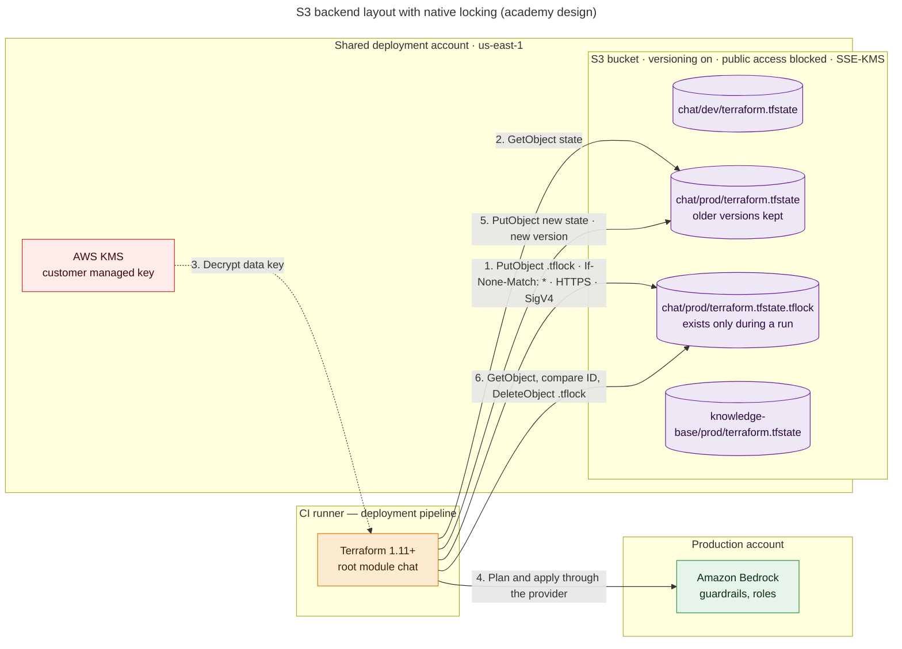
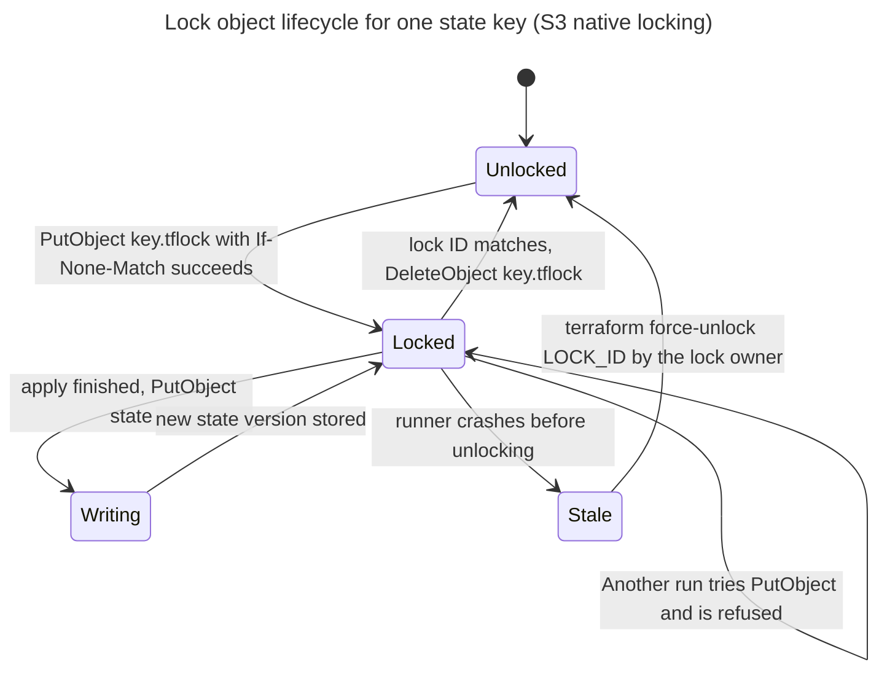

# State, remote backends and state locking

> **Level:** Intermediate · **Verified:** 2026-11-15 · **Feature status:** n/a · **Time:** ~35 min

State is Terraform's record of what it manages. For a Bedrock platform it holds every guardrail ID, role ARN and knowledge base ID — and, if you are careless, API keys in plain text. This chapter shows what state contains, how to keep it in Amazon S3 with native locking instead of a DynamoDB table, how to split it per environment and component, and how to change it without breaking it.

## Learning objectives

After this chapter you can:

- Explain what state contains and why Terraform needs it, including which secrets can end up there.
- Configure the S3 backend with `use_lockfile`, bucket versioning, SSE-KMS and the documented IAM permissions.
- Describe how a lock object is acquired and released, and recognise a run refused because of a lock.
- Use partial backend configuration to give each environment and component its own state object.
- Migrate from DynamoDB locking, and use `terraform state` commands knowing their risks.

## Prerequisites

- [Providers, resources and data sources](01-providers-resources-data-sources.md)
- [Modules](03-modules.md)
- [AWS KMS and encryption](../../00-foundations/security/04-kms-encryption.md)

## Concept in plain language

Imagine a warehouse with a ledger. The shelves are your AWS account; the ledger says "row 12 holds the chat guardrail, serial `abc123`". Terraform reads the ledger to know which real object each line of your code refers to, and writes to it after every change. Keep one ledger per warehouse, lock it while someone is writing, keep old pages, and keep it in a safe — because people write sensitive things in the margins.

## How it really works

**Why state exists.** State binds each resource instance in your configuration to a remote object, records metadata, and speeds up large configurations; Terraform refreshes it before operations and plans from the difference ([State](https://developer.hashicorp.com/terraform/language/state)). It is a JSON document that you should never edit by hand.

**What is in it.**

| Content | Example from this course | Why it matters |
|:--|:--|:--|
| Every managed resource instance and **all its attributes** | `aws_bedrock_guardrail.chat`: `guardrail_arn`, `guardrail_id`, `version` | Anyone who reads state learns your topology |
| Data-source results | The model ARN from `aws_bedrock_foundation_model` | Read again on the next plan |
| Root-module outputs | `invoke_role_arn` | Readable by other configurations through `terraform_remote_state` |
| Dependencies, provider address per resource | `module.invoke_role.aws_iam_role_policy.invoke` | Needed to destroy objects whose code was deleted |
| `lineage` and `serial` | — | Safety checks against overwriting newer or unrelated state ([`state push`](https://developer.hashicorp.com/terraform/cli/commands/state/push)) |
| Secrets in ordinary arguments | `aws_bedrockagentcore_api_key_credential_provider.api_key` is "stored in plain text" ([provider docs](https://raw.githubusercontent.com/hashicorp/terraform-provider-aws/v6.73.0/website/docs/r/bedrockagentcore_api_key_credential_provider.html.markdown)) | State must be protected like a secret store |

> [!NOTE]
> **Documented fact** — State and plan files can contain sensitive values such as initial database passwords or API tokens; values marked `sensitive` are still stored there. Ephemeral values and write-only arguments are not stored.
> Source: [Manage sensitive data](https://developer.hashicorp.com/terraform/language/state/sensitive-data)

**Backends.** The default `local` backend writes `terraform.tfstate` and a `.backup`; HashiCorp advises against keeping state in version control ([State](https://developer.hashicorp.com/terraform/language/state)). A `backend` block in the `terraform` block stores it remotely; there is one per configuration, and it cannot refer to variables or locals ([Backend block configuration](https://developer.hashicorp.com/terraform/language/backend)). HCP Terraform replaces it with a `cloud` block.

### The S3 backend

Required: `bucket`, `key`, `region`. The settings that matter most ([S3 backend](https://developer.hashicorp.com/terraform/language/backend/s3)):

| Argument | Effect |
|:--|:--|
| `use_lockfile = true` | S3 native locking with a `<key>.tflock` object. Defaults to `false` — **locking is opt-in** |
| `encrypt = true` | Server-side encryption of the state **and lock** objects |
| `kms_key_id` | Customer managed KMS key for both; Terraform then needs `kms:Encrypt`, `kms:Decrypt`, `kms:GenerateDataKey` |
| `assume_role { role_arn = ... }` | Read and write state as a role, for example in a central state account |
| `workspace_key_prefix` | Prefix for non-default CLI workspaces; default `env:` |
| `dynamodb_table` | **Deprecated** DynamoDB locking |

> [!IMPORTANT]
> **Status** — S3 native locking appeared in Terraform 1.10.0 (2024-11-27) and became generally available in 1.11.0 (2025-02-27), which also deprecated the DynamoDB arguments. The documentation says DynamoDB locking "will be removed in a future minor version"; the removal version is **UNVERIFIED — REQUIRES DOCUMENTATION REVIEW** (we checked the 1.12–1.17 changelogs: none removes it, and the 1.17.2 source still accepts `dynamodb_table` with a deprecation warning).
> Sources: [S3 backend](https://developer.hashicorp.com/terraform/language/backend/s3), [1.10](https://raw.githubusercontent.com/hashicorp/terraform/v1.10/CHANGELOG.md) and [1.11](https://raw.githubusercontent.com/hashicorp/terraform/v1.11/CHANGELOG.md) changelogs, [S3 backend source, v1.17.2](https://raw.githubusercontent.com/hashicorp/terraform/v1.17.2/internal/backend/remote-state/s3/backend.go)

**How the lock works.** In the Terraform 1.17.2 source, acquiring the lock is a `PutObject` of `<key>.tflock` with the header `If-None-Match: *` — an S3 conditional write that fails if the object already exists. The body is JSON lock information (ID, operation, who, Terraform version, creation time, path), encrypted with the same settings as the state. Releasing the lock reads the object, checks that the lock ID matches, and deletes it. With both `use_lockfile` and `dynamodb_table` set, Terraform takes the S3 lock first, then the DynamoDB lock, and releases the S3 lock if the second fails ([S3 backend client source](https://raw.githubusercontent.com/hashicorp/terraform/v1.17.2/internal/backend/remote-state/s3/client.go), [S3 conditional writes](https://docs.aws.amazon.com/AmazonS3/latest/userguide/conditional-writes.html)).

Locking is automatic for every operation that could write state; if it fails, Terraform stops with "Error acquiring the state lock" and prints the holder's lock information. `-lock-timeout` makes it wait instead of failing immediately (default `0s`); `terraform force-unlock LOCK_ID` removes a lock and is meant only for your own lock after automatic unlocking failed ([State locking](https://developer.hashicorp.com/terraform/language/state/locking), [`terraform init`](https://developer.hashicorp.com/terraform/cli/commands/init), [`force-unlock`](https://developer.hashicorp.com/terraform/cli/commands/force-unlock)).

**Permissions, as documented** for one state key with `use_lockfile`:

| Action | Resource |
|:--|:--|
| `s3:ListBucket` | The bucket (at least the state path) |
| `s3:GetObject`, `s3:PutObject` | `<bucket>/<key>` — **no** `s3:DeleteObject`: Terraform never deletes the state object |
| `s3:GetObject`, `s3:PutObject`, `s3:DeleteObject` | `<bucket>/<key>.tflock` |
| `kms:Encrypt`, `kms:Decrypt`, `kms:GenerateDataKey` | The state KMS key, when `kms_key_id` is set |

CLI workspaces add `<workspace_key_prefix>/*/<key>` paths, including `s3:DeleteObject` for deleting workspaces ([S3 backend](https://developer.hashicorp.com/terraform/language/backend/s3)).

**Versioning.** HashiCorp "highly" recommends bucket versioning so you can recover state after accidental deletion or a bad write ([S3 backend](https://developer.hashicorp.com/terraform/language/backend/s3)).

**Partial configuration.** Leave environment-specific arguments out of the `backend` block and pass them at `terraform init` with `-backend-config=PATH` (a file of top-level attributes, recommended name `*.<backend>.tfbackend`) or `-backend-config="KEY=VALUE"`. The merged configuration is stored in plain text in `.terraform/` and in every plan file, so never put credentials there ([Backend block configuration](https://developer.hashicorp.com/terraform/language/backend)). After a backend change, `init` needs `-reconfigure` (use the new settings, no copy) or `-migrate-state` (copy state across) ([`terraform init`](https://developer.hashicorp.com/terraform/cli/commands/init)).

**State per component.** One state object per environment *and* component — `chat/prod/terraform.tfstate`, `knowledge-base/prod/terraform.tfstate` — keeps plans fast, locks short and mistakes contained ([ADR-011](../../ARCHITECTURE-DECISIONS.md#adr-011-terraform-state-in-s3-with-native-locking-one-state-per-environment)). Components share values through published identifiers (tags, SSM parameters, data sources) or, more tightly coupled, `terraform_remote_state`, which exposes only root-module outputs ([CLI workspaces](https://developer.hashicorp.com/terraform/cli/workspaces)).

**State commands.** All work against remote state, and every modifying command writes a backup ([`terraform state`](https://developer.hashicorp.com/terraform/cli/commands/state)):

| Command | Use | Risk |
|:--|:--|:--|
| `state list`, `state show` | Inspect addresses and attributes | `show` prints sensitive attributes to your terminal |
| `state mv` | Rename or move an address | Prefer a reviewed `moved` block (1.1+) |
| `state rm` | Forget an object without destroying it | The object keeps existing, unmanaged; prefer a `removed` block (1.7+) |
| `state pull` | Download the current state | Leaves a plain-text copy on disk |
| `state push` | Overwrite remote state | Refuses differing `lineage` or a lower `serial` unless `-force` — never force |
| `state replace-provider` | Change provider source addresses | Rarely needed |

The blocks are covered in [Lifecycle rules, import, moved and removed blocks](07-lifecycle-import-moved-removed.md).

**HCP Terraform as the alternative.** Each HCP Terraform workspace stores its own state with full version history, locks during runs, encrypts state at rest and uses TLS in transit; in remote runs it overrides any backend block ([Manage workspace state](https://developer.hashicorp.com/terraform/cloud-docs/workspaces/state), [Manage sensitive data](https://developer.hashicorp.com/terraform/language/state/sensitive-data)). It is billed by managed resources. If you use it, you do not need the bucket, key or lock described here.

## Architecture diagram



**What this shows** — One bucket holds one state object per component and environment; the lock is a sibling object with a `.tflock` suffix that exists only while a run holds it. Every object is encrypted with the same customer managed key, and versioning keeps earlier states for recovery.

**Walkthrough**

1. The run creates the lock object with a conditional write; if it already exists, the run stops.
2. It reads the current state.
3. KMS decrypts the data key; the role needs `kms:Decrypt` (and `kms:GenerateDataKey`, `kms:Encrypt` to write).
4. The provider plans and applies in the workload account (see [Workspaces and environment strategies](05-environments-and-workspaces.md) for the role chain).
5. The new state is written as a new object version.
6. The run deletes the lock — only if the lock ID is still its own.

| Legend | Meaning |
|:--|:--|
| Solid arrow | Request or write |
| Dashed arrow | Key material returned |
| Cylinder | S3 object |
| Nested boxes | Accounts and the bucket boundary |

**Variations** — With DynamoDB locking (deprecated) a table holds a lock item instead of the `.tflock` object; during migration both exist. With HCP Terraform, the whole state account box is replaced by HCP Terraform workspaces. With state in each workload account instead of a shared one, the role chain is shorter but state access is spread over many accounts. Full set: [Diagram 27](../../diagrams/mermaid/27-terraform-state-and-modules.md).

### Lifecycle of the lock object



**What this shows** — The lock is binary: the object exists or it does not. A refused run changes nothing. A crashed runner leaves a stale lock that blocks everyone until it is removed deliberately.

**Walkthrough** — Acquire with a conditional write; write state while holding the lock; release by deleting the object after checking the ID. `force-unlock` is the only exit from the stale state and must not be used while another run may still be working.

## Implementation details

1. **Create the state bucket once, outside the configurations that use it** — a bootstrap root module with local state, or the planned [`terraform-state-backend`](modules/terraform-state-backend/README.md) module. Turn on versioning, block public access, and use SSE-KMS with a customer managed key.
2. **Every root module declares a partial S3 backend** with `use_lockfile = true` and `encrypt = true`; per-environment files supply `bucket`, `key`, `region` and `kms_key_id`.
3. **Key naming**: `<component>/<environment>/terraform.tfstate`. Never reuse a key for two root modules.
4. **One deployment role per environment with access to its own keys only**, using the documented permissions (example below). Humans get read access through break-glass roles, not standing write access.
5. **Require Terraform ≥ 1.11** in `required_version` so no runner ignores `use_lockfile`.
6. **Run `init -backend-config=...` in CI**, not only `init -backend=false`: in our offline test with Terraform 1.17.2, `terraform validate` after `init -backend=false` accepted a misspelt `use_lock_file`, which would have left locking off.

> [!TIP]
> **Academy recommendation** — Keep state buckets in a dedicated deployment or shared-services account, as HashiCorp's multi-account guidance on the S3 backend page also suggests, and add a bucket policy that denies requests not made over TLS. Pair it with [ADR-013](../../ARCHITECTURE-DECISIONS.md#adr-013-one-aws-account-per-environment): one account per environment, one state key per component and environment.
> This is our design guidance, not an official AWS reference architecture.

## Example

A partial backend for the chat root module and its development settings:

> **Code status:** validated with `terraform fmt -check` and `terraform validate` after `init -backend=false` (Terraform 1.17.2, provider 6.73.0); the `.tfbackend` file was format-checked as HCL · **never initialised against a real bucket, never deployed**

```hcl
# live/chat/backend.tf — same in every environment
terraform {
  backend "s3" {
    use_lockfile = true
    encrypt      = true
  }
}
```

```hcl
# live/chat/backend/dev.s3.tfbackend — one file per environment
bucket     = "example-tfstate-111122223333-us-east-1"
key        = "chat/dev/terraform.tfstate"
region     = "us-east-1"
kms_key_id = "arn:aws:kms:us-east-1:111122223333:key/00000000-0000-0000-0000-000000000000"
```

```bash
# Run in your own sandbox account. init reads and writes only the state bucket.
terraform init -backend-config=backend/dev.s3.tfbackend
terraform plan -var-file=envs/dev.tfvars -lock-timeout=5m -out=dev.tfplan
```

The deployment role's state permissions, built in Terraform so the policy can be unit-tested:

> **Code status:** validated with `terraform fmt -check` and `terraform validate` (Terraform 1.17.2, provider 6.73.0) · TFLint core rules clean · mock-tested with `terraform test` (2 runs) · **never deployed**

```hcl
variable "state_bucket" {
  description = "Name of the S3 bucket that holds Terraform state."
  type        = string
}

variable "state_keys" {
  description = "State object keys this role may read and write, for example [\"chat/prod/terraform.tfstate\"]."
  type        = list(string)

  validation {
    condition     = length(var.state_keys) > 0 && alltrue([for k in var.state_keys : !strcontains(k, "*")])
    error_message = "List at least one state key, without wildcards."
  }
}

variable "state_kms_key_arn" {
  description = "Customer managed KMS key that encrypts the state and lock objects."
  type        = string
}

data "aws_partition" "current" {}

locals {
  bucket_arn = "arn:${data.aws_partition.current.partition}:s3:::${var.state_bucket}"

  # Permissions as documented for the S3 backend with use_lockfile = true.
  state_access_policy = jsonencode({
    Version = "2012-10-17"
    Statement = [
      {
        Sid      = "ListStateKeys"
        Effect   = "Allow"
        Action   = "s3:ListBucket"
        Resource = local.bucket_arn
        Condition = {
          StringEquals = { "s3:prefix" = var.state_keys }
        }
      },
      {
        Sid      = "ReadWriteState"
        Effect   = "Allow"
        Action   = ["s3:GetObject", "s3:PutObject"]
        Resource = [for k in var.state_keys : "${local.bucket_arn}/${k}"]
      },
      {
        Sid      = "ManageLockObject"
        Effect   = "Allow"
        Action   = ["s3:GetObject", "s3:PutObject", "s3:DeleteObject"]
        Resource = [for k in var.state_keys : "${local.bucket_arn}/${k}.tflock"]
      },
      {
        Sid      = "UseStateKey"
        Effect   = "Allow"
        Action   = ["kms:Encrypt", "kms:Decrypt", "kms:GenerateDataKey"]
        Resource = var.state_kms_key_arn
      },
    ]
  })
}

resource "aws_iam_policy" "state_access" {
  name        = "terraform-state-chat"
  description = "Read and write the chat component's Terraform state and lock objects."
  policy      = local.state_access_policy
}

output "state_access_policy_json" {
  description = "Rendered policy, for review and tests."
  value       = local.state_access_policy
}
```

```hcl
# tests/policy.tftest.hcl (excerpt; mock_provider and variables blocks omitted)
run "lock_object_is_writable_and_deletable" {
  command = plan

  assert {
    condition = contains(
      [for s in jsondecode(output.state_access_policy_json).Statement : s if s.Sid == "ManageLockObject"][0].Resource,
      "arn:aws:s3:::example-tfstate-111122223333-us-east-1/chat/prod/terraform.tfstate.tflock"
    )
    error_message = "The lock object sits next to the state object with a .tflock suffix."
  }

  assert {
    condition     = !contains([for s in jsondecode(output.state_access_policy_json).Statement : s if s.Sid == "ReadWriteState"][0].Action, "s3:DeleteObject")
    error_message = "Terraform never deletes the state object, so the role must not be able to."
  }
}
```

The `s3:prefix` condition follows the per-object policy example on the [S3 backend page](https://developer.hashicorp.com/terraform/language/backend/s3). The key policy must also allow the role to use the KMS key ([AWS KMS and encryption](../../00-foundations/security/04-kms-encryption.md)).

### Migrating from DynamoDB locking

> **Code status:** the transition backend block below validated with `terraform validate` (Terraform 1.17.2) · steps are for your own sandbox · **never deployed**

```hcl
# Step 2 — both mechanisms at once, so old and new runners exclude each other.
terraform {
  backend "s3" {
    bucket         = "example-tfstate-111122223333-us-east-1"
    key            = "chat/dev/terraform.tfstate"
    region         = "us-east-1"
    encrypt        = true
    use_lockfile   = true
    dynamodb_table = "terraform-locks" # deprecated; delete in step 4
  }
}
```

1. Upgrade every runner and laptop that touches this state to Terraform 1.11 or later, and add the `.tflock` permissions to every role that runs Terraform.
2. Add `use_lockfile = true` next to `dynamodb_table` and run `terraform init -reconfigure`. The state location does not change, so nothing is copied. Each run now takes both locks.
3. When no older Terraform version can run against this state any more, remove `dynamodb_table` and run `terraform init -reconfigure` again.
4. Remove the DynamoDB permissions, then delete the table once no configuration references it.

## Common mistakes

> [!WARNING]
> **Common mistake** — Configuring the S3 backend without `use_lockfile = true` (or a lock table). Locking is opt-in for this backend, so two pipelines can apply at once and the last writer wins, leaving state that no longer matches what exists.

| Mistake | Symptom | Fix |
|:--|:--|:--|
| No bucket versioning | A bad `state push` or deletion cannot be undone | Turn on versioning before the first apply |
| `-lock=false` "to get unstuck" | Concurrent writers, corrupted or lost state | Wait, use `-lock-timeout`, or `force-unlock` your own stale lock |
| `force-unlock` on someone else's running job | Two runs write the same state | Check the lock's `Who` and `Created` fields and the pipeline first |
| Role allowed on the state key but not on `<key>.tflock` | Every run fails acquiring the lock (access denied) | Add Get, Put and Delete on the lock object |
| Credentials in a `.tfbackend` file or `-backend-config` | They are stored in `.terraform/` and in every plan file | Use environment variables or `assume_role` |
| One state for every environment | A dev change plans against production objects; huge blast radius | One key per component and environment |
| `terraform state rm` to "fix" a plan | The object still exists, now unmanaged, and still costs money | `removed` block with `destroy = false`, or `import` it back |

## Security considerations

- Treat read access to state as access to every secret in it. Restrict `s3:GetObject` on state keys to deployment roles and a break-glass role, and audit access with CloudTrail data events.
- Use SSE-KMS with a customer managed key so the key policy is a second gate; the role needs `kms:Decrypt` to read.
- Keep secrets out of state in the first place: write-only arguments, ephemeral resources, or services that read secrets themselves ([Secrets management and policy as code](../maintenance/04-secrets-and-policy-as-code.md)).
- Plan files contain state and backend configuration; store them as short-lived, encrypted CI artifacts.
- `state pull` and `state show` put plain-text state on a laptop. Avoid them in production except under break-glass procedures.

## Cost considerations

- The S3 backend costs storage for state objects and their versions plus requests; each run makes a handful of requests. Add a lifecycle rule that expires noncurrent versions after a period you can live with ([Amazon S3, AWS Lambda and Amazon API Gateway](../../00-foundations/aws-fundamentals/02-s3-lambda-api-gateway.md)).
- Native locking removes the DynamoDB table and its charges.
- A customer managed KMS key has a monthly charge and per-request charges; one key can serve all state in the bucket ([AWS KMS and encryption](../../00-foundations/security/04-kms-encryption.md)).
- HCP Terraform is billed by managed resources instead.

## Knowledge check

1. Older tutorials create a DynamoDB table for Terraform state locking. What replaced it, and since which Terraform version is it generally available?
2. A pipeline role can read and write `chat/prod/terraform.tfstate` but every run fails before planning with an access-denied error. What is most likely missing?
3. Why does the deployment role not need `s3:DeleteObject` on the state object?
4. What would happen if two pipelines with `use_lockfile = true` started `terraform apply` against the same key at the same second?

<details>
<summary>Answers</summary>

1. S3 native locking with `use_lockfile = true`, which writes a `.tflock` object next to the state; it appeared in Terraform 1.10 and is generally available since 1.11.
2. Permission on the lock object `chat/prod/terraform.tfstate.tflock` (Get, Put and Delete), or `kms:GenerateDataKey`/`kms:Encrypt` on the state key, because the lock object is encrypted too.
3. Terraform overwrites the state object but never deletes it; only the lock object is deleted.
4. Both send a conditional `PutObject` with `If-None-Match: *`. S3 lets only one create the object; the other fails with "Error acquiring the state lock" and changes nothing.

</details>

## Further reading

Official sources opened while writing this chapter:

- [S3 backend](https://developer.hashicorp.com/terraform/language/backend/s3) — arguments, `use_lockfile`, permissions, workspaces, multi-account guidance.
- [State](https://developer.hashicorp.com/terraform/language/state) — purpose, storage, format, inspection.
- [Manage sensitive data](https://developer.hashicorp.com/terraform/language/state/sensitive-data) — what is stored in state and plan files.
- [State locking](https://developer.hashicorp.com/terraform/language/state/locking) and [`terraform force-unlock`](https://developer.hashicorp.com/terraform/cli/commands/force-unlock).
- [Backend block configuration](https://developer.hashicorp.com/terraform/language/backend) — partial configuration, `.tfbackend` files, credentials in `.terraform/`.
- [`terraform init`](https://developer.hashicorp.com/terraform/cli/commands/init) — `-backend-config`, `-reconfigure`, `-migrate-state`, `-lock-timeout`.
- [`terraform state`](https://developer.hashicorp.com/terraform/cli/commands/state) and [`terraform state push`](https://developer.hashicorp.com/terraform/cli/commands/state/push) — subcommands, backups, lineage and serial checks.
- [Manage workspace state in HCP Terraform](https://developer.hashicorp.com/terraform/cloud-docs/workspaces/state) — state versions and managed-resource counting.
- Terraform source v1.17.2: [S3 backend client](https://raw.githubusercontent.com/hashicorp/terraform/v1.17.2/internal/backend/remote-state/s3/client.go) and [S3 backend schema](https://raw.githubusercontent.com/hashicorp/terraform/v1.17.2/internal/backend/remote-state/s3/backend.go) — lock implementation, deprecation of `dynamodb_table`.
- [How to prevent object overwrites with conditional writes](https://docs.aws.amazon.com/AmazonS3/latest/userguide/conditional-writes.html) — `If-None-Match` in Amazon S3.
- Terraform changelogs [1.10](https://raw.githubusercontent.com/hashicorp/terraform/v1.10/CHANGELOG.md) and [1.11](https://raw.githubusercontent.com/hashicorp/terraform/v1.11/CHANGELOG.md) — native locking introduced and made GA.

Related in this academy: [Workspaces and environment strategies](05-environments-and-workspaces.md) · [Plan, apply and drift detection](08-plan-apply-drift.md) · [Environments, isolation and controlled promotion](../maintenance/03-environments-and-promotion.md) · [Diagram 27](../../diagrams/mermaid/27-terraform-state-and-modules.md)
