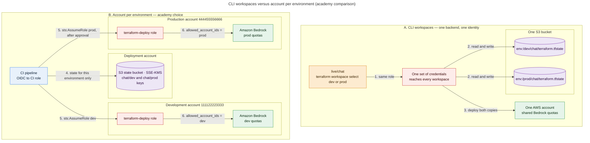

# Workspaces and environment strategies

> **Level:** Intermediate · **Verified:** 2026-11-15 · **Feature status:** n/a · **Time:** ~30 min

A Bedrock platform runs the same code in development, test, staging and production. The question is where the differences live — which state, which credentials, which account — and what stops a change meant for development from reaching production. This chapter compares Terraform CLI workspaces, directory-per-environment, one root module with per-environment files, account-per-environment and Terraform Stacks, and states the academy's choice.

## Learning objectives

After this chapter you can:

- Explain what Terraform CLI workspaces are, and why HashiCorp says they are not an isolation mechanism.
- Compare directory-per-environment, one root module with `-backend-config` and `-var-file`, account-per-environment with `assume_role`, HCP Terraform workspaces and Stacks.
- Build a root module that can only deploy into the account it was given.
- Choose an environment strategy for a Bedrock platform and justify it.

## Prerequisites

- [State, remote backends and state locking](04-state-backends-locking.md)
- [IAM roles, trust policies and cross-account access](../../00-foundations/security/02-iam-roles-and-trust.md)
- [AWS Organizations and AWS Control Tower](../../00-foundations/aws-fundamentals/05-organizations-control-tower.md)

## Concept in plain language

You have one blueprint and four houses. CLI workspaces are four drawers in one filing cabinet: separate papers, but the same key opens every drawer and the cabinet sits in one room. Separate accounts are four houses on four plots, each with its own key; the blueprint is the same, the address and the key change. Most production incidents caused by "the wrong environment" are a missing lock between drawers, not a bad blueprint.

## How it really works

### CLI workspaces — what they are

A workspace is a named instance of state for one configuration and one backend. Every working directory starts with `default`, which cannot be deleted; `terraform workspace new | select | list | delete` manage the others, and `terraform.workspace` gives the current name inside the configuration ([Workspaces](https://developer.hashicorp.com/terraform/language/state/workspaces), [Manage workspaces](https://developer.hashicorp.com/terraform/cli/workspaces)). With the S3 backend, a non-default workspace's state lives at `<workspace_key_prefix>/<name>/<key>`, prefix `env:` by default ([S3 backend](https://developer.hashicorp.com/terraform/language/backend/s3)). Since Terraform 1.15, applying a saved plan in a different workspace from the one it was made in is an explicit error ([1.15 changelog](https://raw.githubusercontent.com/hashicorp/terraform/v1.15/CHANGELOG.md)).

### CLI workspaces — what they are not

> [!NOTE]
> **Documented fact** — Workspaces are not appropriate for system decomposition or for deployments requiring separate credentials and access controls. CLI workspaces in a working directory share one backend, so they are not a suitable isolation mechanism between development stages. HashiCorp's suggested use is a parallel, temporary copy of infrastructure — for example, per feature branch.
> Sources: [Workspaces](https://developer.hashicorp.com/terraform/language/state/workspaces), [Manage workspaces](https://developer.hashicorp.com/terraform/cli/workspaces)

HCP Terraform also uses the word "workspace", for something different: each HCP Terraform workspace has its own configuration, variables, state, run history and permissions — closer to a separate working directory than to a CLI workspace.

### The alternatives

**Directory per environment.** `live/dev/chat/`, `live/prod/chat/`: each a small root module with its own fully specified backend, calling shared modules at pinned versions. HashiCorp describes exactly this as the alternative to workspaces: a root module "consists only of a backend configuration and a small number of `module` blocks" ([Manage workspaces](https://developer.hashicorp.com/terraform/cli/workspaces)). Explicit and easy to read; the cost is near-duplicate files that drift apart.

**One root module, files per environment.** One `live/chat/` directory with a partial backend, plus `backend/<env>.s3.tfbackend` and `envs/<env>.tfvars`. The pipeline runs `terraform init -reconfigure -backend-config=backend/prod.s3.tfbackend` and `terraform plan -var-file=envs/prod.tfvars`. Promotion is applying the *same commit* with the next environment's files. The danger is mixing a production backend file with development variables — guard it in code (example below).

**Account per environment.** Development, test, staging and production are separate AWS accounts ([ADR-013](../../ARCHITECTURE-DECISIONS.md#adr-013-one-aws-account-per-environment)). The CI role, authenticated with OIDC, may only assume one deployment role per account; the provider's `assume_role` block names it and `allowed_account_ids` refuses any other account ([AWS provider configuration](https://registry.terraform.io/providers/hashicorp/aws/latest/docs)). State stays in a shared deployment account. This is an *isolation* strategy; you combine it with one of the two layouts above.

**Terraform Stacks at a glance.** Stacks are an HCP Terraform feature (GA since September 2025, per the [verification register](../../FEATURE-VERIFICATION.md#c-infrastructure-as-code-tooling)) that replaces the root module with **components** in `.tfcomponent.hcl` files and **deployments** in `.tfdeploy.hcl` files. Each deployment has isolated state; a Stack supports up to 20 deployments, 100 components and 10,000 resources; deployments can authenticate to AWS with OIDC through `identity_token` blocks ([Stacks overview](https://developer.hashicorp.com/terraform/language/stacks), [Define deployment configuration](https://developer.hashicorp.com/terraform/language/stacks/deploy/config)). The `terraform stacks` commands need HCP Terraform; in our offline environment the CLI stopped at "Hostname discovery failed".

### Comparison

| Strategy | Separate state | Separate credentials | Same code guaranteed | Blast radius of a mistake | Fits |
|:--|:-:|:-:|:-:|:--|:--|
| CLI workspaces, one backend | Yes (key prefix) | **No** | Yes | Every workspace shares backend and usually the provider identity | Short-lived copies in one dev account |
| Directory per environment | Yes | Possible | No — copies drift | One environment | Few environments, very different shapes |
| One root + `-backend-config` + `-var-file` | Yes | Possible | Yes | One environment, if files are not mixed up | Pipelines promoting one commit |
| Account per environment (+ either layout) | Yes | **Yes**, per account | Depends on layout | One account; quotas and cost isolated | Production platforms |
| HCP Terraform workspaces | Yes | Yes, per workspace | Depends on VCS settings | One workspace | Teams already on HCP Terraform |
| Stacks (HCP Terraform) | Yes, per deployment | Yes, per deployment | Yes | One deployment | Many deployments orchestrated together |

Why accounts matter for Bedrock in particular: quotas are per account and Region, so a load test in a shared account can throttle production; model access, invocation logging and service control policies are also configured per account ([ADR-013](../../ARCHITECTURE-DECISIONS.md#adr-013-one-aws-account-per-environment), [Quotas, rate limits and throttling](../../08-cost-performance-and-reliability/05-quotas-rate-limits-and-throttling.md)).

## Architecture diagram



**What this shows** — In A, the only thing separating development from production is a key prefix; one identity reaches both states and both copies of the infrastructure, in one account with one set of Bedrock quotas. In B, each environment is a separate account with its own deployment role, so the pipeline's permissions — not a workspace name — decide what a run can touch.

**Walkthrough**

1. A: every workspace runs with the same credentials.
2. A: those credentials can read and write every workspace's state.
3. A: both copies live in one account and compete for its quotas.
4. B: the pipeline reads and writes only the state key of the environment it deploys.
5. B: it assumes the deployment role of that account; production requires an approval step first ([Environments, isolation and controlled promotion](../maintenance/03-environments-and-promotion.md)).
6. B: `allowed_account_ids` makes the provider refuse to act if the credentials belong to another account.

| Legend | Meaning |
|:--|:--|
| Red | Identities and roles (the isolation control) |
| Cylinder | State objects |
| Nested boxes | Accounts and the bucket |
| Account IDs | Documentation placeholders |

**Variations** — With HCP Terraform workspaces, the deployment account's bucket disappears and each workspace holds its own state and credentials. With Stacks, each `deployment` block plays the role of one account box. The detailed view with locks and KMS is [Diagram 27](../../diagrams/mermaid/27-terraform-state-and-modules.md).

## Implementation details

1. **Decide the isolation boundary first** — accounts — and the layout second.
2. **One root module per component**, with a partial S3 backend, `backend/<env>.s3.tfbackend` and `envs/<env>.tfvars` ([ADR-011](../../ARCHITECTURE-DECISIONS.md#adr-011-terraform-state-in-s3-with-native-locking-one-state-per-environment)). The academy's [environment example](../maintenance/environments/README.md) uses `env/<env>/backend.hcl` for the same purpose; HashiCorp recommends the `*.<backend>.tfbackend` naming but does not require it ([Backend block configuration](https://developer.hashicorp.com/terraform/language/backend)).
3. **Tie the account to the role in code**: `allowed_account_ids = [var.account_id]` plus a validation that the role ARN belongs to that account.
4. **Always `init -reconfigure`** when switching environment files in one working directory; CI should use a fresh directory per environment.
5. **Differences are data**: filter strength, model IDs, Regions in `.tfvars` — not `if environment == "prod"` scattered through modules.
6. **Use CLI workspaces only** for throwaway copies in a development account, and delete them when the branch is merged.

> [!TIP]
> **Academy recommendation** — Account per environment (ADR-013), one root module per component with per-environment backend and variable files (ADR-011), and a pipeline that promotes one commit from dev to prod. CLI workspaces are not used for environments. Consider Stacks if you already run HCP Terraform and need to orchestrate many deployments together. The full promotion workflow is in [Environments, isolation and controlled promotion](../maintenance/03-environments-and-promotion.md).
> This is our design guidance, not an official AWS reference architecture.

## Example

The chat root module from [Modules](03-modules.md), wired for account-per-environment. Layout:

```text
live/chat/
├── backend.tf                 partial S3 backend (as in the state chapter)
├── providers.tf               assume_role + allowed_account_ids
├── variables.tf · main.tf · outputs.tf · versions.tf
├── backend/dev.s3.tfbackend   backend/prod.s3.tfbackend
├── envs/dev.tfvars.example    envs/prod.tfvars.example
└── tests/environments.tftest.hcl
```

> **Code status:** validated with `terraform fmt -check` and `terraform validate` (Terraform 1.17.2, provider 6.73.0) · TFLint core rules clean · mock-tested with `terraform test` (2 runs) · `.tfvars.example` and `.tfbackend` files format-checked · **never initialised against a real backend, never planned or applied against AWS, never deployed**

```hcl
# providers.tf — the pipeline's own credentials (for example from OIDC) only allow it
# to assume one deployment role per environment account.
provider "aws" {
  region              = var.region
  allowed_account_ids = [var.account_id]

  assume_role {
    role_arn     = var.deployment_role_arn
    session_name = "terraform-chat-${var.environment}"
  }

  default_tags {
    tags = {
      Application = "chat"
      Environment = var.environment
      ManagedBy   = "terraform"
    }
  }
}
```

```hcl
# variables.tf
variable "environment" {
  description = "Environment name; one AWS account per environment."
  type        = string

  validation {
    condition     = contains(["dev", "test", "staging", "prod"], var.environment)
    error_message = "environment must be dev, test, staging or prod."
  }
}

variable "account_id" {
  description = "The only AWS account this run may change."
  type        = string

  validation {
    condition     = can(regex("^[0-9]{12}$", var.account_id))
    error_message = "account_id must be 12 digits."
  }
}

variable "deployment_role_arn" {
  description = "Role in account_id that Terraform assumes to deploy."
  type        = string

  validation {
    condition     = can(regex("^arn:aws[a-z-]*:iam::${var.account_id}:role/", var.deployment_role_arn))
    error_message = "deployment_role_arn must be an IAM role in account_id."
  }
}

variable "region" {
  description = "Region for this environment."
  type        = string
  default     = "us-east-1"
}

variable "chat_model_id" {
  description = "Model the chat role may invoke. Confirm the ID in the model catalog."
  type        = string
}

variable "guardrail_filter_strength" {
  description = "Content filter strength for this environment."
  type        = string
  default     = "HIGH"
}
```

```hcl
# main.tf
module "guardrail" {
  source = "../../modules/chat-guardrail"

  name            = "chat-${var.environment}"
  filter_strength = var.guardrail_filter_strength
}

module "invoke_role" {
  source = "../../modules/bedrock-invocation-role"

  name                 = "chat-invoke-${var.environment}"
  trusted_services     = ["lambda.amazonaws.com"]
  foundation_model_ids = [var.chat_model_id]
  model_regions        = [var.region]

  guardrail_arns                 = [module.guardrail.guardrail_arn]
  required_guardrail_arn_pattern = "${module.guardrail.guardrail_arn}:*"
}
```

```hcl
# envs/dev.tfvars.example — copy to envs/dev.tfvars (git-ignored)
environment               = "dev"
account_id                = "111122223333"
deployment_role_arn       = "arn:aws:iam::111122223333:role/terraform-deploy"
region                    = "us-east-1"
chat_model_id             = "example.model-a-v1:0"
guardrail_filter_strength = "MEDIUM"
```

```hcl
# envs/prod.tfvars.example
environment         = "prod"
account_id          = "444455556666"
deployment_role_arn = "arn:aws:iam::444455556666:role/terraform-deploy"
region              = "us-east-1"
chat_model_id       = "example.model-a-v1:0"
```

```hcl
# backend/prod.s3.tfbackend — state lives in the deployment account 777788889999
bucket     = "example-tfstate-777788889999-us-east-1"
key        = "chat/prod/terraform.tfstate"
region     = "us-east-1"
kms_key_id = "arn:aws:kms:us-east-1:777788889999:key/00000000-0000-0000-0000-000000000000"
```

```hcl
# tests/environments.tftest.hcl (excerpt; mock_provider block omitted)
run "role_in_another_account_is_rejected" {
  command = plan

  variables {
    environment         = "prod"
    account_id          = "444455556666"
    deployment_role_arn = "arn:aws:iam::111122223333:role/terraform-deploy"
    chat_model_id       = "example.model-a-v1:0"
  }

  expect_failures = [var.deployment_role_arn]
}
```

What the pipeline runs per environment, in your own sandbox accounts (creating the guardrail and role costs nothing until the guardrail evaluates requests; destroy with `terraform destroy -var-file=envs/dev.tfvars` when done):

```bash
terraform init -reconfigure -backend-config=backend/dev.s3.tfbackend
terraform plan -var-file=envs/dev.tfvars -out=dev.tfplan
terraform apply dev.tfplan
```

For contrast, CLI workspaces with the same backend — fine for a temporary copy, not for production:

> **Code status:** validated with `terraform fmt -check` and `terraform validate` (Terraform 1.17.2, provider 6.73.0) · **never deployed**

```hcl
terraform {
  backend "s3" {
    bucket               = "example-tfstate-111122223333-us-east-1"
    key                  = "chat/terraform.tfstate"
    region               = "us-east-1"
    use_lockfile         = true
    workspace_key_prefix = "workspaces"
  }
}

provider "aws" {
  region = "us-east-1"
}

locals {
  # The workspace name is the only thing that differs between instances.
  name_suffix = terraform.workspace == "default" ? "main" : terraform.workspace
}

resource "aws_bedrock_guardrail" "chat" {
  name                      = "chat-${local.name_suffix}"
  blocked_input_messaging   = "Sorry, I can't help with that request."
  blocked_outputs_messaging = "Sorry, I can't share that response."

  content_policy_config {
    filters_config {
      type            = "PROMPT_ATTACK"
      input_strength  = "HIGH"
      output_strength = "NONE"
    }
  }
}
```

`terraform workspace new feature-x` then stores that copy's state at `workspaces/feature-x/chat/terraform.tfstate` — in the same bucket, reachable with the same credentials.

The same component as a Stack, for orientation only:

> **Code status:** illustrative — written from the Stacks documentation and not validated: `terraform stacks validate` requires HCP Terraform, which this environment cannot reach · **never deployed**

```hcl
# components.tfcomponent.hcl
required_providers {
  aws = {
    source  = "hashicorp/aws"
    version = "~> 6.73"
  }
}

variable "aws_region" { type = string }
variable "role_arn" { type = string }
variable "aws_token" { type = string }
variable "environment" { type = string }

provider "aws" "this" {
  config {
    region = var.aws_region
    assume_role_with_web_identity {
      role_arn           = var.role_arn
      web_identity_token = var.aws_token
    }
  }
}

component "guardrail" {
  source = "./modules/chat-guardrail"
  inputs = {
    name = "chat-${var.environment}"
  }
  providers = {
    aws = provider.aws.this
  }
}
```

```hcl
# deployments.tfdeploy.hcl
identity_token "aws" {
  audience = ["aws.workload.identity"]
}

deployment "dev" {
  inputs = {
    aws_region  = "us-east-1"
    role_arn    = "arn:aws:iam::111122223333:role/hcp-terraform-deploy"
    aws_token   = identity_token.aws.jwt
    environment = "dev"
  }
}

deployment "prod" {
  inputs = {
    aws_region  = "us-east-1"
    role_arn    = "arn:aws:iam::444455556666:role/hcp-terraform-deploy"
    aws_token   = identity_token.aws.jwt
    environment = "prod"
  }
}
```

## Common mistakes

> [!WARNING]
> **Common mistake** — Using `terraform.workspace == "prod"` to switch behaviour while every workspace runs with the same credentials. A forgotten `terraform workspace select` applies development changes to production state with nothing to stop it. Separate the credentials, not just the state.

| Mistake | Symptom | Fix |
|:--|:--|:--|
| Production backend file with development variables | Plan proposes replacing production resources with dev-named ones | `allowed_account_ids` plus a role/account validation; separate CI jobs per environment |
| Switching backend files without `-reconfigure` | `init` refuses, or (with `-migrate-state`) copies state into the other environment | `terraform init -reconfigure -backend-config=...`, or a fresh directory |
| Environment logic inside modules (`if var.environment == "prod"`) | Modules cannot be tested without knowing every environment | Pass explicit inputs (filter strength, sizes) from `.tfvars` |
| Directory per environment without pinned module versions | Dev and prod silently run different module code | Pin `?ref=` tags and promote by changing the tag |
| One shared account for all environments | A dev load test throttles production Bedrock calls | Account per environment |

## Security considerations

- The isolation boundary is IAM: the CI role should assume exactly one deployment role per account, and production should require an approval before that role is assumed ([GitHub Actions for IaC](../../07-devops-and-cicd/04-github-actions.md)).
- State for all environments can share a bucket only if each role is limited to its own keys, as in the [state access policy](04-state-backends-locking.md#example).
- Service control policies and the per-account invocation logging configuration belong to the account, not to the Terraform workspace ([Governance at scale](../../06-security-governance/06-governance-at-scale.md)).

## Cost considerations

- Accounts are free; the resources in them are not. Cost per environment is visible per account without tagging discipline.
- Each environment duplicates guardrails, knowledge bases and vector stores. Size non-production stores down through `.tfvars`, and destroy temporary workspace copies.
- Stacks and HCP Terraform workspaces are billed by managed resources; Stack resources are aggregated with workspace resources ([Stacks GA update](https://developer.hashicorp.com/terraform/language/stacks/update-GA)).

## Knowledge check

1. Your team uses CLI workspaces `dev` and `prod` in one account with one IAM role. Name two risks HashiCorp's documentation points at, and one Bedrock-specific risk.
2. Why combine `allowed_account_ids` with a validation that the role ARN belongs to `account_id` — isn't one enough?
3. When would you choose directory-per-environment over one root module with per-environment files?
4. What would happen if a pipeline ran `terraform init -migrate-state -backend-config=backend/prod.s3.tfbackend` in a directory initialised for dev?

<details>
<summary>Answers</summary>

1. No separate credentials or access control between environments, and one backend shared by all of them. Bedrock-specific: both share the account's quotas, so development traffic can throttle production.
2. The validation fails at plan time if the files are mixed up, before any credentials are used; `allowed_account_ids` protects at run time if the credentials resolve to a different account than expected. They catch different errors.
3. When environments genuinely differ in shape (for example, production has components that development does not) or when you want each environment's module versions pinned and promoted explicitly.
4. Terraform would offer to copy the dev state into the prod key, overwriting or merging environments. For switching environments use `-reconfigure`, which does not copy state.

</details>

## Further reading

Official sources opened while writing this chapter:

- [Workspaces](https://developer.hashicorp.com/terraform/language/state/workspaces) — what CLI workspaces are, `terraform.workspace`, when not to use them.
- [Manage workspaces](https://developer.hashicorp.com/terraform/cli/workspaces) — use cases, alternatives, HCP Terraform workspaces, internals.
- [S3 backend](https://developer.hashicorp.com/terraform/language/backend/s3) — workspace key paths, multi-account guidance with `assume_role`.
- [Backend block configuration](https://developer.hashicorp.com/terraform/language/backend) — partial configuration and `.tfbackend` files.
- [AWS provider configuration](https://registry.terraform.io/providers/hashicorp/aws/latest/docs) — `assume_role`, `allowed_account_ids`.
- [Stacks overview](https://developer.hashicorp.com/terraform/language/stacks), [Define configuration](https://developer.hashicorp.com/terraform/language/stacks/component/config), [Define deployment configuration](https://developer.hashicorp.com/terraform/language/stacks/deploy/config) and [Update for general availability](https://developer.hashicorp.com/terraform/language/stacks/update-GA) — components, deployments, limits, billing.
- [Terraform 1.15 changelog](https://raw.githubusercontent.com/hashicorp/terraform/v1.15/CHANGELOG.md) — plan files bound to their workspace.

Related in this academy: [Environments, isolation and controlled promotion](../maintenance/03-environments-and-promotion.md) · [Multi-account and multi-Region deployments](../maintenance/06-multi-account-multi-region.md) · [Pattern: multi-account generative AI platform](../../03-architecture-patterns/multi-account/README.md) · [Project F: multi-account enterprise GenAI platform](../../05-practical-projects/project-06-multi-account-platform/README.md)
