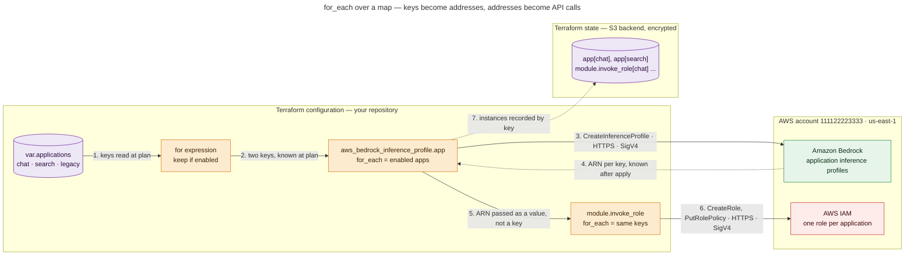

# for_each, count and dynamic blocks

> **Level:** Intermediate · **Verified:** 2026-11-15 · **Feature status:** n/a · **Time:** ~25 min

Most Bedrock platforms need several of the same thing: one application inference profile per team, one invocation role per application, a guardrail whose denied topics come from a list owned by another team. This chapter shows how Terraform repeats resources (`count`, `for_each`) and nested blocks (`dynamic`), and why the choice decides whether a routine change is a no-op or a replacement.

## Learning objectives

After this chapter you can:

- Explain how `count` and `for_each` turn one block into many instances, and how each instance is addressed in state.
- Predict what a plan does when an element is removed from the collection behind `count` versus `for_each`.
- Use `for_each` on resources and module calls, and chain one `for_each` to another.
- Diagnose the "Invalid for_each argument" error caused by keys that are known only after apply.
- Build optional nested blocks with `dynamic`, and decide when a literal block is the better choice.

## Prerequisites

- [Variables, outputs and locals](02-variables-outputs-locals.md) — types, `optional()` attributes, validation.
- [Modules](03-modules.md) — the running example [`bedrock-invocation-role`](modules/bedrock-invocation-role/README.md).
- [Application inference profiles](../../01-amazon-bedrock/inference/05-application-inference-profiles.md) — what the example creates.

## Concept in plain language

Think of a hotel. With `count`, rooms are numbered 0, 1, 2 in the order guests arrive. If the guest in room 1 leaves, everyone after them is asked to move down one room — luggage, keys and all. With `for_each`, each room carries the guest's name on the door. When one guest leaves, only their room is cleared; nobody else moves.

Terraform works the same way. An **instance key** is the room number or the name on the door. Terraform stores every real object (an inference profile, an IAM role) under its key, so the key decides what Terraform thinks changed.

A **dynamic block** is different: it does not repeat whole resources, it repeats a *nested block inside* one resource — for example one `topics_config` block per denied topic inside a single guardrail.

## How it really works

| Construct | Accepts | Instance address | Iterator | Use it for |
|:--|:--|:--|:--|:--|
| `count` | A whole number known at plan time | `aws_bedrock_inference_profile.app[0]` | `count.index` | Nearly identical copies, or `count = var.enabled ? 1 : 0` |
| `for_each` | A map, or a set of strings, whose keys are known at plan time | `aws_bedrock_inference_profile.app["chat"]` | `each.key`, `each.value` | Objects that differ by something other than a number |
| `dynamic "<block>"` | Any collection | No address — it produces nested blocks | `<block>.key`, `<block>.value`, or a custom `iterator` | Repeatable or optional nested blocks inside one resource |
| `for` expression | Any collection | No address — it produces a value | Declared inline | Reshaping and filtering data before it reaches `for_each` |

> [!NOTE]
> **Documented fact** — `for_each` accepts a map or a set of strings; lists are not converted implicitly, so use `toset()`. All keys must be known before Terraform performs any remote operation, may not come from impure functions such as `uuid()` or `timestamp()`, and may not be sensitive, because Terraform shows the key in its output. `count` and `for_each` cannot be used in the same block.
> Source: [for_each reference](https://developer.hashicorp.com/terraform/language/meta-arguments/for_each), [count reference](https://developer.hashicorp.com/terraform/language/meta-arguments/count)

**Where they work.** `resource`, `data`, `module` and `ephemeral` blocks, plus `list` blocks in query files; `for_each` also drives `import` blocks (chapter 7). Addresses inside a repeated module get a prefix such as `module.invoke_role["chat"]`.

**Chaining.** A resource with `for_each` is a map of objects, so it can be the `for_each` of the next resource — one role per profile, keyed identically, which tells Terraform the keys change together.

**Ordering inside `dynamic`.** A `for` expression or `dynamic` block over a map visits keys in lexical order; over a set of strings it sorts by value. Source: [for expressions](https://developer.hashicorp.com/terraform/language/expressions/for). This matters for Bedrock: many nested blocks in the AWS provider — for example `topics_config` in `aws_bedrock_guardrail` — are *lists*, so order is part of the configuration.

> [!NOTE]
> **Documented fact** — A `dynamic` block can generate only blocks that belong to the resource type; it cannot generate meta-argument blocks such as `lifecycle`. HashiCorp warns that overuse makes configuration hard to read and recommends writing nested blocks literally where possible.
> Source: [dynamic blocks](https://developer.hashicorp.com/terraform/language/expressions/dynamic-blocks)

### What a removal really does

The following plan was produced locally with the built-in `terraform_data` resource (no provider, no AWS). `triggers_replace` stands in for an argument that forces replacement — as every argument of an application inference profile except its tags does, because the Bedrock API has `CreateInferenceProfile` and `DeleteInferenceProfile` but no update operation. Three profiles, `["chat", "search", "summarise"]`, were applied; then `"search"` was removed:

```text
  # terraform_data.by_index[1] must be replaced
  # terraform_data.by_index[2] will be destroyed
  # (because index [2] is out of range for count)
  # terraform_data.by_key["search"] will be destroyed
  # (because key ["search"] is not in for_each map)
Plan: 1 to add, 0 to change, 3 to destroy.
```

With `count`, index 1 now means `"summarise"`, so the object that served `summarise` at index 2 is destroyed and index 1 is rebuilt. A replaced inference profile gets a new ARN, so every application that stored the old ARN breaks. With `for_each`, only `"search"` goes.

### Keys that are known only after apply

```text
Error: Invalid for_each argument

  on main.tf line 7, in resource "terraform_data" "alarm":
   7:   for_each = toset([terraform_data.profile.id])
    │ terraform_data.profile.id is a string, known only after apply

When working with unknown values in for_each, it's better to use a map value
where the keys are defined statically in your configuration and where only
the values contain apply-time results.
```

`terraform validate` passed; only `plan` caught it. The fix is in the message: key by something you choose (the application name) and put the ARN in the *value*, as `module.invoke_role` does in the example below.

> [!IMPORTANT]
> **Status** — Terraform's changelogs list a "deferred actions" experiment (`-allow-deferral`) that permits unknown `count` and `for_each` values. Experiments are enabled only in alpha builds, not in stable releases such as 1.17.2.
> Source: [Terraform v1.17 changelog](https://raw.githubusercontent.com/hashicorp/terraform/v1.17/CHANGELOG.md)

## Architecture diagram



**What this shows** — The keys of a map flow from configuration to state; the ARNs flow back from the Bedrock control plane as values. Because keys never depend on apply-time results, every plan knows exactly which instances exist.

**Walkthrough**

1. At plan time Terraform reads the keys of `var.applications`.
2. The `for` expression drops `legacy` (disabled); two keys remain, both known.
3. Terraform calls the Bedrock control plane once per key.
4. Each profile ARN comes back at apply time.
5. The ARN enters `module.invoke_role[<key>]` as an input value, which is allowed.
6. The module creates one least-privilege role per application through IAM.
7. State records each object under its key, so a later removal touches only that key.

| Legend | Meaning |
|:--|:--|
| Solid arrow | Request or data passed forward |
| Dashed arrow | Response or result recorded |
| Cylinder | Data (input variables, state) |
| Boxes | Trust zones: repository, state backend, AWS account |

**Variations** — With `count` instead of `for_each`, step 7 records `app[0]`, `app[1]`, and step 2 depends on list order. For the state backend itself see [State, remote backends and state locking](04-state-backends-locking.md).

## Implementation details

1. **Choose the key deliberately.** It becomes part of the address for the life of the object. Use a stable business name (`chat`), never a value that might be renamed, and validate its format.
2. **Prefer maps of objects over parallel lists.** `map(object({...}))` with `optional()` attributes gives one place per application and a key for free.
3. **Filter with `for ... if`**, not with `count` inside a `for_each` resource.
4. **Use `count` only for on/off switches** (`count = var.enable_logging ? 1 : 0`) and genuinely identical copies. Reference the instance as `one(aws_x.this[*].arn)` or `aws_x.this[0]`.
5. **Optional nested blocks:** `dynamic "word_policy_config" { for_each = length(var.blocked_words) > 0 ? [true] : [] ... }` emits zero or one block.
6. **Switching from `count` to `for_each` later** needs `moved` blocks for each index, or Terraform plans destroy-and-create. See [Lifecycle rules, import, moved and removed blocks](07-lifecycle-import-moved-removed.md).

> [!TIP]
> **Academy recommendation** — Use `dynamic` in reusable modules for blocks the *caller* may omit entirely (denied topics, word lists). In a root configuration with a fixed shape, write blocks literally: reviewers read a plan diff against literal HCL far more easily. This is our design guidance, not an official AWS reference architecture.

## Example

One application inference profile and one invocation role per enabled application, plus a shared guardrail whose topic and word policies exist only when the caller supplies them. It uses the running example module.

> **Code status:** validated with `terraform validate` (Terraform 1.17.2, provider 6.73.0) and TFLint 0.66 (`recommended` preset) · mock-tested: `terraform test`, 4 runs pass with a mock provider · **never planned or applied against AWS** · never deployed

`versions.tf` is the academy standard (`required_version = ">= 1.11.0"`, `hashicorp/aws` `~> 6.73`). The module `source` path assumes the configuration sits in a project folder such as `05-practical-projects/<project>/`. Model IDs and ARNs are inputs; confirm current values in the Bedrock console.

```hcl
# variables.tf
variable "applications" {
  description = "One application inference profile and one invocation role per application. The map key is the application name and becomes part of every resource address."
  type = map(object({
    model_source_arn     = string       # foundation-model ARN or system-defined inference profile ARN
    foundation_model_ids = list(string) # every model the profile can reach
    model_regions        = list(string) # every destination Region of the profile
    cost_center          = string
    enabled              = optional(bool, true)
  }))

  validation {
    condition     = alltrue([for name in keys(var.applications) : can(regex("^[a-z][a-z0-9-]{0,40}$", name))])
    error_message = "Application names must be lower-case, start with a letter and be at most 41 characters: they become resource keys and name prefixes."
  }
}

variable "denied_topics" {
  description = "Denied topics for the shared guardrail. The map key is the topic name. An empty map omits the whole topic policy."
  type = map(object({
    definition = string
    examples   = optional(list(string), [])
  }))
  default = {}
}

variable "blocked_words" {
  description = "Custom words the guardrail blocks. An empty set omits the whole word policy."
  type        = set(string)
  default     = []
}
```

```hcl
# main.tf
locals {
  # A for expression with an if clause: only enabled applications get resources.
  enabled_applications = {
    for name, app in var.applications : name => app
    if app.enabled
  }
}

# for_each over a map: one application inference profile per application.
# Addresses are aws_bedrock_inference_profile.app["<name>"], so adding or removing
# an application never renumbers the others.
resource "aws_bedrock_inference_profile" "app" {
  for_each = local.enabled_applications

  name        = "${each.key}-profile"
  description = "Application inference profile for ${each.key}"

  model_source {
    copy_from = each.value.model_source_arn
  }

  tags = {
    Application = each.key
    CostCenter  = each.value.cost_center
  }
}

# One guardrail shared by all applications. Literal blocks where the shape is fixed,
# dynamic blocks only where the caller decides whether a policy exists at all.
resource "aws_bedrock_guardrail" "shared" {
  name                      = "shared-chat-guardrail"
  blocked_input_messaging   = "Sorry, I can't help with that request."
  blocked_outputs_messaging = "Sorry, I can't provide that answer."

  content_policy_config {
    filters_config {
      type            = "HATE"
      input_strength  = "HIGH"
      output_strength = "HIGH"
    }
    filters_config {
      type            = "INSULTS"
      input_strength  = "MEDIUM"
      output_strength = "MEDIUM"
    }
  }

  # Zero or one topic_policy_config block, containing one topics_config per map entry.
  dynamic "topic_policy_config" {
    for_each = length(var.denied_topics) > 0 ? [var.denied_topics] : []
    content {
      dynamic "topics_config" {
        for_each = topic_policy_config.value # a map: iterated in lexical key order
        iterator = topic
        content {
          name       = topic.key
          definition = topic.value.definition
          examples   = topic.value.examples
          type       = "DENY"
        }
      }
    }
  }

  dynamic "word_policy_config" {
    for_each = length(var.blocked_words) > 0 ? [true] : []
    content {
      dynamic "words_config" {
        for_each = var.blocked_words
        content {
          text = words_config.value
        }
      }
    }
  }
}

# for_each over a module call, chained to the profiles by the same keys.
module "invoke_role" {
  source   = "../../04-infrastructure-as-code/terraform/modules/bedrock-invocation-role"
  for_each = local.enabled_applications

  name             = "${each.key}-invoke"
  trusted_services = ["lambda.amazonaws.com"]

  foundation_model_ids           = each.value.foundation_model_ids
  model_regions                  = each.value.model_regions
  inference_profile_arns         = [aws_bedrock_inference_profile.app[each.key].arn]
  restrict_to_inference_profiles = true

  guardrail_arns = [aws_bedrock_guardrail.shared.guardrail_arn]
}
```

```hcl
# outputs.tf
output "inference_profile_arns" {
  description = "Application name => application inference profile ARN."
  value       = { for name, profile in aws_bedrock_inference_profile.app : name => profile.arn }
}

output "invoke_role_arns" {
  description = "Application name => IAM role ARN that may invoke through that profile."
  value       = { for name, role in module.invoke_role : name => role.role_arn }
}

output "denied_topic_names" {
  description = "Topic names in the order the provider receives them."
  value       = [for t in flatten(aws_bedrock_guardrail.shared.topic_policy_config[*].topics_config) : t.name]
}
```

The test pins the keys, the module fan-out and the `dynamic` ordering. `override_during = plan` makes mocked ARNs known at plan time so the rendered IAM policy can be inspected (the mechanics are explained in [Testing and version pinning](09-testing-and-version-pinning.md)).

```hcl
# tests/for_each.tftest.hcl
mock_provider "aws" {
  mock_data "aws_partition" {
    defaults = {
      partition = "aws"
    }
  }

  # Give every mocked profile a known ARN during plan so the role policy can be inspected.
  mock_resource "aws_bedrock_inference_profile" {
    override_during = plan
    defaults = {
      arn = "arn:aws:bedrock:us-east-1:111122223333:application-inference-profile/mock"
    }
  }

  mock_resource "aws_bedrock_guardrail" {
    override_during = plan
    defaults = {
      guardrail_arn = "arn:aws:bedrock:us-east-1:111122223333:guardrail/mock"
    }
  }
}

variables {
  applications = {
    chat = {
      model_source_arn     = "arn:aws:bedrock:us-east-1:111122223333:inference-profile/us.example.model-a-v1:0"
      foundation_model_ids = ["example.model-a-v1:0"]
      model_regions        = ["us-east-1", "us-east-2", "us-west-2"]
      cost_center          = "cc-100"
    }
    search = {
      model_source_arn     = "arn:aws:bedrock:us-east-1::foundation-model/example.model-b-v1:0"
      foundation_model_ids = ["example.model-b-v1:0"]
      model_regions        = ["us-east-1"]
      cost_center          = "cc-200"
    }
    legacy = {
      model_source_arn     = "arn:aws:bedrock:us-east-1::foundation-model/example.model-c-v1:0"
      foundation_model_ids = ["example.model-c-v1:0"]
      model_regions        = ["us-east-1"]
      cost_center          = "cc-300"
      enabled              = false
    }
  }
}

run "one_profile_and_role_per_enabled_application" {
  command = plan

  assert {
    condition     = keys(aws_bedrock_inference_profile.app) == ["chat", "search"]
    error_message = "Expected instances keyed by application name, without the disabled one."
  }

  assert {
    condition     = keys(module.invoke_role) == ["chat", "search"]
    error_message = "The module call must be keyed exactly like the profiles."
  }

  assert {
    condition     = aws_bedrock_inference_profile.app["search"].tags["CostCenter"] == "cc-200"
    error_message = "each.value must flow into the tags."
  }

  assert {
    condition     = jsondecode(module.invoke_role["chat"].policy_json).Statement[0].Resource == ["arn:aws:bedrock:us-east-1:111122223333:application-inference-profile/mock"]
    error_message = "The role must be scoped to its own application's profile."
  }
}

run "optional_policies_are_omitted_when_empty" {
  command = plan

  assert {
    condition     = length(aws_bedrock_guardrail.shared.topic_policy_config) == 0 && length(aws_bedrock_guardrail.shared.word_policy_config) == 0
    error_message = "Empty inputs must produce no topic or word policy blocks."
  }
}

run "dynamic_topics_follow_map_key_order" {
  command = plan

  variables {
    denied_topics = {
      medical-advice = {
        definition = "Requests for diagnosis or treatment of a medical condition."
      }
      investment-advice = {
        definition = "Requests for recommendations about buying or selling financial products."
        examples   = ["Which stock should I buy this week?"]
      }
    }
    blocked_words = ["project-zeus"]
  }

  assert {
    condition     = output.denied_topic_names == ["investment-advice", "medical-advice"]
    error_message = "A dynamic block over a map iterates in lexical key order."
  }

  assert {
    condition     = length(aws_bedrock_guardrail.shared.word_policy_config[0].words_config) == 1
    error_message = "One words_config block per blocked word."
  }
}

run "rejects_bad_application_names" {
  command = plan

  variables {
    applications = {
      "Chat App" = {
        model_source_arn     = "arn:aws:bedrock:us-east-1::foundation-model/example.model-a-v1:0"
        foundation_model_ids = ["example.model-a-v1:0"]
        model_regions        = ["us-east-1"]
        cost_center          = "cc-100"
      }
    }
  }

  expect_failures = [var.applications]
}
```

```text
$ terraform test
tests/for_each.tftest.hcl... in progress
  run "one_profile_and_role_per_enabled_application"... pass
  run "optional_policies_are_omitted_when_empty"... pass
  run "dynamic_topics_follow_map_key_order"... pass
  run "rejects_bad_application_names"... pass
tests/for_each.tftest.hcl... tearing down
tests/for_each.tftest.hcl... pass

Success! 4 passed, 0 failed.
```

## Common mistakes

> [!WARNING]
> **Common mistake** — Driving `count` from a list of application names. Removing one name from the middle renumbers every later instance, and for Bedrock resources without an update API (application inference profiles) that means replacement and new ARNs. Use `for_each` with a map keyed by name.

| Mistake | Symptom | Fix |
|:--|:--|:--|
| `for_each = var.list` | "Invalid for_each argument … must be a map, or set of strings" — caught by `terraform validate` | `toset(var.list)` or a `set(string)` variable |
| Keys derived from resource IDs or ARNs | "Invalid for_each argument … known only after apply" at plan, after `validate` passed | Key by a name you control; put the ARN in the value |
| Sensitive values in keys | Plan error: sensitive values are not allowed in `for_each` | Key by a non-sensitive name; keep the secret in the value |
| Re-ordering a list that feeds a list-type nested block | A guardrail update that only shuffles `topics_config` | Feed `dynamic` from a map so order is lexical and stable |
| A `dynamic` block around a block that always exists | Harder reviews, no benefit | Write it literally |
| Converting `count` to `for_each` without `moved` blocks | Plan destroys and recreates every instance | One `moved` block per index → key |

## Security considerations

- Keys appear in plan output, logs and state addresses. Never key by a secret, an e-mail address or a customer identifier.
- `for_each` makes per-application least privilege cheap: one role per application, each scoped to its own inference profile, as in the example. A single shared role for every application is the pattern to avoid.
- Validate keys and inputs (`validation` blocks) so a typo cannot create an unexpected role or profile.

## Cost considerations

- Repetition multiplies whatever the resource bills for. A `for_each` over Provisioned Throughput or AgentCore Runtime instances multiplies commitments or compute; review the instance count in every plan.
- An accidental replacement can cost more than the resource: for a fine-tuning job it means re-training ([Model customization](../../01-amazon-bedrock/foundation-models/03-model-customization.md)); for Provisioned Throughput a new purchase ([Provisioned Throughput](../../01-amazon-bedrock/inference/07-provisioned-throughput.md)).
- Terraform itself adds no AWS charge for these meta-arguments.

## Knowledge check

1. You manage three application inference profiles with `count = length(var.apps)` and remove the first application. What does the plan propose, and why is that worse for profiles than for a tag?
2. A colleague writes `for_each = toset([for p in aws_bedrock_inference_profile.app : p.arn])` for CloudWatch alarms. `terraform validate` succeeds. What happens at plan time, and how do you fix it?
3. A guardrail's denied topics come from a `list(object)` variable. The owning team sorts the list alphabetically. What appears in the next plan, and how would you design the input to avoid it?
4. When should a module use `dynamic` for a nested block, and when should it not?

<details>
<summary>Answers</summary>

1. Every remaining instance shifts down one index: indices 0 and 1 are replaced with the next application's settings and the last index is destroyed. Profiles have no update API, so each shift is a replacement with a new ARN that breaks callers; a tag change would be an in-place update.
2. Plan fails with "Invalid for_each argument": ARNs are known only after apply, so the keys are unknown. Key the alarms by application name (`for_each = aws_bedrock_inference_profile.app`) and use `each.value.arn` inside.
3. An in-place update of the guardrail that only re-orders `topics_config`, because the nested block is a list. Accept a map keyed by topic name; a `dynamic` block over a map iterates in lexical key order regardless of how the file is sorted.
4. Use it when the caller may omit the block entirely or supply a variable number of entries (topic lists, word lists). Do not use it to wrap a block that is always present with a fixed shape — write that literally.

</details>

## Further reading

Official sources opened while writing this chapter:

- [for_each meta-argument reference](https://developer.hashicorp.com/terraform/language/meta-arguments/for_each) — accepted types, key rules, chaining, supported blocks.
- [count meta-argument reference](https://developer.hashicorp.com/terraform/language/meta-arguments/count) — `count.index`, choosing between `count` and `for_each`.
- [dynamic blocks](https://developer.hashicorp.com/terraform/language/expressions/dynamic-blocks) — iterator, nested `dynamic`, best practices.
- [for expressions](https://developer.hashicorp.com/terraform/language/expressions/for) — filtering, grouping, element ordering.
- [Terraform v1.17 changelog](https://raw.githubusercontent.com/hashicorp/terraform/v1.17/CHANGELOG.md) — status of the deferred-actions experiment.
- [Terraform `aws_bedrock_inference_profile`](https://raw.githubusercontent.com/hashicorp/terraform-provider-aws/main/website/docs/r/bedrock_inference_profile.html.markdown) and [`aws_bedrock_guardrail`](https://raw.githubusercontent.com/hashicorp/terraform-provider-aws/main/website/docs/r/bedrock_guardrail.html.markdown) — arguments used in the example.
- [CreateInferenceProfile API reference](https://docs.aws.amazon.com/bedrock/latest/APIReference/API_CreateInferenceProfile.html) — name pattern and request shape; the [API operations reference](../../references/bedrock-api-operations.md) shows there is no update operation.
- [Generated Terraform reference](../../references/terraform-aws-provider-bedrock.md) — every Bedrock resource and nested block in provider 6.73.0.
