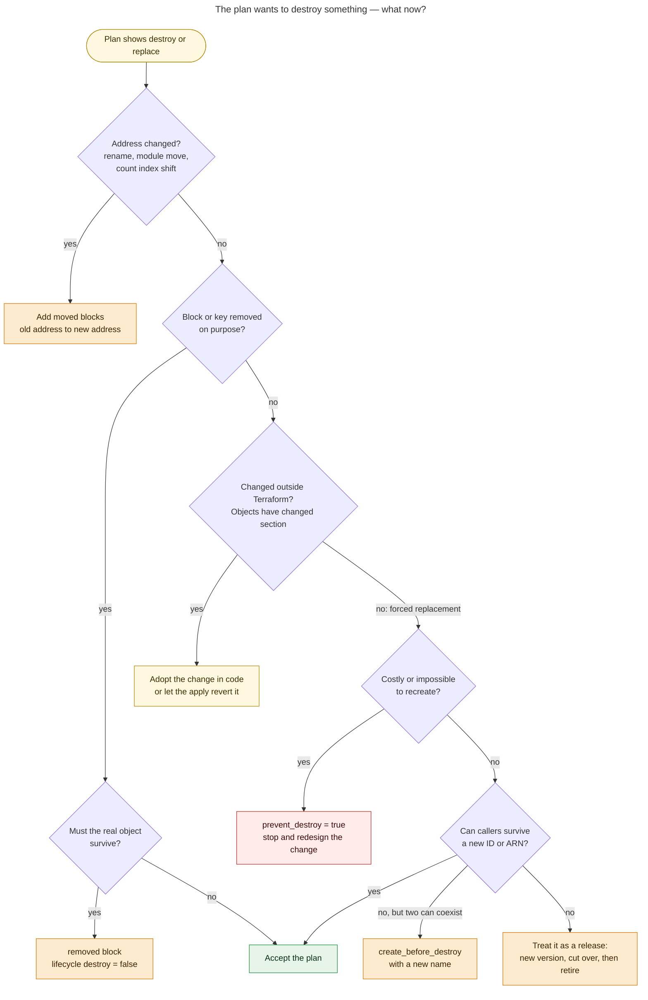

# Lifecycle rules, import, moved and removed blocks

> **Level:** Intermediate · **Verified:** 2026-11-15 · **Feature status:** n/a · **Time:** ~30 min

Terraform decides what to create, update, replace and destroy by comparing configuration with state. This chapter covers the tools that change that decision: `lifecycle` rules on a resource, and the `import`, `moved` and `removed` blocks that edit state through reviewed code instead of ad hoc commands. For Bedrock they matter more than usual, because several resources are jobs, immutable versions or objects without an update API.

## Learning objectives

After this chapter you can:

- Choose the `lifecycle` rule that fits a Bedrock resource: `prevent_destroy`, `create_before_destroy`, `ignore_changes`, `replace_triggered_by`, conditions, or `destroy = false`.
- Adopt existing Bedrock resources with `import` blocks, including `for_each` imports, and know when `-generate-config-out` helps.
- Discover importable Bedrock resources with `terraform query`, and name which types provider 6.73.0 can list.
- Refactor addresses with `moved` and stop managing objects with `removed`, without destroying anything.
- Work through a plan that wants to destroy something and pick the right response.

## Prerequisites

- [for_each, count and dynamic blocks](06-for-each-count-dynamic.md) — instance keys and addresses.
- [State, remote backends and state locking](04-state-backends-locking.md) — what state records.
- [Amazon Bedrock Guardrails](../../01-amazon-bedrock/guardrails/01-guardrails.md) and [Batch inference](../../01-amazon-bedrock/inference/08-batch-inference.md) — the resources in the examples.

## Concept in plain language

State is Terraform's inventory: "the thing at this address is that real object". Most of the time you change the configuration and Terraform changes the world to match. Sometimes you want to change the *inventory* instead:

- **import** — "this object already exists; put it in the inventory under this address."
- **moved** — "I relabelled the shelf; the object did not change."
- **removed** — "take this off the inventory, but leave the object where it is."

**Lifecycle rules** are house rules for one resource: never throw this away, build the replacement before removing the old one, ignore what another team changes, rebuild this when that changes.

## How it really works

### Lifecycle rules

| Rule | Effect | Bedrock use |
|:--|:--|:--|
| `prevent_destroy = true` | Any plan that destroys the object fails | `aws_bedrock_custom_model` — destroying it deletes the model the job produced |
| `create_before_destroy = true` | Replacement creates the new object first | `aws_bedrock_inference_profile` — no update API, so changes replace it; give the new copy a new name in case names must be unique |
| `ignore_changes = [...]` | Listed attributes are set at create, ignored at update | `aws_bedrockagentcore_agent_runtime.agent_runtime_artifact` when an application pipeline rolls out images |
| `replace_triggered_by = [...]` | Replace when a referenced *managed resource* changes | `aws_bedrock_guardrail_version` — publish a new version whenever the DRAFT changes |
| `precondition` / `postcondition` | Custom checks before or after the object is planned | Reject the guardrail STANDARD tier without `cross_region_config` |
| `destroy = false` (Terraform 1.16+) | Replacement or removal "forgets" the old object instead of deleting it | Keep old objects that callers still use |

> [!NOTE]
> **Documented fact** — Lifecycle settings accept only literal values, because they are processed while the graph is built. Except for `create_before_destroy`, lifecycle rules are not recorded in state, so `prevent_destroy` does **not** stop a destroy if you delete the resource block itself. `create_before_destroy` propagates to the resources a resource depends on. `replace_triggered_by` accepts only references to managed resources; use `terraform_data` to trigger on a plain value.
> Source: [lifecycle reference](https://developer.hashicorp.com/terraform/language/meta-arguments/lifecycle)

**What "destroy" means for Bedrock resources.** Several carry a provider-level `skip_destroy` argument, similar to Terraform 1.16's `destroy = false`:

| Resource | What destroy does | Source |
|:--|:--|:--|
| `aws_bedrock_custom_model` | Stops an active customization job; if completed, **deletes the custom model**. Update changes only tags | [Provider docs](https://raw.githubusercontent.com/hashicorp/terraform-provider-aws/main/website/docs/r/bedrock_custom_model.html.markdown) |
| `aws_bedrock_model_invocation_job` | Stops a running batch job (`StopModelInvocationJob`); Bedrock cannot delete jobs. `skip_destroy` leaves it alone | [Provider docs](https://raw.githubusercontent.com/hashicorp/terraform-provider-aws/main/website/docs/r/bedrock_model_invocation_job.html.markdown) |
| `aws_bedrock_evaluation_job` | Stops a running evaluation job (`StopEvaluationJob`). `skip_destroy` leaves it alone | [Provider docs](https://raw.githubusercontent.com/hashicorp/terraform-provider-aws/main/website/docs/r/bedrock_evaluation_job.html.markdown) |
| `aws_bedrock_guardrail_version` | Deletes the numbered version unless `skip_destroy = true` | [Provider docs](https://raw.githubusercontent.com/hashicorp/terraform-provider-aws/main/website/docs/r/bedrock_guardrail_version.html.markdown) |

> [!NOTE]
> **Documented fact** — A guardrail starts with a working draft (`DRAFT`). A version is a snapshot of the draft at the time you create it; changes to the draft are not reflected in applications until they use the new version. Versions are not separate resources and have no ARN of their own.
> Source: [Test your guardrail](https://docs.aws.amazon.com/bedrock/latest/userguide/guardrails-test.html), [Deploy your guardrail](https://docs.aws.amazon.com/bedrock/latest/userguide/guardrails-deploy.html)

### import blocks

An `import` block (Terraform 1.5+) has `to` (the address), `id` *or* `identity`, and optionally `for_each` and `provider`; the ID must be known at plan time, and Terraform 1.16 allows `import` blocks inside modules. The `id` format is per resource type: `"<guardrail_id>,<version>"` (normally `DRAFT`) for `aws_bedrock_guardrail`, `"<guardrail_arn>,<version>"` for `aws_bedrock_guardrail_version`. Job-like resources (`aws_bedrock_custom_model`, `_model_invocation_job`, `_evaluation_job`) also accept `identity = { job_arn = ... }` from Terraform 1.12, per the provider documentation.

`terraform plan -generate-config-out=generated.tf` writes `resource` blocks for imports that have no configuration yet. HashiCorp still labels configuration generation **experimental**, the file must not already exist, and the output is a starting point to edit, not finished code. Sources: [import block](https://developer.hashicorp.com/terraform/language/block/import), [generating configuration](https://developer.hashicorp.com/terraform/language/import/generating-configuration), [v1.16 changelog](https://raw.githubusercontent.com/hashicorp/terraform/v1.16/CHANGELOG.md).

### terraform query and list resources

Terraform 1.14 added `list` blocks in `*.tfquery.hcl` files and the `terraform query` command, which reads existing infrastructure and can write `import` plus `resource` blocks with `-generate-config-out`. A `list` block needs `provider`; it supports `count`/`for_each`, `limit` (default 100), `include_resource` and a provider-specific `config` block. Sources: [terraform query](https://developer.hashicorp.com/terraform/cli/commands/query), [list block](https://developer.hashicorp.com/terraform/language/block/tfquery/list).

Only some Bedrock types can be listed. In provider 6.73.0 the Bedrock-family list resources are:

| Area | Listable types |
|:--|:--|
| Bedrock control plane | `aws_bedrock_evaluation_job`, `aws_bedrock_guardrail_resource_policy`, `aws_bedrock_model_invocation_job` |
| AgentCore | `aws_bedrockagentcore_browser_profile`, `_evaluator`, `_gateway_rule` (needs `gateway_identifier`), `_harness`, `_online_evaluation_config`, `_policy` (needs `policy_engine_id`), `_policy_engine`, `_registry`, `_resource_policy` |
| Data Automation | `aws_bedrockdataautomation_blueprint`, `_library`, `_project` |

Guardrails, inference profiles, knowledge bases, agents and AgentCore runtimes and gateways are **not** listable in 6.73.0; you find their IDs another way and write `import` blocks by hand. Source: [generated Terraform reference](../../references/terraform-aws-provider-bedrock.md).

### moved and removed blocks

A `moved` block (Terraform 1.1+; `from`, `to`) renames an address in state before planning, so nothing is destroyed. It handles renames, moving into or out of modules, and switching between no meta-argument, `count` and `for_each` when you name instance keys. Removing a `moved` block later is a breaking change for anyone who has not applied it yet. A `removed` block (Terraform 1.7+; `from`, plus `lifecycle { destroy = ... }`) takes an object out of state; with `destroy = false` the real object is left untouched. Sources: [feature verification matrix, section C](../../FEATURE-VERIFICATION.md#c-infrastructure-as-code-tooling), [moved block](https://developer.hashicorp.com/terraform/language/block/moved), [refactor modules](https://developer.hashicorp.com/terraform/language/modules/develop/refactoring), [removed block](https://developer.hashicorp.com/terraform/language/block/removed).

## Architecture diagram



**What this shows** — A decision path for any `-` or `-/+` line in a plan. Most unwanted destroys are address problems (fixed with `moved` or `removed`), not infrastructure problems.

**Walkthrough**

1. **Address changes** — a renamed resource, a `count` index shift, a `count` → `for_each` conversion or a module extraction: write `moved` blocks and re-plan until the destroy disappears.
2. **Intentional removal** — if the real object must outlive Terraform's management (a finished batch job, a resource another team now owns), use `removed` with `destroy = false`; otherwise the destroy is what you asked for.
3. **Drift** — the plan's "Objects have changed outside of Terraform" section explains it; handled in [Plan, apply and drift detection](08-plan-apply-drift.md).
4. **Forced replacement** — the plan shows `-/+` for an argument that cannot be updated in place. If the object is expensive (a completed fine-tuning job), stop; `prevent_destroy` should already have failed the plan. If callers hold the ID or ARN, use `create_before_destroy` when two copies can coexist, or plan a versioned cut-over.

| Legend | Meaning |
|:--|:--|
| Rounded box | Starting point |
| Diamond | Question to answer from the plan |
| Orange | Configuration change you make |
| Red | Safety control |
| Yellow | Investigate before acting |

**Variations** — Terraform 1.16+ also lets you put `destroy = false` in a resource's own `lifecycle`; the plan then shows `./+` ("forget and then create replacement") instead of `-/+`.

## Implementation details

1. **Adopting console-built resources:** find IDs (console, `terraform query` where listable), write `import` blocks — with `for_each` for several — then run `terraform plan`. Iterate until the plan shows only `import` actions and no changes; then apply. **Our reading:** once the address is in state an `import` block has nothing left to do, so delete it or keep it as a record.
2. **Refactoring:** add `moved` blocks in the same change as the refactor, run `terraform plan`, and confirm every line reads "has moved to". Because removing a `moved` block is a breaking change, the academy keeps them for at least one major version of a shared module.
3. **Retiring:** a reviewed `removed` block, not `terraform state rm`, so the hand-off shows in code review.
4. **Guarding:** `prevent_destroy` on expensive objects, backed by CI policy checks ([Policy validation, cost estimation and human approval](../../07-devops-and-cicd/06-policy-cost-and-approvals.md)), because deleting the block bypasses it.
5. **`terraform query`** needs credentials; `terraform validate -query` checks query files offline.

> [!TIP]
> **Academy recommendation** — For guardrails, let Terraform own the DRAFT and publish a numbered version on every change (`replace_triggered_by` plus `skip_destroy`), and have applications pin the version output. Never point production at `DRAFT`. This is our design guidance, not an official AWS reference architecture.

The academy's [`bedrock-guardrail` module](modules/bedrock-guardrail/README.md) uses a refinement: it triggers on a `terraform_data` fingerprint of the policy inputs rather than on the guardrail itself, so tag or description edits do not publish a new version.

## Example

> **Code status:** validated with `terraform validate` and `terraform validate -query` (Terraform 1.17.2, provider 6.73.0), TFLint 0.66 · mock-tested: `terraform test`, 3 runs pass · plan outputs below come from local runs against the built-in `terraform_data` resource only · `terraform query` and `-generate-config-out` are **illustrative** (they need AWS credentials) · **never planned or applied against AWS** · never deployed

Variables (`guardrails`, `existing_guardrail_ids`, `agent_runtime_role_arn`, `agent_image_uri`, `custom_model`) are typed inputs; `versions.tf` is the academy standard. The one that shapes the example:

```hcl
# variables.tf (excerpt)
variable "guardrails" {
  description = "Guardrails keyed by name. Each one gets a published, numbered version."
  type = map(object({
    description           = string
    tier                  = optional(string, "CLASSIC") # CLASSIC or STANDARD
    guardrail_profile_arn = optional(string)            # required by the STANDARD tier
  }))
}

variable "existing_guardrail_ids" {
  description = "Guardrails created outside Terraform, keyed like var.guardrails, to adopt with import blocks. Values are guardrail IDs."
  type        = map(string)
  default     = {}
}
```

```hcl
# main.tf
resource "aws_bedrock_guardrail" "this" {
  for_each = var.guardrails

  name                      = each.key
  description               = each.value.description
  blocked_input_messaging   = "Sorry, I can't help with that request."
  blocked_outputs_messaging = "Sorry, I can't provide that answer."

  content_policy_config {
    filters_config {
      type            = "HATE"
      input_strength  = "HIGH"
      output_strength = "HIGH"
    }
    tier_config {
      tier_name = each.value.tier
    }
  }

  dynamic "cross_region_config" {
    for_each = each.value.guardrail_profile_arn == null ? [] : [each.value.guardrail_profile_arn]
    content {
      guardrail_profile_identifier = cross_region_config.value
    }
  }

  lifecycle {
    precondition {
      condition     = each.value.tier != "STANDARD" || each.value.guardrail_profile_arn != null
      error_message = "Guardrail ${each.key}: the STANDARD tier requires cross_region_config (set guardrail_profile_arn)."
    }
  }
}

# A numbered version is an immutable snapshot of the DRAFT. Whenever Terraform changes
# the DRAFT, replace this resource so that a new version is published. skip_destroy keeps
# the old version in Bedrock, so applications pinned to it keep working.
resource "aws_bedrock_guardrail_version" "this" {
  for_each = aws_bedrock_guardrail.this

  guardrail_arn = each.value.guardrail_arn
  description   = "Published by Terraform"
  skip_destroy  = true

  lifecycle {
    replace_triggered_by = [aws_bedrock_guardrail.this[each.key]]
  }
}

# Split ownership: Terraform creates the runtime, the application pipeline rolls out images.
resource "aws_bedrockagentcore_agent_runtime" "agent" {
  agent_runtime_name = "support_agent"
  role_arn           = var.agent_runtime_role_arn

  agent_runtime_artifact {
    container_configuration {
      container_uri = var.agent_image_uri
    }
  }

  network_configuration {
    network_mode = "PUBLIC"
  }

  lifecycle {
    ignore_changes = [agent_runtime_artifact]
  }
}

# Destroying this resource deletes the custom model that the job produced.
resource "aws_bedrock_custom_model" "support" {
  custom_model_name     = "support-tuned"
  job_name              = "support-tuning-1"
  base_model_identifier = var.custom_model.base_model_identifier # a foundation-model ARN
  role_arn              = var.custom_model.role_arn
  hyperparameters       = var.custom_model.hyperparameters

  training_data_config {
    s3_uri = var.custom_model.training_s3_uri
  }

  output_data_config {
    s3_uri = var.custom_model.output_s3_uri
  }

  lifecycle {
    prevent_destroy = true
  }
}
```

```hcl
# refactor.tf
# 1. Refactoring: the configuration used to declare one guardrail, aws_bedrock_guardrail.chat.
#    It now uses for_each. Without these blocks Terraform would destroy and recreate it.
moved {
  from = aws_bedrock_guardrail.chat
  to   = aws_bedrock_guardrail.this["chat"]
}

moved {
  from = aws_bedrock_guardrail_version.chat
  to   = aws_bedrock_guardrail_version.this["chat"]
}

# 2. Adoption: guardrails someone created in the console. The provider's import ID for
#    aws_bedrock_guardrail is "<guardrail_id>,<version>"; DRAFT is the working copy.
import {
  for_each = var.existing_guardrail_ids
  to       = aws_bedrock_guardrail.this[each.key]
  id       = "${each.value},DRAFT"
}

# 3. Hand-off: a batch inference job that has finished. Stop tracking it without calling
#    StopModelInvocationJob, and without touching its output in Amazon S3.
removed {
  from = aws_bedrock_model_invocation_job.nightly_eval

  lifecycle {
    destroy = false
  }
}
```

```hcl
# bedrock.tfquery.hcl — run with `terraform query` (needs credentials)
variable "policy_engine_ids" {
  type    = set(string)
  default = []
}

list "aws_bedrock_model_invocation_job" "batch_jobs" {
  provider = aws
  limit    = 50
}

list "aws_bedrockagentcore_harness" "harnesses" {
  provider         = aws
  include_resource = true
}

list "aws_bedrockagentcore_policy" "policies" {
  for_each = var.policy_engine_ids
  provider = aws

  config {
    policy_engine_id = each.value
  }
}
```

Illustrative workflow (not run here — it calls AWS):

```bash
terraform query                                        # print what exists
terraform query -generate-config-out=to-import/jobs.tf # write import + resource blocks
terraform plan -generate-config-out=generated.tf       # for hand-written import blocks
```

The test file exercises the precondition with `expect_failures` and pins the one-version-per-guardrail contract:

```hcl
# tests/lifecycle.tftest.hcl
mock_provider "aws" {}

variables {
  guardrails = {
    chat = { description = "Customer chat" }
    docs = { description = "Document summaries" }
  }
  agent_runtime_role_arn = "arn:aws:iam::111122223333:role/agent-runtime"
  agent_image_uri        = "111122223333.dkr.ecr.us-east-1.amazonaws.com/support-agent:1.0.0"
  custom_model = {
    base_model_identifier = "arn:aws:bedrock:us-east-1::foundation-model/example.base-model-v1:0"
    role_arn              = "arn:aws:iam::111122223333:role/bedrock-customization"
    training_s3_uri       = "s3://amzn-s3-demo-bucket/train/data.jsonl"
    output_s3_uri         = "s3://amzn-s3-demo-bucket/output/"
    hyperparameters       = { epochCount = "2" }
  }
}

run "one_version_per_guardrail" {
  command = plan

  assert {
    condition     = keys(aws_bedrock_guardrail_version.this) == ["chat", "docs"]
    error_message = "Each guardrail needs exactly one published version, keyed by name."
  }

  assert {
    condition     = alltrue([for v in aws_bedrock_guardrail_version.this : v.skip_destroy])
    error_message = "Old versions must survive replacement."
  }
}

run "standard_tier_needs_a_guardrail_profile" {
  command = plan

  variables {
    guardrails = {
      chat = { description = "Customer chat", tier = "STANDARD" }
    }
  }

  expect_failures = [aws_bedrock_guardrail.this]
}

run "standard_tier_with_profile_passes" {
  command = plan

  variables {
    guardrails = {
      chat = {
        description           = "Customer chat"
        tier                  = "STANDARD"
        guardrail_profile_arn = "arn:aws:bedrock:us-east-1:111122223333:guardrail-profile/us.guardrail.v1:0"
      }
    }
  }

  assert {
    condition     = length(aws_bedrock_guardrail.this["chat"].cross_region_config) == 1
    error_message = "The STANDARD tier must carry cross_region_config."
  }
}
```

The mock provider still enforces provider-side validation: a first draft passed a bare model ID to `base_model_identifier` and the test failed with "Invalid ARN Value" — a real bug caught offline.

What `moved` and `removed` look like in a plan (local `terraform_data` run, Terraform 1.17.2):

```text
  # terraform_data.chat has moved to terraform_data.guardrail["chat"]
 # terraform_data.nightly_job will no longer be managed by Terraform, but will not be destroyed
 # (destroy = false is set in the configuration)
Plan: 0 to add, 0 to change, 0 to destroy.
```

And what `prevent_destroy` and `destroy = false` do to a forced replacement:

```text
./+ forget and then create replacement
 # terraform_data.kept must be replaced, but the existing object will not be destroyed
Error: Instance cannot be destroyed
Resource terraform_data.custom_model has lifecycle.prevent_destroy set, but
the plan calls for this resource to be destroyed.
```

## Common mistakes

> [!WARNING]
> **Common mistake** — Relying on `prevent_destroy` alone. Deleting the resource block, or the module call around it, removes the rule with it and the next apply destroys the object. Back it with a CI policy that fails on destroy actions for protected types.

| Mistake | Symptom | Fix |
|:--|:--|:--|
| Converting to `for_each` without `moved` | Plan replaces every guardrail; new IDs | One `moved` block per old address |
| `terraform state rm` in a shell | Hand-off invisible in review; other workspaces still manage it | `removed` block with `destroy = false` |
| Destroying a finished `aws_bedrock_custom_model` | The trained model is deleted | `prevent_destroy`, or `removed` with `destroy = false` to keep the model unmanaged |
| `ignore_changes` on a whole resource's arguments to "fix" drift | Real misconfiguration never surfaces again | Ignore only the attribute another owner manages |
| Applications using guardrail `DRAFT` | Behaviour changes on every Terraform apply | Publish versions; pin the version number |
| Generated configuration committed unedited | Noisy, hard-coded values, sometimes conflicting arguments | Treat `-generate-config-out` output as a draft |

## Security considerations

- After `import`, the next apply enforces your configuration on the object. Review that first plan line by line.
- `ignore_changes` is a hole in your desired state: never ignore guardrail policies, KMS keys or IAM policies.
- Give the role that runs `terraform query` list and read permissions only.
- A `removed` block leaves a live object without an owner: record and tag who owns it next.

## Cost considerations

- `prevent_destroy` on `aws_bedrock_custom_model` and on committed Provisioned Throughput protects the most expensive mistakes in this course: re-training and re-purchasing.
- `create_before_destroy` briefly keeps two copies. For anything billed by the hour or by capacity (AgentCore Runtime instances, Provisioned Throughput) both copies bill until the old one is gone.
- A `removed` block with `destroy = false` keeps billing for the object; it just stops Terraform from tracking it.

## Knowledge check

1. You rename `aws_bedrock_guardrail.chat` to `aws_bedrock_guardrail.customer_chat`. What does the plan propose, what does that do to applications, and what do you add?
2. A teammate deletes the `aws_bedrock_custom_model` block that had `prevent_destroy = true`. Does the plan fail?
3. Why does the example use `replace_triggered_by` on the guardrail version instead of relying on a changed argument?
4. You need to adopt twenty existing guardrails. Can `terraform query` find them with provider 6.73.0? What do you do instead?
5. A batch inference job finished last week. Which block lets you stop tracking it, and what would a plain destroy have done if the job were still running?

<details>
<summary>Answers</summary>

1. Destroy and recreate it: new ID, new versions, and every application holding the old ID breaks. Add `moved { from = aws_bedrock_guardrail.chat  to = aws_bedrock_guardrail.customer_chat }`.
2. No. The rule lived in the deleted block and is not in state, so Terraform plans the destroy, deleting the trained model. Catch it with a CI policy, or use `removed` with `destroy = false`.
3. The version's own arguments (guardrail ARN, description) do not change when the DRAFT's policies do, so no new snapshot would ever be published. `replace_triggered_by` ties it to updates of the guardrail.
4. No — `aws_bedrock_guardrail` has no list resource in 6.73.0. Collect the IDs (console or `ListGuardrails`), then write one `import` block with `for_each` over a map of name → ID, using the `"<id>,DRAFT"` import format.
5. `removed { from = ... lifecycle { destroy = false } }`. A destroy would have called `StopModelInvocationJob` and stopped the running job.

</details>

## Further reading

Official sources opened while writing this chapter:

- [lifecycle meta-argument reference](https://developer.hashicorp.com/terraform/language/meta-arguments/lifecycle) — every rule, what is stored in state, literal-only values.
- [import block reference](https://developer.hashicorp.com/terraform/language/block/import) and [generating configuration](https://developer.hashicorp.com/terraform/language/import/generating-configuration) — `id`, `identity`, `for_each`, `-generate-config-out` and its limits.
- [terraform query command](https://developer.hashicorp.com/terraform/cli/commands/query), [list block reference](https://developer.hashicorp.com/terraform/language/block/tfquery/list) and [import resources in bulk](https://developer.hashicorp.com/terraform/language/import/bulk).
- [moved block reference](https://developer.hashicorp.com/terraform/language/block/moved) and [refactor modules](https://developer.hashicorp.com/terraform/language/modules/develop/refactoring) — renames, `count`/`for_each` conversion, module splits.
- [removed block reference](https://developer.hashicorp.com/terraform/language/block/removed) — `lifecycle { destroy }`.
- Terraform changelogs [v1.14](https://raw.githubusercontent.com/hashicorp/terraform/v1.14/CHANGELOG.md) (list resources, `terraform query`, `validate -query`) and [v1.16](https://raw.githubusercontent.com/hashicorp/terraform/v1.16/CHANGELOG.md) (`import` in modules, `lifecycle { destroy = false }`).
- Provider docs: [`aws_bedrock_guardrail`](https://raw.githubusercontent.com/hashicorp/terraform-provider-aws/main/website/docs/r/bedrock_guardrail.html.markdown), [`aws_bedrock_guardrail_version`](https://raw.githubusercontent.com/hashicorp/terraform-provider-aws/main/website/docs/r/bedrock_guardrail_version.html.markdown), [`aws_bedrock_custom_model`](https://raw.githubusercontent.com/hashicorp/terraform-provider-aws/main/website/docs/r/bedrock_custom_model.html.markdown), [`aws_bedrock_model_invocation_job`](https://raw.githubusercontent.com/hashicorp/terraform-provider-aws/main/website/docs/r/bedrock_model_invocation_job.html.markdown), [`aws_bedrock_evaluation_job`](https://raw.githubusercontent.com/hashicorp/terraform-provider-aws/main/website/docs/r/bedrock_evaluation_job.html.markdown).
- [Test your guardrail](https://docs.aws.amazon.com/bedrock/latest/userguide/guardrails-test.html), [Deploy your guardrail](https://docs.aws.amazon.com/bedrock/latest/userguide/guardrails-deploy.html) and [Create a version of a guardrail](https://docs.aws.amazon.com/bedrock/latest/userguide/guardrails-versions-create.html) — DRAFT and versions.
