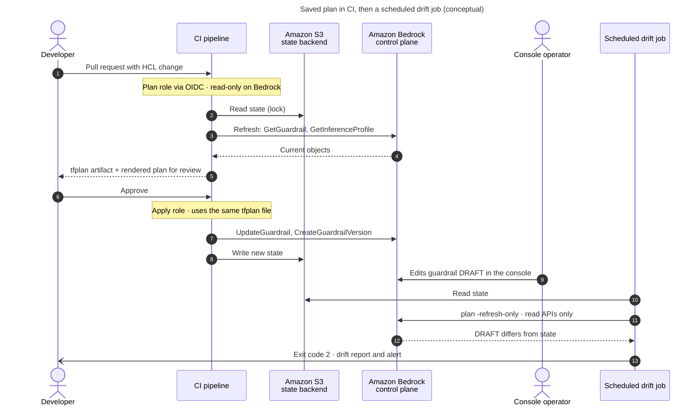

# Plan, apply and drift detection

> **Level:** Intermediate · **Verified:** 2026-11-15 · **Feature status:** n/a · **Time:** ~30 min

A Terraform plan is the only moment you see a change before it happens to a live Bedrock application. This chapter explains what `plan` and `apply` actually do, how to make the reviewed plan the one that runs, and how to find drift — including the Bedrock-specific kind, where someone edits a guardrail's working draft in the console or AWS changes a system-defined inference profile underneath you.

## Learning objectives

After this chapter you can:

- Describe the refresh, compare and propose steps of a plan, and the three planning modes.
- Read a plan: action symbols, "known after apply", and the section on objects changed outside Terraform.
- Run saved plans in CI so that the plan a reviewer approved is exactly the plan that is applied.
- Build a scheduled drift job with `-refresh-only` and `-detailed-exitcode`, and explain the risks of `-target`, `-replace`, `-refresh=false` and `-minimal-refresh`.
- Use `check` blocks and HCP Terraform health assessments to catch Bedrock drift that Terraform state cannot see.

## Prerequisites

- [State, remote backends and state locking](04-state-backends-locking.md)
- [Lifecycle rules, import, moved and removed blocks](07-lifecycle-import-moved-removed.md)
- [Amazon Bedrock Guardrails](../../01-amazon-bedrock/guardrails/01-guardrails.md) and [Cross-Region inference](../../01-amazon-bedrock/inference/04-cross-region-inference.md)

## Concept in plain language

A plan is a builder's quote: "here is what I will change, and why". You approve the quote, then the builder does exactly that work — not a new quote written on the day. **Drift** is what happens when someone repaints a wall between visits. The next quote either repaints it back, or you update the drawings to match the new colour. A drift job is a regular inspection that tells you about the repainting before the next renovation does.

## How it really works

**Plan.** By default `terraform plan` (1) reads the current state of every existing remote object, (2) compares configuration with that refreshed state, and (3) proposes actions that make the remote objects match the configuration. `apply` without a plan file does the same and asks for approval. Source: [plan command](https://developer.hashicorp.com/terraform/cli/commands/plan).

| Mode or option | What it does | Risk |
|:--|:--|:--|
| Normal | Refresh, compare, propose | — |
| `-destroy` | Plan to destroy everything in state | Obvious |
| `-refresh-only` | Only update state and outputs to match remote objects | Accepting it records the drift as the new truth |
| `-refresh=false` | Skip the refresh | Ignores external changes; plan may be wrong |
| `-minimal-refresh` (Terraform 1.17) | Refresh only resources that already have planned changes | Hides drift on everything else |
| `-replace=ADDRESS` | Force replacement of one instance | A new object: callers holding the old ID or ARN break |
| `-target=ADDRESS` | Plan only that address and its dependencies | Documented as for "exceptional circumstances"; leaves the rest unreconciled |
| `-out=FILE` | Save the plan for a later `apply FILE` | The file holds all values, including sensitive ones, in cleartext |
| `-detailed-exitcode` | Exit 0 = no changes, 1 = error, 2 = changes | Scripts must treat 2 as success-with-changes |

**Reading the output.** `+` create, `-` destroy, `~` update in place, `-/+` replace (destroy, then create). Values marked `(known after apply)` come from the API at apply time, so a plan cannot show them. Since Terraform 1.16, `./+` means "forget and then create replacement" for resources with `lifecycle { destroy = false }` (chapter 7). Plans also list `moved` and `removed` results before the action summary.

> [!NOTE]
> **Documented fact** — When you pass a saved plan to `terraform apply`, Terraform performs exactly those operations without prompting, and you cannot add planning modes or options. If an apply fails part-way, Terraform saves what it changed to state and stops; it does **not** roll back. Terraform 1.15 added an explicit error when a plan file created for one workspace is applied to another.
> Source: [apply command](https://developer.hashicorp.com/terraform/cli/commands/apply), [v1.15 changelog](https://raw.githubusercontent.com/hashicorp/terraform/v1.15/CHANGELOG.md)

**Two kinds of drift.** HashiCorp distinguishes *configuration drift* — an external change that makes the remote object differ from your configuration — from *state drift* — an external change that is still consistent with the configuration (for example a value Terraform does not manage). A normal plan reverts configuration drift; `-refresh-only` reconciles state drift. Source: [health assessments](https://developer.hashicorp.com/terraform/cloud-docs/workspaces/health).

**check blocks** run as the last step of every plan and apply. A failing assertion is a **warning**, never a blocking error, and a `data` block nested inside a `check` can be referenced only by that check; its provider errors also become warnings. Source: [check block](https://developer.hashicorp.com/terraform/language/block/check).

> [!IMPORTANT]
> **Status** — HCP Terraform health assessments (drift detection and continuous validation) are available in the Standard and Premium editions. They need remote or agent execution mode, Terraform 0.15.4+ for drift detection and 1.3.0+ for continuous validation, and a successful latest run; an errored run pauses them. Drift detection does not detect state drift. Continuous validation evaluates preconditions, postconditions and `check` blocks.
> Source: [Health assessments in HCP Terraform](https://developer.hashicorp.com/terraform/cloud-docs/workspaces/health)

### Drift in Bedrock resources

| What changed | Terraform sees it? | What to do |
|:--|:--|:--|
| Someone edits the guardrail's **DRAFT** in the console | Yes — `aws_bedrock_guardrail` shows an in-place update that reverts it | Decide: copy the change into code, or apply to revert. Applications pinned to a numbered version are unaffected either way |
| Someone **creates a numbered version** in the console | No — the version is not in state | Import it, or treat versions as Terraform-only (IAM) |
| AWS adds a destination Region to a **system-defined inference profile** | No — you do not manage that profile | A `check` block (example below): the invocation role must grant every destination Region |
| A batch or evaluation job **finishes** | Its computed `status` changes; no action is planned. **Our reading:** a refresh-only drift job reports it until state is refreshed | Retire finished jobs with a `removed` block |

> [!NOTE]
> **Documented fact** — A guardrail version is a snapshot of the working draft; later changes to the draft do not reach an application until it uses a new version. AWS recommends numbered versions in production: while `UpdateGuardrail` runs, the DRAFT is in an `UPDATING` state and inference calls that use it receive a `ValidationException`.
> Sources: [Test your guardrail](https://docs.aws.amazon.com/bedrock/latest/userguide/guardrails-test.html), [Best practices with Amazon Bedrock Guardrails (AWS blog, 2026-03-02)](https://aws.amazon.com/blogs/machine-learning/build-safe-generative-ai-applications-like-a-pro-best-practices-with-amazon-bedrock-guardrails/)

So reverting console drift on a DRAFT that production uses is itself a short outage. That is one more reason to pin versions.

## Architecture diagram



**What this shows** — The reviewed plan and the applied plan are the same file, and drift is detected by a separate read-only job rather than discovered during the next change.

**Walkthrough**

1. A developer opens a pull request.
2. CI reads and locks state in Amazon S3.
3. CI refreshes the Bedrock objects it manages.
4. Bedrock returns their current configuration.
5. CI publishes the plan file and a rendered plan for review.
6. A reviewer approves.
7. The apply stage applies that exact file: the DRAFT is updated and a new version published.
8. State is written back.
9. Later, an operator edits the DRAFT in the console.
10. The drift job reads state.
11. It runs a refresh-only plan, calling only read APIs.
12. Bedrock returns the edited DRAFT.
13. The job exits with code 2 and raises an alert.

| Legend | Meaning |
|:--|:--|
| Solid arrow | Request |
| Dashed arrow | Response |
| Open arrow | Asynchronous notification |
| Notes | Security controls (roles, permissions) |

**Variations** — In HCP Terraform, steps 10–13 are what a health assessment does on its own schedule. CI-specific wiring (GitHub Actions, CodePipeline) is in [From developer change to drift detection: the pipeline](../../07-devops-and-cicd/01-pipeline-overview.md).

## Implementation details

1. **Plan once, apply that plan.** Store `tfplan` as a protected artifact with the rendered text and JSON. The apply job downloads it and runs `terraform apply tfplan`. Never re-plan in the apply job.
2. **Gate on the JSON.** `terraform show -json tfplan` gives `resource_changes[].change.actions`; a replacement contains both `delete` and `create`. A small gate (below) blocks unreviewed deletions.
3. **Separate roles.** The plan role reads; the apply role writes. The drift job uses the plan role.
4. **Drift job.** Schedule `plan -refresh-only -detailed-exitcode`; exit 2 means drift. A normal `plan -detailed-exitcode` also reports unapplied code changes — useful, but a different question.
5. **Respond to drift deliberately:** either change the code to match and apply, or apply the existing code to revert. Accepting a refresh-only plan only updates state.
6. **Avoid `-target` and `-minimal-refresh` in routine pipelines.** Both leave parts of the configuration unchecked.

> [!TIP]
> **Academy recommendation** — Run the drift job daily for production and route exit code 2 to the team that owns the workspace, not to a shared channel. Treat any guardrail drift as a security event until explained. This is our design guidance, not an official AWS reference architecture.

## Example

> **Code status:** shell scripts syntax-checked (`bash -n`); the drift script and the destroy gate were run locally against a `terraform_data` configuration and its plan JSON · Terraform validated (Terraform 1.17.2, provider 6.73.0), TFLint 0.66 · mock-tested: `terraform test`, 2 runs pass · **never planned or applied against AWS** · never deployed

**CI: one plan, one apply.**

```bash
#!/usr/bin/env bash
# ci-plan-apply.sh — two pipeline stages sharing one artifact.
set -euo pipefail

stage="${1:?usage: ci-plan-apply.sh plan|apply}"

if [ "$stage" = "plan" ]; then
  terraform init -input=false -lockfile=readonly
  terraform plan -input=false -no-color -out=tfplan
  terraform show -no-color tfplan > tfplan.txt     # for the human reviewer
  terraform show -json tfplan > tfplan.json        # for policy and cost checks
  # Upload tfplan, tfplan.txt and tfplan.json as one protected artifact.
else
  # Download the same tfplan artifact; never re-plan here.
  terraform init -input=false -lockfile=readonly
  terraform apply -input=false -no-color tfplan
fi
```

**Destroy gate on the plan JSON.**

```bash
#!/usr/bin/env bash
# destroy-gate.sh — fail if the saved plan deletes or replaces anything, unless a reviewer opted in.
set -euo pipefail
plan_json="${1:-tfplan.json}"

deletes=$(jq -r '.resource_changes[]
  | select(.change.actions | index("delete"))
  | "\(.change.actions | join("/"))\t\(.address)"' "$plan_json")

if [ -z "$deletes" ]; then
  echo "No deletions in plan."
  exit 0
fi

echo "This plan deletes or replaces:"
echo "$deletes"
if [ "${ALLOW_DESTROY:-false}" != "true" ]; then
  echo "Set ALLOW_DESTROY=true after review to continue." >&2
  exit 1
fi
echo "ALLOW_DESTROY=true: continuing."
```

Run against the plan from [chapter 6's](06-for-each-count-dynamic.md) `count` demonstration:

```text
This plan deletes or replaces:
delete/create	terraform_data.by_index[1]
delete	terraform_data.by_index[2]
delete	terraform_data.by_key["search"]
Set ALLOW_DESTROY=true after review to continue.
```

**Scheduled drift job.**

```bash
#!/usr/bin/env bash
# drift-check.sh — read-only, never applies. Run with a role that can read, not change.
#   exit 0 = no drift, 2 = drift found (report it), anything else = the job failed.
set -uo pipefail

terraform init -input=false -lockfile=readonly >/dev/null || exit 1

terraform plan -refresh-only -input=false -no-color -lock-timeout=5m \
  -detailed-exitcode -out=drift.tfplan > drift.txt
rc=$?

case "$rc" in
  0) echo "No drift." ;;
  2) echo "Drift detected:"; cat drift.txt
     terraform show -json drift.tfplan > drift.json   # attach to the ticket or alert
     ;;
  *) echo "Drift job failed (exit $rc)." >&2; cat drift.txt >&2 ;;
esac
exit "$rc"
```

**A check block for drift Terraform cannot see.** The invocation role from the [running example module](modules/bedrock-invocation-role/README.md) must grant the foundation model in *every* destination Region of an inference profile. AWS owns system-defined profiles, so a new destination Region is not drift in your state — but calls routed there fail. This check warns on every plan and on every HCP health assessment.

```hcl
# main.tf (variables: inference_profile_id, foundation_model_ids, model_regions)
data "aws_region" "current" {}

data "aws_caller_identity" "current" {}

module "invoke_role" {
  source = "../../04-infrastructure-as-code/terraform/modules/bedrock-invocation-role"

  name                 = "chat-invoke"
  trusted_services     = ["lambda.amazonaws.com"]
  foundation_model_ids = var.foundation_model_ids
  model_regions        = var.model_regions
  inference_profile_arns = [
    "arn:aws:bedrock:${data.aws_region.current.region}:${data.aws_caller_identity.current.account_id}:inference-profile/${var.inference_profile_id}",
  ]
  restrict_to_inference_profiles = true
}

# AWS owns the system-defined profile and can add destination Regions to it.
# That is not Terraform drift (nothing in state changed), but it breaks the role.
# A check block reports it as a warning on every plan, apply and health assessment.
check "profile_regions_are_granted" {
  data "aws_bedrock_inference_profile" "routing" {
    inference_profile_id = var.inference_profile_id
  }

  assert {
    condition = alltrue([
      for m in data.aws_bedrock_inference_profile.routing.models :
      contains(var.model_regions, split(":", m.model_arn)[3])
    ])
    error_message = "Inference profile ${var.inference_profile_id} routes to a Region missing from var.model_regions. Calls routed there will fail with AccessDenied until the role grants it."
  }
}
```

The test swaps in a second mock provider that "adds" `us-east-2`, and expects the check to fail. Mock data lives in shared `.tfmock.hcl` files.

```hcl
# tests/check.tftest.hcl
mock_provider "aws" {
  source = "./tests/mocks/two-regions"
}

mock_provider "aws" {
  alias  = "expanded"
  source = "./tests/mocks/three-regions"
}

variables {
  inference_profile_id = "us.example.model-a-v1:0"
  foundation_model_ids = ["example.model-a-v1:0"]
  model_regions        = ["us-east-1", "us-west-2"]
}

run "all_destination_regions_granted" {
  command = plan
}

run "aws_added_a_destination_region" {
  command = plan

  providers = {
    aws = aws.expanded
  }

  expect_failures = [check.profile_regions_are_granted]
}
```

```hcl
# tests/mocks/two-regions/aws.tfmock.hcl (three-regions adds a us-east-2 model ARN)
mock_data "aws_partition" {
  defaults = {
    partition = "aws"
  }
}

mock_data "aws_region" {
  defaults = {
    region = "us-east-1"
  }
}

mock_data "aws_bedrock_inference_profile" {
  defaults = {
    models = [
      { model_arn = "arn:aws:bedrock:us-east-1::foundation-model/example.model-a-v1:0" },
      { model_arn = "arn:aws:bedrock:us-west-2::foundation-model/example.model-a-v1:0" },
    ]
  }
}
```

As a control, narrowing `model_regions` to `["us-east-1"]` makes the first run fail with "Check block assertion failed", which proves the check is evaluated rather than skipped.

**Variations** — The condition assumes Geo profiles, whose model ARNs carry a Region. Global profiles also use the Region-less foundation-model ARN ([Cross-Region inference](../../01-amazon-bedrock/inference/04-cross-region-inference.md)), so adapt the condition before using it there.

## Common mistakes

> [!WARNING]
> **Common mistake** — Running `terraform apply -auto-approve` in the deploy job after a separate `plan` job. The apply makes a fresh plan, so what runs is not what was reviewed. Pass the saved plan file instead.

| Mistake | Symptom | Fix |
|:--|:--|:--|
| Treating `-detailed-exitcode` 2 as failure | Pipeline fails whenever there are changes | 0 = none, 2 = changes, 1 = error |
| Accepting a refresh-only plan to "fix" drift | State now records the console edit; the code still disagrees | Change the code, or apply the code to revert |
| Plan files in an unprotected artifact store | Sensitive values exposed | Restrict access and retention; encrypt |
| `-target` in routine deploys | Unreconciled resources, surprise diffs later | Split configurations instead |
| Production calls the guardrail `DRAFT` | Every apply changes behaviour and briefly blocks calls | Pin a numbered version |

## Security considerations

- Plan files contain every value of the plan in cleartext — treat them like secrets.
- Separate identities: read-only for plan and drift, write for apply, both through OIDC ([ADR-014](../../ARCHITECTURE-DECISIONS.md#adr-014-pipelines-use-oidc-and-pin-actions-by-commit-sha)).
- Guardrail drift changes what content reaches users. Alert on it, and restrict `bedrock:UpdateGuardrail` in production to the apply role.
- `check` warnings do not block applies. Use preconditions or CI gates for anything that must block.

## Cost considerations

- A plan refreshes every managed object through read APIs; very large states make plans slow and can hit API throttling. Split configurations rather than reaching for `-refresh=false`.
- HCP Terraform health assessments are tied to paid editions; the self-run drift job costs only CI minutes.
- The cheapest drift is the one prevented: limit console write access to Bedrock in production accounts.

## Knowledge check

1. A pipeline runs `terraform plan` in one job and `terraform apply -auto-approve` in the next. What can go wrong between them, and how do you fix it?
2. Your drift job exits with code 2 because someone tightened a guardrail's word filter in the console, and the security team wants to keep it. What do you do?
3. Why can't a normal plan detect that AWS added a Region to the `us.` profile your application uses, and what does?
4. A colleague proposes `-minimal-refresh` to speed up plans. What do you lose?

<details>
<summary>Answers</summary>

1. The second apply makes a new plan; anything that changed in between (code, state, remote objects) changes what runs, unreviewed. Save the plan with `-out` and apply that file.
2. Copy the change into the HCL and plan: the refreshed DRAFT now matches the code, so the guardrail shows no update — and therefore `replace_triggered_by` does not publish a version. Publish one deliberately with `terraform apply -replace='aws_bedrock_guardrail_version.this["chat"]'` (a legitimate use of `-replace`). Do not just accept a refresh-only plan.
3. You do not manage that profile, so nothing in your state changes. A `check` block with a nested `data "aws_bedrock_inference_profile"` evaluates it on every plan and health assessment.
4. Drift detection for every resource without planned changes — the refresh is skipped for them, so console edits go unnoticed until something else touches the resource.

</details>

## Further reading

Official sources opened while writing this chapter:

- [terraform plan command](https://developer.hashicorp.com/terraform/cli/commands/plan) — modes, options, `-detailed-exitcode`, saved plans, output symbols.
- [terraform apply command](https://developer.hashicorp.com/terraform/cli/commands/apply) — saved plan mode, error behaviour.
- [check block reference](https://developer.hashicorp.com/terraform/language/block/check) — scoped data sources, warnings.
- [Health assessments in HCP Terraform](https://developer.hashicorp.com/terraform/cloud-docs/workspaces/health) — drift detection, continuous validation, requirements.
- Terraform changelogs [v1.15](https://raw.githubusercontent.com/hashicorp/terraform/v1.15/CHANGELOG.md), [v1.16](https://raw.githubusercontent.com/hashicorp/terraform/v1.16/CHANGELOG.md) and [v1.17](https://raw.githubusercontent.com/hashicorp/terraform/v1.17/CHANGELOG.md) — workspace check on plan files, `destroy = false`, `-minimal-refresh`.
- [Test your guardrail](https://docs.aws.amazon.com/bedrock/latest/userguide/guardrails-test.html) and [Deploy your guardrail](https://docs.aws.amazon.com/bedrock/latest/userguide/guardrails-deploy.html) — DRAFT and versions.
- [Best practices with Amazon Bedrock Guardrails](https://aws.amazon.com/blogs/machine-learning/build-safe-generative-ai-applications-like-a-pro-best-practices-with-amazon-bedrock-guardrails/) — numbered versions in production.
- [Terraform tests — mocking](https://developer.hashicorp.com/terraform/language/tests/mocking) — `.tfmock.hcl` files and aliased mock providers.
