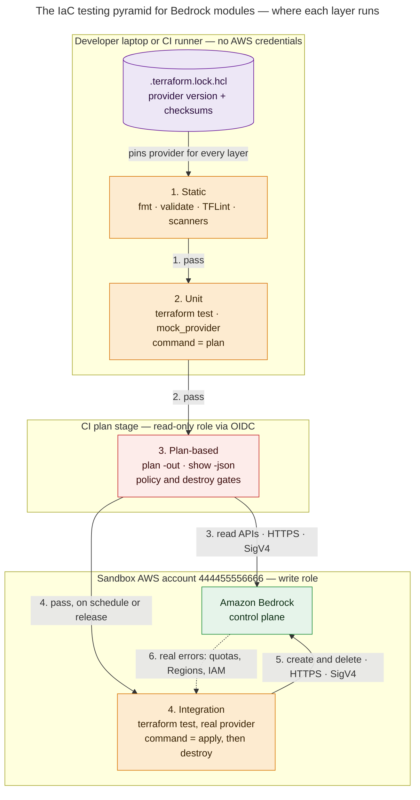

# Testing and version pinning

> **Level:** Intermediate · **Verified:** 2026-11-15 · **Feature status:** n/a · **Time:** ~30 min

Bedrock infrastructure code fails in two ways: the logic is wrong (a role grants the wrong Regions), or the ground moves (a provider upgrade changes a resource). Tests catch the first; version pinning and the dependency lock file control the second. This chapter walks through the testing pyramid for Terraform, the anatomy of a `terraform test` file using the academy's [`bedrock-invocation-role`](modules/bedrock-invocation-role/README.md) module, and how to pin and upgrade Terraform and providers safely.

## Learning objectives

After this chapter you can:

- Place a check in the right layer of the IaC testing pyramid and say which layers need AWS credentials.
- Read and write a `.tftest.hcl` file: `run`, `command`, `variables`, `assert`, `expect_failures`, `mock_provider`, `mock_data`, `mock_resource` and `override_resource`.
- Explain what a mock provider generates, and when `override_during = plan` is needed.
- Choose version constraints for root modules and reusable modules, and explain what the dependency lock file records.
- Upgrade a provider in a controlled way.

## Prerequisites

- [Modules](03-modules.md)
- [for_each, count and dynamic blocks](06-for-each-count-dynamic.md) and [Lifecycle rules, import, moved and removed blocks](07-lifecycle-import-moved-removed.md) — both contain test files you will now understand fully.

## Concept in plain language

Think of a theatre production. A spell-check of the script costs nothing and catches typos (**format, validate, lint**). A read-through with stand-ins checks the logic of every scene without a stage (**unit tests with mocks**). A dress rehearsal on the real stage shows what the lighting crew would actually do (**plan-based tests**). Opening night is real (**integration tests that create resources**). You run the cheap checks constantly and the expensive ones rarely.

**Version pinning** is agreeing which edition of the script everyone uses. The **lock file** is the stamp on the copy you rehearsed with, so nobody turns up with a newer edition by accident.

## How it really works

### The IaC testing pyramid

| Layer | Tools | Catches | AWS credentials? | Speed |
|:--|:--|:--|:-:|:--|
| 1. Static | `terraform fmt -check`, `terraform validate`, TFLint, security scanners | Syntax, types, unknown arguments, style, unused declarations, known misconfigurations | No | Seconds |
| 2. Unit | `terraform test` with `mock_provider` and `command = plan` (or `apply` against mocks) | Module logic: names, ARNs, policy documents, validations, conditions, `for_each` keys | No | Seconds |
| 3. Plan-based | `terraform plan -out`, `terraform show -json`, policy engines (OPA/Conftest, Terraform Policy), destroy gates | What would really change in a real account: replacements, deletions, policy violations | Yes (read) | Minutes |
| 4. Integration | `terraform test` with a real provider and `command = apply`; Terratest | Service-side validation: quotas, Region and model support, IAM propagation | Yes (write, sandbox account) | Minutes to hours, costs money |

> [!NOTE]
> **Documented fact** — `terraform validate` checks only the configuration, without remote services. In a test file, `run` blocks default to `command = apply`, which creates real infrastructure unless the provider is mocked; `command = plan` turns a run into a unit test. Each test file keeps its own state in memory, starting empty, and Terraform tries to destroy what a file created when it finishes.
> Source: [Tests](https://developer.hashicorp.com/terraform/language/tests), [terraform test command](https://developer.hashicorp.com/terraform/cli/commands/test)

Layer 1 found real issues in this course: TFLint flags an untyped variable and an unused one that `terraform validate` accepts (example below). Layer 2 found that `aws_bedrock_custom_model.base_model_identifier` must be an ARN — the mock provider still runs the provider's own validation ([chapter 7](07-lifecycle-import-moved-removed.md)). Layer 4 is the only layer that proves a configuration deploys; nothing in this academy has reached it ([ADR-003](../../ARCHITECTURE-DECISIONS.md#adr-003-validate-offline-never-deploy)).

### Test file anatomy

| Block or attribute | Where | Purpose |
|:--|:--|:--|
| `test { parallel = ... }` | File | File-level options |
| `variables { ... }` | File or `run` | Inputs; a `run` overrides the file. Test-file values take precedence over `-var` and `.tfvars` |
| `provider` / `mock_provider` | File | Real or mocked provider; `alias` for several; `source` loads shared `.tfmock.hcl` files |
| `run "name" { ... }` | File | One plan or apply; runs execute in order and share state |
| `command` | `run` | `apply` (default) or `plan` |
| `plan_options { mode, refresh, replace, target }` | `run` | Same options as the CLI, for example `mode = refresh-only` |
| `module { source = ... }` | `run` | Run a different (setup or loader) module |
| `providers = { ... }` | `run` | Choose which provider (or mock) this run uses |
| `assert { condition, error_message }` | `run` | Assertions on values, outputs and earlier `run.<name>` outputs |
| `expect_failures = [...]` | `run` | Pass only if these custom conditions fail: variables, resources, outputs, `check` blocks |
| `mock_resource` / `mock_data` | `mock_provider` | Default values for computed attributes of a type |
| `override_resource` / `override_data` / `override_module` | File, `run` or `mock_provider` | Fixed values for one address; the provider is not called |
| `override_during = plan` | Mock and override blocks | Make generated values known at plan time instead of `(known after apply)` |

> [!NOTE]
> **Documented fact** — A mock provider has the real provider's schema and generates values only for computed attributes; required arguments must still be set. Generated defaults are 0 for numbers, `false` for booleans, a random 8-character string for strings and empty collections. By default they appear during apply and are "known after apply" during plan, unless `override_during = plan` is set. Repeated nested blocks get one set of values shared by every instance.
> Source: [Tests — provider mocking](https://developer.hashicorp.com/terraform/language/tests/mocking)

Recent changes: functions are allowed inside mock blocks since Terraform 1.15, and `mock_provider` supports ephemeral resources since 1.17 ([v1.15](https://raw.githubusercontent.com/hashicorp/terraform/v1.15/CHANGELOG.md), [v1.17](https://raw.githubusercontent.com/hashicorp/terraform/v1.17/CHANGELOG.md) changelogs).

### Walking through the running example's tests

[`tests/policy.tftest.hcl`](modules/bedrock-invocation-role/tests/policy.tftest.hcl) has seven runs, all `command = plan`:

| Run | What it proves | Construct |
|:--|:--|:--|
| `direct_invocation_defaults` | 2 models × 2 Regions = 4 ARNs; streaming on; one statement; role name from `var.name` | `assert` on outputs and `aws_iam_role.this.name` |
| `streaming_can_be_disabled` | Only `bedrock:InvokeModel` when streaming is off | `variables` override in the run |
| `global_inference_adds_regionless_arns` | Region-less ARNs for Global profiles | `jsondecode(output.policy_json)` |
| `restricting_to_profiles_adds_condition` | `bedrock:InferenceProfileArn` condition present | Deep path into the policy |
| `required_guardrail_adds_explicit_deny` | Exactly one `Deny`; guardrail statement present | `for` expression with `if` |
| `rejects_wildcard_models` | `*` is refused | `expect_failures = [var.foundation_model_ids]` (validation) |
| `rejects_role_nobody_can_assume` | Empty trust is refused | `expect_failures = [aws_iam_role.this]` (precondition) |

Two design choices make this possible. The module builds its policies with `jsonencode` in `locals` rather than with a data source, so the whole document is computed offline. And the one data source it uses, `aws_partition`, is pinned with `mock_data` — otherwise its `partition` would be a random string and every ARN assertion would fail.

### Version constraints and the lock file

| Operator | Meaning | Example |
|:--|:--|:--|
| `=` or none | Exactly this version | `= 6.73.0` |
| `!=` | Exclude a version | `!= 6.70.0` |
| `>`, `>=`, `<`, `<=` | Comparisons | `>= 6.73.0, < 7.0.0` |
| `~>` | Only the right-most component may increase | `~> 6.73` allows 6.74, 6.99, not 7.0; `~> 6.73.0` allows 6.73.x only |

> [!NOTE]
> **Documented fact** — HashiCorp recommends that reusable modules declare only a minimum version (`>=`) and that root modules use `~>` to set both bounds. `terraform init` records the selected provider version, the constraints considered and package checksums (`h1:`, `zh:`) in `.terraform.lock.hcl`, and re-selects that version until you run `terraform init -upgrade`. The lock file tracks providers only, not modules; commit it to version control. A filesystem or network mirror can record checksums only for the platform you ran on; `terraform providers lock -platform=...` fills in the others.
> Source: [Version constraints](https://developer.hashicorp.com/terraform/language/expressions/version-constraints), [Provider requirements](https://developer.hashicorp.com/terraform/language/providers/requirements), [Dependency lock file](https://developer.hashicorp.com/terraform/language/files/dependency-lock), [providers lock](https://developer.hashicorp.com/terraform/cli/commands/providers/lock)

The academy deliberately deviates for its modules: they use `~> 6.73` rather than `>= 6.73`, because every module is validated against exactly one pinned provider schema ([ADR-006](../../ARCHITECTURE-DECISIONS.md#adr-006-pin-tool-versions-and-generate-iac-references-from-the-tools)). For modules you publish to other teams, follow HashiCorp's `>=` advice and let the root module set the upper bound.

> [!WARNING]
> **Common mistake** — Not committing `.terraform.lock.hcl`. This host repository's top-level `.gitignore` ignores it, and the academy's validation script deletes lock files it creates, because the academy validates against an offline mirror. That is a property of this repository, not a recommendation: **in a real project, commit the lock file** and review its diffs like code.

Terraform 1.17.0 also allows variables and locals in provider requirements ([changelog](https://raw.githubusercontent.com/hashicorp/terraform/v1.17/CHANGELOG.md)); the academy does not use it, because its code must run on Terraform 1.11 and later.

## Architecture diagram



**What this shows** — The bottom two layers need no account and run on every commit; credentials appear only at layer 3 (read) and layer 4 (write, in a sandbox account). The lock file makes every layer test the same provider build.

**Walkthrough**

1. Static checks pass, so unit tests run.
2. Unit tests pass, so CI makes a real plan.
3. The plan stage reads the real Bedrock control plane with a read-only role.
4. Integration tests run less often — nightly or before a release.
5. They create and destroy real resources in a sandbox account.
6. Only this layer sees service-side failures.

| Legend | Meaning |
|:--|:--|
| Solid arrow | Gate or request |
| Dashed arrow | Response |
| Cylinder | File committed with the code |
| Boxes | Where the layer runs and with which credentials |

**Variations** — Policy evaluation can also run on `terraform query` results and in HCP Terraform, where Terraform Policy is generally available from 1.17. The CI wiring for all four layers is in [Testing infrastructure code](../../07-devops-and-cicd/03-testing-iac.md).

## Implementation details

1. **Order in CI:** `fmt -check` → `init -lockfile=readonly` → `validate` → TFLint → `terraform test` (mocks) → plan and gates → apply. Fail fast at the first layer.
2. **Default to `command = plan`** in unit tests. A forgotten `command` with a real provider creates resources.
3. **Mock data sources you depend on** (`aws_partition`, `aws_region`, `aws_caller_identity`) with realistic values; generated random strings break ARN logic.
4. **Use `override_during = plan`** when an assertion needs a computed value (an ARN) at plan time — chapter 6's test does this for inference profile and guardrail ARNs.
5. **Share mocks** in `.tfmock.hcl` files and switch with aliased `mock_provider` blocks and `providers = {...}` per run — chapter 8's check test does this.
6. **Report:** `terraform test -junit-xml=results.xml` produces a file CI systems can display.
7. **Upgrades:** change the constraint, run `terraform init -upgrade`, read the provider changelog for every Bedrock resource you use, run all layers, and expect a plan with no changes. Commit constraint and lock file together.

> [!TIP]
> **Academy recommendation** — Give every reusable module at least one test file with plan-mode runs and a mock provider, and test the *negative* cases (`expect_failures`) as carefully as the positive ones. In CI, run `terraform init -lockfile=readonly` so a pipeline can never silently change provider versions. This is our design guidance, not an official AWS reference architecture.

## Example

> **Code status:** the extra test file was run with `terraform test` against a copy of the module (10 runs pass: 3 new + the module's 7) · validated with `terraform validate` (Terraform 1.17.2, provider 6.73.0) · TFLint 0.66 and lock-file outputs captured from local runs · **never planned or applied against AWS** · never deployed

**A second test file for the module** — apply-mode runs against mocks, a fixed value for one resource, and a different partition:

```hcl
# tests/apply_with_mocks.tftest.hcl
mock_provider "aws" {
  mock_data "aws_partition" {
    defaults = {
      partition = "aws-us-gov"
    }
  }
}

# Pin a computed attribute so outputs can be asserted exactly.
override_resource {
  target = aws_iam_role.this
  values = {
    arn = "arn:aws-us-gov:iam::111122223333:role/chat-invoke"
  }
}

variables {
  name                 = "chat-invoke"
  trusted_services     = ["lambda.amazonaws.com"]
  foundation_model_ids = ["example.model-a-v1:0"]
  model_regions        = ["us-gov-west-1"]
}

run "partition_comes_from_the_data_source" {
  command = plan

  assert {
    condition     = output.foundation_model_arns == ["arn:aws-us-gov:bedrock:us-gov-west-1::foundation-model/example.model-a-v1:0"]
    error_message = "ARNs must use the partition reported by aws_partition, never a hard-coded aws."
  }
}

run "apply_exposes_the_overridden_role_arn" {
  command = apply

  assert {
    condition     = output.role_arn == "arn:aws-us-gov:iam::111122223333:role/chat-invoke"
    error_message = "role_arn must pass the role's ARN through unchanged."
  }

  assert {
    condition     = aws_iam_role_policy.invoke.role == aws_iam_role.this.id
    error_message = "The inline policy must be attached to the module's own role."
  }
}

run "plan_after_apply_reuses_the_test_state" {
  command = plan

  variables {
    allow_streaming = false
  }

  assert {
    condition     = jsondecode(output.policy_json).Statement[0].Action == ["bedrock:InvokeModel"]
    error_message = "Turning streaming off must drop InvokeModelWithResponseStream."
  }
}
```

```text
$ terraform test
tests/apply_with_mocks.tftest.hcl... in progress
  run "partition_comes_from_the_data_source"... pass
  run "apply_exposes_the_overridden_role_arn"... pass
  run "plan_after_apply_reuses_the_test_state"... pass
tests/apply_with_mocks.tftest.hcl... tearing down
tests/apply_with_mocks.tftest.hcl... pass
tests/policy.tftest.hcl... in progress
  ...
Success! 10 passed, 0 failed.
```

**Layer 1 catches what `validate` does not.** A `.tflint.hcl` with the bundled Terraform ruleset:

```hcl
plugin "terraform" {
  enabled = true
  preset  = "recommended"
}
```

On a snippet with `variable "model_id" {}` and an unused `variable "unused_region"`, `terraform validate` reports success and TFLint reports:

```text
Warning: `model_id` variable has no type (terraform_typed_variables)
Warning: [Fixable] variable "unused_region" is declared but not used (terraform_unused_declarations)
```

The AWS-specific TFLint ruleset is a separate plugin; it could not be installed in the academy's offline build environment, so only the core rules were exercised.

**The lock file in practice.** Initialised from a filesystem mirror, the lock file holds one checksum, for the local platform only — exactly the limitation the documentation describes:

```hcl
provider "registry.terraform.io/hashicorp/aws" {
  version     = "6.73.0"
  constraints = "~> 6.73"
  hashes = [
    "h1:Jf7FuNLRB9cs3KvwJPMFGmE4C3lvwT/EuvQUo9gdDBc=",
  ]
}
```

Raising the constraint to `~> 6.74` without `-upgrade` stops a read-only init:

```text
Error: Failed to query available provider packages

Could not retrieve the list of available versions for provider hashicorp/aws:
locked provider registry.terraform.io/hashicorp/aws 6.73.0 does not match
configured version constraint ~> 6.74; must use terraform init -upgrade to
allow selection of new versions
```

**A controlled upgrade** (illustrative — needs registry access):

```bash
# 1. Change the constraint in versions.tf, then:
terraform init -upgrade
terraform providers lock -platform=linux_amd64 -platform=darwin_amd64 -platform=windows_amd64
# 2. Run every layer that needs no credentials.
terraform validate && tflint && terraform test
# 3. In CI with real credentials: expect "No changes." for an unchanged configuration.
terraform plan -detailed-exitcode
# 4. Commit versions.tf and .terraform.lock.hcl in one pull request.
```

## Common mistakes

> [!WARNING]
> **Common mistake** — Treating green mock tests as proof that a configuration deploys. A mock provider knows the schema, not the service: model availability in a Region, quotas and IAM propagation are tested only at layer 4.

| Mistake | Symptom | Fix |
|:--|:--|:--|
| No `command` in a run, with a real provider | Tests create (and try to destroy) real resources | `command = plan` for unit tests |
| Asserting on computed values in plan mode | "Unknown condition value" | `override_during = plan`, or `command = apply` with mocks |
| Unmocked `aws_partition` or `aws_region` | ARNs contain random strings; assertions fail | `mock_data` with realistic defaults |
| `expect_failures` listing several resources | Unreliable: a failing condition halts the run before the others are evaluated | One checkable object per run; lists are meant for `check` blocks |
| Unbounded constraint (`>= 6.0`) in a root module | A major upgrade arrives on a routine `init -upgrade` | `~> 6.73` in roots |
| Lock file not committed | Different machines resolve different provider builds | Commit it; use `-lockfile=readonly` in CI |

## Security considerations

- Unit tests with mocks need no credentials — keep it that way, so test jobs cannot be abused to reach AWS.
- Integration tests belong in a dedicated sandbox account with a write role scoped to the services under test, and a cleanup routine for what a failed test leaves behind.
- The lock file's checksums are a supply-chain control (trust on first use). Review lock-file changes, including the signing key reported by `terraform init`.
- Plan JSON used by policy checks contains configuration values; protect it like the plan file.

## Cost considerations

- Layers 1–3 cost CI minutes only.
- Layer 4 creates billable resources. Bedrock resources that start jobs (customization, batch, evaluation) or reserve capacity (Provisioned Throughput) are poor candidates for routine integration tests; test them with mocks and exercise the real thing manually, rarely.
- A broken upgrade discovered in production costs more than a pinned version upgraded deliberately.

## Knowledge check

1. A colleague's new test file has no `command` attributes and uses `provider "aws" {}`. What happens when CI runs `terraform test` with deployment credentials?
2. An assertion on `module.invoke_role["chat"].policy_json` fails with "Unknown condition value". Why, and what are two fixes?
3. You publish a module for twenty teams. Should its `versions.tf` say `~> 6.73` or `>= 6.73`? What about each team's root module?
4. CI runs `terraform init -lockfile=readonly` and fails after someone edited `versions.tf`. Is that a bug?

<details>
<summary>Answers</summary>

1. Every run defaults to `command = apply` with the real provider, so the tests create real resources and then try to destroy them. Add `command = plan` and a `mock_provider`, or move the file to a sandbox integration job.
2. The policy contains ARNs that are known only after apply, so the plan-mode condition is unknown. Use `override_during = plan` on a `mock_resource` or override block to make the ARN known, or run that assertion with `command = apply` against mocks.
3. HashiCorp recommends `>= 6.73` for a reusable module, so teams can upgrade without waiting for you; each root module sets `~> 6.x` and commits its lock file. (The academy uses `~>` in its own modules because it validates against one pinned schema.)
4. No — it is the safeguard working. The new constraint no longer matches the locked version; someone must run `terraform init -upgrade`, test, and commit the updated lock file.

</details>

## Further reading

Official sources opened while writing this chapter:

- [Tests](https://developer.hashicorp.com/terraform/language/tests) — file syntax, run blocks, variables, providers, expecting failures.
- [Tests — provider mocking](https://developer.hashicorp.com/terraform/language/tests/mocking) — `mock_provider`, `mock_resource`, `mock_data`, overrides, `override_during`.
- [terraform test command](https://developer.hashicorp.com/terraform/cli/commands/test) — options, JUnit output, state and cleanup.
- [Version constraints](https://developer.hashicorp.com/terraform/language/expressions/version-constraints) and [Provider requirements](https://developer.hashicorp.com/terraform/language/providers/requirements) — operators and best practice for modules and roots.
- [Dependency lock file](https://developer.hashicorp.com/terraform/language/files/dependency-lock) and [terraform providers lock](https://developer.hashicorp.com/terraform/cli/commands/providers/lock) — what is recorded, mirrors, platforms.
- Terraform changelogs [v1.14](https://raw.githubusercontent.com/hashicorp/terraform/v1.14/CHANGELOG.md), [v1.15](https://raw.githubusercontent.com/hashicorp/terraform/v1.15/CHANGELOG.md) and [v1.17](https://raw.githubusercontent.com/hashicorp/terraform/v1.17/CHANGELOG.md) — testing and provider-requirement changes.
- The running example: [`bedrock-invocation-role`](modules/bedrock-invocation-role/README.md) and its [tests](modules/bedrock-invocation-role/tests/policy.tftest.hcl).
