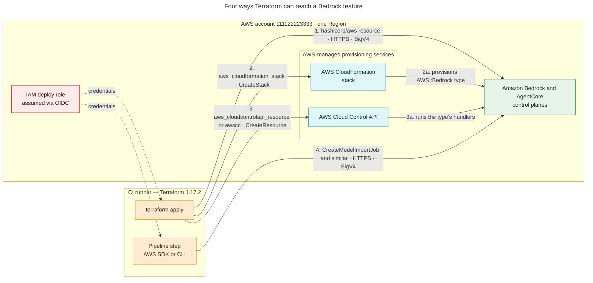

# Terraform coverage for Amazon Bedrock

> **Level:** Intermediate · **Verified:** 2026-11-15 · **Feature status:** n/a · **Time:** ~25 min

"Can I do this in Terraform?" has a precise answer for every Bedrock and AgentCore feature — the provider's schema. This chapter maps each feature to the resources, data sources, list resources and ephemeral resources in `hashicorp/aws` 6.73.0, names the gaps, gives a verified alternative for each, and shows how to check coverage yourself when the next provider release lands.

## Learning objectives

After this chapter you can:

- Find the Terraform resource, data source, list resource or ephemeral resource for a Bedrock or AgentCore feature, or establish that none exists.
- Choose an alternative for a gap: a CloudFormation type through `aws_cloudformation_stack`, the Cloud Control API through `aws_cloudcontrolapi_resource` or the `awscc` provider, or an SDK call in a pipeline step.
- Handle job-like resources and read-only arguments without surprises.
- Query the provider schema with `terraform providers schema -json` to answer coverage questions mechanically.

## Prerequisites

- [Providers, resources and data sources](01-providers-resources-data-sources.md)
- [Lifecycle rules, import, moved and removed blocks](07-lifecycle-import-moved-removed.md)
- The [feature verification matrix](../../FEATURE-VERIFICATION.md) — the status of each feature this chapter maps.

## Concept in plain language

A Terraform provider is a phrase book. If the book has a phrase for what you want ("create a guardrail"), you say it directly. If it does not, you can ask an interpreter who knows more phrases (CloudFormation or Cloud Control), or make the call yourself (an SDK script). The phrase book's index is the provider schema, and it is the only reliable index: blog posts and memory go stale with every weekly release.

## How it really works

In provider 6.73.0 the Bedrock family (`aws_bedrock*`) has **45 resources, 9 data sources, 15 list resources, 1 ephemeral resource and 0 actions**; 27 of the resources support import by `identity`. The [generated Terraform reference](../../references/terraform-aws-provider-bedrock.md) adds S3 Vectors and OpenSearch Serverless, which knowledge bases use. Every resource accepts a `region` argument, so one provider configuration can manage several Regions.

### Coverage map — Amazon Bedrock

| Feature | Resources | Data sources | List (`terraform query`) | Notes |
|:--|:--|:--|:--|:--|
| Model catalog and access | `aws_bedrock_foundation_model_agreement`, `aws_bedrock_use_case_for_model_access` | `aws_bedrock_foundation_model(s)`, `aws_bedrock_foundation_model_agreement_offers`, `aws_bedrock_use_case_for_model_access` | — | — |
| Inference profiles | `aws_bedrock_inference_profile` (application) | `aws_bedrock_inference_profile(s)` (also system-defined) | — | No update API: changes replace the profile and its ARN |
| Provisioned Throughput | `aws_bedrock_provisioned_model_throughput` | — | — | Commitment term; protect with `prevent_destroy` |
| Batch inference | `aws_bedrock_model_invocation_job` | — | ✅ | Job; no `tags`; `model_invocation_type` read-only |
| Customization (fine-tuning, RFT, distillation) | `aws_bedrock_custom_model` | `aws_bedrock_custom_model(s)` | — | Job; destroy deletes the resulting model |
| Model and RAG evaluation | `aws_bedrock_evaluation_job` | — | ✅ | Job |
| Invocation logging | `aws_bedrock_model_invocation_logging_configuration` | — | — | — |
| Guardrails | `aws_bedrock_guardrail`, `aws_bedrock_guardrail_version` | — | — | Ephemeral `aws_bedrockruntime_apply_guardrail` evaluates text |
| Guardrail enforcement and sharing | `aws_bedrock_enforced_guardrail_configuration`, `aws_bedrock_guardrail_resource_policy` | — | ✅ resource policy | — |
| Prompt management | `aws_bedrockagent_prompt` | — | — | No prompt *version* resource |
| Flows | `aws_bedrockagent_flow` | — | — | No flow version or alias resource |
| Knowledge bases (managed and customer-managed) | `aws_bedrockagent_knowledge_base`, `aws_bedrockagent_data_source` | — | — | Managed KB via `managed_knowledge_base_configuration` |
| Agents Classic (maintenance mode) | `aws_bedrockagent_agent`, `_agent_action_group`, `_agent_alias`, `_agent_collaborator`, `_agent_knowledge_base_association` | `aws_bedrockagent_agent_versions` | — | New agent work targets AgentCore ([ADR-008](../../ARCHITECTURE-DECISIONS.md#adr-008-new-agent-work-targets-agentcore)) |
| Data Automation | `aws_bedrockdataautomation_project`, `_blueprint`, `_library` | — | ✅ all three | — |

### Coverage map — Amazon Bedrock AgentCore

| Service | Resources | List (`terraform query`) | Notes |
|:--|:--|:--|:--|
| Runtime | `aws_bedrockagentcore_agent_runtime`, `_agent_runtime_endpoint` | — | — |
| Harness | `aws_bedrockagentcore_harness` | ✅ | No harness endpoint resource |
| Gateway | `aws_bedrockagentcore_gateway`, `_gateway_target`, `_gateway_rule` | ✅ `_gateway_rule` | No gateway rate-limit resource |
| Identity | `aws_bedrockagentcore_workload_identity`, `_api_key_credential_provider`, `_oauth2_credential_provider`, `_token_vault_cmk` | — | `api_key_wo` is the only write-only argument in the Bedrock family |
| Memory | `aws_bedrockagentcore_memory`, `_memory_strategy` | — | — |
| Browser and Code Interpreter | `aws_bedrockagentcore_browser`, `_browser_profile`, `_code_interpreter` | ✅ `_browser_profile` | — |
| Policy | `aws_bedrockagentcore_policy`, `_policy_engine` | ✅ both | — |
| Evaluations | `aws_bedrockagentcore_evaluator`, `_online_evaluation_config` | ✅ both | No dataset resource |
| Registry | `aws_bedrockagentcore_registry` | ✅ | Terraform-only: no CloudFormation type in CDK 2.277.0 |
| Resource policies | `aws_bedrockagentcore_resource_policy` | ✅ | — |

AgentCore has no data sources in 6.73.0. Source for both maps: the provider schema, via the [generated reference](../../references/terraform-aws-provider-bedrock.md) and the script in the Example section.

### Gaps and verified alternatives

| Feature | CloudFormation type (CDK 2.277.0 spec) | `awscc` 1.110.0 resource | Verified alternative |
|:--|:--|:--|:--|
| Custom Model Import, on-demand custom model deployment | — | — | Pipeline step: `CreateModelImportJob`, `CreateCustomModelDeployment` ([Custom Model Import](../../01-amazon-bedrock/foundation-models/04-custom-model-import.md)) |
| Bedrock Marketplace endpoints | — | — | Pipeline step: `CreateMarketplaceModelEndpoint`, or a SageMaker AI endpoint plus `RegisterMarketplaceModelEndpoint` ([Bedrock Marketplace](../../01-amazon-bedrock/foundation-models/05-bedrock-marketplace.md)) |
| Intelligent prompt routers | `AWS::Bedrock::IntelligentPromptRouter` | `awscc_bedrock_intelligent_prompt_router` | Stack or Cloud Control (example below) |
| Automated Reasoning policies | `AWS::Bedrock::AutomatedReasoningPolicy`, `...PolicyVersion` | `awscc_bedrock_automated_reasoning_policy`, `..._version` | Stack or Cloud Control |
| Prompt versions; flow versions and aliases | `AWS::Bedrock::PromptVersion`, `FlowVersion`, `FlowAlias` | `awscc_bedrock_prompt_version`, `_flow_version`, `_flow_alias` | Stack or Cloud Control |
| Knowledge base resource policy; retrieval instructions | `AWS::Bedrock::KnowledgeBasePolicy`, `RetrievalInstruction` | `awscc_bedrock_knowledge_base_policy`, `_retrieval_instruction` | Stack or Cloud Control |
| Projects (`bedrock-mantle`) | `AWS::BedrockMantle::Project` | `awscc_bedrockmantle_project` | Stack or `awscc` |
| AgentCore Payments (preview) | `AWS::BedrockAgentCore::PaymentManager`, `PaymentConnector`, `PaymentCredentialProvider` | `awscc_bedrockagentcore_payment_*` | Stack or `awscc` |
| AgentCore Optimization | `AWS::BedrockAgentCore::ConfigurationBundle` | `awscc_bedrockagentcore_configuration_bundle` | Stack or `awscc` |
| Harness endpoint, gateway rate limit, consent portal, capacity provider | `HarnessEndpoint`, `GatewayRateLimit`, `ConsentPortal`, `CapacityProvider` | `awscc_bedrockagentcore_*` equivalents | Stack or `awscc` |
| AgentCore Evaluations dataset | `AWS::BedrockAgentCore::Dataset` | not found | Stack |
| Advanced Prompt Optimization | — | — | Console or API |
| `AWS::Bedrock::Session` | `AWS::Bedrock::Session` | `awscc_bedrock_session` | The feature itself is **UNVERIFIED — REQUIRES DOCUMENTATION REVIEW** (register item U14) |

CloudFormation types come from the [CDK and CloudFormation reference](../../references/cdk-and-cloudformation-bedrock.md); `awscc` names were confirmed against the provider's documentation pages and changelog on 2026-11-15.

> [!NOTE]
> **Documented fact** — The `awscc` provider is generated from CloudFormation registry schemas, uses the AWS Cloud Control API, and is released weekly by HashiCorp's AWS provider team; version 1.110.0 was released on 2026-11-11. Its documentation warns that optional attributes are marked computed, so drift on optional values you did not set cannot be detected. `aws_cloudcontrolapi_resource` in `hashicorp/aws` takes a CloudFormation `type_name` and a JSON `desired_state` with CloudFormation property names.
> Sources: [awscc README](https://raw.githubusercontent.com/hashicorp/terraform-provider-awscc/main/README.md), [awscc provider documentation](https://raw.githubusercontent.com/hashicorp/terraform-provider-awscc/main/docs/index.md), [awscc changelog](https://raw.githubusercontent.com/hashicorp/terraform-provider-awscc/main/CHANGELOG.md), [`aws_cloudcontrolapi_resource`](https://raw.githubusercontent.com/hashicorp/terraform-provider-aws/main/website/docs/r/cloudcontrolapi_resource.html.markdown)

Cloud Control only works for types that support it. On the verification date, the [Cloud Control supported resources](https://docs.aws.amazon.com/cloudcontrolapi/latest/userguide/supported-resources.html) page listed `AWS::Bedrock::IntelligentPromptRouter` and `AWS::Bedrock::AutomatedReasoningPolicy` with create, read, update, delete and list, but only eight `AWS::BedrockAgentCore::*` types and no `AWS::BedrockMantle::*` type — even though `awscc` 1.110.0 ships resources for them. **Our reading:** the page may lag the registry; for Payments, Optimization and Projects the CloudFormation stack path is the one we can verify.

### Job-like resources and read-only arguments

Three resources start a job rather than create a lasting object: `aws_bedrock_custom_model`, `aws_bedrock_model_invocation_job` and `aws_bedrock_evaluation_job`. Create starts the job; destroy stops it if it is still running (for a completed customization job, destroy **deletes the custom model**); updates change only tags. Use `skip_destroy`, `prevent_destroy` and `removed` blocks as in [chapter 7](07-lifecycle-import-moved-removed.md). Sources: provider docs for [custom models](https://raw.githubusercontent.com/hashicorp/terraform-provider-aws/main/website/docs/r/bedrock_custom_model.html.markdown), [batch jobs](https://raw.githubusercontent.com/hashicorp/terraform-provider-aws/main/website/docs/r/bedrock_model_invocation_job.html.markdown), [evaluation jobs](https://raw.githubusercontent.com/hashicorp/terraform-provider-aws/main/website/docs/r/bedrock_evaluation_job.html.markdown).

A **read-only argument** is an attribute you can read but not set. On `aws_bedrock_model_invocation_job`, `model_invocation_type` is computed-only, so a batch job that uses the Converse input format cannot be requested from Terraform 6.73.0, and the resource has no `tags` — the provider explains that Bedrock cannot return tags for finished jobs ([Batch inference](../../01-amazon-bedrock/inference/08-batch-inference.md)).

> [!TIP]
> **Academy recommendation** — Keep long-lived things (roles, buckets, guardrails, profiles, runtimes) in Terraform, and run jobs (fine-tuning, batch, evaluation, model import) from a pipeline or AWS Step Functions with their inputs and outputs managed by Terraform. Jobs are events, not desired state. This is our design guidance, not an official AWS reference architecture.

## Architecture diagram



**What this shows** — Terraform can own a Bedrock object through four paths. Only path 1 gives native plans with attribute-level diffs; paths 2 and 3 hand the work to an AWS provisioning service; path 4 is outside Terraform's state entirely.

**Walkthrough**

1. A native `aws_` resource calls the Bedrock control plane directly.
2. `aws_cloudformation_stack` creates a stack; **2a.** CloudFormation provisions the `AWS::Bedrock::*` type. Terraform sees the stack (parameters, outputs), not the router's attributes.
3. `aws_cloudcontrolapi_resource` or an `awscc_*` resource calls Cloud Control; **3a.** Cloud Control runs the type's registry handlers. State holds the resource's properties as JSON.
4. A pipeline step calls the API for features with no IaC type at all; record the returned ARN in configuration and delete on teardown.

| Legend | Meaning |
|:--|:--|
| Solid arrow | Request |
| Dashed arrow | Credentials |
| Teal boxes | AWS provisioning services acting on your behalf |
| Nested boxes | Account and trust zones |

**Variations** — With a CloudFormation service role (`iam_role_arn` on the stack, `role_arn` on Cloud Control), the provisioning service acts with that role instead of the caller's session.

## Implementation details

1. **Check the schema first** (`bedrock-coverage.sh` below), then the [feature matrix](../../FEATURE-VERIFICATION.md) for service status.
2. **Prefer a native resource**, even a less complete one, and fill the gap with the next path only for the missing type.
3. **CloudFormation stack path:** keep the template in its own file, lint it with `cfn-lint`, pass inputs as `parameters`, read results from `outputs`. Drift inside the stack is CloudFormation's to detect ([Change sets and drift detection](../cloudformation/04-change-sets-and-drift.md)).
4. **Cloud Control path:** use CloudFormation property names in `desired_state`; read results with `jsondecode(...properties)`.
5. **`awscc` path:** add `hashicorp/awscc` to `required_providers` with its own constraint and lock entry; mind the drift caveat above.
6. **SDK path:** make the step idempotent, store the returned ARN in configuration (for example AWS Systems Manager Parameter Store), and write the teardown step.
7. **Re-check on every provider upgrade** — gaps close often ([ADR-006](../../ARCHITECTURE-DECISIONS.md#adr-006-pin-tool-versions-and-generate-iac-references-from-the-tools)).

## Example

> **Code status:** CloudFormation template passes `cfn-lint`; Terraform validated (Terraform 1.17.2, provider 6.73.0) and TFLint 0.66 clean · mock-tested: `terraform test`, 1 run (stack) and 2 runs (guardrail smoke test) pass · coverage script run against the 6.73.0 schema · the `awscc` snippet is **illustrative** (the `hashicorp/awscc` provider is not in the academy's offline provider mirror, so it was not validated) · **never planned or applied against AWS** · never deployed

**1. Check coverage yourself.** Run inside any initialised configuration that requires `hashicorp/aws`:

```bash
#!/usr/bin/env bash
# bedrock-coverage.sh — every Bedrock-family type the installed AWS provider offers, by kind.
set -euo pipefail
terraform providers schema -json |
  jq -r '.provider_schemas["registry.terraform.io/hashicorp/aws"]
    | {resource: .resource_schemas, data: .data_source_schemas,
       ephemeral: .ephemeral_resource_schemas, list: .list_resource_schemas,
       action: (.action_schemas // {}), identity: (.resource_identity_schemas // {})}
    | to_entries[] | .key as $kind
    | .value | keys[] | select(test("^aws_bedrock")) | "\($kind)\t\(.)"' |
  sort
```

```text
$ ./bedrock-coverage.sh | cut -f1 | sort | uniq -c
      9 data
      1 ephemeral
     27 identity
     15 list
     45 resource
```

Two narrower questions — "does a type exist?" and "which attributes are read-only?":

```bash
terraform providers schema -json | jq '.provider_schemas["registry.terraform.io/hashicorp/aws"]
  .resource_schemas | has("aws_bedrock_prompt_router")'                       # false

terraform providers schema -json | jq -r '.provider_schemas["registry.terraform.io/hashicorp/aws"]
  .resource_schemas.aws_bedrock_model_invocation_job.block.attributes | to_entries[]
  | select(.value.computed and (.value.optional|not) and (.value.required|not)) | .key'
# end_time, error_record_count, job_arn, job_expiration_time, model_invocation_type, ...
```

**2. A gap through CloudFormation: an intelligent prompt router.** The documented properties of `AWS::Bedrock::IntelligentPromptRouter` all require replacement on update except `Tags`, and the console requires exactly two models of the same family ([CloudFormation reference](https://docs.aws.amazon.com/AWSCloudFormation/latest/TemplateReference/aws-resource-bedrock-intelligentpromptrouter.html), [prompt routing](https://docs.aws.amazon.com/bedrock/latest/userguide/prompt-routing.html)).

```yaml
# templates/prompt-router.yaml
AWSTemplateFormatVersion: "2010-09-09"
Description: Amazon Bedrock intelligent prompt router, deployed by Terraform through aws_cloudformation_stack.

Parameters:
  RouterName:
    Type: String
    AllowedPattern: "^([0-9a-zA-Z][ _-]?)+$"
    MaxLength: 64
  PrimaryModelArn:
    Type: String
    Description: Foundation model or inference profile ARN the router may switch to.
  FallbackModelArn:
    Type: String
    Description: Baseline model. Must be in the same model family as the primary model.
  ResponseQualityDifference:
    Type: Number
    Default: 10
    Description: How much better (in percent) the primary model must be predicted to answer before the router uses it.

Resources:
  PromptRouter:
    Type: AWS::Bedrock::IntelligentPromptRouter
    Properties:
      PromptRouterName: !Ref RouterName
      Description: Routes between two models of one family by predicted response quality
      Models:
        - ModelArn: !Ref PrimaryModelArn
        - ModelArn: !Ref FallbackModelArn
      FallbackModel:
        ModelArn: !Ref FallbackModelArn
      RoutingCriteria:
        ResponseQualityDifference: !Ref ResponseQualityDifference

Outputs:
  PromptRouterArn:
    Description: Pass this ARN as the model ID in Converse or InvokeModel.
    Value: !GetAtt PromptRouter.PromptRouterArn
```

```hcl
# main.tf (variables: router_name, primary_model_arn, fallback_model_arn,
# response_quality_difference = 10, tags = {})
resource "aws_cloudformation_stack" "prompt_router" {
  name          = "bedrock-prompt-router-${var.router_name}"
  template_body = file("${path.module}/templates/prompt-router.yaml")

  parameters = {
    RouterName                = var.router_name
    PrimaryModelArn           = var.primary_model_arn
    FallbackModelArn          = var.fallback_model_arn
    ResponseQualityDifference = tostring(var.response_quality_difference)
  }

  on_failure = "DELETE"
  tags       = var.tags
}

output "prompt_router_arn" {
  description = "ARN to use as the model ID in Converse or InvokeModel."
  value       = aws_cloudformation_stack.prompt_router.outputs["PromptRouterArn"]
}
```

```hcl
# tests/stack.tftest.hcl
mock_provider "aws" {}

override_resource {
  target          = aws_cloudformation_stack.prompt_router
  override_during = plan
  values = {
    outputs = {
      PromptRouterArn = "mock-prompt-router-arn"
    }
  }
}

variables {
  router_name        = "support-router"
  primary_model_arn  = "arn:aws:bedrock:us-east-1::foundation-model/example.model-large-v1:0"
  fallback_model_arn = "arn:aws:bedrock:us-east-1::foundation-model/example.model-small-v1:0"
}

run "parameters_reach_the_template" {
  command = plan

  assert {
    condition     = aws_cloudformation_stack.prompt_router.parameters["FallbackModelArn"] == var.fallback_model_arn
    error_message = "The fallback model must be passed to the template."
  }

  assert {
    condition     = strcontains(aws_cloudformation_stack.prompt_router.template_body, "AWS::Bedrock::IntelligentPromptRouter")
    error_message = "The stack must deploy the prompt router type."
  }

  assert {
    condition     = output.prompt_router_arn == "mock-prompt-router-arn"
    error_message = "The stack output must surface as a Terraform output."
  }
}
```

**3. The same type through Cloud Control** — no template file; Terraform state holds the properties:

```hcl
resource "aws_cloudcontrolapi_resource" "prompt_router" {
  type_name = "AWS::Bedrock::IntelligentPromptRouter"

  desired_state = jsonencode({
    PromptRouterName = var.router_name
    Models = [
      { ModelArn = var.primary_model_arn },
      { ModelArn = var.fallback_model_arn },
    ]
    FallbackModel   = { ModelArn = var.fallback_model_arn }
    RoutingCriteria = { ResponseQualityDifference = var.response_quality_difference }
  })
}

output "prompt_router_arn" {
  description = "ARN read back from the resource's current properties."
  value       = jsondecode(aws_cloudcontrolapi_resource.prompt_router.properties)["PromptRouterArn"]
}
```

**4. The same type through `awscc`** (illustrative, attribute names from the [`awscc_bedrock_intelligent_prompt_router` documentation](https://raw.githubusercontent.com/hashicorp/terraform-provider-awscc/main/docs/resources/bedrock_intelligent_prompt_router.md); add `awscc = { source = "hashicorp/awscc", version = "~> 1.110" }` to `required_providers`):

```hcl
resource "awscc_bedrock_intelligent_prompt_router" "support" {
  prompt_router_name = var.router_name
  models = [
    { model_arn = var.primary_model_arn },
    { model_arn = var.fallback_model_arn },
  ]
  fallback_model   = { model_arn = var.fallback_model_arn }
  routing_criteria = { response_quality_difference = var.response_quality_difference }
}
```

**5. The one ephemeral resource: a guardrail smoke test.** `aws_bedrockruntime_apply_guardrail` calls `ApplyGuardrail` during plan and apply without storing the text or result in state; intervention is reported as `action = "GUARDRAIL_INTERVENED"`, not as an error ([provider docs](https://raw.githubusercontent.com/hashicorp/terraform-provider-aws/main/website/docs/ephemeral-resources/bedrockruntime_apply_guardrail.html.markdown)). This turns "the published version still blocks what it must block" into a plan-time gate:

```hcl
# variables: guardrail_id, guardrail_version, must_block_prompt (sensitive)
ephemeral "aws_bedrockruntime_apply_guardrail" "must_block" {
  guardrail_identifier = var.guardrail_id
  guardrail_version    = var.guardrail_version
  source               = "INPUT"

  content {
    text {
      text = var.must_block_prompt
    }
  }

  lifecycle {
    postcondition {
      condition     = self.action == "GUARDRAIL_INTERVENED"
      error_message = "Guardrail ${var.guardrail_id} version ${var.guardrail_version} let a must-block prompt through."
    }
  }
}
```

```hcl
# tests/smoke.tftest.hcl — mock_ephemeral needs Terraform 1.17+
mock_provider "aws" {
  mock_ephemeral "aws_bedrockruntime_apply_guardrail" {
    defaults = {
      action = "GUARDRAIL_INTERVENED"
    }
  }
}

mock_provider "aws" {
  alias = "lets_it_through"

  mock_ephemeral "aws_bedrockruntime_apply_guardrail" {
    defaults = {
      action = "NONE"
    }
  }
}

variables {
  guardrail_id      = "abc123"
  guardrail_version = "3"
  must_block_prompt = "Which stock should I buy this week?"
}

run "intervention_passes_the_smoke_test" {
  command = plan
}

run "no_intervention_fails_the_smoke_test" {
  command = plan

  providers = {
    aws = aws.lets_it_through
  }

  expect_failures = [ephemeral.aws_bedrockruntime_apply_guardrail.must_block]
}
```

The block name `mock_ephemeral` was established by running Terraform 1.17.2 (`mock_ephemeral_resource` is rejected); the mocking page read for this chapter does not yet describe it.

## Common mistakes

> [!WARNING]
> **Common mistake** — Answering "does Terraform support X?" from memory or a blog post. The provider gains Bedrock types in most releases, and the generated reference in this academy is tied to 6.73.0. Run the schema query against the version you actually pin.

| Mistake | Symptom | Fix |
|:--|:--|:--|
| Managing a resource in both a stack and a native resource | Two owners overwrite each other | One owner per object |
| Terraform-style names in `desired_state` | Cloud Control rejects the request | Use CloudFormation property names (`PromptRouterName`) |
| Expecting attribute diffs for a stack-managed resource | Plan shows only parameter changes | Read CloudFormation drift results, or move to Cloud Control or `awscc` |
| Re-running a completed job by changing an argument | Replacement starts a new job; for customization the old model is deleted | Jobs in pipelines; `prevent_destroy` on `aws_bedrock_custom_model` |
| Using the ephemeral guardrail check against `DRAFT` | The smoke test passes while production uses another version | Test the version number the application pins |

## Security considerations

- Paths 2 and 3 act with the caller's credentials unless a service role is set; a CloudFormation service role for Bedrock stacks narrows what Terraform's role must hold.
- Ephemeral `apply_guardrail` keeps test prompts out of state; still mark the variable `sensitive`, because plan logs and CI variables can leak it.
- Write-only `api_key_wo` keeps an AgentCore API key out of state; the plain `api_key` argument does not.
- Every extra provider (`awscc`) is another supply-chain dependency: pin it and commit its lock entry.

## Cost considerations

- Native resources, stacks and Cloud Control add no Terraform-side charge; you pay for the Bedrock resources they create.
- The ephemeral guardrail check calls `ApplyGuardrail` on every plan and apply, and each call is billed by the guardrail's pricing dimensions ([Bedrock pricing](https://aws.amazon.com/bedrock/pricing/)); keep the test texts short.
- Job-like resources bill per run; replacing one by accident buys the run again.

## Knowledge check

1. Your team needs an intelligent prompt router, Terraform-managed, with attribute-level drift detection. Which path do you choose, and what do you lose with a CloudFormation stack instead?
2. A teammate asks for a Terraform resource to deploy a Bedrock Marketplace model. What do you answer?
3. Why can't you create a Converse-format batch inference job with `aws_bedrock_model_invocation_job` in 6.73.0, and how would you have found out without reading any blog?
4. You want to adopt existing guardrails with `terraform query`. Will it work in 6.73.0?

<details>
<summary>Answers</summary>

1. Cloud Control (`aws_cloudcontrolapi_resource`) or `awscc`: state holds the router's properties, so the plan diffs them — with the `awscc` caveat that unset optional attributes are not drift-checked. A stack gives Terraform only parameters and outputs; drift inside the stack must be detected by CloudFormation.
2. There is none in `hashicorp/aws` 6.73.0, no CloudFormation type in the CDK 2.277.0 specification and no `awscc` resource. Run `CreateMarketplaceModelEndpoint` from a pipeline step, store the ARN in configuration, delete on teardown, and manage the role, key and network with Terraform.
3. `model_invocation_type` is computed-only, so you cannot set it. The schema query for computed-only attributes lists it.
4. No — `aws_bedrock_guardrail` has no list resource. Write `import` blocks by hand with the `"<id>,DRAFT"` ID format (chapter 7).

</details>

## Further reading

Official sources opened while writing this chapter:

- [Generated Terraform reference](../../references/terraform-aws-provider-bedrock.md) and [CDK and CloudFormation reference](../../references/cdk-and-cloudformation-bedrock.md) — produced from the tools themselves.
- Provider docs: [`aws_cloudformation_stack`](https://raw.githubusercontent.com/hashicorp/terraform-provider-aws/main/website/docs/r/cloudformation_stack.html.markdown), [`aws_cloudcontrolapi_resource`](https://raw.githubusercontent.com/hashicorp/terraform-provider-aws/main/website/docs/r/cloudcontrolapi_resource.html.markdown), [`aws_bedrockruntime_apply_guardrail`](https://raw.githubusercontent.com/hashicorp/terraform-provider-aws/main/website/docs/ephemeral-resources/bedrockruntime_apply_guardrail.html.markdown), [list resource `aws_bedrock_model_invocation_job`](https://raw.githubusercontent.com/hashicorp/terraform-provider-aws/main/website/docs/list-resources/bedrock_model_invocation_job.html.markdown).
- `awscc`: [README](https://raw.githubusercontent.com/hashicorp/terraform-provider-awscc/main/README.md), [provider documentation](https://raw.githubusercontent.com/hashicorp/terraform-provider-awscc/main/docs/index.md), [changelog](https://raw.githubusercontent.com/hashicorp/terraform-provider-awscc/main/CHANGELOG.md), [`awscc_bedrock_intelligent_prompt_router`](https://raw.githubusercontent.com/hashicorp/terraform-provider-awscc/main/docs/resources/bedrock_intelligent_prompt_router.md).
- [AWS::Bedrock::IntelligentPromptRouter](https://docs.aws.amazon.com/AWSCloudFormation/latest/TemplateReference/aws-resource-bedrock-intelligentpromptrouter.html) and [Understanding intelligent prompt routing](https://docs.aws.amazon.com/bedrock/latest/userguide/prompt-routing.html).
- [Cloud Control API supported resources](https://docs.aws.amazon.com/cloudcontrolapi/latest/userguide/supported-resources.html).
- [terraform test — provider mocking](https://developer.hashicorp.com/terraform/language/tests/mocking) and the [Terraform v1.17 changelog](https://raw.githubusercontent.com/hashicorp/terraform/v1.17/CHANGELOG.md) (mock providers for ephemeral resources).
