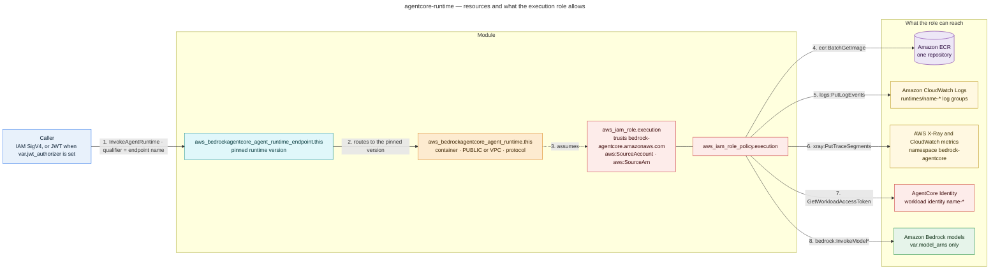

# Module: agentcore-runtime

> **Code status:** `terraform fmt` ✅ · `terraform validate` ✅ (provider 6.73.0) · `terraform test` ✅ 8 runs with a mock provider · `tflint` ✅ · **never planned or applied against AWS — never deployed**

An Amazon Bedrock AgentCore Runtime that runs your agent from a container image, a named
endpoint pinned to a version, and the execution role the runtime assumes. The role carries every
statement of the documented execution policy, but each one is narrowed to **this runtime's
repository, log groups and workload identity**, and model access is granted **only on the ARNs
you list**.

[Module catalog](../README.md) · [Terraform chapters](../../README.md) · [AgentCore Runtime](../../../../01-amazon-bedrock/agentcore/02-agentcore-runtime.md) · [AgentCore Identity](../../../../01-amazon-bedrock/agentcore/05-agentcore-identity.md) · [`bedrock-private-endpoints`](../bedrock-private-endpoints/README.md)

## What it creates



A caller (1) names the endpoint as the qualifier; the runtime (2) serves the endpoint's version
and (3) assumes the execution role for every session; the role's policy (4–8) is everything the
agent's code and the platform can do on its behalf. Dashed: role assumption.

## The documented behaviour it encodes

| Rule | Source |
|:--|:--|
| The execution role's trust policy allows `bedrock-agentcore.amazonaws.com` with `StringEquals aws:SourceAccount` and `ArnLike aws:SourceArn arn:aws:bedrock-agentcore:<region>:<account>:*` | [IAM permissions for AgentCore Runtime](https://docs.aws.amazon.com/bedrock-agentcore/latest/devguide/runtime-permissions.html) |
| The documented execution policy grants ECR image pull plus `ecr:GetAuthorizationToken`; CloudWatch Logs under `/aws/bedrock-agentcore/runtimes/` (including `logs:PutResourcePolicy` on the agent's log groups); four X-Ray actions; `cloudwatch:PutMetricData` with `cloudwatch:namespace = bedrock-agentcore`; workload access tokens on `workload-identity-directory/default` and `…/workload-identity/<agentName>-*`; `bedrock:InvokeModel` and `bedrock:InvokeModelWithResponseStream` | [IAM permissions for AgentCore Runtime](https://docs.aws.amazon.com/bedrock-agentcore/latest/devguide/runtime-permissions.html) |
| `GetWorkloadAccessTokenForUserId` issues tokens for caller-supplied user IDs without identity-provider verification; where JWTs are available AWS recommends granting only `GetWorkloadAccessTokenForJWT` | [IAM permissions for AgentCore Runtime](https://docs.aws.amazon.com/bedrock-agentcore/latest/devguide/runtime-permissions.html) |
| `logs:PutResourcePolicy` on the agent's log group lets AgentCore allow AWS X-Ray to deliver spans to it | [Add observability](https://docs.aws.amazon.com/bedrock-agentcore/latest/devguide/observability-configure.html) |
| Agent log groups are named `/aws/bedrock-agentcore/runtimes/<agent_id>-<endpoint_name>` | [View observability data](https://docs.aws.amazon.com/bedrock-agentcore/latest/devguide/observability-view.html) |
| Runtime names match `[a-zA-Z][a-zA-Z0-9_]{0,47}`; a runtime ARN ends in `runtime/<name>-<10 characters>`; a description is 1–4,096 characters; at most 50 environment variables | [`CreateAgentRuntime` API reference](https://docs.aws.amazon.com/bedrock-agentcore-control/latest/APIReference/API_CreateAgentRuntime.html) |
| Network modes `PUBLIC` and `VPC`; protocols `HTTP`, `MCP`, `A2A`, `AGUI`; platform versions `V1` and `V2` (a new runtime uses `V1` when omitted) | [`aws_bedrockagentcore_agent_runtime` (provider 6.73.0)](https://raw.githubusercontent.com/hashicorp/terraform-provider-aws/v6.73.0/website/docs/r/bedrockagentcore_agent_runtime.html.markdown) |
| Runtimes created after the 5 May 2026 rollout get no service-managed Amazon S3 gateway in VPC mode; S3 access then depends on your VPC alone | [`aws_bedrockagentcore_agent_runtime` (provider 6.73.0)](https://raw.githubusercontent.com/hashicorp/terraform-provider-aws/v6.73.0/website/docs/r/bedrockagentcore_agent_runtime.html.markdown) |
| VPC mode creates network interfaces through the service-linked role `AWSServiceRoleForBedrockAgentCoreNetwork`; a public subnet gives no internet access; subnets must be in supported Availability Zone IDs; without internet access you need `ecr.dkr`, `ecr.api` and an S3 gateway endpoint | [Configure AgentCore Runtime and tools for VPC](https://docs.aws.amazon.com/bedrock-agentcore/latest/devguide/agentcore-vpc.html) |
| `DEFAULT` always points at the latest version; any other endpoint moves only when you update it | [Runtime versioning and endpoints](https://docs.aws.amazon.com/bedrock-agentcore/latest/devguide/agent-runtime-versioning.html) |

## Usage

```hcl
resource "aws_ecr_repository" "agent" {
  name                 = "support-agent"
  image_tag_mutability = "IMMUTABLE"
}

module "support_agent" {
  source = "../../04-infrastructure-as-code/terraform/modules/agentcore-runtime"

  name          = "support_agent"
  container_uri = "${aws_ecr_repository.agent.repository_url}:${var.image_tag}" # ARM64 image

  network_mode       = "VPC"
  subnet_ids         = var.private_subnet_ids
  security_group_ids = [var.agent_security_group_id]

  # Inference profile ARN plus the foundation model in every destination Region.
  model_arns            = var.agent_model_arns
  environment_variables = { MODEL_ID = var.inference_profile_id }

  # null on the first apply; then pin the version you tested and move it deliberately.
  endpoint_name            = "live"
  endpoint_runtime_version = var.live_version
}
```

Confirm current model and inference profile IDs before use. The snippet was validated with
`terraform validate` in a root module that declares those variables. In VPC mode, add the
[`bedrock-private-endpoints`](../bedrock-private-endpoints/README.md) module for
`bedrock-runtime` (and `bedrock-agentcore` if the agent calls Memory or Identity APIs) plus
endpoints for Amazon ECR, Amazon S3 and CloudWatch Logs, or a NAT gateway.

## Inputs

| Name | Type | Default | Description |
|:--|:--|:--|:--|
| `name` | `string` | — | Runtime name; prefixes the role (`<name>-execution`), workload identity and log groups |
| `description` | `string` | `null` | Runtime description, 1–4,096 characters |
| `container_uri` | `string` | — | Private ECR image URI with a tag or `@sha256:` digest |
| `network_mode` | `string` | `"VPC"` | `PUBLIC` or `VPC` |
| `subnet_ids` | `list(string)` | `[]` | Up to 16 private subnets, required in VPC mode |
| `security_group_ids` | `list(string)` | `[]` | Up to 16 security groups, required in VPC mode |
| `server_protocol` | `string` | `"HTTP"` | `HTTP`, `MCP`, `A2A` or `AGUI` |
| `platform_version` | `string` | `"V1"` | `V1` or `V2` |
| `idle_session_timeout_seconds` | `number` | `900` | 60–28,800 |
| `max_lifetime_seconds` | `number` | `28800` | 60–28,800 |
| `environment_variables` | `map(string)` | `{}` | Non-secret configuration, at most 50 entries |
| `model_arns` | `list(string)` | `[]` | Model and inference-profile ARNs the agent may invoke. No wildcards |
| `allow_workload_token_for_user_id` | `bool` | `false` | Also grant `GetWorkloadAccessTokenForUserId` |
| `jwt_authorizer` | `object` | `null` | `discovery_url`, optional `allowed_audiences` and `allowed_clients`; null means IAM (SigV4) |
| `endpoint_name` | `string` | `"live"` | Endpoint to create; `DEFAULT` is rejected because the service creates it |
| `endpoint_runtime_version` | `string` | `null` | Version the endpoint serves; null follows the version created by this apply |
| `permissions_boundary_arn` | `string` | `null` | Permissions boundary for the role |
| `tags` | `map(string)` | `{}` | Extra tags |

VPC mode requires `subnet_ids` and `security_group_ids`; `PUBLIC` mode rejects them (checked by
preconditions).

## Outputs

| Name | Description |
|:--|:--|
| `agent_runtime_arn` | ARN to pass to `InvokeAgentRuntime` |
| `agent_runtime_id` | Runtime ID |
| `agent_runtime_version` | Latest version (the one `DEFAULT` serves) |
| `endpoint_arn` | ARN of the module's endpoint |
| `endpoint_name` | Endpoint name, used as the qualifier |
| `workload_identity_arn` | Workload identity created for the runtime |
| `execution_role_arn` | Execution role ARN |
| `execution_role_name` | Execution role name, for attaching further permissions |
| `ecr_repository_arn` | Repository ARN derived from `container_uri` |
| `execution_policy_json` | The rendered execution policy |
| `trust_policy_json` | The rendered trust policy |

## Design notes

- **Narrower than the documented example, statement by statement.** The documented policy uses
  `repository/*`, `runtimes/*`, `foundation-model/*` and every Bedrock resource in the account.
  This module derives the one repository ARN from `container_uri`, scopes log groups to
  `/aws/bedrock-agentcore/runtimes/<name>-*` and grants models only from `model_arns`.
  **Our reading:** because a runtime ID is `<name>-<10 characters>` and the log group is
  `<runtime id>-<endpoint name>`, `<name>-*` covers this runtime's log groups and no other
  runtime's (names cannot contain hyphens).
- **The trust policy is kept exactly as documented.** Its `aws:SourceArn` covers every
  AgentCore ARN in the account and Region; the documentation does not say which ARN the service
  presents, so the module does not narrow it.
- **`VPC` is the default network mode.** A `PUBLIC` session has internet access, which is a
  deliberate choice the caller has to write down.
- **Endpoint pinning.** While `endpoint_runtime_version` is null, every apply that creates a new
  runtime version also moves the endpoint. After the first apply, set it to the tested version;
  `DEFAULT` keeps following the latest for testing.
- **Policies are built with `jsonencode` in `locals`** and exposed as outputs, so the tests
  assert on the exact JSON.
- **Environment variables are for configuration, not secrets.** Keep keys and tokens in
  AgentCore Identity or AWS Secrets Manager.

> [!CAUTION]
> **Cost or security hazard** — Sessions are billed while they exist, including idle time until
> they are stopped, so `idle_session_timeout_seconds` is a cost lever; see the pricing section of
> [AgentCore Runtime](../../../../01-amazon-bedrock/agentcore/02-agentcore-runtime.md). In `PUBLIC`
> mode the agent can reach any internet host.

> [!WARNING]
> **Common mistake** — A VPC-mode runtime that cannot pull its image. Without internet access the
> subnets need `ecr.api` and `ecr.dkr` interface endpoints and an S3 gateway endpoint (image
> layers are stored in Amazon S3), and the session security groups must allow HTTPS to them.

## Testing

```bash
terraform init -backend=false
terraform validate
terraform test          # 8 runs, mock provider, no AWS credentials
```

The tests in [`tests/runtime.tftest.hcl`](tests/runtime.tftest.hcl) cover: VPC-mode defaults,
the trust conditions and the scoped log, metric and workload-identity resources, `PUBLIC` mode
with models and user-ID tokens, a JWT authorizer with a digest-pinned image and a pinned endpoint
version, and four rejection runs (image without tag or digest; VPC mode without subnets;
wildcard model ARN; hyphenated name, `DEFAULT` endpoint and empty description). One assertion
checks that `logs:PutResourcePolicy` is granted only on this runtime's own log groups.

## Limitations

- Validated against the provider schema and tested with mocks only; IAM evaluates the policies
  only when the role is used in a real account.
- Container artifacts only. Direct code deployment (`code_configuration`), file systems, request
  header allow-lists and custom JWT claims exist in the provider but are not wired in.
- The `CreateAgentRuntime` API also has a custom port and path, `allowedPorts`, a capacity
  provider (Instances compute), resource configurations and hooks. Provider 6.73.0 has no
  arguments for them, so this module cannot set them.
- The image must be ARM64 and the subnets must be in supported Availability Zone IDs; Terraform
  cannot check either.
- The role grants nothing for Memory, Gateway, Code Interpreter, Browser or your data stores.
  Attach those permissions to `execution_role_name`.
