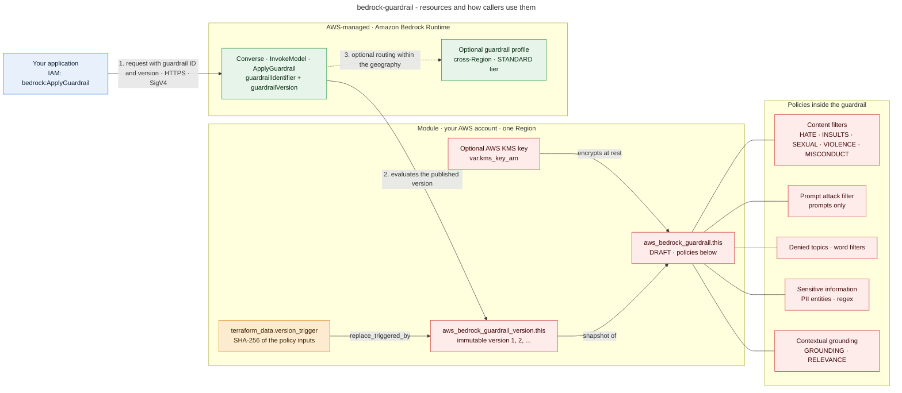

# Module: bedrock-guardrail

> **Code status:** `terraform fmt` ✅ · `terraform validate` ✅ (Terraform 1.17.2, provider 6.73.0) · `terraform test` ✅ 8 runs with a mock provider · TFLint 0.66 ✅ · **never planned or applied against AWS**

An Amazon Bedrock guardrail with content filters, a prompt attack filter, denied topics, word
filters, sensitive-information (PII and regex) filters and an optional contextual grounding
check, plus a **published, immutable version** that is republished whenever the policy changes.
The defaults block the five harmful-content categories and prompt attacks at `HIGH`; everything
application-specific is off until you configure it.

[Module catalog](../README.md) · [Terraform chapters](../../README.md) · [Amazon Bedrock Guardrails](../../../../01-amazon-bedrock/guardrails/01-guardrails.md) · [Automated Reasoning checks and guardrail enforcement](../../../../01-amazon-bedrock/guardrails/02-automated-reasoning-and-enforcement.md) · [`bedrock-invocation-role`](../bedrock-invocation-role/README.md)

## What it creates



| Legend | Meaning |
|:--|:--|
| Red | Security controls: the guardrail, its policies, its version, the KMS key |
| Green | Amazon Bedrock Runtime and the AWS-managed guardrail profile |
| Orange | Terraform-only helper resource (no AWS API call) |
| Solid / dashed arrow | Request or dependency · optional path |

**What this shows** — the module owns the guardrail (its working `DRAFT`) and one published
version. Your application calls the runtime with the guardrail ID and the **version number**;
the runtime evaluates that frozen snapshot. With the `STANDARD` tier, evaluation can be routed to
other Regions of the same geography through a guardrail profile.

## The documented behaviour it encodes

| Rule | Source |
|:--|:--|
| Content filter types `SEXUAL`, `VIOLENCE`, `HATE`, `INSULTS`, `MISCONDUCT`, `PROMPT_ATTACK`; strengths `NONE`, `LOW`, `MEDIUM`, `HIGH`; actions `BLOCK` or `NONE` (detect only); modalities `TEXT` and `IMAGE` (1–2) | [GuardrailContentFilterConfig](https://docs.aws.amazon.com/bedrock/latest/APIReference/API_GuardrailContentFilterConfig.html) |
| The prompt attack filter is configured with `inputStrength` and `inputAction` only, and with `InvokeModel` it filters only user input wrapped in input tags | [Detect prompt attacks](https://docs.aws.amazon.com/bedrock/latest/userguide/guardrails-prompt-attack.html) |
| Content filters do not evaluate tool results, tool definitions or tool call arguments | [Content filters](https://docs.aws.amazon.com/bedrock/latest/userguide/guardrails-content-filters.html) |
| `crossRegionConfig` is required when using the `STANDARD` tier; tiers apply to content filters, denied topics and contextual grounding | [Content filters](https://docs.aws.amazon.com/bedrock/latest/userguide/guardrails-content-filters.html), [Safeguard tiers](https://docs.aws.amazon.com/bedrock/latest/userguide/guardrails-tiers.html) |
| Denied topic definitions: up to 200 characters (Classic) or 1,000 (Standard); name pattern `[0-9a-zA-Z-_ !?.]+` up to 100 characters; up to 5 examples of up to 100 characters | [Safeguard tiers](https://docs.aws.amazon.com/bedrock/latest/userguide/guardrails-tiers.html), [GuardrailTopicConfig](https://docs.aws.amazon.com/bedrock/latest/APIReference/API_GuardrailTopicConfig.html) |
| Custom words are 1–100 characters; the managed word list type is `PROFANITY` | [GuardrailWordConfig](https://docs.aws.amazon.com/bedrock/latest/APIReference/API_GuardrailWordConfig.html), [GuardrailManagedWordsConfig](https://docs.aws.amazon.com/bedrock/latest/APIReference/API_GuardrailManagedWordsConfig.html) |
| PII entity types and the actions `BLOCK`, `ANONYMIZE`, `NONE`; regex name up to 100 and pattern up to 500 characters | [GuardrailPiiEntityConfig](https://docs.aws.amazon.com/bedrock/latest/APIReference/API_GuardrailPiiEntityConfig.html), [GuardrailRegexConfig](https://docs.aws.amazon.com/bedrock/latest/APIReference/API_GuardrailRegexConfig.html) |
| Contextual grounding types `GROUNDING` and `RELEVANCE`; thresholds from 0 to 0.99 (1 would block all content) | [Contextual grounding check](https://docs.aws.amazon.com/bedrock/latest/userguide/guardrails-contextual-grounding-check.html), [GuardrailContextualGroundingFilterConfig](https://docs.aws.amazon.com/bedrock/latest/APIReference/API_GuardrailContextualGroundingFilterConfig.html) |
| Guardrail name 1–50 characters `[0-9a-zA-Z-_]+`; blocked messages 1–500 characters; description 1–200; `CreateGuardrail` always returns version `DRAFT` | [CreateGuardrail](https://docs.aws.amazon.com/bedrock/latest/APIReference/API_CreateGuardrail.html) |
| With a customer managed key, guardrail creators need `kms:Decrypt`, `kms:GenerateDataKey`, `kms:DescribeKey`, `kms:CreateGrant`; roles that use the guardrail at inference need `kms:Decrypt` | [Customer managed key for guardrails](https://docs.aws.amazon.com/bedrock/latest/userguide/guardrails-permissions-kms.html) |
| A guardrail profile is identified by an ARN such as `arn:aws:bedrock:<source-region>:<account-id>:guardrail-profile/us.guardrail.v1:0`; callers need `bedrock:ApplyGuardrail` on the profile ARN in every destination Region | [Supported Regions for cross-Region guardrail inference](https://docs.aws.amazon.com/bedrock/latest/userguide/guardrails-cross-region-support.html), [Permissions for cross-Region guardrails](https://docs.aws.amazon.com/bedrock/latest/userguide/guardrail-profiles-permissions.html) |

Arguments were checked against the [provider schema](../../../../references/terraform-aws-provider-bedrock-schema.json)
and the provider documentation for [`aws_bedrock_guardrail`](https://raw.githubusercontent.com/hashicorp/terraform-provider-aws/main/website/docs/r/bedrock_guardrail.html.markdown)
and [`aws_bedrock_guardrail_version`](https://raw.githubusercontent.com/hashicorp/terraform-provider-aws/main/website/docs/r/bedrock_guardrail_version.html.markdown).

## Usage

> **Code status:** validated with `terraform validate` against this module (provider 6.73.0) · **never planned or applied against AWS**

```hcl
module "chat_guardrail" {
  source = "../../04-infrastructure-as-code/terraform/modules/bedrock-guardrail"

  name        = "chat-guardrail"
  description = "Customer support assistant"

  denied_topics = [{
    name       = "Investment advice"
    definition = "Recommendations about specific stocks, funds or other investments."
    examples   = ["Which shares should I buy this week?"]
  }]

  pii_entities = {
    EMAIL                     = { action = "ANONYMIZE" }
    US_SOCIAL_SECURITY_NUMBER = { action = "BLOCK" }
    AWS_SECRET_KEY            = { action = "BLOCK" }
  }

  contextual_grounding = {
    grounding_threshold = 0.7
    relevance_threshold = 0.5
  }
}

# Require this guardrail on every inference call made by the application role.
module "chat_invoke_role" {
  source = "../../04-infrastructure-as-code/terraform/modules/bedrock-invocation-role"

  name                           = "chat-invoke"
  trusted_services               = ["lambda.amazonaws.com"]
  foundation_model_ids           = [var.model_id]
  model_regions                  = ["us-east-1"]
  guardrail_arns                 = [module.chat_guardrail.guardrail_arn]
  required_guardrail_arn_pattern = "${module.chat_guardrail.guardrail_arn}:*"
}
```

Pass `module.chat_guardrail.guardrail_id` and `module.chat_guardrail.guardrail_version` to the
application (for example as Lambda environment variables) and send them in `guardrailConfig`.

## Inputs

| Name | Type | Default | Description |
|:--|:--|:--|:--|
| `name` | `string` | — | Guardrail name, 1–50 characters |
| `description` | `string` | `null` | Description, 1–200 characters |
| `blocked_input_messaging` | `string` | generic message | Returned when a prompt is blocked |
| `blocked_outputs_messaging` | `string` | generic message | Returned when a response is blocked |
| `kms_key_arn` | `string` | `null` | Customer managed key; `null` uses the service default |
| `safeguard_tier` | `string` | `"CLASSIC"` | `CLASSIC` or `STANDARD`, for content filters and denied topics |
| `cross_region_guardrail_profile_arn` | `string` | `null` | Guardrail profile ARN; required for `STANDARD` |
| `content_filters` | `map(object)` | five categories at `HIGH`, `BLOCK`, `TEXT` | Keyed by category; `{}` disables them |
| `prompt_attack_filter` | `object` | `HIGH`, `BLOCK` | `null` disables the prompt attack filter |
| `denied_topics` | `list(object)` | `[]` | `name`, `definition`, optional `examples` |
| `blocked_words` | `list(string)` | `[]` | Exact-match words or phrases |
| `block_profanity` | `bool` | `false` | Adds the managed `PROFANITY` list |
| `pii_entities` | `map(object)` | `{}` | Keyed by entity type; `action` plus optional per-direction overrides |
| `regex_filters` | `list(object)` | `[]` | `name`, `pattern`, `action`, optional `description` |
| `contextual_grounding` | `object` | `null` | `grounding_threshold` and/or `relevance_threshold`, 0–0.99 |
| `create_version` | `bool` | `true` | Publish a version, and republish on every policy change |
| `version_description` | `string` | `null` | Description of the published version |
| `retain_previous_versions` | `bool` | `true` | Keep superseded versions (`skip_destroy`) |
| `tags` | `map(string)` | `{}` | Extra tags |

## Outputs

| Name | Description |
|:--|:--|
| `guardrail_arn` | Guardrail ARN without a version suffix |
| `guardrail_id` | Value for `guardrailIdentifier` |
| `guardrail_version` | Published version number for `guardrailVersion`, or `null` |
| `policy_fingerprint` | SHA-256 of the policy inputs; a change publishes a new version |
| `content_filter_types` | Configured content filter categories, including `PROMPT_ATTACK` |

## Design notes

- **A new version on every policy change.** `terraform_data.version_trigger` holds a SHA-256 of
  every input that changes the guardrail's behaviour. When it changes, `replace_triggered_by`
  publishes a new version after the `DRAFT` has been updated. With `retain_previous_versions`
  the old version stays in the account (`skip_destroy`), so a caller pinned to it keeps working
  until you roll it forward. Changing only the description or tags does not publish a version.
- **Prompt attacks are a separate input.** The provider requires `output_strength` on every
  filter; the module always sends `NONE` for `PROMPT_ATTACK`, because the documented
  configuration sets the input side only.
- **Typed variables, dynamic blocks.** Each policy block is rendered only when its input is
  non-empty, so the plan never contains an empty policy.
- **No IAM in this module.** Callers get `bedrock:ApplyGuardrail` from
  [`bedrock-invocation-role`](../bedrock-invocation-role/README.md), which can also deny any
  inference call that does not use this guardrail. With the `STANDARD` tier, add the
  guardrail-profile ARN of every destination Region to that module's `guardrail_arns`.

> [!TIP]
> **Academy recommendation** — Start from the strict defaults (`HIGH` and `BLOCK`), run your
> evaluation prompts, and relax individual categories to `MEDIUM` or to `NONE` actions (detect
> only) where you see false positives. Always pass a version number, never `DRAFT`, in
> production. This is our design guidance, not an official AWS reference architecture.

> [!WARNING]
> **Common mistake** — Calling `InvokeModel` without input tags and assuming prompt attacks are
> filtered. The documentation says that without tags, prompt attacks are not filtered for those
> calls.

> [!CAUTION]
> **Data residency** — `safeguard_tier = "STANDARD"` requires cross-Region inference: prompts and
> responses may be evaluated in other Regions of the profile's geography (the guardrail
> configuration stays in the source Region). Check this against your residency requirements.

## Testing

```bash
terraform init -backend=false
terraform validate
terraform test          # 8 runs, mock provider, no AWS credentials
```

The tests in [`tests/guardrail.tftest.hcl`](tests/guardrail.tftest.hcl) cover: the secure
defaults (six filters, prompt attack output `NONE`, `CLASSIC` tier, a retained version), every
policy configured at once, the `STANDARD` tier with a guardrail profile, switching filters and
versioning off, and four rejections (`STANDARD` without a profile, a grounding threshold of 1, a
201-character topic definition on `CLASSIC`, an unknown content category). The
[guardrail smoke test](../../10-terraform-for-bedrock.md) in the Terraform coverage chapter shows
how to check a published version's behaviour with `ApplyGuardrail`.

## Limitations

- Validated against the provider schema and tested with mocks only; whether a filter blocks what
  you expect can only be learned by running real prompts against a published version.
- Provider 6.73.0 has no arguments for the contextual grounding tier, action or `enabled` flag,
  for per-direction actions on denied topics, or for Automated Reasoning policies
  (`automatedReasoningPolicyConfig`). Contextual grounding therefore runs on the Classic tier.
- The key policy of `kms_key_arn` is not managed here; grant creators and users the actions in
  the table above.
- Guardrail resource policies (`aws_bedrock_guardrail_resource_policy`) and account-level
  enforcement (`aws_bedrock_enforced_guardrail_configuration`) are separate resources, covered in
  [Automated Reasoning checks and guardrail enforcement](../../../../01-amazon-bedrock/guardrails/02-automated-reasoning-and-enforcement.md).
- Every policy change publishes a version, and retained versions accumulate. The
  [Amazon Bedrock Guardrails](../../../../01-amazon-bedrock/guardrails/01-guardrails.md) chapter
  lists a quota of 20 versions per guardrail (not adjustable). Delete retained versions that
  nobody pins any more (Terraform no longer tracks them), or set
  `retain_previous_versions = false` so that each change deletes the superseded version.
- Safeguard tier and Standard-tier contextual grounding availability differ by Region; see
  [Safeguard tiers](https://docs.aws.amazon.com/bedrock/latest/userguide/guardrails-tiers.html).
