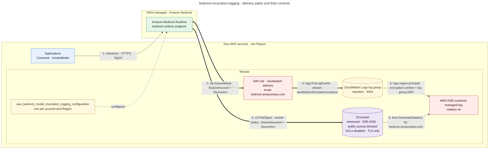

# Module: bedrock-invocation-logging

> **Code status:** `terraform fmt` ✅ · `terraform validate` ✅ (Terraform 1.17.2, provider 6.73.0) · `terraform test` ✅ 7 runs with a mock provider · TFLint 0.66 ✅ · **never planned or applied against AWS**

Account-level Amazon Bedrock **model invocation logging** for one Region, delivered to Amazon
CloudWatch Logs, Amazon S3, or both, with everything encrypted by one customer managed AWS KMS
key. The module creates the destinations with the exact permissions the documentation asks for:
the bucket policy and key policy statements for `bedrock.amazonaws.com`, the role Bedrock assumes
to write to CloudWatch Logs, and the CloudWatch Logs key permissions.

[Module catalog](../README.md) · [Terraform chapters](../../README.md) · [CloudWatch and Bedrock-specific observability](../../../../02-related-aws-services/observability/01-cloudwatch-and-bedrock-observability.md) · [Logging, audit and compliance evidence](../../../../06-security-governance/07-logging-audit-and-compliance.md) · [AWS KMS and encryption](../../../../00-foundations/security/04-kms-encryption.md)

## What it creates



| Legend | Meaning |
|:--|:--|
| Solid arrow | Request or key use |
| Thick arrow | Asynchronous log delivery by the service |
| Dashed arrow | Configuration relationship |
| Cylinder | Data at rest |

**What this shows** — the logging configuration is a Regional account setting, not something
your application calls. After an inference request (1), Bedrock delivers the log record
asynchronously: to CloudWatch Logs through the delivery role (2–3), and to S3 directly as the
`bedrock.amazonaws.com` service principal (4). Both destinations are encrypted with the same key,
whose policy names exactly those two service principals with conditions (5–6).

## The documented behaviour it encodes

| Rule | Source |
|:--|:--|
| Logging covers Converse, ConverseStream, InvokeModel and InvokeModelWithResponseStream on the `bedrock-runtime` endpoint (including the OpenAI-compatible APIs there); calls through `bedrock-mantle` are not captured | [Model invocation logging](https://docs.aws.amazon.com/bedrock/latest/userguide/model-invocation-logging.html) |
| Logging is disabled by default; destinations must be in the same account and Region as the configuration | [Model invocation logging](https://docs.aws.amazon.com/bedrock/latest/userguide/model-invocation-logging.html) |
| Bucket policy: `bedrock.amazonaws.com` may `s3:PutObject` on `<bucket>/<prefix>/AWSLogs/<account>/BedrockModelInvocationLogs/*` with `aws:SourceAccount` and `aws:SourceArn` (`arn:aws:bedrock:<region>:<account>:*`) | [Set up an Amazon S3 destination](https://docs.aws.amazon.com/bedrock/latest/userguide/model-invocation-logging.html) |
| With SSE-KMS, the key policy lets `bedrock.amazonaws.com` call `kms:GenerateDataKey` under the same two conditions | [Set up an Amazon S3 destination](https://docs.aws.amazon.com/bedrock/latest/userguide/model-invocation-logging.html) |
| Bucket ACLs must be disabled for the bucket policy to take effect | [Set up an Amazon S3 destination](https://docs.aws.amazon.com/bedrock/latest/userguide/model-invocation-logging.html) |
| CloudWatch Logs: a role trusting `bedrock.amazonaws.com` (same conditions) with `logs:CreateLogStream` and `logs:PutLogEvents` on `log-group:<name>:log-stream:aws/bedrock/modelinvocations` | [Set up a CloudWatch Logs destination](https://docs.aws.amazon.com/bedrock/latest/userguide/model-invocation-logging.html) |
| Bodies up to 100 KB are logged inline; larger or binary data goes only to S3, and for the CloudWatch destination only when a large-data S3 location is set | [Logging destinations](https://docs.aws.amazon.com/bedrock/latest/userguide/model-invocation-logging.html) |
| A KMS-encrypted log group needs the `logs.<region>.amazonaws.com` principal in the key policy, restricted with `kms:EncryptionContext:aws:logs:arn`; principals that call `PutLogEvents` need KMS permissions, granted in the key policy or in IAM with `kms:ViaService` | [Encrypt log data with AWS KMS](https://docs.aws.amazon.com/AmazonCloudWatch/latest/logs/encrypt-log-data-kms.html) |
| The key policy statement for the account principal (`kms:*`) lets IAM policies grant access and prevents an unmanageable key | [Default key policy](https://docs.aws.amazon.com/kms/latest/developerguide/key-policy-default.html) |
| Log group retention accepts 1, 3, 5, 7, 14, 30, 60, 90, 120, 150, 180, 365, 400, 545, 731, 1096, 1827, 2192, 2557, 2922, 3288 or 3653 days | [PutRetentionPolicy](https://docs.aws.amazon.com/AmazonCloudWatchLogs/latest/APIReference/API_PutRetentionPolicy.html) |
| The logging configuration is per Region and should not be defined in more than one Terraform configuration | [`aws_bedrock_model_invocation_logging_configuration`](https://raw.githubusercontent.com/hashicorp/terraform-provider-aws/main/website/docs/r/bedrock_model_invocation_logging_configuration.html.markdown) |

Every resource type and argument was checked against the provider 6.73.0 schema
([Bedrock subset](../../../../references/terraform-aws-provider-bedrock-schema.json); the S3,
KMS, IAM and CloudWatch Logs types against the full provider schema).

## Usage

> **Code status:** validated with `terraform validate` against this module (provider 6.73.0) · **never planned or applied against AWS**

```hcl
module "invocation_logging" {
  source = "../../04-infrastructure-as-code/terraform/modules/bedrock-invocation-logging"

  name_prefix            = "bedrock-invocation-logs"
  log_retention_days     = 30  # CloudWatch Logs: recent, searchable with Logs Insights
  s3_log_expiration_days = 400 # S3: longer-term audit copy

  # Example choice: leave embedding vectors out of the logs.
  data_delivery = { embedding = false }
}
```

Grant readers access deliberately: a principal needs `logs:` read actions on the log group or
`s3:GetObject` on the bucket **and** `kms:Decrypt` on `module.invocation_logging.kms_key_arn`.

## Inputs

| Name | Type | Default | Description |
|:--|:--|:--|:--|
| `name_prefix` | `string` | `"bedrock-invocation-logs"` | Prefix for the role, key description and default bucket name |
| `enable_cloudwatch_logs` | `bool` | `true` | Deliver to a CloudWatch Logs log group |
| `enable_s3` | `bool` | `true` | Deliver to an S3 bucket; at least one destination is required |
| `cloudwatch_large_data_delivery` | `bool` | `true` | Send bodies over 100 KB and binary data from the CloudWatch path to the bucket |
| `large_data_key_prefix` | `string` | `"bedrock-large-data"` | Prefix for those large bodies; Bedrock may write anywhere below it |
| `log_group_name` | `string` | `"/aws/bedrock/model-invocation-logs"` | Log group name |
| `log_retention_days` | `number` | `90` | One of the `PutRetentionPolicy` values; never-expire is not offered |
| `s3_bucket_name` | `string` | `null` | `null` derives `<name_prefix>-<account-id>-<region>` |
| `s3_key_prefix` | `string` | `"bedrock"` | Key prefix, no leading or trailing slash; `""` for none |
| `s3_log_expiration_days` | `number` | `365` | Expire log and large-data objects (noncurrent versions 30 days later); `null` keeps them |
| `force_destroy` | `bool` | `false` | Allow destroying a non-empty bucket |
| `data_delivery` | `object` | all `true` | `text`, `image`, `embedding`, `video` |
| `kms_key_deletion_window_in_days` | `number` | `30` | 7–30 |
| `tags` | `map(string)` | `{}` | Extra tags |

## Outputs

| Name | Description |
|:--|:--|
| `kms_key_arn` | Key that encrypts both destinations |
| `log_group_name`, `log_group_arn` | The log group, or `null` |
| `cloudwatch_delivery_role_arn` | Role Bedrock assumes for CloudWatch Logs, or `null` |
| `s3_bucket_name`, `s3_bucket_arn` | The log bucket, or `null` |
| `s3_log_object_prefix` | `<prefix>/AWSLogs/<account-id>/BedrockModelInvocationLogs` |
| `large_data_key_prefix` | Prefix of large bodies from the CloudWatch destination, or `null` |
| `key_policy_json`, `bucket_policy_json`, `cloudwatch_trust_policy_json` | Rendered policies, for review and tests |

## Design notes

- **Policies are built with `jsonencode` in `locals`** from the account, partition and Region
  data sources, so the tests can assert on the exact statements with a mock provider.
- **One key, narrow statements.** The CloudWatch Logs statement is pinned to the log group ARN
  through the encryption context; the Bedrock statement allows only `kms:GenerateDataKey` and
  carries the confused-deputy conditions. `Resource = "*"` in a key policy means "this key".
  The `kms:*` statement is the documented default for the account principal; it grants nothing
  by itself and lets IAM policies delegate access.
- **The delivery role uses the key only through CloudWatch Logs** (`kms:ViaService`), with the
  explicit actions `kms:Encrypt`, `kms:Decrypt`, `kms:GenerateDataKey` and `kms:DescribeKey`
  instead of the wildcarded forms in the CloudWatch Logs example. **Our reading:** these cover
  writing to the log group; verify in a sandbox before relying on it.
- **Two write paths, both narrow.** The S3 destination may write only below the documented
  `AWSLogs/<account-id>/BedrockModelInvocationLogs/` path. Large bodies from the CloudWatch
  destination go to their own `large_data_key_prefix`, and Bedrock may write anywhere below it,
  because the documentation does not give the object layout for that path.
- **The bucket denies requests without TLS** and expires objects under both prefixes through a
  lifecycle rule, both beyond what the Bedrock page requires.
- **Ordering.** The logging configuration depends on the role policy, the bucket policy and the
  bucket encryption, so logging is switched on only after every permission exists.

> [!CAUTION]
> **Sensitive data** — Invocation logs contain full prompts and responses, which can include
> personal data and secrets pasted by users. Treat the bucket and log group as sensitive data
> stores: restrict `kms:Decrypt` on the key, keep `force_destroy = false`, and set retention to
> what your policy requires.

> [!WARNING]
> **Common mistake** — Declaring this module (or the resource) in two root modules for the same
> account and Region. There is only one logging configuration per Region, so each apply
> overwrites the other's settings; the provider documentation warns against defining it in more
> than one configuration.

## Testing

```bash
terraform init -backend=false
terraform validate
terraform test          # 7 runs, mock provider, no AWS credentials
```

The tests in [`tests/logging.tftest.hcl`](tests/logging.tftest.hcl) cover: both destinations
with the bucket hardening, the large-data prefix, the lifecycle rules and the log group settings,
the bucket policy and delivery role policy
against the documented statements, the key policy principals and conditions, S3-only delivery
without a prefix, CloudWatch-only delivery without a bucket, and two rejections (no destination,
an unsupported retention value). The mock provider fixes the KMS key ARN during plan
(`override_during = plan`) so the role policy can be inspected.

## Limitations

- Validated against the provider schema and tested with mocks only. Whether delivery succeeds is
  decided by Bedrock, IAM, S3 and KMS at run time in a real account.
- **UNVERIFIED — REQUIRES DOCUMENTATION REVIEW**: the object layout that Bedrock uses below the
  large-data prefix of the CloudWatch destination. The documentation gives a bucket policy path
  only for the S3 destination, so the module grants `s3:PutObject` on the whole
  `large_data_key_prefix` (still limited by `aws:SourceAccount` and `aws:SourceArn`). Looked for
  the layout on the model invocation logging page and the `PutModelInvocationLoggingConfiguration`
  API reference.
- The `PutModelInvocationLoggingConfiguration` API also has `audioDataDeliveryEnabled`; provider
  6.73.0 has no argument for it, so audio delivery is left at the service default.
- The module always creates its own key and bucket; bringing an existing key or a central
  logging bucket in another account is not supported (the documentation requires same-account
  destinations).
- No S3 server access logging or object lock on the log bucket, and no alarms; add them in the
  root module. The delivery health metrics (`ModelInvocationLogsCloudWatchDeliveryFailure` and
  related) are listed in
  [CloudWatch and Bedrock-specific observability](../../../../02-related-aws-services/observability/01-cloudwatch-and-bedrock-observability.md).
