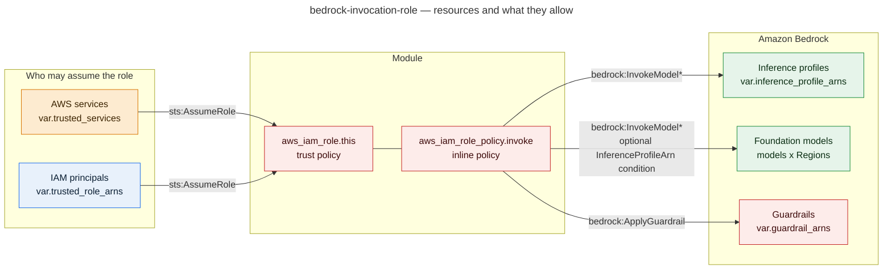

# Module: bedrock-invocation-role

> **Code status:** `terraform fmt` ✅ · `terraform validate` ✅ (provider 6.73.0) · `terraform test` ✅ 7 runs with a mock provider · **never planned or applied against AWS**

A least-privilege IAM role for calling Amazon Bedrock inference APIs (Converse, ConverseStream,
InvokeModel, InvokeModelWithResponseStream). It grants access to **named models in named
Regions** — never `*` — and can require an inference profile and a guardrail.

[Module catalog](../README.md) · [Terraform chapters](../../README.md) · [Converse API](../../../../01-amazon-bedrock/inference/01-converse-api.md) · [Cross-Region inference](../../../../01-amazon-bedrock/inference/04-cross-region-inference.md)

## What it creates



## The documented behaviour it encodes

| Rule | Source |
|:--|:--|
| Converse requires `bedrock:InvokeModel`; to deny inference on a resource you must deny both `bedrock:InvokeModel` and `bedrock:InvokeModelWithResponseStream` | [Converse API reference](https://docs.aws.amazon.com/bedrock/latest/APIReference/API_runtime_Converse.html) |
| When a policy names an inference profile, it must also name the foundation model in each Region associated with the profile | [Prerequisites for inference profiles](https://docs.aws.amazon.com/bedrock/latest/userguide/inference-profiles-prereq.html) |
| Global inference profiles need the Region-less ARN `arn:aws:bedrock:::foundation-model/<id>` | [Prerequisites for inference profiles](https://docs.aws.amazon.com/bedrock/latest/userguide/inference-profiles-prereq.html) |
| `bedrock:InferenceProfileArn` restricts model invocation to specific inference profiles | [Prerequisites for inference profiles](https://docs.aws.amazon.com/bedrock/latest/userguide/inference-profiles-prereq.html) |
| Using a guardrail needs `bedrock:ApplyGuardrail` on the guardrail ARN | [Guardrails permissions](https://docs.aws.amazon.com/bedrock/latest/userguide/guardrails-permissions.html) |
| `bedrock:GuardrailIdentifier` with an explicit deny enforces a guardrail on Converse, ConverseStream, InvokeModel and InvokeModelWithResponseStream | [Enforce specific guardrails](https://docs.aws.amazon.com/bedrock/latest/userguide/guardrails-permissions-id.html) |

## Usage

```hcl
module "chat_invoke_role" {
  source = "../../04-infrastructure-as-code/terraform/modules/bedrock-invocation-role"

  name             = "chat-invoke"
  trusted_services = ["lambda.amazonaws.com"]

  # Confirm current IDs in the Bedrock model catalog before use.
  foundation_model_ids = [var.model_id]
  model_regions        = ["us-east-1", "us-east-2", "us-west-2"]

  # Invoke only through a geographic cross-Region inference profile.
  inference_profile_arns         = [var.inference_profile_arn]
  restrict_to_inference_profiles = true

  # Refuse any call that does not carry this guardrail.
  guardrail_arns                 = [aws_bedrock_guardrail.chat.guardrail_arn]
  required_guardrail_arn_pattern = "${aws_bedrock_guardrail.chat.guardrail_arn}:*"
}
```

## Inputs

| Name | Type | Default | Description |
|:--|:--|:--|:--|
| `name` | `string` | — | Role name; also prefixes the inline policy name |
| `trusted_services` | `list(string)` | `[]` | Service principals that may assume the role |
| `trusted_role_arns` | `list(string)` | `[]` | IAM principal ARNs that may assume the role |
| `foundation_model_ids` | `list(string)` | — | Model IDs the role may invoke. No wildcards |
| `model_regions` | `list(string)` | — | Regions where those models may be invoked; include every destination Region of a cross-Region profile |
| `inference_profile_arns` | `list(string)` | `[]` | System-defined or application inference profile ARNs |
| `restrict_to_inference_profiles` | `bool` | `false` | Allow the models only through the listed profiles |
| `allow_global_inference` | `bool` | `false` | Add the Region-less model ARNs that Global profiles need |
| `allow_streaming` | `bool` | `true` | Grant `bedrock:InvokeModelWithResponseStream` |
| `guardrail_arns` | `list(string)` | `[]` | Guardrails the role may apply |
| `required_guardrail_arn_pattern` | `string` | `null` | When set, deny inference without a matching guardrail |
| `permissions_boundary_arn` | `string` | `null` | Permissions boundary for the role |
| `tags` | `map(string)` | `{}` | Extra tags |

At least one of `trusted_services` and `trusted_role_arns` must be non-empty (checked by a precondition).

## Outputs

| Name | Description |
|:--|:--|
| `role_arn` | ARN of the role |
| `role_name` | Name of the role |
| `policy_json` | The rendered inference policy |
| `foundation_model_arns` | Every foundation-model ARN granted |

## Design notes

- **Policies are built with `jsonencode` in `locals`**, not with the `aws_iam_policy_document`
  data source. That keeps the logic pure, so `terraform test` can assert on the exact policy
  with a mock provider and no credentials.
- **No wildcard on models.** A validation rule rejects `*`. If you want every model, write that
  policy deliberately, outside this module.
- **The deny statement uses `Resource = "*"`** on purpose: an explicit deny must cover every
  path to inference, including inference profiles.

> [!WARNING]
> **Common mistake** — Granting the inference profile ARN but not the foundation-model ARNs in
> the profile's destination Regions. The call fails with an access-denied error that names a
> Region you did not expect. Set `model_regions` to every Region the profile can route to.

## Testing

```bash
terraform init -backend=false
terraform validate
terraform test          # 7 runs, mock provider, no AWS credentials
```

The tests in [`tests/policy.tftest.hcl`](tests/policy.tftest.hcl) cover: default direct
invocation, disabling streaming, Global inference ARNs, the inference-profile condition, the
guardrail deny, and two rejection cases (wildcard model, role nobody can assume).

## Limitations

- Validated against the provider schema and tested with mocks only. IAM does not evaluate the
  policy until it is attached and used in a real account.
- The role does not grant access to Provisioned Throughput, custom model deployments, imported
  models, Marketplace endpoints or prompt routers; those have different resource ARNs.
- Model IDs and inference profile destination Regions change. Re-check them when a model is retired.
