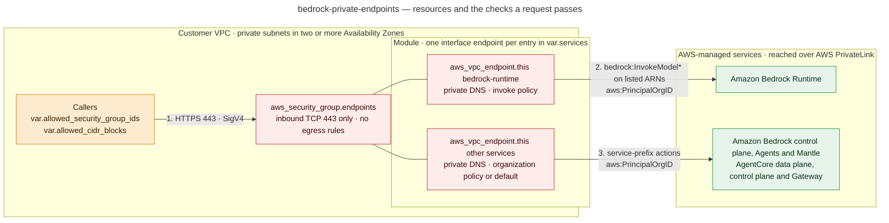

# Module: bedrock-private-endpoints

> **Code status:** `terraform fmt` ✅ · `terraform validate` ✅ (provider 6.73.0) · `terraform test` ✅ 11 runs with a mock provider · `tflint` ✅ · **never planned or applied against AWS — never deployed**

Interface VPC endpoints (AWS PrivateLink) for the Amazon Bedrock and Amazon Bedrock AgentCore
APIs, so that callers in private subnets reach them with no internet gateway or NAT gateway. The
module creates one endpoint per service you select, one security group that admits HTTPS only
from named callers, and optional endpoint policies: **inference on named models only**, and
**principals of your organization only**.

[Module catalog](../README.md) · [Terraform chapters](../../README.md) · [VPC endpoints and AWS PrivateLink](../../../../00-foundations/networking/03-vpc-endpoints-and-privatelink.md) · [Private connectivity for Bedrock](../../../../02-related-aws-services/networking/01-private-connectivity-for-bedrock.md)

## What it creates



Red boxes are the controls this module creates. A request (1) must pass the security group, then
(2, 3) the endpoint policy, and finally the caller's own IAM policy, which this module does not
change. Endpoints without a custom policy keep the AWS default full-access policy.

## The documented behaviour it encodes

| Rule | Source |
|:--|:--|
| Bedrock endpoint services are `com.amazonaws.<region>.` followed by `bedrock`, `bedrock-runtime`, `bedrock-mantle`, `bedrock-agent` or `bedrock-agent-runtime`; with private DNS, the default Regional names (for Mantle `bedrock-mantle.<region>.api.aws`) resolve to the endpoint | [Bedrock interface endpoints](https://docs.aws.amazon.com/bedrock/latest/userguide/vpc-interface-endpoints.html) |
| AgentCore has three endpoint services: `bedrock-agentcore` (data plane), `bedrock-agentcore-control` (control plane) and `bedrock-agentcore.gateway` (Gateway) | [AgentCore interface endpoints](https://docs.aws.amazon.com/bedrock-agentcore/latest/devguide/vpc-interface-endpoints.html) |
| Private DNS needs DNS hostnames and DNS resolution enabled on the VPC; the endpoint security group must allow inbound HTTPS from the callers; one subnet per Availability Zone; interface endpoints are billed per hour and per GB processed | [Access an AWS service using an interface VPC endpoint](https://docs.aws.amazon.com/vpc/latest/privatelink/create-interface-endpoint.html) |
| With no custom policy an endpoint allows full access. An endpoint policy does not override or replace identity-based policies, must contain a `Principal` element and cannot exceed 20,480 characters | [Control access to VPC endpoints using endpoint policies](https://docs.aws.amazon.com/vpc/latest/privatelink/vpc-endpoints-access.html) |
| `Converse` requires `bedrock:InvokeModel`; to cover inference completely, cover both `bedrock:InvokeModel` and `bedrock:InvokeModelWithResponseStream` | [Converse API reference](https://docs.aws.amazon.com/bedrock/latest/APIReference/API_runtime_Converse.html) |
| Applying a guardrail needs `bedrock:ApplyGuardrail` on the guardrail ARN | [Guardrails permissions](https://docs.aws.amazon.com/bedrock/latest/userguide/guardrails-permissions.html) |
| AgentCore endpoint policies can restrict IAM principals only; for OAuth callers to pass, the principal must be `*` | [AgentCore interface endpoints](https://docs.aws.amazon.com/bedrock-agentcore/latest/devguide/vpc-interface-endpoints.html) |
| `aws:PrincipalOrgID` is a global condition key and a sensitive key: never use wildcards in it | [AWS global condition context keys](https://docs.aws.amazon.com/IAM/latest/UserGuide/reference_policies_condition-keys.html) |
| Terraform removes the default allow-all egress rule from security groups it creates; separate ingress-rule resources are the provider's current best practice | [`aws_security_group` (provider 6.73.0)](https://raw.githubusercontent.com/hashicorp/terraform-provider-aws/v6.73.0/website/docs/r/security_group.html.markdown) |

## Usage

```hcl
module "bedrock_endpoints" {
  source = "../../04-infrastructure-as-code/terraform/modules/bedrock-private-endpoints"

  name       = "chat"
  vpc_id     = var.vpc_id
  subnet_ids = var.private_subnet_ids # one subnet in each of two or more Availability Zones

  services                   = ["bedrock-runtime", "bedrock-agent-runtime"]
  allowed_security_group_ids = [var.app_security_group_id]

  # Through this endpoint: inference on these resources only, by principals of this organization.
  invoke_resource_arns = concat(
    [var.inference_profile_arn],
    [for r in ["us-east-1", "us-east-2", "us-west-2"] : "arn:aws:bedrock:${r}::foundation-model/${var.model_id}"],
  )
  guardrail_arns   = [var.guardrail_arn]
  principal_org_id = var.organization_id
}
```

Confirm current model IDs and the destination Regions of an inference profile in the Bedrock
documentation before use. The snippet was validated with `terraform validate` in a root module
that declares those variables.

## Inputs

| Name | Type | Default | Description |
|:--|:--|:--|:--|
| `name` | `string` | — | Prefix for the security group name and the endpoints' `Name` tags |
| `vpc_id` | `string` | — | VPC in which the endpoints are created |
| `subnet_ids` | `list(string)` | — | One subnet per Availability Zone; two or more Availability Zones recommended (a `check` block warns otherwise) |
| `services` | `set(string)` | `["bedrock-runtime"]` | Service-name suffixes from the allow-list: `bedrock`, `bedrock-runtime`, `bedrock-mantle`, `bedrock-agent`, `bedrock-agent-runtime`, `bedrock-agentcore`, `bedrock-agentcore-control`, `bedrock-agentcore.gateway` |
| `private_dns_enabled` | `bool` | `true` | Resolve the default service names to the endpoints |
| `allowed_cidr_blocks` | `list(string)` | `[]` | IPv4 sources allowed on TCP 443; `0.0.0.0/0` is rejected |
| `allowed_security_group_ids` | `list(string)` | `[]` | Security groups allowed on TCP 443 (preferred) |
| `invoke_resource_arns` | `list(string)` | `[]` | When set, the `bedrock-runtime` endpoint allows inference only on these ARNs. No wildcards |
| `guardrail_arns` | `list(string)` | `[]` | Guardrails that may be applied through the restricted `bedrock-runtime` endpoint |
| `principal_org_id` | `string` | `null` | When set, endpoint policies admit only principals of this organization |
| `apply_org_policy_to_oauth_services` | `bool` | `false` | Also restrict `bedrock-agentcore` and `bedrock-agentcore.gateway`; breaks OAuth callers |
| `tags` | `map(string)` | `{}` | Extra tags |

At least one of `allowed_cidr_blocks` and `allowed_security_group_ids` must be non-empty, and
`invoke_resource_arns` requires `bedrock-runtime` in `services` (checked by preconditions).

## Outputs

| Name | Description |
|:--|:--|
| `endpoint_ids` | Service suffix → endpoint ID, for `aws:SourceVpce` conditions in resource policies |
| `endpoint_dns_entries` | Service suffix → DNS entries, needed when private DNS is off |
| `endpoint_network_interface_ids` | Service suffix → endpoint network interface IDs |
| `security_group_id` | The endpoint security group |
| `service_names` | Service suffix → full service name |
| `endpoint_policies` | Service suffix → attached policy JSON, or `null` for the default policy |

## Design notes

- **Policies are built with `jsonencode` in `locals`** and exposed in `endpoint_policies`, so
  `terraform test` asserts on the exact JSON with a mock provider.
- **Which endpoint gets which policy.** `bedrock-runtime` gets the invoke policy when
  `invoke_resource_arns` is set. Every other endpoint gets an organization-only policy when
  `principal_org_id` is set, with the service's action prefix (`bedrock:*`, `bedrock-mantle:*`
  or `bedrock-agentcore:*`). That wildcard is a filter, not a grant: callers still need an
  identity-based policy.
- **OAuth-capable endpoints are left out of the organization policy by default.** An OAuth
  caller of AgentCore Runtime or Gateway is not an IAM principal, so a condition on
  `aws:PrincipalOrgID` would refuse it.
- **One security group, one ingress rule per source**, TCP 443 only, no egress rules: the
  endpoint network interfaces only answer connections.
- **Preconditions** stop a plan when the VPC's DNS attributes are off while private DNS is on,
  when nobody could reach the endpoints, or when a policy would exceed 20,480 characters.
- **FIPS endpoint services are not in the allow-list.** The Bedrock page lists `bedrock-fips`
  and `bedrock-runtime-fips` for six Regions but gives no private DNS names for them; create
  those with `aws_vpc_endpoint` directly after checking the service in your Region.

> [!TIP]
> **Academy recommendation** — Put the same ARNs in `invoke_resource_arns` as in the callers'
> identity policies: the inference profile and the foundation model in every destination Region
> (see [`bedrock-invocation-role`](../bedrock-invocation-role/README.md)). Whether an endpoint
> policy is also evaluated against the destination-Region model ARNs of a cross-Region profile
> is **UNVERIFIED — REQUIRES DOCUMENTATION REVIEW** (the Bedrock interface-endpoint page does not
> say); listing them is harmless. This is our design guidance, not an official AWS reference
> architecture.

> [!WARNING]
> **Common mistake** — Attaching the invoke policy and then calling another `bedrock-runtime`
> operation through the same endpoint. Any request whose IAM action is not
> `bedrock:InvokeModel`, `bedrock:InvokeModelWithResponseStream` or `bedrock:ApplyGuardrail` is
> refused by the endpoint policy. List the actions your code needs before you restrict the endpoint.

## Testing

```bash
terraform init -backend=false
terraform validate
terraform test          # 11 runs, mock provider, no AWS credentials
```

The tests in [`tests/endpoints.tftest.hcl`](tests/endpoints.tftest.hcl) cover: the default
single `bedrock-runtime` endpoint, AgentCore and Agents service names, the invoke policy with
organization and guardrail statements, the organization policy on OAuth-capable endpoints, and
seven rejection cases (unknown service, wildcard ARN, `0.0.0.0/0`, unreachable endpoint, invoke
policy without `bedrock-runtime`, VPC DNS off, a single subnet).

## Limitations

- Validated against the provider schema and tested with mocks only. Whether each service is
  offered in your Region is not checked; [VPC endpoints and AWS PrivateLink](../../../../00-foundations/networking/03-vpc-endpoints-and-privatelink.md)
  explains how to look it up.
- Only the Bedrock-family services above. A private workload usually also needs endpoints for
  AWS STS, Amazon CloudWatch Logs, AWS KMS, Amazon ECR and an Amazon S3 gateway endpoint; create
  them with `aws_vpc_endpoint` next to this module.
- `policy` is an optional and computed argument in provider 6.73.0. **Our reading:** removing
  the inputs that produced a custom policy may leave the old policy attached instead of restoring
  the default; recreate the endpoint or set a policy explicitly. Not tested against AWS.
- IPv4 ingress rules only; no `dns_options`, `ip_address_type` or designated IP addresses.
- Endpoint policy changes can take a few minutes to take effect.
