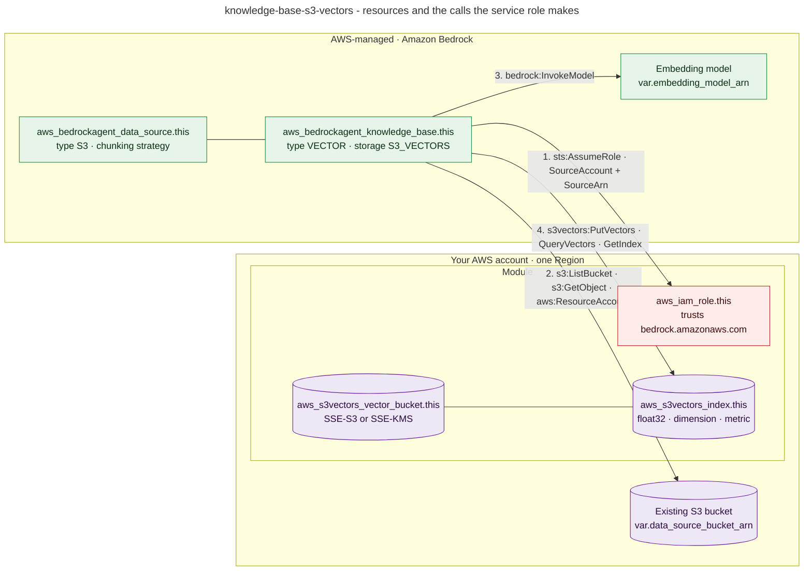

# Module: knowledge-base-s3-vectors

> **Code status:** `terraform fmt` ✅ · `terraform validate` ✅ (Terraform 1.17.2, provider 6.73.0) · `terraform test` ✅ 8 runs with a mock provider · TFLint 0.66 ✅ · **never planned or applied against AWS**

A **customer-managed** Amazon Bedrock knowledge base (type `VECTOR`) whose vector store is an
Amazon S3 Vectors bucket and index created by the module, with an Amazon S3 data source and a
least-privilege service role built from the documented permission blocks. The index dimension
and the knowledge base's embedding dimension come from one variable, so they cannot drift apart.

[Module catalog](../README.md) · [Terraform chapters](../../README.md) · [Customer-managed knowledge bases and vector stores](../../../../01-amazon-bedrock/knowledge-bases/03-customer-managed-knowledge-bases.md) · [Ingestion, parsing and chunking](../../../../01-amazon-bedrock/knowledge-bases/04-ingestion-parsing-chunking.md) · [Amazon S3 and Amazon S3 Vectors](../../../../02-related-aws-services/storage/01-amazon-s3-and-s3-vectors.md) · [`managed-knowledge-base`](../managed-knowledge-base/README.md)

> [!IMPORTANT]
> **Status** — Customer-managed knowledge bases are GA, but AWS now recommends the Managed
> Knowledge Base for new work; use [`managed-knowledge-base`](../managed-knowledge-base/README.md)
> unless you need this type (for example for `RetrieveAndGenerate`, or a store you control).
> Source: [Knowledge Bases overview](https://docs.aws.amazon.com/bedrock/latest/userguide/knowledge-base.html)

## What it creates



| Legend | Meaning |
|:--|:--|
| Purple cylinder | Data at rest in your account |
| Green | Bedrock resources and the embedding model |
| Red | The service role (security boundary) |
| Numbered arrows | Calls Bedrock makes with the service role during ingestion and queries |

**What this shows** — every byte of data stays in your account: documents in your bucket,
vectors in the module's S3 Vectors index. Bedrock reaches both only through the service role
(1), reads documents (2), embeds chunks and queries with the model (3), and writes and searches
vectors (4). Nothing is ingested until you call `StartIngestionJob`.

## The documented behaviour it encodes

| Rule | Source |
|:--|:--|
| Trust policy: `bedrock.amazonaws.com`, `aws:SourceAccount` and an `ArnLike` `aws:SourceArn` of `knowledge-base/*` | [Create a service role for Knowledge Bases](https://docs.aws.amazon.com/bedrock/latest/userguide/kb-permissions.html) |
| Model access: `bedrock:ListFoundationModels` and `bedrock:ListCustomModels` on `*`, `bedrock:InvokeModel` on the embedding model ARN | [Create a service role for Knowledge Bases](https://docs.aws.amazon.com/bedrock/latest/userguide/kb-permissions.html) |
| S3 data source: `s3:ListBucket` on the bucket and `s3:GetObject` on its objects, each with `aws:ResourceAccount` | [Create a service role for Knowledge Bases](https://docs.aws.amazon.com/bedrock/latest/userguide/kb-permissions.html) |
| S3 Vectors: `s3vectors:PutVectors`, `GetVectors`, `DeleteVectors`, `QueryVectors`, `GetIndex` on `bucket/<bucket>/index/<index>` | [Create a service role for Knowledge Bases](https://docs.aws.amazon.com/bedrock/latest/userguide/kb-permissions.html) |
| Encrypted documents: `kms:Decrypt` with `kms:ViaService` = `s3.<region>.amazonaws.com`; transient ingestion data: `kms:GenerateDataKey` and `kms:Decrypt` on the data source key | [Encryption of knowledge base resources](https://docs.aws.amazon.com/bedrock/latest/userguide/encryption-kb.html) |
| `CreateDataSource`, `UpdateDataSource` and `StartIngestionJob` pass no role, so scope the role to the buckets and prefixes your data sources need | [Create a service role for Knowledge Bases](https://docs.aws.amazon.com/bedrock/latest/userguide/kb-permissions.html) |
| Index: dimension 1–4096, cosine or Euclidean, float32 only; add `AMAZON_BEDROCK_TEXT` and `AMAZON_BEDROCK_METADATA` as non-filterable keys (at most 10) | [Prerequisites for a vector store you created](https://docs.aws.amazon.com/bedrock/latest/userguide/knowledge-base-setup.html) |
| Semantic search only; up to 1 KB of custom metadata and 35 keys per vector; hierarchical chunking with high token counts can exceed metadata limits | [Using S3 Vectors with Bedrock Knowledge Bases](https://docs.aws.amazon.com/AmazonS3/latest/userguide/s3-vectors-bedrock-kb.html) |
| Vector bucket names: 3–63 lowercase letters, digits and hyphens, unique per account and Region | [Vector bucket naming rules](https://docs.aws.amazon.com/AmazonS3/latest/userguide/s3-vectors-buckets-naming.html) |
| SSE-S3 by default; SSE-KMS needs a full key ARN, cannot be changed later, and the key policy must let `indexing.s3vectors.amazonaws.com` call `kms:Decrypt`; principals need `kms:Decrypt` for vector operations | [Data protection and encryption in S3 Vectors](https://docs.aws.amazon.com/AmazonS3/latest/userguide/s3-vectors-data-encryption.html) |
| Chunking strategies `FIXED_SIZE` (max tokens 1–8192, overlap 1–99%), `HIERARCHICAL` (two levels), `SEMANTIC` (max tokens 1–8192, buffer 0–1, breakpoint 50–99), `NONE` | [ChunkingConfiguration](https://docs.aws.amazon.com/bedrock/latest/APIReference/API_agent_ChunkingConfiguration.html), [FixedSizeChunkingConfiguration](https://docs.aws.amazon.com/bedrock/latest/APIReference/API_agent_FixedSizeChunkingConfiguration.html), [HierarchicalChunkingConfiguration](https://docs.aws.amazon.com/bedrock/latest/APIReference/API_agent_HierarchicalChunkingConfiguration.html), [SemanticChunkingConfiguration](https://docs.aws.amazon.com/bedrock/latest/APIReference/API_agent_SemanticChunkingConfiguration.html) |
| `s3_vectors_configuration` takes `index_arn`, or `index_name` with `vector_bucket_arn`, not both | [`aws_bedrockagent_knowledge_base`](https://raw.githubusercontent.com/hashicorp/terraform-provider-aws/main/website/docs/r/bedrockagent_knowledge_base.html.markdown) |

Resource types and arguments were checked against the
[provider schema](../../../../references/terraform-aws-provider-bedrock-schema.json). The SDK model
for `CreateDataSource` limits `inclusionPrefixes` to exactly one prefix, which is why the module
takes a single `inclusion_prefix`.

## Usage

> **Code status:** validated with `terraform validate` against this module (provider 6.73.0) · **never planned or applied against AWS**

```hcl
module "handbook_kb" {
  source = "../../04-infrastructure-as-code/terraform/modules/knowledge-base-s3-vectors"

  name                   = "handbook-kb"
  embedding_model_arn    = var.embedding_model_arn # confirm the model ID and its dimensions
  embedding_dimensions   = 1024
  data_source_bucket_arn = aws_s3_bucket.documents.arn
  inclusion_prefix       = "handbooks/"

  chunking_strategy   = "FIXED_SIZE"
  fixed_size_chunking = { max_tokens = 300, overlap_percentage = 20 }
}
```

After `apply`, nothing is searchable until the first sync: call `StartIngestionJob` with the
`knowledge_base_id` and `data_source_id` outputs, for example from a pipeline step. Every sync
and every query is billed for embedding tokens, and S3 Vectors bills storage and requests;
`terraform destroy` removes the module's resources (the documents bucket is yours).

## Inputs

| Name | Type | Default | Description |
|:--|:--|:--|:--|
| `name` | `string` | — | 3–48 lowercase characters; also names the vector bucket, index, data source and role |
| `description` | `string` | `null` | Knowledge base description |
| `embedding_model_arn` | `string` | — | Bedrock embedding model ARN, no wildcards |
| `embedding_dimensions` | `number` | `1024` | 1–4096; used for both the index and the knowledge base |
| `distance_metric` | `string` | `"cosine"` | `cosine` or `euclidean` |
| `additional_non_filterable_metadata_keys` | `list(string)` | `[]` | Added to the two Bedrock keys; at most 10 in total |
| `data_source_bucket_arn` | `string` | — | Existing general purpose bucket in the same Region |
| `data_source_bucket_owner_account_id` | `string` | `null` | `null` means the current account |
| `inclusion_prefix` | `string` | `null` | One prefix to ingest; also the only prefix the role can read |
| `chunking_strategy` | `string` | `"FIXED_SIZE"` | `FIXED_SIZE`, `HIERARCHICAL`, `SEMANTIC` or `NONE` |
| `fixed_size_chunking` | `object` | 300 tokens, 20% | Used with `FIXED_SIZE` |
| `hierarchical_chunking` | `object` | 1500 / 300 tokens, overlap 60 | Used with `HIERARCHICAL` |
| `semantic_chunking` | `object` | 300 tokens, buffer 0, breakpoint 95 | Used with `SEMANTIC` |
| `data_deletion_policy` | `string` | `"DELETE"` | `DELETE` or `RETAIN` vectors when the data source is deleted |
| `vector_kms_key_arn` | `string` | `null` | SSE-KMS for the vector bucket; `null` means SSE-S3 |
| `data_source_kms_key_arn` | `string` | `null` | Key of an SSE-KMS documents bucket |
| `transient_data_kms_key_arn` | `string` | `null` | Key for transient ingestion data |
| `vector_bucket_force_destroy` | `bool` | `false` | Allow destroying a non-empty vector bucket |
| `permissions_boundary_arn` | `string` | `null` | Permissions boundary for the role |
| `tags` | `map(string)` | `{}` | Extra tags |

The chunking defaults are this module's choices, not service defaults.

## Outputs

| Name | Description |
|:--|:--|
| `knowledge_base_id`, `knowledge_base_arn` | For `Retrieve`, `RetrieveAndGenerate`, `StartIngestionJob` and caller policies |
| `data_source_id` | For `StartIngestionJob` |
| `vector_bucket_arn`, `vector_index_arn` | The vector store |
| `service_role_arn` | The service role |
| `service_role_policy_json`, `trust_policy_json` | Rendered policies, for review and tests |
| `vector_kms_key_policy_statement_json` | Statement to add to the vector key's policy, or `null` |

## Design notes

- **One store per knowledge base.** The vector bucket and index are named after the knowledge
  base and created with it, following the documented best practice of a separate vector store
  for each knowledge base
  ([Using S3 Vectors with Bedrock Knowledge Bases](https://docs.aws.amazon.com/AmazonS3/latest/userguide/s3-vectors-bedrock-kb.html)).
- **The role's ARNs are built from names**, not from resource attributes, so the policy is known
  at plan time, has no dependency cycle, and can be asserted on in tests.
- **The only `"*"` resource** is the documented `ListFoundationModels`/`ListCustomModels`
  statement (read-only listing). Everything else names a model, bucket, prefix, index or key.
- **`depends_on`** makes the knowledge base wait for the role policy, so Bedrock can reach the
  model, documents and index when the knowledge base is created.
- **Defaults** — SSE-S3 for vectors, `DELETE` data deletion policy (vectors are removed with the
  data source, the vector bucket never is) and fixed-size chunking.

> [!WARNING]
> **Common mistake** — Changing `embedding_model_arn`, `embedding_dimensions`,
> `distance_metric` or the chunking settings on a live knowledge base. They force replacement of
> the index, knowledge base or data source, and every document must be ingested again. Decide
> them before the first sync.

> [!TIP]
> **Academy recommendation** — Prefer `FIXED_SIZE` or `SEMANTIC` chunking on S3 Vectors; the S3
> documentation warns that hierarchical chunking with high token counts can exceed the per-vector
> metadata limits. This is our design guidance, not an official AWS reference architecture.

## Testing

```bash
terraform init -backend=false
terraform validate
terraform test          # 8 runs, mock provider, no AWS credentials
```

The tests in [`tests/knowledge_base.tftest.hcl`](tests/knowledge_base.tftest.hcl) cover: the
vector store and knowledge base wiring (dimensions, metric, non-filterable keys, storage type,
SSE-S3), the five least-privilege role statements and the trust policy, prefix narrowing and the
three optional KMS keys, semantic and hierarchical chunking, and three rejections (8,192
dimensions, a wildcard bucket ARN, an unknown chunking strategy).

## Limitations

- Validated against the provider schema and tested with mocks only. A role that cannot reach the
  index, or a dimension the model does not produce, surfaces during creation or the first sync.
- No resource starts an ingestion job; call `StartIngestionJob` from a pipeline or a schedule.
- The S3 documentation recommends a vector bucket policy that restricts the bucket and index to
  the custom role. The module does not create one, because a deny-all-others policy must also
  exempt your deployment and break-glass roles; add `aws_s3vectors_vector_bucket_policy` in the
  root module.
- The key policies of the optional KMS keys are not managed; add the statement from
  `vector_kms_key_policy_statement_json` to the vector key, and keep the account principal
  statement so that the role's IAM grants take effect.
- No custom parsing, context enrichment or custom transformation Lambda; S3 data source only.
- Since 2026-09-30 new Confluence, SharePoint, Salesforce and Web Crawler data sources cannot be
  created on customer-managed knowledge bases
  ([Connect a data source](https://docs.aws.amazon.com/bedrock/latest/userguide/data-source-connectors.html)).
