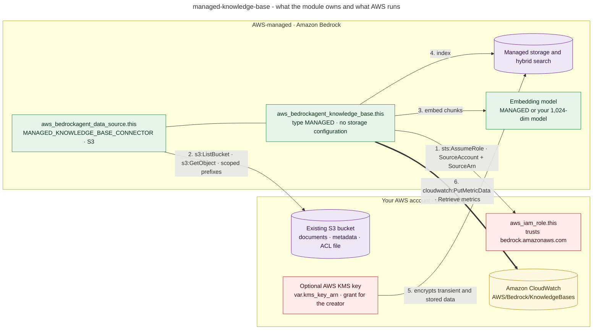

# Module: managed-knowledge-base

> **Code status:** `terraform fmt` ✅ · `terraform validate` ✅ (Terraform 1.17.2, provider 6.73.0) · `terraform test` ✅ 8 runs with a mock provider · TFLint 0.66 ✅ · **never planned or applied against AWS**

An Amazon Bedrock **Managed Knowledge Base** (type `MANAGED`): Amazon Bedrock runs parsing,
chunking, embedding, storage, hybrid search and reranking, and you supply an Amazon S3 data source
and a service role. The module uses the service-managed embedding model by default or your own
1,024-dimension model, an optional customer managed KMS key, the managed S3 connector with
filters, sync schedule, deletion protection and optional document-level ACLs, and a service role
that can read only what the connector needs.

[Module catalog](../README.md) · [Terraform chapters](../../README.md) · [Managed Knowledge Base](../../../../01-amazon-bedrock/knowledge-bases/02-managed-knowledge-base.md) · [Knowledge Bases overview](../../../../01-amazon-bedrock/knowledge-bases/01-knowledge-bases-overview.md) · [Agentic retrieval](../../../../01-amazon-bedrock/agentic-retrieval/01-agentic-retrieval.md) · [`knowledge-base-s3-vectors`](../knowledge-base-s3-vectors/README.md)

> [!IMPORTANT]
> **Status** — Generally available since 2026-06-17 in nine Regions (GovCloud (US-West) without
> service-managed models, ACLs or SaaS connectors), and the type AWS recommends.
> `RetrieveAndGenerate` does not work on it; use `Retrieve` or `AgenticRetrieveStream`.
> Sources: [GA announcement](https://aws.amazon.com/about-aws/whats-new/2026/06/amazon-bedrock-managed-knowledge-base/) (as recorded in the [feature register](../../../../FEATURE-VERIFICATION.md)),
> [Knowledge Bases overview](https://docs.aws.amazon.com/bedrock/latest/userguide/knowledge-base.html),
> [Managed Knowledge Base chapter](../../../../01-amazon-bedrock/knowledge-bases/02-managed-knowledge-base.md#regions-and-govcloud)

## What it creates



| Legend | Meaning |
|:--|:--|
| Solid arrow | Call made with the service role, or key use |
| Thick arrow | Asynchronous metric publication (best effort) |
| Cylinder | Data at rest |
| Boxes | Your account versus the AWS-managed boundary |

**What this shows** — unlike a customer-managed knowledge base, there is no vector store in your
account. Bedrock assumes the service role (1) to read the documents (2); embedding (3), indexing
(4) and search happen inside the managed boundary, encrypted with your key if you give one (5).
For `Retrieve`, Bedrock publishes metrics with the service role (6).

## The documented behaviour it encodes

| Rule | Source |
|:--|:--|
| `type = MANAGED`; `embeddingModelType` defaults to `MANAGED`, with which `embeddingModelArn` and `embeddingModelConfiguration` must not be set; with `CUSTOM` both are required, with 1,024 dimensions and float32 | [Create a managed knowledge base](https://docs.aws.amazon.com/bedrock/latest/userguide/kb-managed-create.html), [ManagedKnowledgeBaseConfiguration](https://docs.aws.amazon.com/bedrock/latest/APIReference/API_agent_ManagedKnowledgeBaseConfiguration.html) |
| The embedding model type cannot be changed after creation; with a custom embedding model the managed reranker is not available | [Create a managed knowledge base](https://docs.aws.amazon.com/bedrock/latest/userguide/kb-managed-create.html) |
| `storage_configuration` is not required for type `MANAGED` | [`aws_bedrockagent_knowledge_base`](https://raw.githubusercontent.com/hashicorp/terraform-provider-aws/main/website/docs/r/bedrockagent_knowledge_base.html.markdown) |
| Data sources use type `MANAGED_KNOWLEDGE_BASE_CONNECTOR` with `managedKnowledgeBaseConnectorConfiguration`; `s3Configuration` is for self-managed knowledge bases | [DataSourceConfiguration](https://docs.aws.amazon.com/bedrock/latest/APIReference/API_agent_DataSourceConfiguration.html), [Connect a data source](https://docs.aws.amazon.com/bedrock/latest/userguide/kb-managed-connect-ds.html) |
| S3 connector parameters: `type` `S3`, `version` `"1"`, `connectionConfiguration` (`bucketName`, `bucketOwnerAccountId`), `filterConfiguration` (prefixes, patterns, `maxFileSizeInMegaBytes` as a numeric string, default `"500"`), `metadataFilesPrefix`, `aclEnabled` (cannot be changed), `aclConfiguration.globalAccessControlListS3Uri` | [Amazon S3 connector](https://docs.aws.amazon.com/bedrock/latest/userguide/kb-managed-ds-s3.html) |
| The bucket must be a general purpose bucket in the same Region as the knowledge base | [Amazon S3 connector](https://docs.aws.amazon.com/bedrock/latest/userguide/kb-managed-ds-s3.html) |
| `deletionProtectionThreshold` 0–100, default 15; `syncSchedule` is one of `daily`, `weekly` (`dayOfWeek`) or `monthly` (`dayNumber` 1–28 or `lastDayOfMonth`); omit it to sync on demand; `CreateDataSource` is asynchronous (`CREATING` to `AVAILABLE`) | [Connect a data source](https://docs.aws.amazon.com/bedrock/latest/userguide/kb-managed-connect-ds.html) |
| Service role: trust `bedrock.amazonaws.com` with `aws:SourceAccount` and `aws:SourceArn`; `s3:ListBucket` and `s3:GetObject` with `aws:ResourceAccount`; `bedrock:InvokeModel` (and the list actions) for a custom embedding model | [Service role for managed knowledge bases](https://docs.aws.amazon.com/bedrock/latest/userguide/kb-managed-permissions.html) |
| For `Retrieve`, metrics are published with the service role, which needs `cloudwatch:PutMetricData` for the `AWS/Bedrock/KnowledgeBases` namespace; publishing is best effort | [Observability for managed knowledge bases](https://docs.aws.amazon.com/bedrock/latest/userguide/kb-managed-observability.html) |
| One KMS key covers transient and stored data; Bedrock creates a grant for the identity that creates the knowledge base; the service role needs no permissions on the key | [Encryption of knowledge base resources](https://docs.aws.amazon.com/bedrock/latest/userguide/encryption-kb.html) |
| SSE-KMS source buckets: the service role needs `kms:Decrypt` with `kms:ViaService` = `s3.<region>.amazonaws.com` | [Encryption of knowledge base resources](https://docs.aws.amazon.com/bedrock/latest/userguide/encryption-kb.html) |

Resource types and arguments were checked against the
[provider schema](../../../../references/terraform-aws-provider-bedrock-schema.json) and the
[`aws_bedrockagent_data_source`](https://raw.githubusercontent.com/hashicorp/terraform-provider-aws/main/website/docs/r/bedrockagent_data_source.html.markdown)
documentation. `terraform validate` does not check the contents of the `connector_parameters`
JSON string; the tests assert on it instead.

## Usage

> **Code status:** validated with `terraform validate` against this module (provider 6.73.0) · **never planned or applied against AWS**

```hcl
module "support_kb" {
  source = "../../04-infrastructure-as-code/terraform/modules/managed-knowledge-base"

  name               = "support-kb"
  source_bucket_name = "example-support-docs"
  inclusion_prefixes = ["public/"]

  # Customer managed key; its policy must allow the identity that runs terraform apply.
  kms_key_arn = var.knowledge_base_kms_key_arn

  sync_frequency   = "WEEKLY"
  sync_day_of_week = "SUNDAY"
}
```

The key policy for `kms_key_arn` must contain the statements from the encryption page for the
role that runs `terraform apply` (shown with placeholders):

> **Code status:** illustrative (copied from the documentation, placeholder account and role) · **never deployed**

```json
[
  {
    "Effect": "Allow",
    "Principal": { "AWS": "arn:aws:iam::111122223333:role/terraform-deployer" },
    "Action": ["kms:CreateGrant"],
    "Resource": "*",
    "Condition": {
      "StringEquals": { "kms:ViaService": "bedrock.us-east-1.amazonaws.com" },
      "ForAllValues:StringEquals": {
        "kms:GrantOperations": ["CreateGrant", "GenerateDataKey", "GenerateDataKeyWithoutPlaintext", "DescribeKey", "Encrypt", "Decrypt"]
      }
    }
  },
  {
    "Effect": "Allow",
    "Principal": { "AWS": "arn:aws:iam::111122223333:role/terraform-deployer" },
    "Action": ["kms:GenerateDataKey", "kms:Decrypt"],
    "Resource": "*",
    "Condition": { "StringEquals": { "kms:ViaService": "bedrock.us-east-1.amazonaws.com" } }
  }
]
```

Callers need `bedrock:Retrieve` (and `bedrock:GetDocumentContent` to expand documents) on
`module.support_kb.knowledge_base_arn`; see the
[Managed Knowledge Base chapter](../../../../01-amazon-bedrock/knowledge-bases/02-managed-knowledge-base.md)
for the query side and for `AgenticRetrieveStream`.

## Inputs

| Name | Type | Default | Description |
|:--|:--|:--|:--|
| `name` | `string` | — | Knowledge base name, at most 48 characters; also names the data source and role |
| `description` | `string` | `null` | Description |
| `embedding_model_type` | `string` | `"MANAGED"` | `MANAGED` or `CUSTOM`; immutable |
| `custom_embedding_model_arn` | `string` | `null` | Required exactly when `CUSTOM`; 1,024-dimension float32 model |
| `kms_key_arn` | `string` | `null` | Customer managed key for the knowledge base data |
| `source_bucket_name` | `string` | — | Existing general purpose bucket, same Region |
| `source_bucket_owner_account_id` | `string` | `null` | `null` means the current account |
| `inclusion_prefixes`, `exclusion_prefixes` | `list(string)` | `[]` | Key prefix filters; inclusion prefixes also narrow the role |
| `inclusion_patterns`, `exclusion_patterns` | `list(string)` | `[]` | Regular-expression filters on object keys |
| `max_file_size_mb` | `number` | `null` | Largest file ingested; `null` keeps the service default |
| `metadata_files_prefix` | `string` | `null` | Where `.metadata.json` sidecar files live |
| `acl_global_file_s3_uri` | `string` | `null` | Enables document-level ACLs (permanent) with this global ACL file |
| `source_kms_key_arn` | `string` | `null` | Key of an SSE-KMS source bucket |
| `sync_frequency` | `string` | `"ON_DEMAND"` | `ON_DEMAND`, `DAILY`, `WEEKLY` or `MONTHLY` |
| `sync_day_of_week` | `string` | `"SUNDAY"` | Used with `WEEKLY` |
| `sync_day_of_month` | `number` | `null` | 1–28 with `MONTHLY`; `null` is the last day of the month |
| `deletion_protection_threshold` | `number` | `15` | 0–100 percent; `null` disables deletion protection |
| `data_deletion_policy` | `string` | `"DELETE"` | `DELETE` or `RETAIN` indexed content when the data source is deleted |
| `media_extraction` | `object` | all `false` | `images`, `audio`, `video` |
| `publish_retrieve_metrics` | `bool` | `true` | Grant `cloudwatch:PutMetricData` for the knowledge base namespace |
| `permissions_boundary_arn` | `string` | `null` | Permissions boundary for the role |
| `tags` | `map(string)` | `{}` | Extra tags |

## Outputs

| Name | Description |
|:--|:--|
| `knowledge_base_id`, `knowledge_base_arn` | For `Retrieve`, `AgenticRetrieveStream`, `StartIngestionJob` and caller policies |
| `data_source_id` | For `StartIngestionJob` |
| `service_role_arn` | The service role |
| `service_role_policy_json`, `trust_policy_json` | Rendered policies, for review and tests |
| `connector_parameters_json` | The S3 connector parameters sent to `CreateDataSource` |

## Design notes

- **The documented data source block.** The provider accepts both `s3_configuration` and
  `managed_knowledge_base_connector_configuration`; the API reference reserves `s3Configuration`
  for self-managed knowledge bases, so the module uses only the managed connector.
- **Least-privilege reads.** Without inclusion prefixes the role can read the whole bucket (the
  connector may ingest any object). With prefixes it can read only those prefixes, the metadata
  prefix and the ACL file. **Our reading:** the connector reads metadata and ACL files with the
  service role; test ingestion in a sandbox when you narrow the role.
- **Connector parameters are built in `locals`** from typed variables and exposed as an output,
  so the tests check the JSON that `terraform validate` cannot.
- **Safe defaults** — on-demand sync (no surprise ingestion), deletion protection at 15%, ACLs
  off (they are permanent once on), media extraction off, managed parser (`SMART_PARSING`) and
  default chunking.
- **`cloudwatch:PutMetricData` on `*`** is the documented form: the action has no resource ARN, so
  the `cloudwatch:namespace` condition is the scope. Set `publish_retrieve_metrics = false` to
  omit it; requests still work.

> [!WARNING]
> **Common mistake** — Enabling ACLs "to try them out". `aclEnabled` cannot be changed after the
> data source is created, and ACL-enabled sources return no results to `Retrieve` calls without
> `userContext`. Decide before the first apply.

> [!CAUTION]
> **Cost hazard** — Managed Knowledge Base storage is billed on the raw size of everything the
> connector ingests, every month, until you destroy the knowledge base. Start with narrow
> `inclusion_prefixes` and watch the `RawDataSize` metric; see the pricing section of the
> [Managed Knowledge Base chapter](../../../../01-amazon-bedrock/knowledge-bases/02-managed-knowledge-base.md).

## Testing

```bash
terraform init -backend=false
terraform validate
terraform test          # 8 runs, mock provider, no AWS credentials
```

The tests in [`tests/managed_knowledge_base.tftest.hcl`](tests/managed_knowledge_base.tftest.hcl)
cover: the managed-embedding defaults (type, connector, connector JSON, deletion protection, the
three role statements), a custom embedding model with a KMS key (and no key permissions on the
role), prefix, metadata and ACL narrowing, weekly sync with image extraction, a monthly sync on
the last day, and three rejections (`CUSTOM` without a model, day 29, a threshold over 100).

## Limitations

- Validated against the provider schema and tested with mocks only; the connector parameter keys
  are copied from the S3 connector page and are only checked by Bedrock at `CreateDataSource`.
- S3 data source only. SaaS connectors need AWS Secrets Manager secrets and different
  `connector_parameters`; the Custom connector takes pushed documents and no schedule.
- No argument in provider 6.73.0 for a multimodal storage destination
  (`supplementalDataStorageConfiguration`), so the TwelveLabs Marengo multimodal model is not
  supported; nor a resource for the knowledge base resource policy used for cross-account access.
- Source conflict: the API example on *Create a managed knowledge base* places a
  `deletionProtectionConfiguration` with `enableDeletionProtection` inside `connectorParameters`;
  *Connect a data source* and the provider schema place it beside them with
  `deletionProtectionStatus`. The module follows the latter.
- No ingestion log delivery; configure CloudWatch vended log delivery separately (see
  [Observability for managed knowledge bases](https://docs.aws.amazon.com/bedrock/latest/userguide/kb-managed-observability.html)).
- The key policy of `kms_key_arn` is not managed here; creation with a customer managed key can
  take longer than without.
