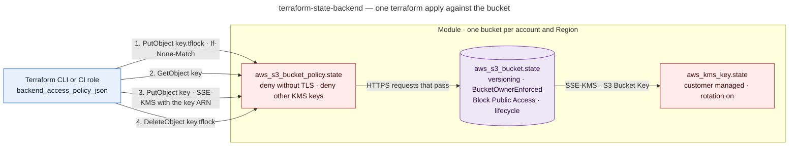

# Module: terraform-state-backend

> **Code status:** `terraform fmt` ✅ · `terraform validate` ✅ (provider 6.73.0) · `terraform test` ✅ 7 runs with a mock provider · `tflint` ✅ · **never planned or applied against AWS — never deployed**

An Amazon S3 bucket for Terraform remote state with **native S3 locking** (`use_lockfile = true`)
and **no DynamoDB table**. The bucket is versioned, encrypted with a customer managed AWS KMS key
that rotates, closed to the public, free of ACLs, and guarded by a bucket policy that refuses
plain HTTP and writes encrypted with any other key. The module also outputs the backend settings
and an IAM policy with exactly the permissions the backend needs.

[Module catalog](../README.md) · [Terraform chapters](../../README.md) · [State, remote backends and state locking](../../04-state-backends-locking.md) · [ADR-011](../../../../ARCHITECTURE-DECISIONS.md#adr-011-terraform-state-in-s3-with-native-locking-one-state-per-environment) · [AWS KMS and encryption](../../../../00-foundations/security/04-kms-encryption.md)

## What it creates



1. Terraform takes the lock by writing `<key>.tflock` with a conditional write that fails if the
   lock file already exists.
2. It reads the state object.
3. It writes the new state, encrypted with the module's key.
4. It releases the lock by deleting the lock file.

Every request passes the bucket policy first; permissions come from the caller's
identity-based policy.

## The documented behaviour it encodes

| Rule | Source |
|:--|:--|
| The S3 backend locks with `use_lockfile = true`; DynamoDB-based locking is deprecated and will be removed in a future minor version | [S3 backend](https://developer.hashicorp.com/terraform/language/backend/s3) |
| Bucket versioning is highly recommended so that state can be recovered | [S3 backend](https://developer.hashicorp.com/terraform/language/backend/s3) |
| Required permissions: `s3:ListBucket` on the bucket; `s3:GetObject` and `s3:PutObject` on the state key; `s3:GetObject`, `s3:PutObject` and `s3:DeleteObject` on `<key>.tflock`; `s3:DeleteObject` is not needed on the state | [S3 backend](https://developer.hashicorp.com/terraform/language/backend/s3) |
| With `kms_key_id`, Terraform needs `kms:Encrypt`, `kms:Decrypt` and `kms:GenerateDataKey` on the key | [S3 backend](https://developer.hashicorp.com/terraform/language/backend/s3) |
| With `encrypt` and `kms_key_id`, the backend sends `aws:kms` and the key ID on both state and lock writes; the lock is written with `If-None-Match: *` | [Backend source, `client.go`](https://raw.githubusercontent.com/hashicorp/terraform/main/internal/backend/remote-state/s3/client.go) |
| Listing is used to discover workspaces under `env:/`; if that listing is denied with the default prefix, the backend falls back to the default workspace | [Backend source, `backend_state.go`](https://raw.githubusercontent.com/hashicorp/terraform/main/internal/backend/remote-state/s3/backend_state.go) |
| A bucket policy can deny every request with `aws:SecureTransport = false`, and deny writes not encrypted with a specific key using `ArnNotEqualsIfExists` on `s3:x-amz-server-side-encryption-aws-kms-key-id` (key ARN format) or a `Null` check on that key | [Bucket policy examples](https://docs.aws.amazon.com/AmazonS3/latest/userguide/example-bucket-policies.html), [Using SSE-KMS](https://docs.aws.amazon.com/AmazonS3/latest/userguide/UsingKMSEncryption.html) |
| S3 Bucket Keys reduce AWS KMS request traffic and cost for SSE-KMS | [Using SSE-KMS](https://docs.aws.amazon.com/AmazonS3/latest/userguide/UsingKMSEncryption.html) |
| Automatic rotation of customer managed keys; the default period is 365 days | [Rotate AWS KMS keys](https://docs.aws.amazon.com/kms/latest/developerguide/rotate-keys.html) |
| Block Public Access and disabling ACLs (`BucketOwnerEnforced`) are S3 security best practices | [S3 security best practices](https://docs.aws.amazon.com/AmazonS3/latest/userguide/security-best-practices.html) |
| `blocked_encryption_types = ["SSE-C"]` blocks uploads with customer-provided keys | [`aws_s3_bucket_server_side_encryption_configuration` (provider 6.73.0)](https://raw.githubusercontent.com/hashicorp/terraform-provider-aws/v6.73.0/website/docs/r/s3_bucket_server_side_encryption_configuration.html.markdown) |
| Lifecycle rules can expire noncurrent versions, remove expired delete markers and abort incomplete multipart uploads in a versioned bucket | [Lifecycle configuration examples](https://docs.aws.amazon.com/AmazonS3/latest/userguide/lifecycle-configuration-examples.html) |

## Usage

Create the bucket once per account and Region from a small bootstrap root module:

```hcl
data "aws_caller_identity" "current" {}
data "aws_region" "current" {}

module "state_backend" {
  source = "../../04-infrastructure-as-code/terraform/modules/terraform-state-backend"

  bucket_name = "tfstate-${data.aws_caller_identity.current.account_id}-${data.aws_region.current.region}"
  state_keys = [
    "prod/network/terraform.tfstate",
    "prod/agents/terraform.tfstate",
  ]
}

# Give the role that runs Terraform exactly what the backend needs.
resource "aws_iam_role_policy" "terraform_backend" {
  name   = "terraform-s3-backend"
  role   = var.terraform_role_name
  policy = module.state_backend.backend_access_policy_json
}

# Save this as backend.hcl next to each root module.
output "backend_hcl" {
  value = module.state_backend.backend_config_hcl
}
```

Each root module then keeps only its own key in code and reads the rest from `backend.hcl`
with `terraform init -backend-config=backend.hcl`:

```hcl
terraform {
  backend "s3" {
    key = "prod/agents/terraform.tfstate"
    # bucket, region, encrypt, kms_key_id and use_lockfile come from backend.hcl
  }
}
```

Both snippets were validated with `terraform validate` (the bootstrap root declares
`terraform_role_name`).

## Inputs

| Name | Type | Default | Description |
|:--|:--|:--|:--|
| `bucket_name` | `string` | — | 3–63 lowercase letters, digits and hyphens (no dots) |
| `state_keys` | `list(string)` | `["terraform.tfstate"]` | State keys or key patterns covered by `backend_access_policy_json`; `.tflock` keys are added |
| `kms_alias_name` | `string` | `null` | Defaults to `alias/terraform-state-<bucket_name>` |
| `kms_deletion_window_in_days` | `number` | `30` | 7–30 |
| `kms_rotation_period_in_days` | `number` | `365` | 90–2,560; rotation is always on |
| `require_kms_key_header` | `bool` | `true` | Deny writes that do not name a KMS key |
| `noncurrent_version_expiration_days` | `number` | `90` | Expire noncurrent versions after this many days; `null` disables the lifecycle rule |
| `noncurrent_versions_to_keep` | `number` | `10` | Newest noncurrent versions kept regardless of age |
| `abort_incomplete_multipart_upload_days` | `number` | `7` | Abort incomplete multipart uploads after this many days |
| `tags` | `map(string)` | `{}` | Extra tags |

## Outputs

| Name | Description |
|:--|:--|
| `bucket_name`, `bucket_arn` | The state bucket |
| `kms_key_arn`, `kms_alias_name` | The customer managed key; use the **ARN** as `kms_key_id` |
| `backend_config` | `bucket`, `region`, `encrypt = true`, `kms_key_id`, `use_lockfile = true` |
| `backend_config_hcl` | The same values as a partial backend configuration file |
| `backend_access_policy_json` | Identity-based policy for the role that runs Terraform |
| `bucket_policy_json` | The bucket policy the module attaches |

## Design notes

- **The bucket policy only denies.** Access is granted by `backend_access_policy_json` on the
  Terraform role. The key keeps the AWS default key policy, which lets IAM policies in the
  account grant its use.
- **Three deny statements.** Plain HTTP to the bucket or its objects; a write that names another
  KMS key (`ArnNotEqualsIfExists`); and, with `require_kms_key_header`, a write that names no key
  at all (`Null`). The backend passes when `encrypt = true` and `kms_key_id` is the key **ARN** —
  exactly what `backend_config` contains.
- **`s3:ListBucket` has no `s3:prefix` condition.** The HashiCorp example adds one; the backend
  lists the workspace prefix (`env:/` by default), so a condition must allow that prefix. Add it
  if key names in the bucket are sensitive.
- **Workspaces are not covered** by the access policy, following
  [ADR-011](../../../../ARCHITECTURE-DECISIONS.md#adr-011-terraform-state-in-s3-with-native-locking-one-state-per-environment):
  one state key per environment and component instead.
- **Lock files in a versioned bucket.** **Our reading:** every lock release deletes
  `<key>.tflock`, leaving a noncurrent version and a delete marker each time. The lifecycle rule
  expires the noncurrent versions and then the expired delete markers, so they do not pile up.
- **`force_destroy = false`** and a 30-day key deletion window by default: destroying state by
  accident should be hard.
- **Tests use `override_during = plan`** (Terraform 1.11 and later) so that the mocked key ARN is
  known at plan time and the policies that embed it can be asserted
  ([Terraform 1.11 changelog](https://raw.githubusercontent.com/hashicorp/terraform/v1.11/CHANGELOG.md)).

> [!CAUTION]
> **Cost or security hazard** — Destroying this module schedules the KMS key for deletion. Once
> the key is deleted, every state version encrypted with it is unreadable. Keep the bucket and
> key in a bootstrap root that is almost never destroyed.

> [!WARNING]
> **Common mistake** — Setting `kms_key_id` to the key alias, or leaving out `encrypt = true`.
> The bucket policy then refuses the write with `AccessDenied`. Copy the values from
> `backend_config_hcl`.

## Testing

```bash
terraform init -backend=false
terraform validate
terraform test          # 7 runs, mock provider, no AWS credentials
```

The tests in [`tests/backend.tftest.hcl`](tests/backend.tftest.hcl) cover: the bucket's secure
defaults, the three bucket-policy statements, the backend access policy against the documented
permission list (and the absence of DynamoDB), the backend configuration values, switching the
optional controls off, and two rejection runs (invalid bucket name; bad state key, deletion
window and reserved alias).

## Limitations

- Validated against the provider schema and tested with mocks only; S3 and KMS evaluate the
  policies only in a real account.
- No cross-Region replication, Object Lock or server access logging. A server access logging
  destination bucket must use SSE-S3, not SSE-KMS
  ([Using SSE-KMS](https://docs.aws.amazon.com/AmazonS3/latest/userguide/UsingKMSEncryption.html)).
- Same-account use only. Cross-account access needs an explicit key policy and an allow
  statement in the bucket policy, which this module does not write.
- The bucket that holds state cannot store its own bootstrap state before it exists: apply the
  bootstrap root with local state first.
