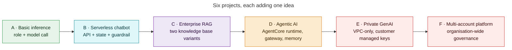

# Practical IaC projects

> **Level:** Intermediate to Advanced · **Verified:** 2026-11-15 · **Time:** 1–3 hours per project to read and validate

Six projects, each a complete, self-contained example with source code. Every one can be
**validated on your laptop with no AWS account**. Deploying is optional and at your own cost.

[Academy home](../README.md) · [Architecture patterns](../03-architecture-patterns/README.md) · [Scripts](../scripts/README.md) · Previous: [Infrastructure as Code](../04-infrastructure-as-code/README.md) · Next: [Security and governance](../06-security-governance/README.md)

> [!CAUTION]
> **Cost or security hazard** — Nothing here has been deployed by the academy's authors. The code
> passes `terraform validate`, mock-provider tests and `cdk synth`; that proves it is consistent
> with the provider schema and the CloudFormation specification, not that AWS will accept it in
> your account and Region. If you deploy, read the project's cost and teardown sections first.

## The projects



| Project | You build | New idea | IaC | Pattern |
|:--|:--|:--|:--|:--|
| [A — Basic inference](project-01-basic-inference/README.md) | A least-privilege IAM role, invocation logging and a client that calls Converse | Scoping IAM to a model and an inference profile | Terraform · CDK | [Basic inference](../03-architecture-patterns/basic-inference/README.md) |
| [B — Serverless chatbot](project-02-serverless-chatbot/README.md) | API Gateway, Lambda, DynamoDB conversation history, a guardrail | Stateless model, stateful application | Terraform · CDK | [Serverless](../03-architecture-patterns/serverless/README.md) |
| [C — Enterprise RAG](project-03-enterprise-rag/README.md) | S3 documents into a knowledge base; a query path with citations | Customer-managed (S3 Vectors) versus Managed Knowledge Base | Terraform · CDK | [Enterprise RAG](../03-architecture-patterns/enterprise-rag/README.md) |
| [D — Agentic AI](project-04-agentic-ai/README.md) | An agent on AgentCore with tools behind a gateway, identity and memory | Deterministic control around a non-deterministic agent | Terraform · CDK | [Agentic AI](../03-architecture-patterns/agentic-ai/README.md) |
| [E — Private GenAI](project-05-private-genai/README.md) | Interface endpoints, endpoint policies, customer managed keys, audit logging | Removing every public path | Terraform · CDK | [Private enterprise](../03-architecture-patterns/private-enterprise/README.md) |
| [F — Multi-account platform](project-06-multi-account-platform/README.md) | Organization-level guardrails, per-environment accounts and state, controlled promotion | Governance as code | Terraform · CloudFormation StackSets | [Multi-account](../03-architecture-patterns/multi-account/README.md) |

## What every project contains

Architecture and diagrams · complete directory structure · IaC source with variables and
outputs · example configuration without secrets · resource dependencies · security and IAM
policies with the reason for each statement · validation commands and expected output ·
teardown · potential costs · limitations and anything unverified.

## Validate all of them

```bash
cd aws-bedrock-architecture-academy
bash scripts/validate-terraform.sh 05-practical-projects
bash scripts/validate-cdk.sh 05-practical-projects      # after `npm ci` in each cdk/ folder
```

## Chapters

<!-- TOC:START — generated by scripts/build-nav.py; do not edit by hand -->
| # | Chapter | Group | Status |
|--:|:--|:--|:-:|
| 1 | [Project A: basic Bedrock model inference](project-01-basic-inference/README.md) | Project A | 🚧 planned |
| 2 | [Project B: serverless chatbot with API Gateway and Lambda](project-02-serverless-chatbot/README.md) | Project B | 🚧 planned |
| 3 | [Project C: enterprise RAG with Knowledge Bases](project-03-enterprise-rag/README.md) | Project C | 🚧 planned |
| 4 | [Project D: agentic application on AgentCore](project-04-agentic-ai/README.md) | Project D | 🚧 planned |
| 5 | [Project E: secure private enterprise GenAI](project-05-private-genai/README.md) | Project E | 🚧 planned |
| 6 | [Project F: multi-account enterprise GenAI platform](project-06-multi-account-platform/README.md) | Project F | 🚧 planned |
<!-- TOC:END -->
