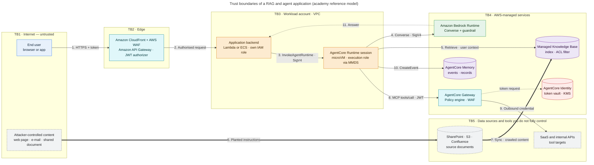

# Shared responsibility and a GenAI threat model

> **Level:** Advanced · **Verified:** 2026-11-15 · **Feature status:** n/a · **Time:** ~35 min

This chapter draws the line between what AWS documents that it secures in Amazon Bedrock and
Amazon Bedrock AgentCore and what you own, then builds a threat model of a retrieval-augmented
generation (RAG) application with an agent. The result is a threats → controls → residual-risk
table that the other six chapters of this section fill in.

## Learning objectives

After this chapter you can:

- Separate, for each layer of a Bedrock or AgentCore workload, what AWS documents that it secures from what you configure and own.
- Draw the trust boundaries of a RAG and agent system and say which data crosses each one.
- Enumerate threats with STRIDE and name them with the 2026 OWASP lists and MITRE ATLAS identifiers.
- Map each threat to a preventive and a detective control, and state the residual risk honestly.
- Decide which combinations of agent capabilities need human approval.

## Prerequisites

- [IAM fundamentals: principals, policies and evaluation](../00-foundations/security/01-iam-fundamentals.md)
- [Agentic AI, tool calling and multi-agent architectures](../00-foundations/generative-ai-fundamentals/06-agents-tool-calling-multi-agent.md)
- [What Amazon Bedrock is: services, namespaces and planes](../01-amazon-bedrock/overview/01-what-is-amazon-bedrock.md)
- [Amazon Bedrock Guardrails](../01-amazon-bedrock/guardrails/01-guardrails.md) and [AgentCore Policy](../01-amazon-bedrock/agentcore/09-agentcore-policy.md)

## Concept in plain language

Renting an office in a well-guarded building does not make your filing cabinets safe. The landlord
locks the front door and checks the wiring; you decide who gets a key to your office, what goes in
the cabinets and who may read the files.

A generative-AI assistant adds a new kind of risk to that office: an assistant who reads every
letter that arrives and follows instructions it finds in them. A letter that says "photocopy the
payroll file and post it to this address" is a threat no door lock stops. A threat model is the
list of such letters, the doors they come through, and which lock, rule or supervisor stops each one.

## How it really works

### Shared responsibility, layer by layer

Both services state the same model: AWS is responsible for "security of the cloud", and your
responsibility "is determined by the AWS service that you use" plus your data, requirements and
laws ([Bedrock security](https://docs.aws.amazon.com/bedrock/latest/userguide/security.html),
[AgentCore security](https://docs.aws.amazon.com/bedrock-agentcore/latest/devguide/security.html)).
The table records only what the linked pages say AWS does; everything else is yours.

| Layer | What AWS documents that it does | What you own | Source |
|:--|:--|:--|:--|
| Model hosting | Models run in Model Deployment Accounts owned by the Bedrock service team; providers have no access to them, to Bedrock logs, or to prompts and completions | Choosing the model, its version and its Region | [Data protection](https://docs.aws.amazon.com/bedrock/latest/userguide/data-protection.html) |
| Use of your content | Inputs and outputs are not used to train Amazon or third-party models and are not shared with model providers | Reading the model's terms; deciding what data may be sent at all | [Bedrock FAQs](https://aws.amazon.com/bedrock/faqs/) |
| Retention by AWS | Retention follows a per-Region data retention mode; some models require `aws_review` and retain up to 30 days | Setting and enforcing the mode (`none`, `default`, `aws_review`) | [Data retention](https://docs.aws.amazon.com/bedrock/latest/userguide/data-retention.html) |
| Agent session isolation | Each AgentCore Runtime session runs in a dedicated microVM that is terminated and sanitised afterwards | Mapping sessions to users — "AgentCore does not enforce session-to-user mappings" | [Runtime security best practices](https://docs.aws.amazon.com/bedrock-agentcore/latest/devguide/runtime-security-best-practices.html) |
| Credentials inside a session | The execution role's credentials are served by a metadata service (MMDS) to any code in the microVM | Scoping that role; enabling MMDSv2 (required from 2026-06-30) | [Runtime security best practices](https://docs.aws.amazon.com/bedrock-agentcore/latest/devguide/runtime-security-best-practices.html) |
| Prompt injection | AWS secures the service; "the responsibility for secure application development and preventing vulnerabilities like prompt injection lies with the customer" | All application-level defences | [Prompt injection security](https://docs.aws.amazon.com/bedrock/latest/userguide/prompt-injection.html) |
| Content safeguards | Provides Guardrails and updates their detection models | Configuring, versioning, enforcing and testing guardrails | [Guardrails](../01-amazon-bedrock/guardrails/01-guardrails.md) |
| Identity, network, keys, logging | Provides IAM, PrivateLink, KMS, CloudTrail and invocation logging (off by default) | Every policy, endpoint, key and log destination | [Data protection](https://docs.aws.amazon.com/bedrock/latest/userguide/data-protection.html) |
| Compliance | Third-party audits of the service; reports in AWS Artifact | Your workload's compliance | [Compliance validation](https://docs.aws.amazon.com/bedrock/latest/userguide/compliance-validation.html) |

> [!NOTE]
> **Documented fact** — AWS places this workload in Scope 3 of its Generative AI Security Scoping
> Matrix: "you build an agentic AI application using a pre-trained FM … You control your
> application, the tools agents can access, and customer data. The FM provider controls the
> pre-trained model and its training data."
> Source: [AWS SRA — Capability 5, generative AI agents](https://docs.aws.amazon.com/prescriptive-guidance/latest/security-reference-architecture-generative-ai/gen-auto-agents.html)

### Threat taxonomies, as of the verification date

| Taxonomy | Version read | What changed that older material misses | Source |
|:--|:--|:--|:--|
| OWASP Top 10 for LLM Applications | **2026**, published 2026-08-04 | LLM01 Prompt Injection · LLM02 Sensitive Information Disclosure · LLM03 Excessive Agency (up from sixth) · LLM04 Supply Chain · LLM05 Data and Model Poisoning · LLM06 Unbounded Consumption · LLM07 Misinformation · LLM08 Hidden Context Exposure (replaces System Prompt Leakage) · LLM09 Vector and Embedding Weaknesses · LLM10 Improper Output Handling | [OWASP 2026 list](https://genai.owasp.org/resource/owasp-genai-llm-top-10-2026/), [canonical source](https://github.com/GenAI-Security-Project/GenAI-LLM-Top10/blob/main/2026/README.md) |
| OWASP Top 10 for Agentic Applications | 2026 edition, released 2025-12-09 | ASI01 Agent Goal Hijack … ASI06 Memory and Context Poisoning … ASI10 Rogue Agents | [OWASP announcement](https://genai.owasp.org/2025/12/09/owasp-top-10-for-agentic-applications-the-benchmark-for-agentic-security-in-the-age-of-autonomous-ai/) |
| MITRE ATLAS | Data release 2026.10: 16 tactics, 221 techniques | Agent-specific techniques such as AML.T0080 AI Agent Context Poisoning and AML.T0086 Exfiltration via AI Agent Tool Invocation | [MITRE ATLAS](https://atlas.mitre.org/), [ATLAS data 2026.10](https://raw.githubusercontent.com/mitre-atlas/atlas-data/main/dist/v6/ATLAS-2026.10.yaml) |

The AWS Well-Architected Generative AI Lens groups its security pillar into six focus areas:
endpoint security, response validation, event monitoring, prompt security, excessive agency and
data poisoning ([Generative AI Lens — Security](https://docs.aws.amazon.com/wellarchitected/latest/generative-ai-lens/security.html)).
Use OWASP and ATLAS to *name* threats and the Lens to check you have *covered the areas*.

## Architecture diagram



**What this shows** — Five trust zones (TB1–TB5) and the eleven flows that cross them. The two
thick arrows are the paths that matter most for an AI system: attacker text reaches the model
*through your own data sources*, without ever touching your edge controls.

**Walkthrough**

1. The user calls your API over HTTPS with an identity token; AWS WAF and the authorizer see it first.
2. Only authenticated requests reach the backend, which runs under its own IAM role.
3. The backend invokes the agent; the session runs in its own microVM with the agent's execution role.
4. The agent calls the model with SigV4; a guardrail evaluates input and output.
5. The agent retrieves passages, passing a user context that the knowledge base filters on.
6. An attacker plants instructions in content you index — a page, a ticket, a shared file.
7. The connector syncs that content into the index: the attack now sits *inside* TB4.
8. The agent calls tools through the gateway with a JWT; the policy engine decides per call.
9. The gateway presents a stored credential to the tool — the agent never holds the secret.
10. The agent writes conversation events to memory, which later sessions read back.
11. The answer returns to the backend and the user.

**Legend** — solid arrow: request · dashed arrow: response or token fetch · thick arrow: asynchronous
data flow · cylinder: data store · dashed grey box: outside your control · TB: trust boundary.

**Variations** — Without AgentCore, flows 3 and 8–10 collapse into your backend calling tools
directly, which moves tool authorisation into your code. With a customer-managed knowledge base,
the index lives in your vector store (TB3) and access control becomes a metadata filter you build.

## Implementation details

### STRIDE per trust boundary

STRIDE (spoofing, tampering, repudiation, information disclosure, denial of service, elevation of
privilege) still works; the AI-specific part is *where* each letter shows up.

| Boundary | S | T | R | I | D | E |
|:--|:--|:--|:--|:--|:--|:--|
| TB1→TB2 user to edge | Stolen tokens | Oversized prompts | No user ID in logs | — | Request floods, token-cost floods | — |
| TB2→TB3 edge to backend | Forged `user-id` headers | Client-supplied filters | — | — | — | Caller picks another tenant |
| TB3→TB4 agent to model/KB | — | Direct prompt injection | Unattributed model calls | System prompt and context leakage; cross-tenant retrieval | Throttling | Jailbreak bypasses instructions |
| TB5→TB4 sources to index | Spoofed document authors | Retrieval poisoning, indirect injection | Unknown document provenance | Over-broad connector permissions | Index flooding | Injected text drives tools |
| TB4→TB5 gateway to tools | Agent reuses user's token for another user | Tool output carries instructions | Tool calls not tied to a user | Exfiltration through tool arguments | Runaway loops | Tool with more privilege than the user |
| Memory (within TB4) | Actor ID chosen by the caller | Memory poisoning | — | Another user's memories | — | Persisted instructions |

### Threats → controls → residual risk

Controls name the chapter that implements them. "Residual" is what still gets through when every
listed control works as designed (ADR-015).

| # | Threat · OWASP 2026 · ATLAS | Preventive controls | Detective controls | Residual risk |
|--:|:--|:--|:--|:--|
| T1 | Direct prompt injection and jailbreak · LLM01 · AML.T0051.000, AML.T0054 | Guardrail prompt-attack filter on tagged user input; least-privilege tools ([ch. 4](04-prompt-injection-and-untrusted-content.md)) | Guardrail interventions; GuardDuty `PromptInjection.Direct` | Paraphrased or encoded attacks the classifier misses |
| T2 | Indirect injection through retrieved content · LLM01 · AML.T0051.001, AML.T0070 | Source allow-lists, ingestion scanning, content isolation, tool-call policy ([ch. 4](04-prompt-injection-and-untrusted-content.md)) | Policy decision logs in `LOG_ONLY` and `ENFORCE` | Any text the model reads can still bias the *answer* |
| T3 | Injection through tool output · ASI02 · AML.T0110 | Screen tool results with `ApplyGuardrail`; Dogwood `suppressOutput`; narrow tools | Gateway data events (`InvokeGateway`) | Instructions that pass classifiers |
| T4 | Exfiltration via tool calls or links · LLM02 · AML.T0086 | AgentCore Policy argument checks; egress allow-lists; output URL allow-list ([ch. 5](05-network-security-and-private-access.md)) | VPC Flow Logs, DNS Firewall logs | Exfiltration inside an allowed channel |
| T5 | Excessive agency · LLM03 · AML.T0053 | One role per agent, permissions boundary, human approval for irreversible actions ([ch. 2](02-identity-and-least-privilege.md)) | IAM Access Analyzer unused access | Misuse of permissions the task legitimately needs |
| T6 | Cross-tenant or cross-user disclosure · LLM02, LLM09 | Server-side tenant filters, ACL user context from a verified token, per-actor memory conditions ([ch. 3](03-data-protection-and-privacy.md)) | Retrieval audit sampling | Mislabelled documents at ingestion |
| T7 | Hidden context exposure · LLM08 · AML.T0069 | No secrets in prompts; Standard-tier prompt-leakage filter | Guardrail findings | System prompt text will leak eventually — design for it |
| T8 | Memory poisoning · ASI06 · AML.T0080.000 | Actor and session IDs from the authenticated caller; write filtering | Memory data-plane logs | Slow, plausible false facts |
| T9 | Credential theft and cost harvesting · LLM06 · AML.T0034 | No long-term API keys, short sessions, WAF rate rules, SCPs ([ch. 6](06-governance-at-scale.md)) | GuardDuty `CostHarvesting`, budgets | Spend between detection and response |
| T10 | Unattributed actions (repudiation) | JWT inbound auth, user ID derived from token | CloudTrail management and data events, invocation logs ([ch. 7](07-logging-audit-and-compliance.md)) | Content of `bedrock-mantle` calls is not in invocation logs |
| T11 | Data leaving the Region or retained by AWS · LLM02 | Geo profiles or in-Region IDs, retention mode `none` enforced by SCP ([ch. 6](06-governance-at-scale.md)) | CloudTrail `inferenceRegion` | Models that require retention are then unavailable |
| T12 | Supply chain: unvetted models, MCP servers, tool packages · LLM04 · AML.T0010 | Model allow-list SCP; gateway target-type conditions; approved registry | AWS Config, CloudTrail on target changes | A vetted component that later turns malicious |

### Capability budgeting

OWASP's 2026 prompt-injection entry recommends treating an agent that combines (A) untrusted
input, (B) sensitive data and (C) state change or external communication as high-risk, and
requiring per-action human approval when all three are present
([LLM01:2026 source](https://github.com/GenAI-Security-Project/GenAI-LLM-Top10/blob/main/2026/final/LLM01_PromptInjection.md)).

| Agent has | Academy decision |
|:--|:--|
| A only, B only, or C only | Normal controls |
| A + B (reads untrusted content and private data, cannot act) | Residual-risk sign-off; output filtering; no outbound links |
| A + C or B + C | Residual-risk sign-off; AgentCore Policy on every action |
| A + B + C | Human approval per consequential action, or split into two agents so no single agent holds all three |

> [!TIP]
> **Academy recommendation** — Review the capability budget, not the prompt, when an agent
> changes. Adding one tool can move an agent from "A + B" to "A + B + C" without anyone touching
> the system prompt. This is our design guidance, not an official AWS reference architecture.

## Example

A threat-register entry in YAML. Keep one file per workload in the repository, next to the IaC, so
a pull request that adds a tool also has to update the register.

> **Code status:** syntax-checked (YAML parse with PyYAML) · **never deployed**

```yaml
workload: support-assistant
reviewed: "2026-11-15"
capability_budget: { untrusted_input: true, sensitive_data: true, external_action: true }
threats:
  - id: T4
    title: Exfiltration of ticket data through the send_email tool
    stride: [information_disclosure]
    owasp_llm_2026: [LLM01, LLM02]
    owasp_agentic: [ASI02]
    atlas: [AML.T0051.001, AML.T0086]
    boundary: TB4->TB5
    preventive:
      - agentcore_policy: "forbid send_email unless recipient domain is example.com"
      - human_approval: "external recipients"
    detective:
      - cloudtrail_data_events: "AWS::BedrockAgentCore::Gateway"
    residual: "Data placed in an e-mail to an allowed internal recipient"
    owner: platform-security
    revisit_when: [new_tool, new_data_source, model_change]
```

## Common mistakes

> [!WARNING]
> **Common mistake** — Threat-modelling only the chat box. Every flow in the diagram that carries
> text the model will read (6, 7, 9 and 10) is an input. A model of the system that stops at the
> edge misses the paths that the 2026 OWASP list ranks first and third.

| Mistake | Symptom | Fix |
|:--|:--|:--|
| Treating "AWS does not train on my data" as the whole privacy answer | Retention, logging and cross-Region processing never reviewed | Record training, retention, logging and Region separately ([ch. 3](03-data-protection-and-privacy.md)) |
| Citing OWASP 2025 numbering in 2026 reviews | LLM06 means "Excessive Agency" to one reader and "Unbounded Consumption" to another | Write the version: `LLM03:2026` |
| Assuming microVM isolation means user isolation | One user resumes another user's session | Map session IDs to users in your backend |
| Listing a guardrail as the only control for a high-impact threat | Residual risk is "everything the classifier misses" | Add a deterministic control: IAM, network or policy engine |
| No residual-risk column | Risk owners believe the risk is closed | Write what still gets through and who accepted it |

## Security considerations

- The threat register itself describes your defences; store it with the same access controls as
  security architecture documents.
- Re-run the model on every new tool, data source, model or Region — the triggers in the example.
- Separate content controls (probabilistic) from access controls (deterministic) in every row; a
  row with only probabilistic controls is a finding.
- Use [Lab 6: threat-model an agent](../labs/lab-06-threat-model-an-agent.md) to practise the method.

## Cost considerations

- Threat modelling is people time; the controls it selects carry the bill: guardrail text units,
  AgentCore Policy authorisation requests, AWS WAF requests, CloudTrail data events and log storage.
  Pricing dimensions are in each linked chapter.
- Price each control against the threat it addresses; a control that mitigates no row in the
  register is a candidate for removal.

## Knowledge check

1. Which flows in the diagram never pass through AWS WAF, and what does that imply for prompt injection?
2. An agent reads customer e-mails, can query the CRM and can send e-mails. Where does it sit in the capability budget and what does the academy recommend?
3. A reviewer says "AgentCore runs each session in a microVM, so users are isolated". What is missing?
4. Why does T11 have a residual risk even when the SCP works?

<details>
<summary>Answers</summary>

1. Flows 6, 7, 9 and 10 (planted content, connector sync, tool calls, memory writes). Indirect injection arrives through your own data paths, so edge controls cannot stop it; controls must sit at retrieval, tool and action boundaries.
2. A + B + C — untrusted input, sensitive data and external communication. Require human approval for each consequential action or split the agent so that no single agent holds all three capabilities.
3. AWS documents that AgentCore does not enforce session-to-user mappings; your backend must bind session IDs to authenticated users.
4. Enforcing retention mode `none` makes models that require `aws_review` unavailable, so the business may push for an exception; and the SCP does not bind the management account.

</details>

## Further reading

Official sources opened while writing this chapter:

- [Security in Amazon Bedrock](https://docs.aws.amazon.com/bedrock/latest/userguide/security.html) and [Security in AgentCore](https://docs.aws.amazon.com/bedrock-agentcore/latest/devguide/security.html) — shared responsibility statements.
- [Bedrock data protection](https://docs.aws.amazon.com/bedrock/latest/userguide/data-protection.html) — Model Deployment Accounts, TLS requirements.
- [Bedrock FAQs](https://aws.amazon.com/bedrock/faqs/) — training and provider-sharing statements.
- [Data retention](https://docs.aws.amazon.com/bedrock/latest/userguide/data-retention.html) — retention modes.
- [Prompt injection security](https://docs.aws.amazon.com/bedrock/latest/userguide/prompt-injection.html) — customer responsibility for prompt injection.
- [Security best practices for AgentCore Runtime](https://docs.aws.amazon.com/bedrock-agentcore/latest/devguide/runtime-security-best-practices.html) — session isolation, MMDS, session-to-user mapping.
- [AWS SRA — AI security](https://docs.aws.amazon.com/prescriptive-guidance/latest/security-reference-architecture-generative-ai/introduction.html) and [Capability 5, agents](https://docs.aws.amazon.com/prescriptive-guidance/latest/security-reference-architecture-generative-ai/gen-auto-agents.html) — scoping matrix, agent risks.
- [Generative AI Lens — Security](https://docs.aws.amazon.com/wellarchitected/latest/generative-ai-lens/security.html) — principles and focus areas.
- [OWASP GenAI LLM Top 10 2026](https://genai.owasp.org/resource/owasp-genai-llm-top-10-2026/), [2026 source repository](https://github.com/GenAI-Security-Project/GenAI-LLM-Top10/blob/main/2026/README.md) and [LLM01:2026 Prompt Injection](https://github.com/GenAI-Security-Project/GenAI-LLM-Top10/blob/main/2026/final/LLM01_PromptInjection.md) — the 2026 list and the capability-budget rule.
- [OWASP Top 10 for Agentic Applications announcement](https://genai.owasp.org/2025/12/09/owasp-top-10-for-agentic-applications-the-benchmark-for-agentic-security-in-the-age-of-autonomous-ai/) — ASI01–ASI10.
- [MITRE ATLAS](https://atlas.mitre.org/) and [ATLAS data release 2026.10](https://raw.githubusercontent.com/mitre-atlas/atlas-data/main/dist/v6/ATLAS-2026.10.yaml) — technique identifiers used above.
- [Compliance validation for Amazon Bedrock](https://docs.aws.amazon.com/bedrock/latest/userguide/compliance-validation.html) — Artifact and services in scope.
