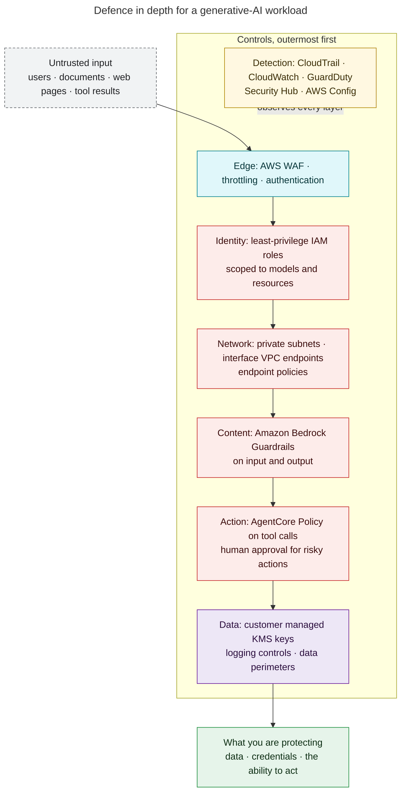

# Security and governance

> **Level:** Advanced · **Verified:** 2026-11-15 · **Time:** about 2 days at 2 hours a day

A generative-AI system has every security concern of an ordinary cloud application plus some
new ones: instructions hidden in data, tools called on a model's say-so, and outputs that can
leak what the model was shown. This section builds a threat model and then layers controls
against it.

[Academy home](../README.md) · [ADR-015: layered controls](../ARCHITECTURE-DECISIONS.md#adr-015-security-controls-are-layered-and-none-is-trusted-alone) · Previous: [Practical projects](../05-practical-projects/README.md) · Next: [DevOps and CI/CD](../07-devops-and-cicd/README.md)

## Layers of control

> [!TIP]
> **Academy recommendation** — Treat a guardrail and a system prompt as probabilistic controls.
> Anything that must never happen needs a deterministic control as well: an IAM policy, a
> network boundary, or a policy-engine decision on the tool call. This is our design guidance,
> not an official AWS reference architecture.

## What each chapter answers

| Chapter | Question |
|:--|:--|
| Shared responsibility and threat model | What can go wrong, and whose job is each control? |
| Identity and least privilege | Who can call which model, and what can an agent's role actually do? |
| Data protection and privacy | Where does data rest and travel, who can read it, and how do you stop leakage? |
| Prompt injection and untrusted content | How do instructions in data reach a model, and what limits the damage? |
| Network security and private access | Which paths are public, and how do you close them? |
| Governance at scale | How do you enforce rules across an organisation rather than per team? |
| Logging, audit and compliance | What evidence exists that controls worked? |

## Chapters

<!-- TOC:START — generated by scripts/build-nav.py; do not edit by hand -->
| # | Chapter | Group | Status |
|--:|:--|:--|:-:|
| 1 | [Shared responsibility and a GenAI threat model](01-shared-responsibility-and-threat-model.md) | Security and governance | 🚧 planned |
| 2 | [Identity, least privilege and IAM isolation for agents](02-identity-and-least-privilege.md) | Security and governance | 🚧 planned |
| 3 | [Data protection, privacy and data leakage prevention](03-data-protection-and-privacy.md) | Security and governance | 🚧 planned |
| 4 | [Prompt injection, untrusted tool output and retrieval poisoning](04-prompt-injection-and-untrusted-content.md) | Security and governance | 🚧 planned |
| 5 | [Network security and private access](05-network-security-and-private-access.md) | Security and governance | 🚧 planned |
| 6 | [Governance at scale: Organizations, SCPs and guardrail enforcement](06-governance-at-scale.md) | Security and governance | 🚧 planned |
| 7 | [Logging, audit and compliance evidence](07-logging-audit-and-compliance.md) | Security and governance | 🚧 planned |
<!-- TOC:END -->
