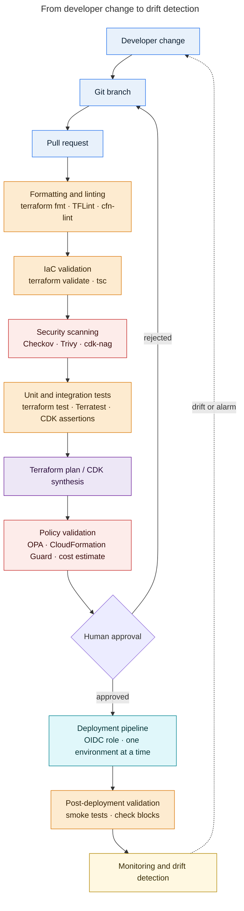

# DevOps and CI/CD

> **Level:** Advanced · **Verified:** 2026-11-15 · **Time:** about 2 days at 2 hours a day

How an infrastructure change travels from a developer's branch to production — and what stops
a bad one on the way. The chapters follow the pipeline stage by stage; runnable examples are in
[`examples/`](examples/).

[Academy home](../README.md) · [IaC maintenance](../04-infrastructure-as-code/maintenance/README.md) · [Diagram 26 — CI/CD and IaC deployment](../diagrams/mermaid/26-cicd-and-iac-deployment.md) · Previous: [Security and governance](../06-security-governance/README.md) · Next: [Cost, performance and reliability](../08-cost-performance-and-reliability/README.md)

## The pipeline

| Stage | Catches | Chapter |
|:--|:--|:--|
| Formatting, linting, validation | Syntax errors, wrong argument names, style drift | Formatting, linting and security scanning |
| Security scanning | Known misconfigurations before they exist | Formatting, linting and security scanning |
| Tests | Logic errors in modules and constructs | Testing infrastructure code |
| Plan / synth | What will actually change | Pipeline overview |
| Policy and cost | Changes that are valid but not allowed, or too expensive | Policy validation, cost estimation and human approval |
| Approval | Anything the automation cannot judge | Policy validation, cost estimation and human approval |
| Deployment | — | GitHub Actions · CodePipeline and CodeBuild |
| Post-deployment and drift | What validation could not predict; changes made outside the pipeline | Post-deployment validation, monitoring and drift detection |

> [!CAUTION]
> **Cost or security hazard** — Pin third-party CI actions to a full commit SHA. In March 2026 the
> release tags of a widely used scanner's GitHub Action were replaced with malicious commits.
> Source: [Trivy advisory GHSA-69fq-xp46-6x23](https://github.com/aquasecurity/trivy/security/advisories/GHSA-69fq-xp46-6x23)

## Chapters

<!-- TOC:START — generated by scripts/build-nav.py; do not edit by hand -->
| # | Chapter | Group | Status |
|--:|:--|:--|:-:|
| 1 | [From developer change to drift detection: the pipeline](01-pipeline-overview.md) | DevOps and CI/CD | 🚧 planned |
| 2 | [Formatting, linting and security scanning](02-static-analysis-and-security-scanning.md) | DevOps and CI/CD | 🚧 planned |
| 3 | [Testing infrastructure code](03-testing-iac.md) | DevOps and CI/CD | 🚧 planned |
| 4 | [GitHub Actions for IaC](04-github-actions.md) | DevOps and CI/CD | 🚧 planned |
| 5 | [AWS CodePipeline and AWS CodeBuild](05-codepipeline-and-codebuild.md) | DevOps and CI/CD | 🚧 planned |
| 6 | [Policy validation, cost estimation and human approval](06-policy-cost-and-approvals.md) | DevOps and CI/CD | 🚧 planned |
| 7 | [Post-deployment validation, monitoring and drift detection](07-post-deploy-validation-and-drift.md) | DevOps and CI/CD | 🚧 planned |
<!-- TOC:END -->
