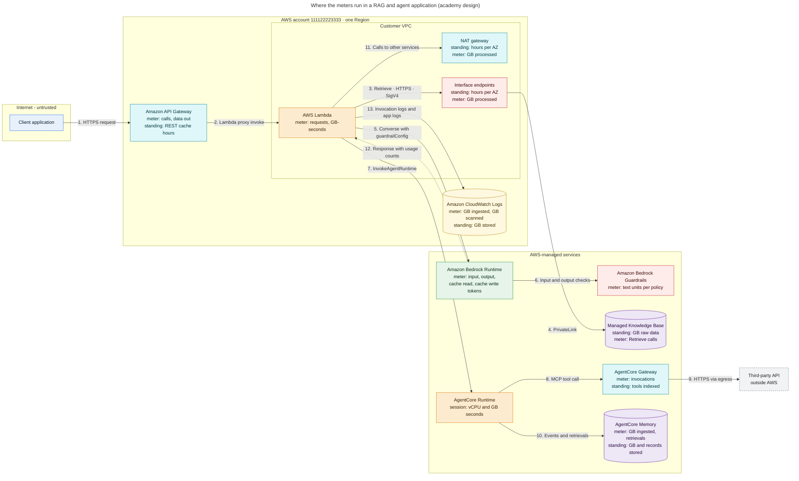

# Pricing model and cost drivers

> **Level:** Intermediate · **Verified:** 2026-11-15 · **Feature status:** n/a · **Time:** ~30 min

A Bedrock application is billed by many meters at once: tokens, retrieval calls, guardrail text units, agent compute seconds, and the network and logging services around them. This chapter maps every metered dimension, shows which ones keep charging when nobody uses the application, and turns an architecture into a cost formula you can fill in.

> [!IMPORTANT]
> **Status** — Prices differ by model, Region, routing and tier, and they change often. This chapter teaches the **dimensions**. Every figure it quotes is a US dollar list price read **as of 2026-11-15** from the page linked beside it; read the page again before you budget.
> Sources: [Amazon Bedrock pricing](https://aws.amazon.com/bedrock/pricing/), [Amazon Bedrock AgentCore pricing](https://aws.amazon.com/bedrock/agentcore/pricing/)

## Learning objectives

After this chapter you can:

- List the metered dimensions of Bedrock inference, knowledge bases, Guardrails, Data Automation and AgentCore.
- Separate usage meters from standing charges, and find every component that bills while idle.
- Decode a Bedrock line in the Cost and Usage Report: token type, service tier and routing.
- Write a cost-driver formula for an architecture, including the multipliers hidden in agent loops, guardrails and logging.
- Choose a purchase mode from a workload's traffic shape.

## Prerequisites

- [Latency and token economics](../00-foundations/generative-ai-fundamentals/08-latency-and-token-economics.md) — token pricing, caching and batch as concepts.
- [Service tiers](../01-amazon-bedrock/inference/06-service-tiers.md), [Provisioned Throughput](../01-amazon-bedrock/inference/07-provisioned-throughput.md) and [Batch inference](../01-amazon-bedrock/inference/08-batch-inference.md).
- Helpful: [Managed Knowledge Base](../01-amazon-bedrock/knowledge-bases/02-managed-knowledge-base.md) and [AgentCore Runtime](../01-amazon-bedrock/agentcore/02-agentcore-runtime.md).

## Concept in plain language

Think of a household utility bill. Most lines are **meters**: water used, electricity used. Use nothing and you pay nothing. Some lines are **standing charges**: line rental, a rented boiler. You pay them every day the contract exists, even while you are on holiday. And some bills rise because of a **leak**: a dripping tap that nobody notices until the bill arrives.

A Bedrock bill has the same three shapes. Tokens, retrieval calls and guardrail checks are meters. Reserved capacity, Provisioned Throughput, knowledge-base storage, NAT gateways and VPC endpoints are standing charges. The leaks are agent loops that resend the whole conversation on every step, retries that pay for a second generation, and logging that stores every prompt twice.

## How it really works

### Three shapes of charge

| Shape | Billed on | At zero traffic | Examples |
|:--|:--|:--|:--|
| Usage meter | Units consumed | Nothing | Tokens, `Retrieve` calls, guardrail text units, Data Automation pages, Gateway invocations |
| Standing charge | Time the resource exists | Full charge | Provisioned Throughput, Reserved tier, managed knowledge base storage, NAT gateway hours, interface endpoint hours |
| Session or copy time | Time a session or model copy is alive | Charge until it ends or scales to zero | AgentCore Runtime sessions, Custom Model Import copies, AgentCore Runtime Instances |

### Inference

All rows are per model and per Region. Example figures are as of 2026-11-15 from the [Amazon Bedrock pricing](https://aws.amazon.com/bedrock/pricing/) page unless another source is named.

| Dimension | Unit | Bills while idle | Notes and example |
|:--|:--|:-:|:--|
| Input tokens (uncached) | Per token, quoted per 1M | No | Global cross-Region lines are listed separately from Geo and in-Region lines. Example, Moonshot Kimi 3, Standard tier: $3.00 Global versus $3.30 US cross-Region inference |
| Output tokens | Per token | No | Same Kimi 3 row: $15.00 Global, $16.50 US |
| Cache write tokens | Per token written | No | Same row: $3.75 for the 30-minute cache. Can be higher than the input rate; a 1-hour cache is billed at a different rate from the 5-minute cache ([Prompt caching](../01-amazon-bedrock/prompt-caching/01-prompt-caching.md)) |
| Cache read tokens | Per token read | No | Same row: $0.30 — a tenth of the input rate for this model |
| Long-context rate | Per token | No | Some models bill large requests at a separate long-context rate; CloudWatch tags those requests with `ContextWindow` = `1M` ([runtime metrics](https://docs.aws.amazon.com/bedrock/latest/userguide/monitoring-runtime-metrics.html)) |
| Priority and Flex tiers | Per token | No | Provider footnotes: "Priority tier pricing is at 75% premium to Standard tier pricing", "Flex tier pricing is at 50% discount" |
| Reserved tier | Per 1K tokens-per-minute reserved, billed monthly | **Yes** | 1- or 3-month term; minimum 100,000 input and 10,000 output TPM; "Billing continues until you delete the Reserved Tier reservation" ([Service tiers](https://docs.aws.amazon.com/bedrock/latest/userguide/service-tiers-inference.html)) |
| Batch inference | Per token | No | "50% lower price compared to on-demand" for select models; no prompt caching |
| Provisioned Throughput | Per model unit per hour | **Yes** | Example, Cohere Command: $49.50 no commitment, $39.60 1-month, $23.77 6-month, per hour per model unit |
| Custom model storage | Per model per month | **Yes** | Example: $1.95 per month in the Meta fine-tuning table |
| Custom Model Import inference | Per Custom Model Unit (CMU) per minute, in 5-minute windows | No, after 5 idle minutes | v1.0: $0.05718 per CMU-minute in N. Virginia and Oregon. "If there are no invocations for a 5-minute period, Bedrock will scale down to zero"; scaling back up can take "tens of seconds" |
| Custom Model Import storage | Per CMU per month | **Yes** | $1.95 per CMU per month |
| Bedrock Marketplace model | SageMaker AI instance-hours plus the provider's software price | **Yes** | The endpoint keeps at least one instance ([Bedrock Marketplace](../01-amazon-bedrock/foundation-models/05-bedrock-marketplace.md)) |
| Intelligent prompt routing | Per request | No | $1 per 1,000 requests, plus the tokens of the model that answers |
| Flows | Per node transition | No | $0.035 per 1,000 node transitions in the page's worked example, plus the services each node calls |
| Model evaluation | Model tokens; per human task | No | $0.21 per completed human task; judge-model tokens at Standard on-demand prices |

The OpenAI- and Anthropic-compatible APIs and the `bedrock-mantle` endpoint charge the same per-token price as `bedrock-runtime` ([feature register](../FEATURE-VERIFICATION.md#a1-inference)).

### Knowledge bases and retrieval

| Dimension | Unit | Bills while idle | Notes (as of 2026-11-15) |
|:--|:--|:-:|:--|
| Managed Knowledge Base storage | Per GB of **raw data** per month | **Yes** | $5.00 per GB-month |
| Managed `Retrieve` | Per 1,000 calls | No | $1.00 per 1,000 calls; managed parsing, embedding and reranking are $0 |
| Managed agentic retrieval | Per 1,000 `AgenticRetrieveStream` calls | No | $4.00 per 1,000, **plus** $1.00 per 1,000 underlying `Retrieve` calls; with your own planning model, the model's tokens replace the $4.00 |
| Customer-managed: embeddings | Embedding-model tokens | No | At ingestion **and** on every query |
| Customer-managed: vector store | The store's own pricing | Often **yes** | "A provisioned retrieval service can have a minimum idle cost even at low volume" ([AWS migration blog](https://aws.amazon.com/blogs/machine-learning/migrate-to-amazon-bedrock-managed-knowledge-base-with-your-coding-agent/)) |
| Parsing | Per page (Data Automation) or tokens (foundation-model parser) | No | Knowledge-base parsing through Data Automation uses standard output at $0.010 per page; text-only parsing is free |
| Reranking | Per query | No | Cohere Rerank 3.5: $2.00 per 1,000 queries, where a query holds up to 100 document chunks |

The vector store decides the idle floor of a customer-managed knowledge base. Amazon OpenSearch Serverless shows both behaviours: Classic collections bill "at least for a minimum of 2 OCUs" for the first collection (1 OCU in the dev-test mode without standby nodes), while NextGen collections have "no minimum OCU requirement" and scale to zero "after 10 minutes of inactivity" ([OpenSearch Service pricing](https://aws.amazon.com/opensearch-service/pricing/)).

### Guardrails and Data Automation

Guardrails are billed **per policy, per 1,000 text units**, where "a text unit can contain up to 1000 characters" — a 5,600-character input is 6 text units. As of 2026-11-15: content filters $0.15, denied topics $0.15, sensitive-information filters $0.10 (regular-expression filters free), word filters free, contextual grounding $0.10, Automated Reasoning $0.17 per policy, image content filters $0.00075 per image. `InvokeGuardrailChecks` has its own rate card ([Amazon Bedrock pricing](https://aws.amazon.com/bedrock/pricing/)). Which content each policy meters is in [Amazon Bedrock Guardrails](../01-amazon-bedrock/guardrails/01-guardrails.md#10-pricing-dimensions).

Data Automation bills **per page, image or minute**, not per token. The page's examples use $0.010 per page for standard document output and $0.040 per page for a custom blueprint of 30 fields or fewer ([Amazon Bedrock pricing](https://aws.amazon.com/bedrock/pricing/)).

### AgentCore

All figures as of 2026-11-15 from [AgentCore pricing](https://aws.amazon.com/bedrock/agentcore/pricing/).

| Service | Dimension | Bills while idle | Notes |
|:--|:--|:-:|:--|
| Runtime (microVMs) | vCPU-hours and GB-hours, per second | **Memory, until the session ends** | V1: $0.0895 per vCPU-hour, $0.00945 per GB-hour. V2 consumption: $0.1276 and $0.0169. The session is billed "from microVM ready … idle periods, until session termination"; CPU scales to zero during I/O wait; 128 MB memory minimum; V2 reclaims idle memory after 120 seconds |
| Runtime (Instances) | EC2 instance-hours plus a management fee | **Yes**, while running; EBS even when stopped | The fee is a percentage of the EC2 On-Demand price — 12% in the page's example, 7.8% for G-series GPU families |
| Browser, Code Interpreter | vCPU-hours and GB-hours, per second | Memory, during the session | $0.0895 and $0.00945; memory is billed at the peak reached so far |
| Gateway | Per 1,000 invocations; per 100 tools indexed per month | **Tool index, yes** | $0.005 per 1,000 API invocations; $0.025 per 1,000 search calls; $0.02 per 100 tools indexed per month; $0.006 per GB to your VPCs |
| Identity | Per 1,000 token or key requests | No | Free through Runtime or Gateway; otherwise $0.010 per 1,000 |
| Memory | GB ingested, retrieved, stored; records stored; retrievals | **Storage, yes** | Short-term: $1.00 per GB ingested (12–64 KB billed per event), $0.20 per GB retrieved, $0.10 per GB-month. Long-term: $0.75 per 1,000 records per month (built-in strategies), $0.25 (self-managed), $0.50 per 1,000 retrievals |
| Policy | Per authorization request; per input token for authoring | No | $0.000025 per request; natural-language authoring $0.13 "per 1,000 tokens" in the table, while the text says "per one million user input tokens" — confirm the unit |
| Evaluations | Judge tokens; per evaluation | No | Built-in: $0.0024 per 1,000 input and $0.012 per 1,000 output tokens; custom: $1.50 per 1,000 evaluations plus your model; batch 25% lower |
| Observability | CloudWatch ingestion, storage, queries | Log storage, yes | "Charged as per Amazon CloudWatch pricing" |
| Web Search, Web Answer | Per 1,000 queries or calls | No | $7.00 and $10 |
| Registry | Records; search, list and get calls | Records above free tier | First 5,000 records free, then $0.400 per 1,000; searches free to 1,000,000 a month |
| Payments | Wallet-provider operations | No | Charged at the wallet provider's rates |

Model tokens used by an agent are billed separately, as inference.

### The AWS services around Bedrock

| Service | Dimensions | Bills while idle | Source |
|:--|:--|:-:|:--|
| AWS Lambda | Event Functions: requests and GB-seconds of duration. Web Functions: requests and active CPU time. Managed Instances: EC2 plus a 15% management fee | Managed Instances only | [Lambda pricing](https://aws.amazon.com/lambda/pricing/) |
| Amazon API Gateway | REST and HTTP APIs: calls received plus data transferred out. WebSocket: messages (32 KB increments) and connection minutes. REST API cache: per hour by cache size | **Cache, yes** | [API Gateway pricing](https://aws.amazon.com/api-gateway/pricing/) |
| Amazon S3 | Storage by class and duration, requests, retrievals, data transfer | Storage, yes | [S3 pricing](https://aws.amazon.com/s3/pricing/) |
| Amazon CloudWatch | Log ingestion per GB (Standard and Essentials classes differ "in ingestion costs only"), storage, Logs Insights per GB scanned, custom metrics, alarms | Log storage, yes | [CloudWatch pricing](https://aws.amazon.com/cloudwatch/pricing/), [log classes](https://docs.aws.amazon.com/AmazonCloudWatch/latest/logs/CloudWatch_Logs_Log_Classes.html) |
| NAT gateway | Per hour (per Availability Zone for a Regional NAT gateway) plus per GB processed, plus data transfer | **Yes** | [VPC pricing](https://aws.amazon.com/vpc/pricing/) |
| Interface VPC endpoints | Per hour per Availability Zone, plus per GB processed ($0.01 for the first PB per Region) | **Yes** | [PrivateLink pricing](https://aws.amazon.com/privatelink/pricing/) |
| Data transfer | Internet egress and cross-AZ traffic at EC2 rates; AgentCore network transfer "at standard EC2 rates" | No | [VPC pricing](https://aws.amazon.com/vpc/pricing/), [AgentCore pricing](https://aws.amazon.com/bedrock/agentcore/pricing/) |

### Reading the bill

> [!NOTE]
> **Documented fact** — Bedrock pricing in the Cost and Usage Report (CUR) "is determined by three factors: the token type, the service tier, and whether the request was routed through cross-region inference". Four token types — input, output, cache read, cache write — each have their own usage type and unit price, and "if you only sum input and output tokens, your totals will not match your bill". CUR has no per-request line; per-request detail lives in model invocation logs.
> Source: [Understanding your Amazon Bedrock CUR data](https://docs.aws.amazon.com/bedrock/latest/userguide/cost-mgmt-understanding-cur-data.html)

| Usage type pattern | Meaning |
|:--|:--|
| `{region}-{model}-{token-type}` | `bedrock-runtime`, Standard tier |
| `{region}-{model}-{token-type}-{tier}` | Priority or Flex |
| `{region}-{model}-mantle-{token-type}-standard` | `bedrock-mantle` |
| `{region}-{model}-{token-type}-cross-region-global` | Global cross-Region routing |

The cache token types end in `-cache-read-input-token-count` and `-cache-write-input-token-count`, not `-tokens`. Third-party models "appear in Cost Explorer and on your bill under the AWS Marketplace billing entity" ([Cost Anomaly Detection](https://docs.aws.amazon.com/cost-management/latest/userguide/manage-ad.html)), so a filter on the Bedrock service alone can miss them.

### From architecture to formula

For one user action that makes `n` model calls:

```text
C_action = Σ over the n calls of  (I_u·p_in + I_cr·p_cr + I_cw·p_cw + O·p_out) × f_tier
         + R·p_retrieve + A·p_agentic                        (knowledge base)
         + Σ over policies and directions of ceil(chars / 1000)·p_policy   (guardrails)
         + vCPU_s·p_cpu + GB_s·p_mem + G·p_gateway + memory events          (AgentCore)
C_month  = N_actions × C_action + standing charges + log GB × p_log
```

`I_u`, `I_cr` and `I_cw` are uncached, cache-read and cache-write input tokens; `f_tier` is 1 for Standard, 1.75 for Priority, 0.5 for Flex where the footnote applies. **Our reading:** the terms people forget are multipliers, not prices — calls per action, the history resent on every call, guardrail policies times directions, retries, and log bytes per request.

## Architecture diagram



**What this shows** — One user action crosses about ten metered components. Each box names its **meter** (charged per use) and its **standing** charge (charged while it exists). The token meter on the runtime is usually the largest line, but six of the boxes bill something at zero traffic. This is an academy design, not an AWS reference architecture.

**Walkthrough**

1. The client calls API Gateway: one billed call plus data transferred out.
2. API Gateway invokes Lambda: requests and duration, including time spent waiting for the model.
3. Lambda calls `Retrieve` through an interface endpoint: endpoint data processing per GB.
4. The managed knowledge base charges per `Retrieve` call; its storage is charged every month.
5. Lambda calls `Converse`: input, cache and output tokens at the rate for the model, Region, routing and tier.
6. A guardrail checks input and output: text units for every enabled policy, in each direction.
7. For agentic work, Lambda starts an AgentCore Runtime session, billed per second until the session ends.
8. Tool calls through AgentCore Gateway are billed per invocation; the semantic tool index is billed monthly.
9. Traffic to a third-party API leaves through a NAT gateway or Gateway egress: per-GB processing and data transfer.
10. AgentCore Memory bills ingestion, retrieval and storage.
11. Any other outbound call from the VPC passes the NAT gateway, which bills per hour and per GB.
12. The response carries the `usage` counts that the token bill is built from.
13. Invocation logs and application logs bill per GB ingested, stored and queried.

| Legend | Meaning |
|:--|:--|
| Solid arrow | Request |
| Dashed arrow | Response |
| Cylinder | Data store (bills storage while idle) |
| "standing" in a label | Charged for time, not use |
| Dashed grey box | Outside your AWS account |

**Variations** — A customer-managed knowledge base replaces box 4 with embedding tokens plus your vector store's pricing. Provisioned Throughput or the Reserved tier adds a standing charge to box 5. Batch inference removes boxes 1–2 and halves the token rate for supported models. The full request path is drawn in [diagram set 3](../diagrams/mermaid/03-model-inference-lifecycle.md).

## Implementation details

Build the cost map in this order:

1. **Inventory every component** and classify each charge as meter, standing or session time.
2. **Measure the multipliers before the prices.** Log `usage` from every response (all four token fields), calls per user action, `Retrieve` calls, guardrail units from the trace's `invocationMetrics.usage`, and bytes logged per request.
3. **Compute the idle floor**: the monthly bill at zero traffic. Present it separately from the per-action cost — it decides whether a low-traffic environment should exist at all.
4. **Choose a purchase mode per traffic shape** using the matrix below.
5. **Turn on attribution on day one**, because cost allocation tags are not retroactive — see [Cost optimization and token budgeting](02-cost-optimization-and-token-budgeting.md).

### Decision matrix — purchase mode by traffic shape

| Traffic shape | Standard on-demand | Flex | Priority | Batch | Reserved tier | Provisioned Throughput |
|:--|:-:|:-:|:-:|:-:|:-:|:-:|
| Interactive, unpredictable volume | ✅ default | ❌ slower | Only on latency-critical paths | ❌ | ❌ | ❌ |
| Interactive, steady high volume, must not throttle | ✅ for overflow | ❌ | Possible | ❌ | ✅ fixed monthly | Only where the model requires it |
| Background work that can wait minutes | Possible | ✅ where the model offers it | ❌ | Possible | ❌ | ❌ |
| Large offline jobs with a deadline in hours | ❌ | Possible | ❌ | ✅ about half price, no completion guarantee | ❌ | ❌ |
| Custom or imported model | Custom model on-demand deployment, or Custom Model Import | ❌ | ❌ | ❌ | ❌ | ✅ where on-demand is not offered |
| Development and test | ✅ | ✅ | ❌ | ❌ | ❌ standing charge | ❌ standing charge |

Tier and batch support is per model; check the model card. Capacity products pay off only when utilisation stays high — see [Provisioned Throughput](../01-amazon-bedrock/inference/07-provisioned-throughput.md).

## Example

A worked **idle-floor** calculation for a small private RAG environment with nobody using it. Rates are as of 2026-11-15 from the linked pages; 730 hours per month is our assumption.

| Standing charge | Quantity | Rate (as of 2026-11-15) | Per month |
|:--|:--|:--|--:|
| NAT gateway | 2 Availability Zones × 730 h | $0.045 per hour, US East (Ohio) ([VPC pricing](https://aws.amazon.com/vpc/pricing/)) | $65.70 |
| Interface endpoints (`bedrock-runtime`, `bedrock-agent-runtime`, CloudWatch Logs) | 3 endpoints × 2 AZs × 730 h | $0.01 per AZ-hour in the US East example ([API Gateway pricing](https://aws.amazon.com/api-gateway/pricing/)) | $43.80 |
| Managed Knowledge Base storage | 15 GB raw data | $5.00 per GB-month ([Bedrock pricing](https://aws.amazon.com/bedrock/pricing/)) | $75.00 |
| AgentCore Memory, long-term records | 50,000 records (built-in strategy) | $0.75 per 1,000 records per month ([AgentCore pricing](https://aws.amazon.com/bedrock/agentcore/pricing/)) | $37.50 |
| AgentCore Gateway semantic tool index | 200 tools | $0.02 per 100 tools per month | $0.04 |
| **Idle floor** | | | **$222.04** |

The same environment with one Provisioned Throughput model unit at the Cohere Command no-commitment rate would add $49.50 × 730 = $36,135 a month. Usage meters — tokens, `Retrieve` calls, guardrail units — add nothing until someone sends a request.

## Common mistakes

> [!WARNING]
> **Common mistake** — Budgeting from the input and output token prices alone. Cache writes, long-context rates, guardrail text units, knowledge-base calls and the standing charges of the network around Bedrock are all separate lines, and CUR reconciliation fails if any is left out.

| Mistake | Symptom | Fix |
|:--|:--|:--|
| Summing only input and output tokens | Your estimate is below the bill for cached workloads | Include `cacheReadInputTokens` and `cacheWriteInputTokens` and their own rates |
| Applying one rate per model | Reconciliation gaps when traffic mixes Global, Geo, Priority and Flex | Match each CUR usage type to its own rate |
| Filtering cost reports on the Bedrock service only | Third-party model spend missing | Include the AWS Marketplace billing entity |
| Leaving a dev environment's NAT gateways and endpoints running | Idle bill of hundreds of dollars a month | Tear down, or share endpoints centrally |
| Long AgentCore idle timeout | Memory billed for idle sessions | Size `LifecycleConfiguration` timeouts to real pauses; stop sessions explicitly |
| Enabling every guardrail policy on both directions for long RAG prompts | Guardrail line rivals the token line | Scope policies and content; see [Cost optimization and token budgeting](02-cost-optimization-and-token-budgeting.md) |
| Committing to Provisioned Throughput for a pilot | A cost that cannot be cancelled before the term ends | Start on demand; commit only from measured, steady utilisation |

## Security considerations

- **Unbounded meters are an attack surface.** An unauthenticated endpoint lets anyone spend your tokens, retrievals and guardrail units. Authenticate and rate-limit at the edge.
- **Purchase actions need tight permissions.** `CreateProvisionedModelThroughput` with a commitment creates a liability that cannot be cancelled; restrict it with IAM and service control policies — see [Governance at scale](../06-security-governance/06-governance-at-scale.md).
- **Billing data reveals behaviour.** CUR 2.0 with caller identity and invocation logs show who used which model and when; restrict access as you would to application logs.

## Cost considerations

- The largest meter is almost always tokens; the most overlooked are standing charges in non-production accounts.
- Multipliers — calls per action, resent history, policies × directions, retries — move the bill more than a price difference between two neighbouring models.
- Methods to reduce each line are in [Cost optimization and token budgeting](02-cost-optimization-and-token-budgeting.md) and [Caching strategies](04-caching-strategies.md); practise the estimate in [Lab 7: estimate the cost of a chatbot](../labs/lab-07-estimate-chatbot-cost.md).

## Knowledge check

1. Which of these bill at zero traffic: Managed Knowledge Base storage, `Retrieve` calls, a Reserved tier reservation, Flex-tier tokens, an AgentCore Gateway tool index, a Custom Model Import copy after ten idle minutes?
2. A guardrail with content filters and denied topics checks a 2,400-character user message and a 3,100-character answer. How many billed text units is that, and why?
3. Your CUR query sums `*-input-tokens` and `*-output-tokens` for a model and lands 18% below the invoice. Name two likely causes.
4. A pilot runs 30 requests an hour, around the clock. Why is Provisioned Throughput a poor fit, and what is the better default?
5. Why can moving from a Geo profile to a Global profile lower the token bill without changing the model?

<details>
<summary>Answers</summary>

1. Knowledge-base storage, the Reserved reservation and the tool index bill while idle. `Retrieve` calls and Flex tokens are usage meters. The Custom Model Import copy has scaled to zero after five idle minutes, but its storage per CMU still bills.
2. Input: 3 units; output: 4 units; 7 units per policy, 14 billed units for two policies — each policy meters its own units and each started 1,000 characters counts.
3. Cache read and cache write tokens are separate usage types, and Priority, Flex or cross-Region lines carry different rates than the one applied.
4. It bills every hour per model unit whatever the traffic, and some terms cannot be cancelled. Standard on-demand bills only the tokens used.
5. The pricing page lists Global cross-Region lines separately at a lower rate — for example $3.00 versus $3.30 per 1M input tokens for Kimi 3 as of 2026-11-15 — in exchange for routing to any supported commercial Region.

</details>

## Further reading

Official sources opened while writing this chapter:

- [Amazon Bedrock pricing](https://aws.amazon.com/bedrock/pricing/) — model rates, tiers, batch, Provisioned Throughput, Custom Model Import, knowledge bases, Guardrails, Data Automation, Flows, prompt routing, evaluation.
- [Amazon Bedrock AgentCore pricing](https://aws.amazon.com/bedrock/agentcore/pricing/) — every AgentCore dimension and worked examples.
- [Service tiers for optimizing performance and cost](https://docs.aws.amazon.com/bedrock/latest/userguide/service-tiers-inference.html) — Reserved tier billing and minimums.
- [Monitor bedrock-runtime inference using CloudWatch metrics](https://docs.aws.amazon.com/bedrock/latest/userguide/monitoring-runtime-metrics.html) — token metrics and the long-context `ContextWindow` dimension.
- [Understanding your Amazon Bedrock Cost and Usage Report data](https://docs.aws.amazon.com/bedrock/latest/userguide/cost-mgmt-understanding-cur-data.html) — token types and usage-type patterns.
- [Detecting unusual spend with AWS Cost Anomaly Detection](https://docs.aws.amazon.com/cost-management/latest/userguide/manage-ad.html) — third-party models under the AWS Marketplace billing entity.
- [Migrate to Amazon Bedrock Managed Knowledge Base with your coding agent](https://aws.amazon.com/blogs/machine-learning/migrate-to-amazon-bedrock-managed-knowledge-base-with-your-coding-agent/) — cost drivers of managed versus customer-managed knowledge bases.
- [Amazon OpenSearch Service pricing](https://aws.amazon.com/opensearch-service/pricing/) — OCU minimums and scale to zero.
- [AWS Lambda pricing](https://aws.amazon.com/lambda/pricing/), [Amazon API Gateway pricing](https://aws.amazon.com/api-gateway/pricing/), [Amazon S3 pricing](https://aws.amazon.com/s3/pricing/), [Amazon CloudWatch pricing](https://aws.amazon.com/cloudwatch/pricing/), [Amazon VPC pricing](https://aws.amazon.com/vpc/pricing/), [AWS PrivateLink pricing](https://aws.amazon.com/privatelink/pricing/) — the services around Bedrock.
- [CloudWatch Logs log classes](https://docs.aws.amazon.com/AmazonCloudWatch/latest/logs/CloudWatch_Logs_Log_Classes.html) — Standard versus Essentials pricing difference.
