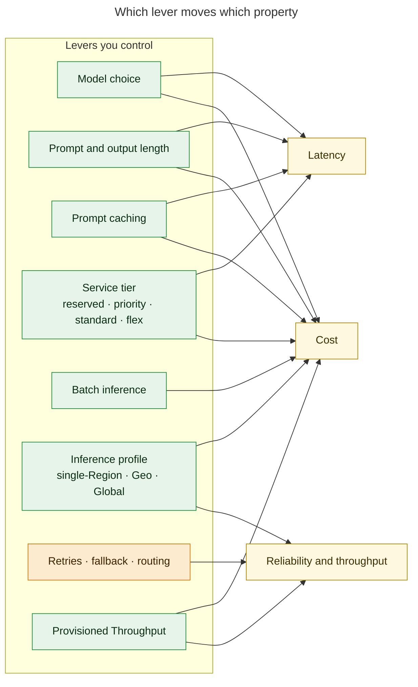

# Cost, performance and reliability

> **Level:** Advanced · **Verified:** 2026-11-15 · **Time:** about 2 days at 2 hours a day

Three properties that pull against each other. A faster model costs more; a cheaper tier may
be preempted; a resilient design spans Regions and raises data-residency questions. This
section gives you the levers and the trade-offs.

[Academy home](../README.md) · [Feature verification matrix](../FEATURE-VERIFICATION.md) · Previous: [DevOps and CI/CD](../07-devops-and-cicd/README.md) · Next: [Advanced topics](../09-advanced-topics/README.md)

> [!IMPORTANT]
> **Status** — Prices, quotas and limits change often and differ by model and Region. This section
> teaches the **dimensions** and the reasoning; take the numbers from the
> [Bedrock pricing page](https://aws.amazon.com/bedrock/pricing/), the
> [AgentCore pricing page](https://aws.amazon.com/bedrock/agentcore/pricing/) and the Service
> Quotas console on the day you need them.

## The levers

## What each chapter gives you

| Chapter | You leave with |
|:--|:--|
| Pricing model and cost drivers | A map of every metered dimension across inference, knowledge bases and AgentCore |
| Cost optimization and token budgeting | A budgeting method per request, per user and per tenant |
| Latency optimization | Where time goes in a request, and which changes shorten it |
| Caching strategies | Prompt caching, response caching and retrieval caching — and when each is unsafe |
| Quotas, rate limits and throttling | How quotas apply per account, Region and model, and how to handle `ThrottlingException` |
| Resilience, fallback models and model routing | A degradation ladder: retry, reroute, fall back, shed load |
| Disaster recovery and business continuity | What a Regional failure means for inference, knowledge bases and agents |
| Production monitoring and incident response | The signals to alarm on and a runbook shape |

## Chapters

<!-- TOC:START — generated by scripts/build-nav.py; do not edit by hand -->
| # | Chapter | Group | Status |
|--:|:--|:--|:-:|
| 1 | [Pricing model and cost drivers](01-pricing-model-and-cost-drivers.md) | Cost, performance and reliability | 🚧 planned |
| 2 | [Cost optimization and token budgeting](02-cost-optimization-and-token-budgeting.md) | Cost, performance and reliability | 🚧 planned |
| 3 | [Latency optimization](03-latency-optimization.md) | Cost, performance and reliability | 🚧 planned |
| 4 | [Caching strategies](04-caching-strategies.md) | Cost, performance and reliability | 🚧 planned |
| 5 | [Quotas, rate limits and throttling](05-quotas-rate-limits-and-throttling.md) | Cost, performance and reliability | 🚧 planned |
| 6 | [Resilience, fallback models and model routing](06-resilience-fallback-and-model-routing.md) | Cost, performance and reliability | 🚧 planned |
| 7 | [Disaster recovery and business continuity](07-disaster-recovery-and-business-continuity.md) | Cost, performance and reliability | 🚧 planned |
| 8 | [Production monitoring and incident response](08-monitoring-and-incident-response.md) | Cost, performance and reliability | 🚧 planned |
<!-- TOC:END -->
