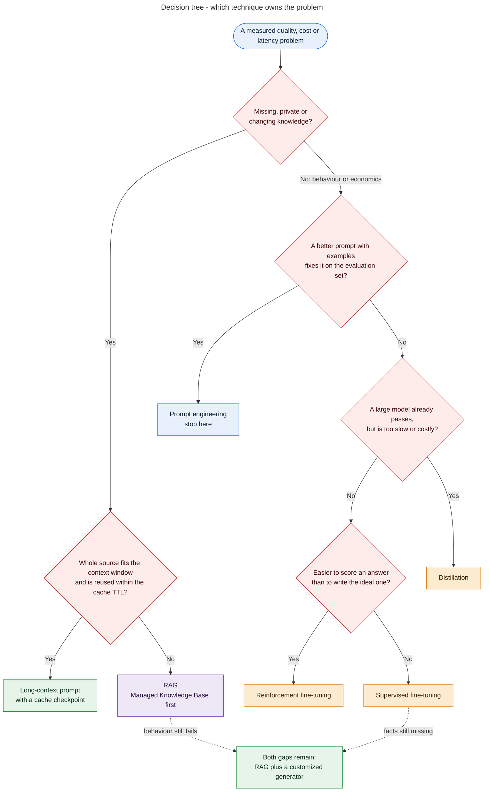
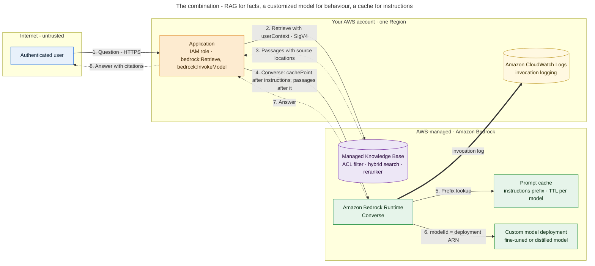

# RAG versus fine-tuning versus long-context inference

> **Level:** Advanced · **Verified:** 2026-11-15 · **Feature status:** n/a · **Time:** ~25 min

There are three ways to make a foundation model use what your organisation knows: fetch the
relevant pieces for each request (RAG), change the model (fine-tuning, reinforcement fine-tuning,
distillation), or send everything in the prompt (long context, made affordable by prompt caching).
This chapter puts them side by side on the forces that decide real designs, and shows when to
combine them.

## Learning objectives

After this chapter you can:

- Diagnose whether a quality problem is a knowledge gap, a behaviour gap or a cost and latency gap.
- Read the decision matrix and pick a default for a workload, with the "choose when" and "avoid when" conditions.
- Estimate the cost per query of cached long-context prompting against RAG and find the break-even corpus size.
- Design a combination in which each technique owns exactly one problem.
- State what Amazon Bedrock supports for each option today, including the IaC gaps.

## Prerequisites

- [Retrieval-augmented generation (RAG)](../00-foundations/generative-ai-fundamentals/04-rag-fundamentals.md)
- [Fine-tuning and model customization](../00-foundations/generative-ai-fundamentals/05-fine-tuning-and-customization.md)
- [Tokens, context windows, and training versus inference](../00-foundations/generative-ai-fundamentals/02-tokens-context-windows-inference.md)
- [Prompt caching](../01-amazon-bedrock/prompt-caching/01-prompt-caching.md) and [Model customization](../01-amazon-bedrock/foundation-models/03-model-customization.md)

## Concept in plain language

Imagine a consultant who must answer questions about your company. You can **hand over the whole
binder** with every question — simple, but slow to read and expensive if the binder is thick.
You can **hire a librarian** who pulls out the three relevant pages each time — cheap per question
and always up to date, but only as good as the librarian's search. Or you can **send the
consultant on a course** — afterwards they work in your house style without being told, but what
they learned is frozen on the last day of the course and they cannot tell you where it came from.

The trick is to name the problem first. "It does not know our refund rules" is a knowledge gap:
librarian or binder. "It knows the rules but writes the claim note in the wrong format" is a
behaviour gap: better instructions, then a course. "It is right but too slow and too costly" is
an economics gap: a cache for the binder, or a smaller consultant trained by the expert
(distillation).

## How it really works

### The options and what each changes

| Option | What changes | Bedrock mechanism | Status on 2026-11-15 |
|:--|:--|:--|:--|
| **RAG** | What the model reads, per request | Knowledge base `Retrieve`, `AgenticRetrieveStream` (managed) or `RetrieveAndGenerate` (customer-managed), or your own retrieval plus Converse | GA — [register A4](../FEATURE-VERIFICATION.md#a4-knowledge-bases-and-retrieval) |
| **Supervised fine-tuning (SFT)** | The model's weights, from labelled examples | `CreateModelCustomizationJob`, type `FINE_TUNING` | GA, per model and Region |
| **Reinforcement fine-tuning (RFT)** | The weights, from a reward signal | Same operation, type `REINFORCEMENT_FINE_TUNING` | GA, few models |
| **Distillation** | A smaller student's weights, from a teacher's answers | Same operation, type `DISTILLATION` | GA; not for Anthropic models |
| **Long context + prompt caching** | Nothing is stored: the whole source travels in each prompt, behind a cache checkpoint | `cachePoint` (Converse), `cache_control` (InvokeModel) and model-specific equivalents | GA request option, model-dependent |
| **Continued pre-training** | Weights, from unlabelled text | — | **UNVERIFIED — REQUIRES DOCUMENTATION REVIEW** (register U1) |

The customization statuses come from the [register](../FEATURE-VERIFICATION.md#a2-models-access-and-customization)
and the [model customization chapter](../01-amazon-bedrock/foundation-models/03-model-customization.md).
The Generative AI Lens best practice GENOPS05-BP01 still names continued pre-training among
Bedrock's managed features; the Bedrock customization overview no longer lists it, so the academy
keeps it unverified and does not design for it.

> [!NOTE]
> **Documented fact** — AWS's guidance is to "start with the least resource-intensive option
> (prompt engineering), and progressively move to more advanced methods if needed", evaluating
> RAG before fine-tuning or continued pre-training.
> Source: [GENOPS05-BP01 Learn when to customize models](https://docs.aws.amazon.com/wellarchitected/latest/generative-ai-lens/genops05-bp01.html)

> [!NOTE]
> **Documented fact** — AWS Prescriptive Guidance lists as fine-tuning disadvantages that it "can
> take a few hours to days", that "fine-tuned models do not provide a reference to the source in
> their responses", and an increased risk of hallucination when answering questions; for RAG, that
> it "can incorporate the latest documents in a few minutes" but "does not work well when
> summarizing information from entire documents".
> Source: [Comparing Retrieval Augmented Generation and fine-tuning](https://docs.aws.amazon.com/prescriptive-guidance/latest/retrieval-augmented-generation-options/rag-vs-fine-tuning.html)

### What research says about long context

Long context is not free accuracy. Models use information "at the beginning or end of the input
context" best and degrade "in the middle of long contexts, even for explicitly long-context
models" ([Liu et al.](https://arxiv.org/abs/2307.03172)). A comparison of RAG and long-context
models found that long context "consistently outperforms RAG in terms of average performance"
when resourced sufficiently, while "RAG's significantly lower cost remains a distinct advantage"
([Li et al.](https://arxiv.org/abs/2407.16833)). An earlier study found that retrieval "can
significantly improve the performance of LLMs regardless of their extended context window sizes"
([Xu et al.](https://arxiv.org/abs/2310.03025)). **Our reading:** treat long context as the
right tool for small, reused, whole-document tasks, and RAG as the default above that size.

### Prompt caching changes the long-context arithmetic

A cache checkpoint lets later requests read an identical prompt prefix at a reduced rate. Three
documented details decide whether it pays: cache writes can cost more than ordinary input, the
TTL "resets with each successful cache hit" and differs by model, and "a cache entry is stored on
the server that processed the request", so a hit is never guaranteed. Caching is "not supported
with the batch inference API".
Source: [Prompt caching for faster model inference](https://docs.aws.amazon.com/bedrock/latest/userguide/prompt-caching.html)

### Decision matrix

Cells link a source where they state documented behaviour; everything else is our assessment.

| Option | Freshness | Cost per query | Latency | Data volume | Citations and grounding | Governance | Effort | Bedrock support |
|:--|:--|:--|:--|:--|:--|:--|:--|:--|
| **RAG** | Next sync; incremental, scheduled or pushed ([Managed KB](../01-amazon-bedrock/knowledge-bases/02-managed-knowledge-base.md)) | Low: retrieval plus a few passages as input tokens | One retrieval plus one generation; more with agentic loops | Large: 10 TB raw data per managed KB, adjustable ([quotas](https://docs.aws.amazon.com/bedrock/latest/userguide/kb-managed-quotas.html)) | Strong: every chunk carries its source location | Delete a source and it is gone after sync; document ACL filtering on Managed KB | Low (managed) to medium (own store) | GA; Terraform and CloudFormation resources exist |
| **Long context + caching** | Whatever you send — always current | High: every token of the source is input, at cache-read rate on hits | Higher time to first token when uncached | Bounded by the model's context window | Model can quote, but no retrieval trail; you must ask for citations | Every caller sees the whole prompt; prompts land in invocation logs | Lowest | GA request option; nothing to provision |
| **SFT** | Frozen at training; a new job to update | Low if the tuned model is smaller or the prompt shorter | Same as base or lower | Labelled examples; limits per model | None ([Prescriptive Guidance](https://docs.aws.amazon.com/prescriptive-guidance/latest/retrieval-augmented-generation-options/rag-vs-fine-tuning.html)) | A fact in weights cannot be deleted or ACL-filtered; retrain when the base model goes Legacy | High: data, evaluation, retraining | GA per model; Terraform `aws_bedrock_custom_model`; no CloudFormation type |
| **RFT** | Frozen | As SFT | As SFT | Prompts plus a reward function | None | As SFT, plus reward-function review | High: reward design | GA for a handful of models; Terraform cannot supply `rftConfig` |
| **Distillation** | Frozen at the teacher's behaviour | Lowest on the narrow task | Lowest | 100–15,000 prompts per job | None | Teacher outputs become training data | Medium | GA; Terraform cannot supply a teacher configuration |
| **RAG + customized generator** | Facts fresh, behaviour frozen | Low | Low | Large | Strong (from retrieval) | Facts governed in the index, behaviour in the model | Highest | `Retrieve`, then Converse with the custom model deployment ARN |
| **RAG + cached instructions** | Fresh | Lower than RAG alone when the instruction block is long and reused | Lower | Large | Strong | As RAG | Low | Retrieved passages after the checkpoint; instructions before it |

### Choose when, avoid when

| Option | Choose when | Avoid when |
|:--|:--|:--|
| **RAG** | Facts are private, large or change; answers need sources; users see different documents | The task needs whole-document reasoning on every request, or the failure is format and tone |
| **Long context + caching** | One bounded document set is queried repeatedly within the cache TTL (a contract review session, a codebase walkthrough) | The corpus is larger than a few prompts' worth, traffic is bursty with gaps longer than the TTL, or users must not see each other's documents |
| **SFT** | A narrow, repeated task fails on format, style or classification after prompt work, and you have consistent labelled examples | The goal is to teach facts that change |
| **RFT** | Correctness is easier to score (by code or a judge) than to demonstrate | You cannot write a reward function that resists gaming |
| **Distillation** | A large model already passes your evaluation, but cost or latency at volume does not | The teacher has not been evaluated on your task — the student inherits its errors |
| **Combinations** | Both a knowledge gap and a behaviour gap remain after measuring each fix alone | You have not yet measured the simpler parts |

> [!TIP]
> **Academy recommendation** — Keep facts in retrieval and behaviour in weights. A changed policy
> should need a document edit, never a training run. This is our design guidance, not an
> official AWS reference architecture.

## Architecture diagram



**What this shows** — The first question separates knowledge from behaviour. Knowledge problems
end in long context (small, reused sources) or RAG; behaviour problems end in prompting,
distillation, RFT or SFT, in rising order of effort. Dashed edges are the escalation to a combination.

**Walkthrough** — Answer each question with evidence from your evaluation set, not opinion. If a
branch's result fails the same evaluation, follow the dashed edge rather than switching technique.



**What this shows** — One request uses all three techniques, each for one job. This is an
academy design, not an AWS reference architecture; whether a given customized model supports
prompt caching is model-specific and must be checked on its model card.

**Walkthrough**

1. The application authenticates the user before anything else.
2. It retrieves with the user's identity, so ACL filtering applies.
3. Passages return with their source locations — the citation trail.
4. The prompt puts the long, stable instructions first, a cache checkpoint, then the passages and the question.
5. On a cache hit the instruction prefix is read at the cache-read rate.
6. The request is served by the customized model, addressed by its deployment ARN.
7. and 8. The answer returns with the passage sources mapped to citations.

**Legend** — solid arrow: request · dashed arrow: response · thick arrow: asynchronous log ·
cylinder: data store · boxes: trust boundaries.

## Implementation details

Run the decision as an experiment, in this order:

1. **Freeze an evaluation set** of real questions with expected answers and sources. Every option
   is scored on the same set — see [Model and RAG evaluation](../01-amazon-bedrock/model-evaluation/01-model-evaluation.md).
2. **Prompt baseline.** Best prompt, no retrieval. Record quality, tokens and latency.
3. **Long-context variant** if the source fits: put it before a cache checkpoint and watch the
   cache read and write fields in the responses.
4. **RAG variant** on a [Managed Knowledge Base](../01-amazon-bedrock/knowledge-bases/02-managed-knowledge-base.md),
   or on a customer-managed one if the [vector store chapter](02-vector-store-selection.md) says so.
5. **Customization** only for failures that remain *and* are behavioural. Check that the base
   model supports the method in your Region and is not near Legacy; a Legacy model cannot start a
   new fine-tuning job.
6. **Make the break-even explicit.** AWS's Agentic AI Lens frames customization as "(one-time
   training cost + quarterly refresh cost × planning horizon in quarters) divided by monthly
   inference savings" ([AGENTCOST02-BP04](https://docs.aws.amazon.com/wellarchitected/latest/agentic-ai-lens/agentcost02-bp04.html)).

**IaC.** Knowledge bases are fully provisionable with Terraform, CloudFormation and the CDK (L1).
Customization jobs are one-time actions: Terraform covers supervised fine-tuning only, and
CloudFormation and the CDK have no custom-model type, so start jobs from a pipeline step
([Terraform coverage](../04-infrastructure-as-code/terraform/10-terraform-for-bedrock.md)).
Prompt caching is a request field and needs no IaC.

## Example

**Worked scenario.** A claims team asks 30,000 questions a month about a policy library of about
400,000 tokens (0.5 GB of source files) that changes weekly. Adjusters need citations, and claim
notes must follow a fixed format.

- Knowledge gap (weekly changes, citations) → RAG on a Managed Knowledge Base.
- Format failures → prompt first; only if they persist on the evaluation set, distil or fine-tune
  a smaller generator *on examples that include the retrieved passages*, the idea behind RAFT
  ([Zhang et al.](https://arxiv.org/abs/2403.10131)).
- A single 300-page reinsurance treaty reviewed for an afternoon → long context with caching, as a
  separate tool.

The cost shape behind that call:

> **Code status:** syntax-checked (`python -m py_compile`) and run locally; no AWS calls · token prices are illustrative placeholders · **never deployed**

```python
"""Compare the monthly cost shape of long-context prompting with caching, RAG and a customized model.

All token prices are ILLUSTRATIVE placeholders, not AWS prices: take real rates per model
from the Amazon Bedrock pricing page. The two Managed Knowledge Base rates are the ones the
pricing page showed on 2026-11-15 (index storage per GB-month, Retrieve per 1,000 calls).
"""
from dataclasses import dataclass

M = 1_000_000


@dataclass
class Rates:  # USD per 1M tokens: ILLUSTRATIVE ONLY
    input: float = 1.00
    output: float = 5.00
    cache_read: float = 0.10
    cache_write: float = 1.25


KB_STORAGE_PER_GB_MONTH = 5.00  # Managed Knowledge Base index storage (pricing page)
KB_RETRIEVE_PER_CALL = 1.00 / 1000  # Managed Knowledge Base Retrieve (pricing page)


def long_context(queries, corpus_tokens, question, answer, hit_ratio, r=Rates()):
    """Whole corpus in every prompt, behind a cache checkpoint."""
    prefix = corpus_tokens * (hit_ratio * r.cache_read + (1 - hit_ratio) * r.cache_write)
    per_query = (prefix + question * r.input + answer * r.output) / M
    return per_query, per_query * queries


def rag(queries, raw_gb, passages, passage_tokens, instructions, question, answer, r=Rates()):
    """Managed Knowledge Base Retrieve, then one model call with the passages."""
    prompt = passages * passage_tokens + instructions + question
    per_query = KB_RETRIEVE_PER_CALL + (prompt * r.input + answer * r.output) / M
    return per_query, per_query * queries + raw_gb * KB_STORAGE_PER_GB_MONTH


def customized(queries, short_prompt, question, answer, monthly_fixed, r):
    """A smaller customized model with a short prompt and no retrieval (facts are frozen)."""
    per_query = ((short_prompt + question) * r.input + answer * r.output) / M
    return per_query, per_query * queries + monthly_fixed


big = Rates()
small = Rates(input=0.10, output=0.40)  # ILLUSTRATIVE smaller model
Q = 30_000

lc_q, lc_m = long_context(Q, corpus_tokens=400_000, question=50, answer=400, hit_ratio=0.9)
lc0_q, lc0_m = long_context(Q, corpus_tokens=400_000, question=50, answer=400, hit_ratio=0.0,
                            r=Rates(cache_write=1.00))  # no caching at all
rag_q, rag_m = rag(Q, raw_gb=0.5, passages=5, passage_tokens=300, instructions=300,
                   question=50, answer=400)
ft_q, ft_m = customized(Q, short_prompt=200, question=50, answer=400, monthly_fixed=50.0, r=small)

for name, q, m in [("long context, no cache", lc0_q, lc0_m), ("long context, 90% cache hits", lc_q, lc_m),
                   ("RAG on a Managed KB", rag_q, rag_m), ("customized small model", ft_q, ft_m)]:
    print(f"{name:30s} {q:8.5f} USD/query {m:10.2f} USD/month")

# Corpus size at which cached long context costs the same per query as RAG.
fixed_lc = (50 * big.input + 400 * big.output) / M
per_corpus_token = (0.9 * big.cache_read + 0.1 * big.cache_write) / M
print(f"break-even corpus size: {(rag_q - fixed_lc) / per_corpus_token:,.0f} tokens")
```

Output:

```text
long context, no cache          0.40205 USD/query   12061.50 USD/month
long context, 90% cache hits    0.08805 USD/query    2641.50 USD/month
RAG on a Managed KB             0.00485 USD/query     148.00 USD/month
customized small model          0.00018 USD/query      55.55 USD/month
break-even corpus size: 13,023 tokens
```

Read the shape, not the numbers. Caching cut long-context cost by about 4.5×, yet RAG stays an
order of magnitude cheaper because it sends 1,850 tokens instead of 400,000. With these
placeholder rates, cached long context only matches RAG below roughly 13,000 tokens of source —
about the size of the passages you would retrieve anyway. The customized model is cheapest but
answers from frozen facts, so it is only valid for the format layer, not for the policy content.

## Common mistakes

> [!WARNING]
> **Common mistake** — Fine-tuning to fix stale answers. The new facts are frozen on training
> day, cannot be cited and cannot be removed without retraining. Put changing facts in retrieval.

| Mistake | Symptom | Fix |
|:--|:--|:--|
| Choosing by intuition | Months spent on a training pipeline that a prompt would have replaced | Run the four variants on one evaluation set first |
| Long context "because the window is big" | Answers miss facts buried mid-prompt; bills scale with corpus size | Measure position effects; switch to RAG above the break-even size |
| Caching a prefix that changes | Cache writes on every request, higher cost than no caching | Put stable content first and anything per-request after the checkpoint |
| Expecting cache hits in batch jobs | No savings | Caching is on-demand only |
| Distilling an unevaluated teacher | The student reproduces the teacher's errors faster | Evaluate the teacher on your task before distilling |
| Forgetting the base model's lifecycle | A tuned model cannot be retrained when its base goes Legacy | Keep data and pipeline reproducible; plan the move to a newer base |

## Security considerations

- **Permissions belong in retrieval.** Only retrieval can filter per user (document ACLs on a
  Managed Knowledge Base); weights and long prompts cannot. See [Multitenant RAG](06-multitenant-rag.md).
- **Long context widens exposure.** Every document in the prompt is visible to the model on every
  request and is captured by [model invocation logging](../02-related-aws-services/observability/01-cloudwatch-and-bedrock-observability.md) if enabled.
- **Training data becomes model behaviour.** Scrub personal data before SFT, RFT or distillation;
  a customized model can reproduce what it saw. Control who may invoke it with IAM.
- **Retrieved text is untrusted.** RAG imports whatever the index holds — see
  [Prompt injection, untrusted tool output and retrieval poisoning](../06-security-governance/04-prompt-injection-and-untrusted-content.md).

## Cost considerations

| Option | You pay for | What makes it grow |
|:--|:--|:--|
| RAG (Managed KB) | Raw data stored per GB-month; `Retrieve` per 1,000 calls; generation tokens | Corpus size, query volume, passages per prompt |
| Long context + caching | Input tokens at cache-write, cache-read and standard rates; output tokens | Corpus tokens × queries; low hit ratios |
| SFT, RFT, distillation | Training (tokens × epochs, or hours for RFT); teacher inference (distillation); monthly model storage; serving | Retraining frequency, serving mode |

Managed Knowledge Base rates are on the [Amazon Bedrock pricing page](https://aws.amazon.com/bedrock/pricing/):
on 2026-11-15, $5.00 per GB of raw data per month and $1.00 per 1,000 `Retrieve` calls, with
managed parsing, embedding and reranking at no extra charge. Wider guidance:
[Pricing model and cost drivers](../08-cost-performance-and-reliability/01-pricing-model-and-cost-drivers.md).

## Knowledge check

1. The model quotes last quarter's prices. Your colleague proposes fine-tuning on this quarter's price list. What do you recommend, and why?
2. Analysts query the same 60-page report for two hours, a question every minute. Which option is the simplest that works, and what must the prompt layout look like?
3. What happens to a fine-tuned model's usefulness when its base model moves to Legacy?
4. A RAG assistant retrieves the right passages, but answers still misquote clause numbers. Which technique addresses this, and how should its training data be built?

<details>
<summary>Answers</summary>

1. RAG. Prices are changing facts: retrieval serves the current value with a source, while fine-tuning would freeze this quarter's values and need a new job next quarter.
2. Long context with prompt caching: the report goes before a cache checkpoint and each question after it; steady traffic inside the TTL keeps the entry alive.
3. You cannot start new fine-tuning jobs on a Legacy base, so the model cannot be refreshed; keep the dataset and pipeline ready to retrain on a newer base.
4. The gap is in how the model reads, so customize the generator (SFT or distillation) on examples that include the retrieved passages in the input, as in RAFT, and keep retrieval for the facts.

</details>

## Further reading

Official sources opened while writing this chapter:

- [GENOPS05-BP01 Learn when to customize models](https://docs.aws.amazon.com/wellarchitected/latest/generative-ai-lens/genops05-bp01.html) — the escalation order in the Generative AI Lens.
- [Comparing Retrieval Augmented Generation and fine-tuning](https://docs.aws.amazon.com/prescriptive-guidance/latest/retrieval-augmented-generation-options/rag-vs-fine-tuning.html) — AWS Prescriptive Guidance trade-off table.
- [AGENTCOST02-BP04 Implement model customization for long-term cost reduction](https://docs.aws.amazon.com/wellarchitected/latest/agentic-ai-lens/agentcost02-bp04.html) — break-even formula.
- [The generative AI customization spectrum](https://aws.amazon.com/blogs/machine-learning/the-generative-ai-customization-spectrum-from-prompt-engineering-to-custom-models-on-aws/) — AWS Machine Learning Blog, 2026-09-14: escalation signals per step.
- [Prompt caching for faster model inference](https://docs.aws.amazon.com/bedrock/latest/userguide/prompt-caching.html) — TTL, cache placement, billing, batch exclusion.
- [Service quotas for managed knowledge bases](https://docs.aws.amazon.com/bedrock/latest/userguide/kb-managed-quotas.html) — storage and request quotas.
- [Amazon Bedrock pricing](https://aws.amazon.com/bedrock/pricing/) — Managed Knowledge Base and model rates.
- [Lost in the Middle](https://arxiv.org/abs/2307.03172), [Retrieval Augmented Generation or Long-Context LLMs?](https://arxiv.org/abs/2407.16833), [Retrieval meets Long Context Large Language Models](https://arxiv.org/abs/2310.03025) and [RAFT](https://arxiv.org/abs/2403.10131) — research background for the conceptual claims.
