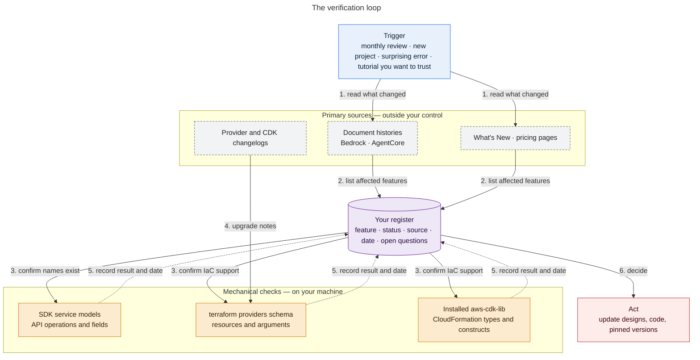

# Keeping up with AWS changes without outdated tutorials

> **Level:** Advanced · **Verified:** 2026-11-15 · **Feature status:** n/a · **Time:** ~20 min

Everything you learned in this course will drift. This chapter gives you a repeatable way to
find out **what changed, whether it affects you, and whether your tools support it yet** —
using only primary sources. It is the exact method used to build this academy.

## Learning objectives

After this chapter you can:

- Name the primary source that answers each kind of "is this still true?" question.
- Run a 30-minute monthly review that catches the changes that matter.
- Check mechanically whether an API, a Terraform resource or a CloudFormation type exists.
- Spot the signs that a tutorial, a blog post or your own memory is out of date.
- Record what you verified so the next review is faster.

## Prerequisites

- [What Amazon Bedrock is: services, namespaces and planes](../01-amazon-bedrock/overview/01-what-is-amazon-bedrock.md)
- [Terraform coverage for Amazon Bedrock](../04-infrastructure-as-code/terraform/10-terraform-for-bedrock.md)
- Skim the [feature verification matrix](../FEATURE-VERIFICATION.md) so you know what a register looks like.

## Concept in plain language

A tutorial is a photograph. The service keeps moving after the picture is taken, and nothing
on the page tells you how old it is in service-time. A year can turn a correct tutorial into a
misleading one without changing a word of it.

So do not ask "what does the tutorial say?" Ask "what does the service say today, and where
does it say it?" Each kind of question has one authoritative place to look. Learn those places
and you no longer depend on anyone's snapshot — including this course.

## How it really works

### The evidence ladder

Not all sources are equal. Climb as high as the question allows.

| Rank | Evidence | Answers | Example in this repository |
|--:|:--|:--|:--|
| 1 | **The tool or SDK itself** | "Does this operation, resource or argument exist in this version?" | [API operations](../references/bedrock-api-operations.md) from the SDK's service models; [Terraform resources](../references/terraform-aws-provider-bedrock.md) from the provider schema; [CloudFormation types](../references/cdk-and-cloudformation-bedrock.md) from the CDK library |
| 2 | **Service documentation** — user guide, API reference, document history | "How does it behave, what are the limits, what is its status?" | Every chapter's last section |
| 3 | **Announcements and pricing pages** | "When did it launch, where, and what is metered?" | What's New posts cited in the matrix |
| 4 | **Vendor blogs and changelogs** | "Why was it built, what changed between versions?" | Provider and CDK changelogs |
| — | Third-party posts, forum answers, model memory | Leads to follow up — never evidence | Not cited anywhere |

> [!NOTE]
> **Documented fact** — The Amazon Bedrock User Guide publishes a document history table of
> "important changes in each release" and offers an RSS feed for it.
> Source: [Document history for the Amazon Bedrock User Guide](https://docs.aws.amazon.com/bedrock/latest/userguide/bedrock-ug-doc-history.html)

### Which source answers which question

| Question | Go to |
|:--|:--|
| What changed in Bedrock recently? | [Bedrock document history](https://docs.aws.amazon.com/bedrock/latest/userguide/bedrock-ug-doc-history.html) |
| What changed in AgentCore? | [AgentCore document history](https://docs.aws.amazon.com/bedrock-agentcore/latest/devguide/doc-history.html) |
| What did AWS launch this week? | [What's New with AWS](https://aws.amazon.com/new/) |
| Is the feature in my Region? | [AWS capabilities by Region](https://builder.aws.com/build/capabilities), then the feature's own Region page |
| Does this API operation exist, and what are its fields? | The API reference, or the SDK model: [`bedrock-api-operations.json`](../references/bedrock-api-operations.json) |
| Does Terraform support it? | The provider schema ([generated table](../references/terraform-aws-provider-bedrock.md)) and the [provider changelog](https://raw.githubusercontent.com/hashicorp/terraform-provider-aws/main/CHANGELOG.md) |
| Does CloudFormation support it? | [CloudFormation resource and property types reference](https://docs.aws.amazon.com/AWSCloudFormation/latest/TemplateReference/aws-template-resource-type-ref.html) |
| Does the CDK have an L2 construct? | The installed library ([generated table](../references/cdk-and-cloudformation-bedrock.md)) |
| What does it cost? | [Bedrock pricing](https://aws.amazon.com/bedrock/pricing/) and [AgentCore pricing](https://aws.amazon.com/bedrock/agentcore/pricing/) |
| Is a model being retired? | The model lifecycle page and the document history — see [Model lifecycle and selection](../01-amazon-bedrock/foundation-models/02-model-lifecycle-and-selection.md) |

### Why the tool beats the page

Documentation is written by people and can lag or disagree with itself — the
[matrix records four such conflicts](../FEATURE-VERIFICATION.md#conflicts-between-sources). A
provider schema or an SDK model cannot describe something that is not there. When you need to
know whether a name is real, ask the tool.

## Architecture diagram



**What this shows** — Change information flows from AWS's own pages into a register you keep;
names are then confirmed against tools on your machine; the register, not memory, drives decisions.

**Walkthrough**

1. Something triggers a review. Start with the document histories and What's New — they are short.
2. Note each change that touches a feature you use, in your register, with the link and date.
3. Confirm that the operations, resources and types involved exist in the versions you run.
4. Read the provider and CDK changelogs before upgrading anything.
5. Write the result and the date back to the register — including "could not confirm".
6. Decide what to change: a design, some code, a pinned version, or nothing.

**Legend** — solid arrow: step in the loop · dashed arrow: result recorded · dashed boxes:
sources you do not control · cylinder: the register you keep.

## Implementation details

### The 30-minute monthly review

| Minutes | Do | Output |
|--:|:--|:--|
| 0–10 | Read the new rows of the Bedrock and AgentCore document histories | A list of changes that touch features you use |
| 10–15 | Scan What's New for "Bedrock", "AgentCore" and your Regions | Launch dates, Region expansions, deprecations |
| 15–22 | For each change, open the feature page; update status, limits and Regions in your register | An updated register row with a new date |
| 22–27 | Check the provider and CDK changelogs for the features you want to adopt | "Supported in version X" or "not yet" |
| 27–30 | Write down anything you could not confirm | Open questions to resolve next time |

### Signs that a source is stale

| Sign | What it usually means |
|:--|:--|
| It tells you to "request model access" before using a model | Written before default model access |
| It builds a new agent with "Bedrock Agents" and no mention of AgentCore | Written before Agents Classic entered maintenance mode |
| It says a knowledge base always needs a vector store you create | Written before Managed Knowledge Base |
| It configures a DynamoDB table for Terraform state locking | Written before native S3 locking |
| It uses a model ID you cannot find in the current model catalog | The model was retired or renamed |
| It has no date, no tool versions and no links to documentation | You cannot tell how old it is — treat it as a lead only |

Each of these is a real change recorded in
[what changed since older tutorials](../FEATURE-VERIFICATION.md#what-changed-since-older-tutorials).

### What to record

A register row needs five things: the feature's **current name**, its **status**, the **source
link**, the **date** you checked, and any **open question**. That is all the
[verification matrix](../FEATURE-VERIFICATION.md) is. Keep "could not confirm" as a first-class
answer; an honest gap is more useful than a confident guess.

> [!TIP]
> **Academy recommendation** — Put the register in the same repository as your infrastructure
> code and review it in pull requests. A change that adopts a new feature should update the row
> that proves the feature exists. This is our guidance, not an official AWS reference architecture.

## Example

Three mechanical checks. None of them contacts AWS or needs credentials.

> **Code status:** these exact commands were run while building this repository (Terraform 1.17.2, provider 6.73.0, botocore 1.44.3) · **nothing is deployed**

```bash
# 1. Does the API operation exist, and on which service?
python3 - <<'PY'
import boto3
for service in ("bedrock-agent-runtime", "bedrock-runtime", "bedrock-agentcore"):
    names = boto3.client(service, region_name="us-east-1").meta.service_model.operation_names
    print(service, [n for n in names if "Retrieve" in n or "Converse" in n])
PY

# 2. Does the Terraform resource exist, and what does it accept?  (in a scratch directory)
terraform init -backend=false
terraform providers schema -json \
  | jq '.provider_schemas["registry.terraform.io/hashicorp/aws"].resource_schemas
        | keys[] | select(test("bedrock"))'

# 3. Which CloudFormation types does my installed CDK know about?
grep -o 'CFN_RESOURCE_TYPE_NAME="AWS::Bedrock[A-Za-z]*::[A-Za-z]*"' \
  node_modules/aws-cdk-lib/aws-bedrock*/lib/*.generated.js | sort -u
```

Creating a `boto3` client only loads the service model from disk; no request is sent until
you call an operation. This repository wraps the three checks in scripts —
see [references](../references/README.md).

## Common mistakes

> [!WARNING]
> **Common mistake** — Treating "the code validates" as "the feature is available to me".
> `terraform validate` and `cdk synth` prove a name exists in the tool. Only the documentation
> tells you the Region, the model support and the account eligibility — and only a real
> deployment proves all of them together.

| Mistake | Symptom | Fix |
|:--|:--|:--|
| Trusting search results over the document history | You build on a feature that changed or was closed to new customers | Read the document history first; it is the shortest authoritative summary |
| Upgrading the provider without reading the changelog | A plan wants to replace resources, or an argument is now rejected | Read the changelog and the upgrade guide; upgrade in a branch and inspect the plan |
| Assuming all features share Regions | A design works in one Region and cannot be deployed in another | Check each feature's Region page; AgentCore services range from 22 Regions down to 1 |
| Verifying once | The register quietly becomes a tutorial | Put the review in the calendar and date every row |
| Hiding uncertainty | A guess gets copied into three designs | Label it `UNVERIFIED` and say what you looked for |
| Verifying the feature but not the IaC | The design is right and cannot be provisioned | Check the tool, not just the service |

## Security considerations

- Deprecations and maintenance-mode notices are security-relevant: a service in maintenance
  mode stops receiving new capabilities, and a retired model stops being served.
- Managed policies change. The Bedrock documentation keeps a change log of its AWS managed
  policies; review it if you rely on them.
- Verify advisories at the source. In March 2026 a compromised release of a popular scanner
  was distributed through its normal channels — pinning by commit SHA and reading the vendor's
  own advisory mattered more than any third-party summary. See
  [Formatting, linting and security scanning](../07-devops-and-cicd/02-static-analysis-and-security-scanning.md).

## Cost considerations

- Reading documentation and dumping a provider schema cost nothing.
- Pricing dimensions change with features: a new tier, a new managed option or a new metering
  unit can change your bill without any change on your side. Re-read the pricing page in the
  monthly review — see [Pricing model and cost drivers](../08-cost-performance-and-reliability/01-pricing-model-and-cost-drivers.md).
- The expensive failure is building on something that changed. Half an hour a month is cheap
  insurance.

## Knowledge check

1. A colleague sends a tutorial that creates a Bedrock agent with `CreateAgent`. Your account is new. What do you check first, and where?
2. You want to manage a newly announced Bedrock resource with Terraform. Name two independent ways to find out whether your provider version supports it.
3. The user guide and an announcement give different dates for the same feature. What do you do?
4. Why is "I could not confirm this" worth writing down?

<details>
<summary>Answers</summary>

1. The status of the feature in the Bedrock documentation — the document history or the
   feature's own page. Agents Classic is in maintenance mode and closed to new customers, so a
   new account cannot follow that tutorial.
2. Dump the provider schema (`terraform providers schema -json`) and look for the resource
   type; and read the provider changelog for a "New Resource" entry.
3. Follow an explicit authority order, record both dates and the conflict in your register,
   and re-check next review. Do not silently pick one.
4. It stops a guess from becoming a "fact" that other designs build on, and it tells the next
   reviewer exactly what to look for.

</details>

## Further reading

Official sources opened while writing this chapter:

- [Document history for the Amazon Bedrock User Guide](https://docs.aws.amazon.com/bedrock/latest/userguide/bedrock-ug-doc-history.html) — every notable change, with dates, and an RSS feed.
- [Amazon Bedrock AgentCore document history](https://docs.aws.amazon.com/bedrock-agentcore/latest/devguide/doc-history.html) — launch and GA dates for AgentCore services.
- [What's New with AWS](https://aws.amazon.com/new/) — launch announcements and Region expansions.
- [AWS capabilities by Region](https://builder.aws.com/build/capabilities) — feature availability across Regions.
- [CloudFormation resource and property types reference](https://docs.aws.amazon.com/AWSCloudFormation/latest/TemplateReference/aws-template-resource-type-ref.html) — every resource type CloudFormation supports.
- [AWS managed policies for Amazon Bedrock](https://docs.aws.amazon.com/bedrock/latest/userguide/security-iam-awsmanpol.html) — the change log of managed policies.
- [Terraform AWS provider changelog](https://raw.githubusercontent.com/hashicorp/terraform-provider-aws/main/CHANGELOG.md) — new resources and breaking changes per release.
- [AWS Architecture Center](https://aws.amazon.com/architecture/) and [AWS Solutions Library](https://aws.amazon.com/solutions/) — AWS's own reference architectures.
